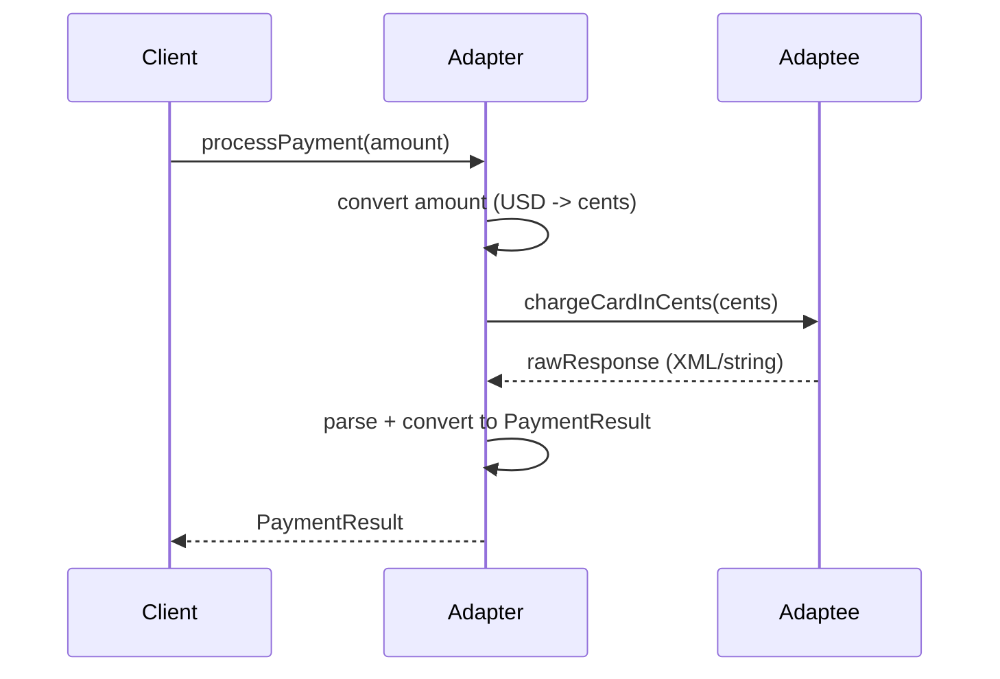

# What is the adapter design pattern?

> Adapter là pattern structural cho phép giao tiếp giữa hai interface không tương thích bằng cách bọc interface gốc vào một lớp adapter, giúp tái sử dụng code cũ mà không sửa client.

Chủ đề: OOP - Design Patterns · Ngày: 2026-10-16

## 0. Nền tảng trước khi đọc

**Bối cảnh:** Cách tổ chức code thành những đối tượng dễ thay đổi. Mục tiêu là giữ luật của nghiệp vụ rõ ràng và tránh code phụ thuộc chặt vào nhau.

**Nói đơn giản:** Adapter bọc một interface cũ để nó nói chuyện được với code đang mong đợi interface mới.

**Từ khóa cần biết:** class = khuôn; object = instance cụ thể; method = hành vi mà object cung cấp.

**Ví dụ dễ hình dung:** Code mới cần PaymentGateway nhưng SDK cũ có LegacyBankClient; adapter đổi tên và định dạng method giữa hai bên.

Khi đọc, luôn hỏi ba câu: nó giải quyết vấn đề gì, nó làm việc theo những bước nào, và khi nào không nên dùng?

**Cách học bài này:** Đọc phần này trước để nắm từ khóa; đọc phần 1 để lấy câu trả lời 30 giây; đọc phần 2 để hiểu cơ chế; cuối cùng mở từng câu hỏi ở phần 3 để luyện nói. Các con số và lệnh trong bài là bằng chứng cho câu trả lời, không cần học thuộc nếu chưa hiểu cơ chế.

## 1. Là gì

### Đọc nhanh trước khi đi sâu

**Ý chính:** Adapter bọc một interface cũ để nó nói chuyện được với code đang mong đợi interface mới.

**Ví dụ interview:** Code mới cần PaymentGateway nhưng SDK cũ có LegacyBankClient; adapter đổi tên và định dạng method giữa hai bên.

**Luồng 4 bước:**

1. Client gọi một contract dễ hiểu.
2. Object hoặc pattern chọn code thực hiện phía sau contract.
3. State và dependency được giữ ở nơi có trách nhiệm rõ ràng.
4. Khi requirement đổi, thay implementation mà giảm ảnh hưởng tới client.

**Nói như trong interview:** Adapter bọc một interface cũ để nó nói chuyện được với code đang mong đợi interface mới. Hãy nói theo bốn bước trên trước; nếu interviewer hỏi sâu, chuyển sang cơ chế **Bước 1. Bốn thành phần chuẩn**, rồi nêu trade-off và failure mode ở các phần sau.

## 2. Cơ chế cốt lõi

### Bước 1. Bốn thành phần chuẩn

1. **Target**: interface client mong đợi (ví dụ `PaymentProcessor`).
2. **Adaptee**: lớp hiện có có sẵn nhưng interface không khớp (ví dụ `LegacyStripeAPI` với method `chargeCardInCents`).
3. **Adapter**: implement Target, giữ reference Adaptee, dịch method.
4. **Client**: chỉ biết Target, không biết Adaptee tồn tại.

### Bước 2. Object adapter vs class adapter

- **Object adapter** (composition): `class StripeAdapter implements PaymentProcessor { private StripeAPI s; ... }`. Linh hoạt: dùng được với mọi adaptee, kể cả sealed/final; thay đổi adaptee runtime được.
- **Class adapter** (kế thừa): `class StripeAdapter extends StripeAPI implements PaymentProcessor`. Chỉ có trong C++/Python (đa kế thừa). Trong Java, C#, TypeScript dùng object adapter vì không đa kế thừa class.

### Bước 3. Hai chiều thích ứng

- **One-way adapter**: chỉ Target → Adaptee (client gọi adaptee qua target). Đa số trường hợp.
- **Two-way adapter**: Adapter vừa implement Target vừa có method của Adaptee. Client có thể dùng theo cả hai hướng. Hiếm gặp, tăng coupling.

### Bước 4. Adapter chain

Khi tích hợp nhiều hệ thống cũ, có thể chain: AdapterA bọc AdapterB bọc AdapteeC. Ví dụ: JSON adapter bọc XML adapter bọc SOAP client cũ. Đọc dễ nhưng debug khó; mỗi tầng thêm overhead nhỏ (microsecond).

### Bước 5. Null object adapter

Adapter cho adaptee rỗng: trả về giá trị mặc định thay vì null. Giúp client không phải null-check. Ví dụ: `EmptyPaymentProcessor` implement `PaymentProcessor`, mọi method trả `PaymentResult.success()`.

### Bước 6. Luồng thực thi



*Sơ đồ cơ chế: client gọi Adapter qua Target interface; Adapter chuyển đổi tham số (USD sang cents), gọi Adaptee, nhận response thô, parse và trả về dạng Target. Client không hề biết Adaptee tồn tại.*

### Bước 7. Quan sát

```java
// Object adapter trong Java
public interface PaymentProcessor {
    PaymentResult charge(Money amount);
}

public class StripeAdapter implements PaymentProcessor {
    private final StripeSDK stripe;
    public StripeAdapter(StripeSDK stripe) { this.stripe = stripe; }
    @Override
    public PaymentResult charge(Money amount) {
        long cents = amount.toCents(); // chuyển đổi
        String raw = stripe.createCharge(cents); // gọi adaptee
        return PaymentResult.from(raw); // parse response
    }
}
```

```ts
// Adapter cho Promise <-> callback API trong TypeScript
type LegacyCallbackApi = (cb: (err: Error | null, data: string) => void) => void;
interface ModernPromiseApi {
    fetch(): Promise<string>;
}
class CallbackToPromiseAdapter implements ModernPromiseApi {
    constructor(private legacy: LegacyCallbackApi) {}
    fetch(): Promise<string> {
        return new Promise((resolve, reject) => {
            this.legacy((err, data) => err ? reject(err) : resolve(data));
        });
    }
}
```

### Bước 8. Quy tắc thiết kế Adapter

- **Adapter mỏng**: chỉ một nhiệm vụ dịch interface. Nếu cần thêm logic (validation, retry), tách thành Decorator riêng.
- **Adapter KHÔNG giấu Adaptee**: nếu cần truy cập method Adaptee-specific từ client, đó là dấu hiệu Target interface chưa đủ rộng — mở rộng Target, đừng lộ Adaptee.
- **Adapter KHÔNG phụ thuộc vào nhiều Adaptee**: nếu một Adapter bọc 3 SDK khác nhau, đó là anti-pattern (god adapter). Tách thành 3 Adapter riêng.
- **Adapter có thể Stateless hoặc Stateful**: Stateless (function adapter) chỉ truyền qua lời gọi. Stateful (cache adapter) lưu connection/session của Adaptee.
- **Idempotency**: Adapter nên giữ nguyên idempotency của Adaptee hoặc document rõ nếu thay đổi.

### Ví dụ chạy từng bước

Kịch bản: microservice mới chỉ biết interface `PaymentProcessor.charge(Money)`. Hệ thống cũ có `LegacyStripeSDK` với method `createChargeInCents(long cents)`. Adapter bọc SDK cũ, chuyển đổi USD → cents, parse response thô về `PaymentResult`.

**Trạng thái ban đầu:** Client chỉ biết `PaymentProcessor`; LegacyStripeSDK chưa ai dùng; không có Adapter.

**Bước 1 — Định nghĩa Target interface:**
```java
interface PaymentProcessor {
    PaymentResult charge(Money amount);
}
```
Client (`OrderService`) chỉ code với interface này. Không biết Stripe tồn tại.

**Bước 2 — Adapter bọc Adaptee:**
```java
class StripeAdapter implements PaymentProcessor {
    private final LegacyStripeSDK stripe;
    StripeAdapter(LegacyStripeSDK s) { this.stripe = s; }
    public PaymentResult charge(Money m) {
        long cents = m.toCents();          // USD 10.50 -> 1050 cents
        String raw = stripe.createChargeInCents(cents);
        return PaymentResult.from(raw);    // parse XML/string -> typed result
    }
}
```
Vì sao: Adapter implement Target, giữ reference Adaptee. Mỗi method Target dịch sang Adaptee.

| Object | Trạng thái sau Bước 2 |
|---|---|
| OrderService | chỉ biết PaymentProcessor interface |
| StripeAdapter | bọc LegacyStripeSDK, sẵn sàng nhận charge |
| LegacyStripeSDK | chưa được gọi |

**Bước 3 — Client gọi charge(10.50 USD):**
- `orderService.charge(Money.of(10.50))` → gọi `adapter.charge(...)`
- Adapter: `cents = 1050`, gọi `stripe.createChargeInCents(1050)`
- LegacyStripeSDK trả về `"<charge id='ch_abc' status='succeeded'/>"`
- Adapter parse → `PaymentResult(id="ch_abc", status=SUCCESS)`
- Trả về `OrderService`

| Object | Trạng thái sau Bước 3 |
|---|---|
| OrderService | đã nhận PaymentResult SUCCESS |
| StripeAdapter | vừa convert + parse xong |
| LegacyStripeSDK | đã ghi charge id ch_abc |

**Bước 4 — Charge thất bại (card declined):**
- `orderService.charge(Money.of(20.00))` → `cents = 2000`
- `stripe.createChargeInCents(2000)` trả `"<charge status='failed' code='card_declined'/>"`
- Adapter parse → `PaymentResult(status=DECLINED, errorCode="card_declined")`

Vì sao: Adapter KHÔNG throw, trả Result type. Client xử lý theo status.

**Biến thể — Nếu Adapter nuốt exception từ SDK:**
- SDK mới version 2.0 throw `NetworkTimeoutException` khi timeout.
- Adapter cũ `try { ... } catch (Exception e) { return null; }` → trả null.
- Client không phân biệt được "chưa charge" vs "đã charge thành công". Nguy hiểm trong payment domain.
- Fix đúng: `catch (Exception e) { throw new PaymentException(...); }` hoặc `Result.failure(e)`.

Điều rút ra: Adapter là cầu nối giữa hai interface không tương thích. Client không cần biết Adaptee là gì, chỉ cần Target. Cơ chế này giúp trả lời câu "Tại sao InputStreamReader trong Java IO là adapter?" — vì byte stream (InputStream) và char stream (Reader) là hai interface khác nhau, adapter dịch giữa chúng theo charset.

## 3. Câu hỏi phỏng vấn

### 3A. Câu hỏi đào sâu

<details class="qa">
<summary>Câu 1. Adapter khác gì Decorator? Cùng là bọc (wrap) một object.</summary>

**Trả lời ngắn:** Adapter thay đổi interface để phù hợp với client mong đợi. Decorator giữ nguyên interface nhưng thêm hành vi (logging, caching, retry). Adapter tập trung vào tương thích; Decorator tập trung vào mở rộng.

**Đào sâu:**
- Adapter: `Target` interface khác `Adaptee` interface. Adapter dịch method/ghi/attribute. Thường viết một lần khi tích hợp.
- Decorator: cùng interface với object bọc. Thêm logic trước/sau khi gọi. Có thể chồng nhiều decorator (logging → caching → retry).
- Ví dụ Adapter: bọc Stripe SDK thành PaymentProcessor interface nội bộ. Ví dụ Decorator: bọc PaymentProcessor bằng `LoggingPaymentProcessor`, `RetryPaymentProcessor`.
- Phân biệt qua câu hỏi: "Bọc có thay đổi signature/method không? Có → Adapter. Không, chỉ thêm logic? → Decorator."

**Bẫy:** "Adapter cũng có thể thêm logic." Có thể, nhưng nếu thêm logic thì đó là anti-pattern: trộn hai trách nhiệm (chuyển đổi + xử lý). Giữ Adapter thuần chuyển đổi.

**Follow-up:** Facade pattern khác Adapter thế nào? Facade đơn giản hóa nhiều subsystem phức tạp thành một interface gọn; Adapter dịch một interface đơn lẻ.
</details>

<details class="qa">
<summary>Câu 2. Khi nào dùng Adapter thay vì sửa trực tiếp Adaptee?</summary>

**Trả lời ngắn:** Khi Adaptee là thư viện bên thứ ba, legacy code không sửa được, hoặc có nhiều client dùng Target interface. Sửa trực tiếp Adaptee khi bạn sở hữu code, sửa một chỗ là đủ, và không có ràng buộc compatibility.

**Đào sâu:**
- Adapter phù hợp: tích hợp SDK bên thứ ba (Stripe, AWS, Firebase); bọc legacy API sang microservice mới; unit test cần fake một dependency phức tạp.
- Sửa trực tiếp khi: codebase đơn giản, bạn sở hữu toàn bộ; chỉ một nơi gọi; đổi interface dễ.
- Adapter cũng hữu ích khi cần nhiều "phiên bản" của cùng Target (StripeAdapter, PayPalAdapter, MockAdapter) cho test hoặc multi-provider.
- Khi codebase có nhiều Adapter cho cùng Adaptee (do nhiều team khác nhau viết), đó là dấu hiệu nên refactor Adaptee thành interface chuẩn.

**Bẫy:** "Adapter là quick fix, không cần refactor." Sai — nếu một adapter bị duplicate nhiều nơi, refactor thành Target interface ở Adaptee là đúng.

**Follow-up:** Có nên viết Adapter cho mỗi SDK bên thứ ba? Có, nhưng giữ adapter gọn và document rõ dependency nào đang bọc để migrate dễ khi đổi SDK.
</details>

<details class="qa">
<summary>Câu 3 (Debug). App gọi `adapter.charge()` trả về `null` thay vì `PaymentResult`. Log lỗi từ adaptee không hiển thị. Phân tích.</summary>

**Trả lời ngắn:** Adapter nuốt exception từ adaptee và trả về null/giá trị mặc định. Khi adaptee thay đổi contract (thêm validation, trả error code), adapter chưa cập nhật.

**Đào sâu:**
- Bước 1: Kiểm tra log ở adaptee — nếu không có log thì adapter nuốt mất exception. Wrap try/catch trong adapter và log exception gốc.
- Bước 2: Thêm fallback unit test: feed adaptee giả lỗi, kiểm tra adapter có propagate hay nuốt.
- Bước 3: Đảm bảo adapter có interface rõ ràng về error case: trả `Result<T, E>` (success/failure) hoặc throw exception chuẩn (ví dụ `PaymentException`).
- Bước 4: Adaptee SDK update có thể đổi response format (XML → JSON, error code mới). Adapter parse cũ trả null. Cần test contract mỗi khi update SDK.
- Bước 5: Trong production, log structured với request id, trace từ client → adapter → adaptee.

**Bẫy:** "Null là kết quả hợp lệ." Sai trong payment domain. Null từ payment thường là bug — gây âm thầm mất tiền hoặc duplicate charge. Cần trả Result thay vì null.

**Follow-up:** Adapter nên throw exception hay trả Result? Tùy ngôn ngữ và convention. Java/Kotlin: throw checked exception hoặc Result sealed class. Go: trả error. TypeScript: throw Promise rejection.
</details>

<details class="qa">
<summary>Câu 4 (Thiết kế). Hệ thống microservice cần tích hợp 3 payment gateway (Stripe, PayPal, Adyen). Mỗi gateway có SDK riêng với API khác nhau. Thiết kế sao cho service chỉ biết một interface?</summary>

**Trả lời ngắn:** Định nghĩa `PaymentGateway` interface nội bộ. Mỗi SDK bên thứ ba có một Adapter implement `PaymentGateway`. Service chỉ inject `PaymentGateway`, chọn implementation qua config (factory).

**Đào sâu:**
- **Yêu cầu**: business logic phải độc lập với provider; dễ thêm provider mới; test dễ với stub.
- **Quyết định chính**: Adapter cho mỗi SDK. StripeAdapter, PayPalAdapter, AdyenAdapter đều implement `PaymentGateway`.
- **Config routing**: Spring `@ConditionalOnProperty`, factory chọn implementation theo config. Một thời điểm một provider hoặc song song cho redundancy.
- **Adapter interface design**: chuẩn hoá các concept chung (Charge, Refund, Capture, Cancel). Adapter dịch sang method riêng provider.
- **Test**: MockPaymentGateway giả lập các kết quả (success, decline, timeout). Business logic test không cần thật sự gọi Stripe.
- **Điểm nghẽn**: SDK update phá contract → test adapter. Webhook verify chuẩn hoá về một interface nội bộ.

**Bẫy:** "Để business gọi thẳng Stripe SDK." Sai — coupling cao, test khó, đổi provider phải sửa business. Vi phạm Dependency Inversion.

**Follow-up:** Webhook từ 3 provider khác format khác nhau, có cần adapter không? Có — webhook handler nhận event thô, dispatch tới business logic qua cùng `PaymentEvent` interface.
</details>

<details class="qa">
<summary>Câu 5. Adapter pattern trong Java Collections như thế nào?</summary>

**Trả lời ngắn:** `Arrays.asList()` là adapter biến array thành `List`. `Collections.list()` biến `Enumeration` thành `List`. `Collections.enumeration()` làm ngược lại. `InputStreamReader` adapter `InputStream` byte thành `Reader` char. Tất cả đều là object adapter.

**Đào sâu:**
- `Arrays.asList(array)` trả `Arrays.ArrayList` (không phải `java.util.ArrayList`), chỉ wrap array. Thay đổi trên list phản ánh trên array.
- `Collections.enumeration(collection)` dùng cho API cũ cần `Enumeration`. Duyệt qua collection.
- `InputStreamReader` chain với `OutputStreamWriter` cho phép đọc/ghi theo charset. Là adapter điển hình cho IO API.
- `java.util.Properties` chứa `Hashtable`, có method `stringPropertyNames()` adapter thành `Set<String>`.
- Adapter khác với Decorator: các class này KHÔNG thêm logic, chỉ chuyển đổi interface.

**Bẫy:** "`Arrays.asList` trả ArrayList đầy đủ." Sai — trả view, không phải implementation độc lập. Cố `add/remove` sẽ ném `UnsupportedOperationException`.

**Follow-up:** `Collections.unmodifiableList` là adapter hay decorator? Decorator — giữ nguyên interface `List`, chỉ chặn mutation.
</details>

<details class="qa">
<summary>Câu 6. Adapter pattern có thể thay thế được bằng Dependency Injection không?</summary>

**Trả lời ngắn:** Không thay thế, bổ sung cho nhau. Adapter giải quyết "interface không khớp"; DI giải quyết "ai tạo và inject dependency nào". Thường dùng kết hợp: DI inject adapter implementation cho client.

**Đào sâu:**
- Adapter định nghĩa class chuyển đổi interface. DI định nghĩa cách tạo và cung cấp instance.
- Ví dụ: `PaymentService` cần `PaymentGateway`. DI container tạo `StripeAdapter` (bọc `StripeSDK`) và inject vào `PaymentService`. StripeAdapter là adapter; quá trình inject là DI.
- DI không tự giải quyết incompat interface — phải có adapter (hoặc class wrapper) trước khi inject.
- Trong một số framework (Spring), Adapter có thể viết bằng `@Configuration` + `@Bean`. DI framework tự tạo và inject.
- Tuy nhiên, DI không bao giờ "biến interface X thành Y" — đó là trách nhiệm của adapter.

**Bẫy:** "DI giải quyết mọi vấn đề coupling." Sai — DI giảm coupling về instantiation, không giảm coupling về contract. Adapter mới là cầu nối contract.

**Follow-up:** Spring `HandlerInterceptor` hay `Filter` có phải adapter không? Filter là adapter giữa Servlet container và application; HandlerInterceptor là adapter cho Spring MVC.
</details>

<details class="qa">
<summary>Câu 7. Test Adapter cần những gì?</summary>

**Trả lời ngắn:** Test rằng Adapter dịch đúng từ Target sang Adaptee, bao gồm: tham số được chuyển đổi đúng; response được parse đúng; error từ Adaptee được map đúng sang Target.

**Đào sâu:**
- Unit test Adapter với mock Adaptee: verify mỗi method của Target gọi đúng method Adaptee với argument đã chuyển đổi.
- Test edge case: null input, empty list, special characters trong string, overflow số (vd: USD $0.001 có thể làm tròn cents).
- Test error mapping: Adaptee trả error code XYZ → Adapter trả PaymentException đúng loại.
- Integration test với Adaptee thật (sandbox mode của Stripe) để verify parsing response thật.
- Contract test (Pact) đảm bảo Adaptee không đổi format làm Adapter hỏng.
- Test performance: Adapter thêm overhead bao nhiêu? Tính bằng benchmark (JMH cho Java).

**Bẫy:** "Test Adapter qua integration test là đủ." Sai — unit test Adapter quan trọng hơn vì Adapter là glue code, lỗi ở đây ảnh hưởng mọi consumer.

**Follow-up:** Có cần test Adapter với Adaptee bị thay thế runtime không? Nếu adapter cho phép swap (qua DI), cần test mỗi implementation một lượt.
</details>

### 3B. Câu hỏi phỏng vấn liên quan

<details class="qa">
<summary>Câu 8. Adapter pattern thuộc nhóm nào trong GoF?</summary>

**Trả lời:** Structural (cùng với decorator, facade, proxy, bridge, composite, flyweight). Tập trung vào cách cấu thành class/object để đạt mục tiêu.
</details>

<details class="qa">
<summary>Câu 9. Object adapter và class adapter khác nhau thế nào về mặt kế thừa?</summary>

**Trả lời:** Object adapter dùng composition (giữ reference Adaptee), class adapter dùng đa kế thừa (kế thừa cả Target và Adaptee). Class adapter chỉ có trong C++/Python. Trong Java/C#/TS phải dùng object adapter.
</details>

<details class="qa">
<summary>Câu 10. Khi nào KHÔNG nên dùng Adapter?</summary>

**Trả lời:** Khi bạn sở hữu code Adaptee và chỉ có 1 client — sửa trực tiếp nhanh hơn. Khi logic chuyển đổi quá phức tạp, đó không còn là adapter nữa mà là business logic; tách riêng. Khi đã có Target interface chuẩn rồi — không cần adapter nữa, dùng thẳng.
</details>

<details class="qa">
<summary>Câu 11. Adapter pattern trong Java IO API là gì?</summary>

**Trả lời:** `InputStreamReader(InputStream, Charset)` bọc byte stream thành char stream theo charset. `OutputStreamWriter` ngược lại. `BufferedReader` bọc `Reader` thêm buffering — đây là decorator, không phải adapter (cùng interface Reader). Phân biệt: adapter đổi interface, decorator giữ nguyên interface thêm logic.
</details>

<details class="qa">
<summary>Câu 12. Adapter pattern và Bridge pattern khác nhau thế nào?</summary>

**Trả lời:** Adapter "hồi tố" — bọc class hiện có để khớp interface client mong đợi. Bridge "dự phòng" — thiết kế trước để abstraction và implementation tách rời, dễ thay đổi độc lập. Adapter thường viết sau khi đã có Adaptee; Bridge thiết kế từ đầu.
</details>

<details class="qa">
<summary>Câu 13. True or false: "Adapter pattern thêm logic nghiệp vụ vào Adaptee."</summary>

**Trả lời:** Sai. Adapter chỉ chuyển đổi interface (method signature, parameter encoding, response parsing). Nếu thêm logic nghiệp vụ (validation, retry, cache), đó đã là Decorator hoặc Wrapper. Tách adapter và decorator ra hai lớp riêng để dễ test và tái sử dụng.
</details>

<details class="qa">
<summary>Câu 14. Hai-way adapter (two-way adapter) có hữu ích không?</summary>

**Trả lời:** Hiếm khi hữu ích. Adapter thường chỉ một chiều (Target → Adaptee). Hai chiều tăng coupling (Adapter phải biết cả hai interface), khó maintain. Chỉ dùng khi thật sự cần expose Adaptee qua Target và ngược lại — ví dụ migrate từ từ từ Adaptee sang Target.
</details>

<details class="qa">
<summary>Câu 15. Adapter có cần implements Target interface không?</summary>

**Trả lời:** Có — đó là điều kiện tiên quyết để client (chỉ biết Target) gọi được Adapter. Adapter là một concrete class implement Target và giữ Adaptee. Nếu Adapter chỉ là class riêng không implement Target, nó không phải adapter pattern — đó là Wrapper.
</details>

## 4. Đánh đổi và sự cố production

### So sánh Adapter với các pattern structural liên quan

| Tiêu chí | Adapter | Decorator | Proxy | Facade |
|---|---|---|---|---|
| Mục đích | Chuyển đổi interface | Thêm hành vi | Kiểm soát truy cập | Đơn giản hoá subsystem |
| Interface | Khác Adaptee | Giống object bọc | Giống object bọc | Định nghĩa mới |
| Số lượng | 1 Adapter / Adaptee | Có thể chain nhiều | 1 Proxy / object | 1 Facade / subsystem |
| Khi nào dùng | Tích hợp SDK/legacy | Logging, cache, retry | Lazy load, security | API gateway |

### Năm failure mode

| Triệu chứng | Nguyên nhân gốc | Cách kiểm tra | Cách sửa |
|---|---|---|---|
| Adapter trả null/empty khi Adaptee lỗi | Adapter nuốt exception, không log | Unit test với mock Adaptee throw exception | Log exception gốc, throw domain exception chuẩn hoặc trả Result |
| Parse response thất bại khi SDK update | Adapter hard-code schema cũ | Contract test tự động với schema mới | Tách parser thành method, viết test cho từng field, upgrade test khi SDK update |
| Performance overhead cao | Adapter chain nhiều tầng, mỗi tầng copy data | Benchmark JMH đo overhead từng tầng | Bỏ tầng thừa, batch conversion, dùng zero-copy nếu được |
| Memory leak từ Adapter | Adapter giữ strong reference Adaptee lâu hơn cần | Heap dump trong quá trình xử lý | Dùng WeakReference, scope adapter với client lifecycle |
| Adapter gọi Adaptee đồng bộ gây block UI | Adapter không nhận thức context (UI, async) | Profiler thread + latency p99 | Inject ExecutorService; làm adapter async; dùng Reactive Streams wrapper |

## 5. Cheat sheet

| Chủ đề | Con số / quy tắc cần nhớ |
|---|---|
| Pattern group | Structural (GoF) |
| Thành phần | Target, Adaptee, Adapter, Client |
| Object vs Class adapter | Object (composition) phổ biến; Class chỉ có ở C++/Python |
| Đặc điểm | Adapter không thêm logic nghiệp vụ, chỉ dịch interface |
| Adapter khác Decorator | Adapter đổi interface; Decorator giữ interface thêm logic |
| Adapter khác Facade | Adapter 1-1; Facade nhiều subsystem |
| Adapter khác Proxy | Adapter dịch interface; Proxy kiểm soát truy cập |
| Ví dụ Java IO | `InputStreamReader`, `OutputStreamWriter` |
| Ví dụ TS | Promise↔callback adapter |

**Học tiếp:**
- [factory-pattern](factory-pattern.md) — encapsulate object creation
- [singleton-pattern](singleton-pattern.md) — chỉ một instance toàn cục
- [strategy-pattern](strategy-pattern.md) — encapsulate thuật toán thay đổi runtime
- [observer-pattern](observer-pattern.md) — thông báo sự kiện tới dependents

**Lỗi thường gặp khi implement:** (1) Trộn logic nghiệp vụ vào Adapter (validation, retry) → tách thành Decorator riêng. (2) Adapter nuốt exception từ Adaptee → log và throw domain exception chuẩn. (3) Adapter chain quá nhiều tầng → debug khó, performance giảm; giữ tối đa 2-3 tầng. (4) Quên test khi Adaptee SDK update version mới → contract test tự động với CI. (5) Adapter trả null thay vì Result/exception cho lỗi nghiêm trọng (payment, security).
