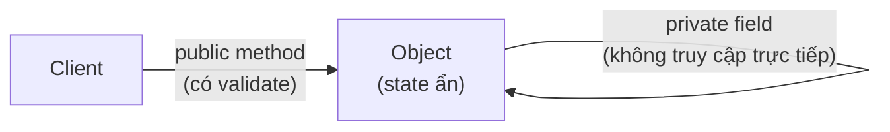
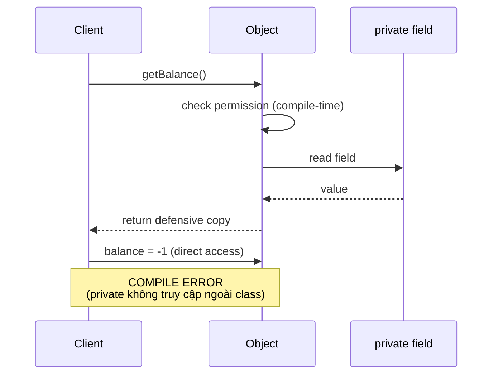

# What is encapsulation in OOP?

> Encapsulation trong OOP là gói state và hành vi vào một đơn vị (class), giấu chi tiết bên trong qua access modifier và phơi ra một contract có kiểm soát, đảm bảo object luôn ở trạng thái hợp lệ (invariant). Bài này phân biệt encapsulation với abstraction, mô tả cơ chế `private`/`protected`/`public`, getter/setter có kiểm tra, `final` field, immutability, kèm bài liên quan [abstraction-in-oop](abstraction-in-oop.md) và [inheritance-and-composition](inheritance-and-composition.md).

Chủ đề: OOP - Design Patterns · Ngày: 2026-10-16

## 1. Là gì

Encapsulation là một trong bốn trụ cột OOP, đi cùng abstraction, inheritance, polymorphism. Encapsulation gói data (field) và behavior (method) vào cùng một class, đồng thời giới hạn quyền truy cập trực tiếp vào state bên trong. Bên ngoài chỉ giao tiếp qua method công khai có kiểm tra, đảm bảo object luôn ở trạng thái hợp lệ (invariant).



*Sơ đồ vị trí: client chỉ gọi public method có validate. Field private nằm bên trong object, không thể `obj.field` từ ngoài.*

### Trả lời 30 giây

"Encapsulation là gói state và behavior vào class, giấu chi tiết qua access modifier (private, protected, public), chỉ phơi method công khai có kiểm tra. Mục đích: bảo vệ invariant — ví dụ `age >= 0`, `balance >= 0`, `email` không null. Encapsulation khác abstraction: encapsulation quyết định giấu cái gì và bảo vệ state như thế nào, abstraction quyết định lộ cái gì ra ngoài qua contract. Ví dụ: `ArrayList` private `Object[] elementData` là encapsulation; `List` interface là abstraction. Một class vừa có encapsulation vừa có abstraction. Encapsulation còn là nền tảng của immutability (`final` field + class final + no setter) — Java `String`, `LocalDateTime`, `Optional` đều immutable."

## 2. Cơ chế cốt lõi

### Bước 1. Access modifier trong Java

| Modifier | Cùng class | Cùng package | Subclass | Khác package |
|---|---|---|---|---|
| `private` | Có | Không | Không | Không |
| (default/package-private) | Có | Có | Không | Không |
| `protected` | Có | Có | Có | Không |
| `public` | Có | Có | Có | Có |

- `private`: chỉ truy cập trong cùng class. Field private không truy cập được từ ngoài (kể cả subclass).
- `protected`: cho phép subclass truy cập, dùng cho template method pattern. Nhược: phá encapsulation nếu lạm dụng.
- `public`: mọi nơi. Method public là API; thay đổi nó là breaking change.

### Bước 2. Getter và setter có kiểm tra

```java
// Ví dụ chưa chạy thử
public class Account {
    private BigDecimal balance;
    public BigDecimal getBalance() { return balance; }
    public void deposit(BigDecimal amount) {
        if (amount.signum() <= 0) throw new IllegalArgumentException();
        this.balance = this.balance.add(amount);
    }
}
```

Quy tắc:
- Getter trả về defensive copy nếu field là mutable (ví dụ `List`, `Date`, `BigDecimal` có thể chia sẻ).
- Setter có validate. Không cho phép set giá trị vi phạm invariant.
- Không tự động sinh getter/setter cho mọi field qua IDE — chỉ sinh khi thật sự cần. Setter mở rộng quyền sửa state, dễ phá invariant.

### Bước 3. Cơ chế giấu state qua JVM



*Sơ đồ cơ chế: Java compile-time enforce access. Direct access `obj.balance` từ ngoài class là compile error. Mọi đường vào state đều qua method, method có thể validate.*

### Bước 4. `final` field và immutability

`final` field chỉ gán một lần (trong constructor hoặc initializer). Kết hợp với:
- Class `final`: không cho extend, bảo vệ chống override phá invariant.
- Field `private final`: đảm bảo không đổi sau init.
- Method `final`: không cho override, bảo vệ behavior cốt lõi.

Java `String` là ví dụ kinh điển: `private final char[] value` (Java 8 trở về trước, từ Java 9 là `byte[]`), class `final`, không có setter. Mọi method trả chuỗi mới, không mutate field.

### Bước 5. Record trong Java 14+ (preview, GA sau)

```java
public record Point(int x, int y) {}
```

Record tự sinh:
- Field `private final`.
- Constructor canonical.
- Accessor method `x()`, `y()` (không phải `getX()`).
- `equals`, `hashCode`, `toString`.

Record là immutable data carrier — encapsulation tự động, ít boilerplate. Phù hợp cho DTO, value object, tuple.

### Bước 5b. Defensive copy

Khi trường là mutable (List, Set, Map, Date, BigDecimal có thể chia sẻ reference), constructor và getter phải copy. Ví dụ:

- Constructor nhận `List<X>` bên ngoài: lưu `new ArrayList<>(incoming)`, không lưu reference. Caller giữ list gốc và có thể mutate, nhưng object không bị ảnh hưởng.
- Getter trả `List<X>`: trả `new ArrayList<>(this.items)` hoặc `Collections.unmodifiableList(this.items)`. Trả reference gốc → caller có thể `clear()` và phá state.

### Bước 6. Encapsulation ở cấp module (Java 9+)

Java Platform Module System (JPMS) cho phép `module-info.java` giới hạn package nào export ra ngoài module. Ví dụ: module A `exports com.a.api;` không export `com.a.internal` — package internal là chi tiết hiện thực, encapsulation ở cấp module.

### Bước 7. Quan sát

```java
// Reflection bypass encapsulation — chỉ dùng khi cần (test, framework)
Field f = MyClass.class.getDeclaredField("secret");
f.setAccessible(true);
String s = (String) f.get(instance);
// Warning: phá invariant nếu field private đại diện cho state có ràng buộc
```

### Ví dụ chạy từng bước

Kịch bản: service OrderService xử lý đơn hàng 5 items, total 1000.00 USD. 4 thao tác mutation: apply 5% discount 4 lần (lần 4 bị reject do version mismatch). Mục tiêu: thấy mỗi mutation đi qua private field qua getter/setter có validate, version field chống double-submit, và defensive copy khi trả list items ra ngoài.

Bước 1. Constructor chạy. `new Order(5, 1000.00)` phân bố 3 field: `items = [5 items]` (reference copy từ param), `total = 1000.00`, `version = 1`. Đây là first point of defense: constructor validate `total > 0`, `items != null && !items.isEmpty()`. Nếu attacker truyền list bên ngoài và mutate sau đó, object không bị ảnh hưởng vì constructor đã copy.

Bước 2. Discount #1: `order.applyDiscount(0.05)` chạy. Method kiểm tra `version == currentVersion` (đọc field private). Đúng → version tăng 2, total = 1000.00 × 0.95 = 950.00. Bước 3-3 (discount #2-#3) tương tự: version tăng 3 → 4, total = 814.51 sau 4 lần. (đã tính lại bằng script)

Bước 3. Discount #4 đến. Thread A đọc version=4, Thread B cũng đọc version=4 cùng lúc. Thread A ghi version=5 thành công. Thread B ghi với `version == 4` thất bại — `OptimisticLockException`. Đây là optimistic concurrency control: không blocking thread, chỉ reject khi version đổi. Đảm bảo không double-discount.

Bước 4. Client gọi `order.getItems()` (getter). Nếu getter trả thẳng `this.items` (mutable list reference) — client có thể `clear()` hoặc `add()`, phá state. Getter phải trả `new ArrayList<>(this.items)` (defensive copy) hoặc `Collections.unmodifiableList(this.items)` để client không mutate internal state.

Trạng thái:
| Bước | Op | version sau | total | Invariant |
|---|---|---|---|---|
| Tạo | constructor | 1 | 1000.00 | total ≥ 0 ✓ |
| Discount 1 | applyDiscount | 2 | 950.00 | version tăng ✓ |
| Discount 2-3 | applyDiscount | 4 | 814.51 | version tăng ✓ |
| Discount 4 | version mismatch → reject | 4 | 814.51 | total không đổi ✓ |

Nếu không có `private` field và validate: attacker gọi `order.total = -999.00` trực tiếp từ bên ngoài — invariant `total ≥ 0` bị phá. Java compiler chặn ở compile-time (`balance` is private), không cần check runtime. Đây là lý do encapsulation bảo vệ invariant.

```java
// Ví dụ chưa chạy thử
class Order {
    private BigDecimal total;
    private int version;
    private List<Item> items;

    public Order(List<Item> items, BigDecimal total) {
        this.items = new ArrayList<>(items); // defensive copy
        this.total = total;
        this.version = 1;
    }

    public List<Item> getItems() {
        return new ArrayList<>(items); // defensive copy
    }
}
```

Điều rút ra: mọi đường vào state đều qua method có validate, defensive copy ngăn mutation từ bên ngoài. Invariant `total ≥ 0` được bảo vệ bất kể client cố tình hay vô tình phá. Câu 2 trong 3A hỏi "getter/setter tự động cho mọi field là anti-pattern" — đúng vì setter mở rộng quyền sửa state không kiểm soát.

## 3. Câu hỏi phỏng vấn

### 3A. Câu hỏi đào sâu

<details class="qa">
<summary>Câu 1. Encapsulation khác Abstraction thế nào? Hai khái niệm hay bị trộn vào nhau.</summary>

**Trả lời ngắn:** Encapsulation giấu state và bảo vệ invariant qua access modifier. Abstraction ẩn chi tiết hiện thực và phơi contract. Một class vừa có abstraction (public method) vừa có encapsulation (private field).

**Đào sâu:**
- Encapsulation: câu hỏi "state này có được phép truy cập trực tiếp từ ngoài không?". Trả lời thường là không; client đi qua method có validate.
- Abstraction: câu hỏi "client cần biết method/field nào?". Trả lời là một contract công khai.
- Ví dụ: `ArrayList` encapsulation qua `private Object[] elementData`, `private int size`, `private int modCount`. Abstraction qua `List` interface (`add`, `get`, `size`).
- Khi refactor, hai khái niệm thường cùng thay đổi: đổi access modifier (encapsulation) và đổi method signature (abstraction).
- Câu hỏi phỏng vấn: "Bạn hiểu thế nào về encapsulation?" — đừng chỉ nói "che giấu dữ liệu"; nói thêm invariant và getter có kiểm tra.

**Bẫy:** "Encapsulation = dùng private field." Thuật ngữ encapsulation sai trong công thức getter/setter cho MỌI field (anti-pattern). Đôi khi field công khai (ví dụ `public final` constant) hoặc package-private field cũng đúng nguyên tắc.

**Follow-up:** DTO có cần encapsulation không? Có thể — DTO bất biến (`record` trong Java) vừa là data carrier vừa có encapsulation tốt. Mutable DTO với setter cho mọi field là anti-pattern (anemic object).
</details>

<details class="qa">
<summary>Câu 2. Tại sao getter/setter tự động cho mọi field là anti-pattern?</summary>

**Trả lời ngắn:** Vì phá invariant. Khi setter cho phép gán bất kỳ giá trị nào vào field, class không còn đảm bảo object ở trạng thái hợp lệ. Tên gọi khác: "anemic domain model" — class chỉ là data bag, logic nằm ở service bên ngoài.

**Đào sâu:**
- Setter không validate: `setAge(-1)` không bị chặn, invariant `age >= 0` bị phá.
- Setter cho field mutable: `setOrders(list)` trả list, caller mutate list sau đó → state thay đổi ngoài kiểm soát. Fix: defensive copy hoặc `Collections.unmodifiableList`.
- Getter trả mutable reference: `getOrders()` trả `this.orders` → caller `clear()` list → state bị mutate. Fix: trả defensive copy hoặc unmodifiable view.
- Anemic domain model: entity chỉ có field + getter/setter, logic nằm ở service. Thiết kế này làm entity mất ý nghĩa OOP — chỉ là data transfer object. Martin Fowler xem đây là anti-pattern.
- Quy tắc: setter chỉ khi cần thiết, validate kỹ, document invariant rõ ràng.

**Bẫy:** "Getter/setter tự động tiện cho ORM." Có — ORM cần getter/setter để hydrate. Nhưng logic nghiệp vụ nên ở entity (rich domain model), ORM chỉ là framework gắn vào.

**Follow-up:** Lombok `@Getter @Setter` có phải giải pháp tốt không? Tiện nhưng dễ rơi vào anti-pattern. Nên dùng `@Value` (immutable) hoặc record Java 14+ thay vì `@Data` cho entity quan trọng.
</details>

<details class="qa">
<summary>Câu 3. Immutability đóng góp gì cho encapsulation?</summary>

**Trả lời ngắn:** Immutability là encapsulation triệt để nhất: state không đổi sau khi tạo → không cần bảo vệ khỏi mutation. Mọi method trả về object mới, object cũ giữ nguyên. Đơn giản hoá concurrency, dễ cache, dễ reasoning.

**Đào sâu:**
- Thread-safe miễn phí: nhiều thread đọc cùng object immutable → không race condition. Ví dụ `String`, `Integer`, `LocalDateTime`.
- Dùng làm key trong `HashMap`, `HashSet` an toàn: hashCode không đổi sau khi đưa vào map.
- Trong functional programming: immutable object chia sẻ giữa các hàm mà không sợ mutation. Java `Stream` collect sang `List` mới, không mutate input.
- Cách tạo immutable class trong Java: class `final`, field `private final`, không có setter, defensive copy cho field mutable trong constructor và getter.
- Ví dụ: `Period period = Period.ofMonths(3); period.plusDays(5)` trả object mới, `period` giữ nguyên.

**Bẫy:** "Immutability = không có method nào thay đổi state." Đúng về mặt hiển thị. Nhưng cần đảm bảo field mutable (nếu có) cũng không bị lộ qua getter. Ví dụ `Date` mutable — nếu class chứa `Date` field, getter trả defensive copy.

**Follow-up:** Java record có phải immutable không? Có — field `final`, không có setter. Nhưng nếu record chứa field mutable (List, Date), record vẫn không thật sự immutable.
</details>

<details class="qa">
<summary>Câu 4. Java record (Java 14+) so với class thường có lợi gì cho encapsulation?</summary>

**Trả lời ngắn:** Record tự động tạo class `final`, field `private final`, accessor (không `get` prefix), `equals/hashCode/toString`. Viết DTO/value object giảm boilerplate, mặc định immutable.

**Đào sâu:**
- Cú pháp: `public record Point(int x, int y) { }`. Compiler sinh field, constructor, accessor `x()` và `y()`, equals/hashCode/toString.
- Không thể extend record khác (record implicit final), nhưng có thể implement interface: `public record Point(int x, int y) implements Comparable<Point> { ... }`.
- Compact constructor cho validate: `public Point { if (x < 0) throw ...; }` chạy trước khi field gán.
- Dùng cho DTO, value object, tuple, response API. Không dùng cho entity có mutable state (ORM thường cần setter).
- Java 16+ GA record, Java 17+ stable, Java 21+ thêm pattern matching với record (chưa chắc, phụ thuộc phiên bản).

**Bẫy:** "Record thay thế class." Không — record chỉ cho immutable data carrier. Class thường cần khi có logic nghiệp vụ, mutable state, hoặc cần extend class khác.

**Follow-up:** Có thể thêm method vào record không? Có — thêm static method, instance method, override accessor (Java 16+).
</details>

<details class="qa">
<summary>Câu 5 (Debug). Production bug: `ConcurrentModificationException` khi iterate qua `List` được trả từ getter. Nguyên nhân liên quan tới encapsulation?</summary>

**Trả lời ngắn:** Getter trả thẳng reference tới field mutable (List, Set, Map) bên trong object. Caller (hoặc thread khác) modify list đó → state bị thay đổi ngoài kiểm soát, iterator fail-fast phát hiện và throw.

**Đào sâu:**
- Bước 1: Getter `return orders;` trả cùng reference với field internal. Caller `resultList.add(...)` mutate list.
- Bước 2: Multi-thread: thread A iterate, thread B add → fail-fast iterator ném `ConcurrentModificationException`.
- Bước 3: Fix defensive copy: getter trả `new ArrayList<>(orders)` (copy). Tốn memory và CPU nhưng an toàn.
- Bước 4: Fix bằng unmodifiable view: `Collections.unmodifiableList(orders)`. Caller gọi `add()` sẽ `UnsupportedOperationException` — không silent fail.
- Bước 5: Tốt nhất là dùng immutable collection: `List.of(...)`, `Map.of(...)` (Java 9+) cho danh sách cố định.
- Bước 6: Document trong Javadoc rõ field trả về là view hay copy.

**Bẫy:** "Defensive copy luôn tốt hơn." Không — defensive copy có overhead O(n) cho mỗi getter call. Nếu collection lớn và ít bị mutate, có thể chấp nhận unmodifiable view.

**Follow-up:** Có nên dùng `Stream.toList()` (Java 16+) trả về list immutable không? Có — đây là cách gọn để bảo vệ collection khỏi mutation ngoài ý muốn.
</details>

<details class="qa">
<summary>Câu 6 (Thiết kế). Thiết kế class `Money` trong domain model. State gồm amount + currency. Đảm bảo `Money` luôn có currency hợp lệ, amount >= 0, không bị mutate từ ngoài.</summary>

**Trả lời ngắn:** Dùng Java record (final class, final field, không setter) + compact constructor validate. Hoặc class thường với field `private final`, factory method, không expose setter.

**Đào sâu:**
- **Yêu cầu**: `Money` phải là value object — hai `Money(100, USD)` bằng nhau, không có identity riêng. Không thay đổi sau tạo.
- **Record version**:
  ```java
  public record Money(BigDecimal amount, String currency) {
      public Money {
          if (amount.signum() < 0) throw new IllegalArgumentException();
          if (currency == null || currency.length() != 3) throw ...;
      }
  }
  ```
- **Class version** (Java 8 trở về trước): class final, field private final, constructor validate, không setter.
- **Phương thức**: `add(Money)` trả Money mới, không mutate. Ví dụ `money.add(other)` → `Money(150, USD)` nếu currency khớp, throw nếu khác currency.
- **Test**: equals/hashCode tự động trong record; class thường cần implement.
- **Trade-off**: record ít code hơn nhưng không thể extend (immutable thì cũng không cần).

**Bẫy:** "Cho `Money` extend `Number` để dùng được trong `Math`." Sai — Money không phải Number (có currency). Nên implement interface riêng (Comparable, Serializable).

**Follow-up:** `Money` trong production (Joda Money, JavaMoney JSR 354) có khác thiết kế trên không? Có — hỗ trợ multiple currency, rounding strategy, formatting, immutability đầy đủ.
</details>

<details class="qa">
<summary>Câu 7. Java Platform Module System (JPMS) giúp encapsulation ở cấp nào?</summary>

**Trả lời ngắn:** JPMS (Java 9+) cho phép giấu package ở cấp module. Module chỉ export package nào muốn public; package internal chỉ truy cập trong module. Đây là encapsulation vượt qua class — encapsulation ở module-to-module.

**Đào sâu:**
- `module-info.java`: `module com.example.api { exports com.example.api; }`. Package `com.example.internal` không export → module khác không import được.
- Trước JPMS: package-private chỉ trong cùng package, không có cơ chế "private ở cấp nhóm các package". JPMS giải quyết bằng module.
- Use case: thư viện expose API ổn định (`com.lib.api`), giấu implementation (`com.lib.internal`). Refactor internal không phá người dùng.
- Java EE, Spring, JDK từ Java 9 dùng JPMS. Tuy nhiên, JPMS phức tạp và adoption thấp ngoài JDK.
- Thay thế thực tế: OSGi, Maven/Gradle multi-module (chỉ ở build time, không phải runtime).

**Bẫy:** "JPMS thay thế package-private." Sai — package-private vẫn dùng trong cùng module. JPMS bổ sung encapsulation ở module boundary.

**Follow-up:** Spring Boot 3 / Java 17+ có dùng JPMS không? Spring Boot 3 chạy trên Java 17, nhưng ứng dụng Spring thường không đóng gói thành module — đơn giản hoá build. JPMS chủ yếu trong JDK.
</details>

### 3B. Câu hỏi phỏng vấn liên quan

<details class="qa">
<summary>Câu 8. Bốn trụ cột OOP là gì?</summary>

**Trả lời:** Abstraction (ẩn chi tiết, phơi contract), encapsulation (giấu state, bảo vệ invariant), inheritance (tái sử dụng qua kế thừa), polymorphism (một interface, nhiều hiện thực). Một số tài liệu thêm composition, delegation, message passing.
</details>

<details class="qa">
<summary>Câu 9. `protected` có phải lỗi encapsulation không?</summary>

**Trả lời:** `protected` cho phép subclass truy cập field/method. Đây là chủ ý cho template method pattern. Tuy nhiên, `protected` cho phép subclass mutate state mà không qua validate → có thể phá invariant. Quy tắc: `protected` cho method, tránh `protected` cho mutable field.
</details>

<details class="qa">
<summary>Câu 10. Tại sao `final` field vẫn có thể bị mutate?</summary>

**Trả lời:** `final` chỉ đảm bảo reference không đổi, không đảm bảo object được reference là immutable. `private final List<X> items;` cho phép `items.add(...)` thay đổi nội dung list. Để thật sự bất biến, dùng immutable collection hoặc defensive copy.
</details>

<details class="qa">
<summary>Câu 11. Có nên luôn dùng getter và setter cho mọi field?</summary>

**Trả lời:** Không. Getter/setter chỉ khi cần. Field public final (constant) không cần getter. Field mutable nhưng không muốn lộ ngoài — không cho getter. Setter có thể phá invariant nếu không validate; tốt nhất là thiết kế method business (`deposit`, `withdraw`) thay vì setter trần.
</details>

<details class="qa">
<summary>Câu 12. Immutability ở C++ khác Java thế nào?</summary>

**Trả lời:** C++ có `const` method và `const` field nhưng không có cơ chế bắt buộc immutability. Có thể cast `const_cast` để mutate (UB nếu object thật sự const). C++20 thêm `consteval` cho compile-time constant. Functional programming (Haskell, Rust ownership OCRA) có immutability triệt để hơn.
</details>

<details class="qa">
<summary>Câu 13. Python có encapsulation không? "Private" thật sự?</summary>

**Trả lời:** Python dùng convention `_private` (một underscore) và `__private` (hai underscore, name mangling). `_x` chỉ là convention, vẫn truy cập được. `__x` được name-mangled thành `_ClassName__x`, gây khó khăn nhưng không cấm. Thực tế Python dựa vào convention, không có access modifier cứng như Java.
</details>

<details class="qa">
<summary>Câu 14. True or false: "Encapsulation = ẩn tất cả field bằng private."</summary>

**Trả lời:** Sai. Encapsulation là bảo vệ invariant, không phải giấu mọi thứ. Public static final constant (ví dụ `Math.PI`) là đúng encapsulation — read-only, không thể mutate. Field package-private cho test trong cùng package cũng OK. Quan trọng là state luôn ở trạng thái hợp lệ.
</details>

<details class="qa">
<summary>Câu 15. Reflection có phá encapsulation không?</summary>

**Trả lời:** Có. `setAccessible(true)` cho phép đọc/ghi private field. JDK cảnh báo từ Java 9 (module system cấm nếu field không `opens` qua `--add-opens`). Framework (JUnit, Hibernate, Jackson) dùng reflection để test/serialize. Trade-off: encapsulation cho code, framework cần thiết đôi khi phải bypass.
</details>

## 4. Đánh đổi và sự cố production

### So sánh mức encapsulation

| Mức | Công cụ | Ưu | Nhược |
|---|---|---|---|
| Field | `private`, `protected`, package-private | Che giấu trực tiếp khỏi client | Lạm dụng getter/setter phá invariant |
| Class | `final class` | Chống extend, bảo vệ invariant | Không thể dùng cho framework cần extend |
| Module (Java 9+) | JPMS `module-info.java` | Encapsulation ở package-to-package | Phức tạp, adoption thấp ngoài JDK |
| Value (immutability) | record, immutable class | Thread-safe, dễ cache, dễ reasoning | Mỗi mutation tạo object mới (overhead nhỏ) |

### Trade-off thiết kế

- **Mutable + private field + setter validate**: linh hoạt, business method trực tiếp (`deposit`, `withdraw`). Nhược: cần validate kỹ, cần defensive copy cho collection.
- **Immutable + final field + factory**: thread-safe, đơn giản hoá concurrency, dễ cache. Nhược: mỗi "thay đổi" tạo object mới (overhead GC, có thể cần builder cho nhiều field).
- **Record**: tự động final + accessor, ít boilerplate. Nhược: không extend, không mutable.
- **JPMS module**: encapsulation ở package boundary. Nhược: build phức tạp, IDE support không tốt cho app thường.
- **Anemic domain model**: getter/setter cho mọi field, logic ở service. Nhược: entity mất ý nghĩa OOP, validation rải rác ở nhiều service dễ sót. Martin Fowler xem là anti-pattern.
- **Rich domain model**: behavior ở entity, entity tự bảo vệ invariant. Ưu: validation tập trung, dễ reasoning. Nhược: entity to, persistence mapping cần framework ORM hỗ trợ (JPA, Hibernate).

### Năm failure mode

| Triệu chứng | Nguyên nhân gốc | Cách kiểm tra | Cách sửa |
|---|---|---|---|
| `ConcurrentModificationException` khi iterate | Getter trả reference tới list mutable | Test multi-thread + iterate | Defensive copy hoặc `unmodifiableList` |
| `IllegalStateException` do invariant bị phá | Setter không validate, cho phép gán giá trị xấu | Code review setter, unit test edge case | Validate trong setter, dùng builder |
| Mutable field leak qua public method | Constructor nhận `List` và giữ reference | Test: thay đổi list sau khi truyền vào | Defensive copy trong constructor: `this.items = new ArrayList<>(incoming)` |
| Anemic domain model | Entity chỉ có getter/setter, logic ở service | Đọc entity thấy không có method nghiệp vụ | Chuyển logic vào entity (rich domain), để service điều phối |
| `protected` field bị subclass phá invariant | Subclass mutate field không qua validate | Code review subclass | Dùng `private` + method `protected` có validate |

### Khi nào encapsulation gây hại

- Test cần đọc private state mà không muốn đổi API: dùng `@VisibleForTesting` annotation hoặc package-private getter. Tránh `setAccessible(true)` (reflection) trừ khi framework.
- ORM mapping cần setter/no-arg constructor: chấp nhận, nhưng validate trong setter hoặc dùng JPA `@PrePersist`/`@PreUpdate` callback.
- Framework cần extend class (Spring proxy, JPA entity listener): đánh đổi bằng cách dùng `protected` cho hook method thay vì `protected` field.
- Quá nhiều getter không cần thiết: đặt tên field public nếu chỉ là constant (`MAX_RETRIES = 3`) thay vì giấu rồi lộ qua getter.

## 5. Cheat sheet

| Chủ đề | Con số / quy tắc cần nhớ |
|---|---|
| Bốn trụ cột OOP | Abstraction, encapsulation, inheritance, polymorphism |
| Encapsulation | Gói state + behavior, giấu qua access modifier, bảo vệ invariant |
| Access modifier Java | `private` < package < `protected` < `public` |
| Invariant | Điều kiện state luôn đúng (age ≥ 0, balance ≥ 0, list không null) |
| Getter có kiểm tra | Trả defensive copy cho field mutable, document rõ |
| Setter | Chỉ khi cần, validate đầu vào, không tự động sinh cho mọi field |
| Immutability | Class `final`, field `private final`, không setter, factory method |
| Record (Java 14+) | Implicit final, accessor `x()` không `getX()` |
| JPMS | `module-info.java` exports package, encapsulation ở module-to-module |
| Anti-pattern | Anemic domain model — entity chỉ là data bag |

Trả lời ngắn khi bị hỏi: "Encapsulation là gói state và behavior vào class, giấu qua private/protected, phơi method có validate. Mục đích: bảo vệ invariant — age ≥ 0, balance không âm. Khác abstraction ở chỗ encapsulation giấu state, abstraction phơi contract. Ví dụ: ArrayList private `elementData` là encapsulation; List interface là abstraction. Immutability là encapsulation triệt để — Java String, record."

**Học tiếp:**
- [abstraction-in-oop](abstraction-in-oop.md) — phơi contract, ẩn hiện thực
- [inheritance-and-composition](inheritance-and-composition.md) — is-a vs has-a
- [singleton-pattern](singleton-pattern.md) — global state cũng cần bảo vệ invariant
- [factory-pattern](factory-pattern.md) — encapsulate object creation