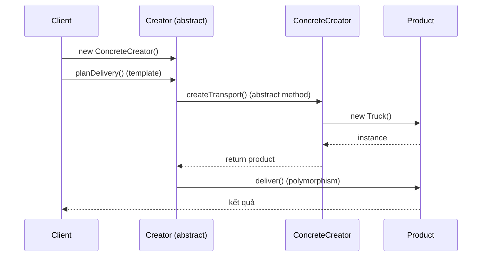

# Explain the factory design pattern.

> Factory là pattern creational cho phép tạo object mà không cần chỉ định chính xác class nào sẽ được khởi tạo, đẩy quyết định xuống subclass hoặc method, giúp code mở rộng mà không sửa chỗ tạo object.

Chủ đề: OOP - Design Patterns · Ngày: 2026-10-16

## 0. Nền tảng trước khi đọc

**Bối cảnh:** Cách tổ chức code thành những đối tượng dễ thay đổi. Mục tiêu là giữ luật của nghiệp vụ rõ ràng và tránh code phụ thuộc chặt vào nhau.

**Nói đơn giản:** Factory gom quyết định tạo object vào một chỗ, để code gọi không phải biết class cụ thể nào sẽ được tạo.

**Từ khóa cần biết:** class = khuôn; object = instance cụ thể; method = hành vi mà object cung cấp.

**Ví dụ dễ hình dung:** Ứng dụng chọn Stripe hoặc PayPal theo config, còn client chỉ gọi factory.createGateway().

Khi đọc, luôn hỏi ba câu: nó giải quyết vấn đề gì, nó làm việc theo những bước nào, và khi nào không nên dùng?

**Cách học bài này:** Đọc phần này trước để nắm từ khóa; đọc phần 1 để lấy câu trả lời 30 giây; đọc phần 2 để hiểu cơ chế; cuối cùng mở từng câu hỏi ở phần 3 để luyện nói. Các con số và lệnh trong bài là bằng chứng cho câu trả lời, không cần học thuộc nếu chưa hiểu cơ chế.

## 1. Là gì

### Đọc nhanh trước khi đi sâu

**Ý chính:** Factory gom quyết định tạo object vào một chỗ, để code gọi không phải biết class cụ thể nào sẽ được tạo.

**Ví dụ interview:** Ứng dụng chọn Stripe hoặc PayPal theo config, còn client chỉ gọi factory.createGateway().

**Luồng 4 bước:**

1. Client gọi một contract dễ hiểu.
2. Object hoặc pattern chọn code thực hiện phía sau contract.
3. State và dependency được giữ ở nơi có trách nhiệm rõ ràng.
4. Khi requirement đổi, thay implementation mà giảm ảnh hưởng tới client.

**Nói như trong interview:** Factory gom quyết định tạo object vào một chỗ, để code gọi không phải biết class cụ thể nào sẽ được tạo. Hãy nói theo bốn bước trên trước; nếu interviewer hỏi sâu, chuyển sang cơ chế **Bước 1. Simple Factory (static factory)**, rồi nêu trade-off và failure mode ở các phần sau.

## 2. Cơ chế cốt lõi

### Bước 1. Simple Factory (static factory)

Không phải pattern GoF chính thức nhưng phổ biến nhất. Một method static trả về instance của các class khác nhau dựa trên tham số.

```java
public class PaymentProcessorFactory {
    public static PaymentProcessor create(String provider) {
        return switch (provider) {
            case "stripe" -> new StripeProcessor();
            case "paypal" -> new PaypalProcessor();
            default -> throw new IllegalArgumentException("Unknown provider");
        };
    }
}
```

- Ưu: gọn, dễ hiểu, phù hợp khi số class cố định và ít.
- Nhược: switch/if-else phải sửa mỗi khi thêm provider — vi phạm Open/Closed.

### Bước 2. Factory Method pattern (GoF chính thức)

Định nghĩa abstract method `createProduct()` trong Creator class. Subclass override để tạo concrete product.

```java
abstract class TransportFactory {
    public void planDelivery() {
        Transport t = createTransport(); // factory method
        t.deliver();
    }
    protected abstract Transport createTransport();
}
class TruckFactory extends TransportFactory {
    @Override protected Transport createTransport() { return new Truck(); }
}
class ShipFactory extends TransportFactory {
    @Override protected Transport createTransport() { return new Ship(); }
}
```

- Ưu: tuân thủ Open/Closed (thêm Truck mới không sửa client code).
- Nhược: nhiều class con, overhead cho hệ thống nhỏ.

### Bước 3. Abstract Factory pattern

Tạo họ sản phẩm liên quan (family). Mỗi ConcreteFactory tạo một bộ product khớp nhau.

```java
interface UIFactory {
    Button createButton();
    Checkbox createCheckbox();
}
class WindowsUIFactory implements UIFactory {
    public Button createButton() { return new WindowsButton(); }
    public Checkbox createCheckbox() { return new WindowsCheckbox(); }
}
class MacUIFactory implements UIFactory {
    public Button createButton() { return new MacButton(); }
    public Checkbox createCheckbox() { return new MacCheckbox(); }
}
```

- Ưu: đảm bảo các product tương thích (Mac button + Mac checkbox đồng nhất).
- Nhược: khó thêm product mới (thêm `Slider` phải sửa mọi UIFactory).

### Bước 4. Sơ đồ cơ chế Factory Method



*Sơ đồ cơ chế: client khởi tạo ConcreteCreator, gọi template method; Creator gọi factory method (đã override), ConcreteCreator tạo ConcreteProduct, trả về Creator xử lý. Client không thấy class cụ thể.*

### Bước 5. Parametric Factory vs Registry-based Factory

- **Parametric**: `create(type: String)` switch theo type. Đơn giản nhưng phải sửa code khi thêm.
- **Registry-based**: factory giữ Map<String, Supplier<Product>>, đăng ký implementation runtime. Thêm product không sửa factory (Open/Closed đúng nghĩa).
  ```java
  Map<String, Supplier<PaymentProcessor>> registry = new HashMap<>();
  registry.put("stripe", StripeProcessor::new);
  registry.get("stripe").get(); // tạo instance
  ```
- Registry phổ biến trong Spring, Java SPI, plug-in architecture.

### Bước 6. Quan sát

```java
// Java SPI (Service Provider Interface) - registry factory tự động
ServiceLoader<PaymentProcessor> loader = ServiceLoader.load(PaymentProcessor.class);
for (PaymentProcessor p : loader) {
    // tất cả implementation đã đăng ký qua META-INF/services/
}

// Spring: @Autowired với @Qualifier chọn implementation theo tên
@Autowired @Qualifier("stripeProcessor")
private PaymentProcessor processor;

// SLF4J
Logger log = LoggerFactory.getLogger(MyClass.class);
```

### Bước 7. Quyết định giữa các biến thể

- **Số implementation**: 2-3 → Simple Factory; 4+ và cần mở rộng → Factory Method.
- **Quan hệ product**: độc lập → Factory Method; có family (UI theme, OS-specific) → Abstract Factory.
- **Config chọn runtime**: Simple/Abstract Factory dễ; Factory Method cần DI container để chọn ConcreteCreator theo profile.
- **Kích thước codebase**: dưới 50 class → Simple Factory; 50-500 → Factory Method; > 500 hoặc cần framework mạnh → DI + Factory.
- **Test strategy**: Factory Method dễ test nhất (inject mock creator). Abstract Factory phức tạp hơn (nhiều interface).

### Bước 8. Lỗi thường gặp khi implement

- **Static factory + private constructor**: ngăn subclass, không thể kế thừa. Cân nhắc protected constructor nếu muốn extension.
- **Factory trả new instance mỗi lần**: tốn kém cho class nặng (database connection). Cân nhắc cache (singleton) hoặc pool.
- **Factory không thread-safe**: nếu cache instance, dùng double-checked locking hoặc `ConcurrentHashMap.computeIfAbsent`.
- **Factory phụ thuộc config file**: nếu config lỗi, factory crash. Validate config lúc startup.

### Ví dụ chạy từng bước

Kịch bản: hệ thống giao hàng cần tạo `Transport` object theo khoảng vày. Nếu vày < 500km dùng `Truck`, nếu vày >= 500km dùng `Ship`. `TransportFactory` là abstract Creator với method abstract `createTransport()`.

**Trạng thái ban đầu:** `TruckFactory` và `ShipFactory` extend `TransportFactory`; client chưa khởi tạo creator.

**Bước 1 — Khởi tạo ConcreteCreator:**
- `TransportFactory factory = new TruckFactory()`; factory.transport = null
- Vì sao: client chỉ biết `TransportFactory` abstract, không biết concrete. Compiler không cho `new TransportFactory()` vì abstract.

| Object | Trạng thái sau Bước 1 |
|---|---|
| factory (TruckFactory) | đã tạo, transport = null |
| TruckFactory | chưa override gì |

**Bước 2 — Gọi planDelivery("Hà Nội", 100km):**
- `factory.planDelivery(order)` gọi `createTransport()` → `new Truck()`
- `Truck.deliver(order)` → log "Truck giao hàng 100km, chi phí 500k"
- Trả về client

| Object | Trạng thái sau Bước 2 |
|---|---|
| factory.transport | đã gán Truck instance |
| Truck instance | đã deliver xong |

**Bước 3 — Đổi sang đơn hàng quốc tế 2000km:**
- Cùng `factory`, gọi `planDelivery(order_2000km)`
- Vì TruckFactory chỉ tạo Truck, dù vày xa vẫn dùng Truck → chi phí cao, giao chậm.
- Fix đúng: chọn ConcreteCreator khác — `factory = new ShipFactory()`.

**Bước 4 — Khởi tạo ShipFactory và gọi planDelivery(2000km):**
- `TransportFactory factory = new ShipFactory()`
- `factory.planDelivery(order)` gọi `createTransport()` → `new Ship()`
- `Ship.deliver(order)` → log "Ship giao hàng 2000km, chi phí 2000k"

| Object | Trạng thái sau Bước 4 |
|---|---|
| factory (ShipFactory) | đã tạo mới |
| Ship instance | đã deliver xong |

**Bước 5 — Registry-based factory:**
```java
Map<String, Supplier<Transport>> registry = new HashMap<>();
registry.put("truck", Truck::new);
registry.put("ship", Ship::new);
Transport t = registry.get("ship").get();  // tạo Ship
```
Thêm transport mới (Airplane): chỉ cần `registry.put("airplane", Airplane::new)`. Không sửa code factory.

**Biến thể — Nếu client tự `new` thay vì dùng factory:**
- `Transport t = new Truck()` → client phụ thuộc concrete class Truck.
- Test khó: phải mock Truck (qua PowerMock) thay vì inject Factory mock.
- Khi đổi sang Ship, sửa toàn bộ client code → vi phạm Open/Closed.

Điều rút ra: Factory pattern đẩy quyết định class cụ thể ra khỏi client. Mỗi ConcreteCreator có thể test riêng, swap runtime qua registry. Cơ chế này chứng minh Open/Closed — thêm ConcreteCreator không sửa client, giúp trả lời câu "Spring `@Bean` method có phải Factory Method không?" — vì `@Bean` là factory method và Spring là ConcreteCreator framework.

## 3. Câu hỏi phỏng vấn

### 3A. Câu hỏi đào sâu

<details class="qa">
<summary>Câu 1. Simple Factory, Factory Method và Abstract Factory khác nhau thế nào?</summary>

**Trả lời ngắn:** Simple Factory là static method chọn class dựa trên tham số (không phải pattern GoF). Factory Method là abstract method trong Creator, subclass quyết định class — GoF chính thức. Abstract Factory tạo cả họ sản phẩm liên quan (Button + Checkbox + TextField cùng family).

**Đào sâu:**
- Simple Factory: 1 method, switch/if-else. Dễ hiểu nhưng vi phạm Open/Closed. Dùng khi số class cố định và ít (3-5).
- Factory Method: tách creation thành method abstract. Subclass override. Dùng khi muốn mở rộng mà không sửa Creator (ví dụ Spring `FactoryBean`).
- Abstract Factory: nhóm các factory method có liên quan. Đảm bảo product tương thích (Mac button + Mac checkbox). Dùng khi hệ thống cần đổi cả họ (cross-platform UI).
- Kích thước codebase: Simple Factory < 50 LOC; Factory Method 50-200; Abstract Factory 200+.

**Bẫy:** "Simple Factory là anti-pattern." Không hẳn — nó phù hợp khi đơn giản. Anti-pattern là dùng Simple Factory cho hệ thống nhiều class phức tạp.

**Follow-up:** Abstract Factory có thể implement bằng Factory Method không? Có — mỗi method của AbstractFactory là một Factory Method.
</details>

<details class="qa">
<summary>Câu 2. Khi nào nên dùng Factory thay vì `new` trực tiếp?</summary>

**Trả lời ngắn:** Khi cần đa hình (client chỉ biết interface), khi logic khởi tạo phức tạp (nhiều tham số, lookup, config), hoặc khi cần mock trong test. `new` trực tiếp khi class cụ thể là duy nhất, không có đa hình, không cần test với mock.

**Đào sâu:**
- Logic khởi tạo phức tạp: factory có thể đọc config, lookup database, validate dependency. Client không cần biết.
- Test: inject factory mock, mock trả về stub object. Với `new` trực tiếp, mock phải qua static mocking (PowerMock, Mockito-inline) — phức tạp hơn.
- Đa hình: client chỉ phụ thuộc interface; factory quyết định class cụ thể theo config runtime.
- DI container (Spring, Guice) về bản chất là factory + lifecycle management. Inject `PaymentProcessor` thay vì tự `new`.
- Anti-pattern: factory chỉ wrap `new` đơn giản (`return new X()`). Thừa abstraction.

**Bẫy:** "Luôn dùng factory." Không — over-engineering. Một class chỉ có một implementation, không cần factory.

**Follow-up:** DI framework có thay thế factory pattern không? Có trong nhiều trường hợp — Spring `@Bean` là factory method; `@Autowired` là dependency lookup. Tuy nhiên, factory pattern tường minh hơn cho test và refactor.
</details>

<details class="qa">
<summary>Câu 3 (Debug). App dùng `factory.create("stripe")` trả về `StripeProcessor` cho cả dev và prod. Dev muốn dùng `MockProcessor` để test, prod dùng Stripe thật. Làm sao?</summary>

**Trả lời ngắn:** Dùng Registry-based Factory với DI. Đăng ký `MockProcessor` trong test profile, `StripeProcessor` trong prod. Hoặc dùng Spring `@Profile` / `@ConditionalOnProperty` để chọn bean.

**Đào sâu:**
- Bước 1: Nếu factory là static method → refactor thành instance factory để có thể inject mock.
- Bước 2: Tạo interface `PaymentProcessorFactory { PaymentProcessor create(); }`. Implement `DefaultFactory` (lookup theo config) và `MockFactory` (trả mock).
- Bước 3: Inject factory vào client. Trong test inject `MockFactory`, trong prod inject `DefaultFactory`.
- Bước 4: Spring: `@Profile("test")` cho MockFactory, `@Profile("prod")` cho DefaultFactory. ApplicationContext tự chọn.
- Bước 5: Nếu dùng registry map, test set `registry.put("default", MockProcessor::new)` trong `@BeforeEach`.
- Bước 6: Verify mock behavior bằng Mockito `verify(mock).charge(...)`.

**Bẫy:** "Hard-code `if (env == "test") return mock` trong factory." Sai — factory biết quá nhiều về môi trường. Tách config ra ngoài.

**Follow-up:** Nếu cần đổi processor runtime (không phải khởi động app)? Dùng strategy pattern với hot-reload config, hoặc circuit breaker fallback.
</details>

<details class="qa">
<summary>Câu 4 (Thiết kế). Hệ thống cần hỗ trợ 3 database backend (PostgreSQL, MySQL, MongoDB) với connection pool, query builder, transaction manager riêng cho mỗi loại. Thiết kế bằng factory nào?</summary>

**Trả lời ngắn:** Abstract Factory — mỗi database backend là một `DatabaseKitFactory` tạo cả họ (ConnectionPool, QueryBuilder, TransactionManager). Client chỉ inject một factory và nhận đủ bộ component tương thích.

**Đào sâu:**
- **Yêu cầu**: 3 backend, mỗi backend có 3 component riêng; backend phải đồng nhất (PostgreSQL connection pool phải đi với PostgreSQL transaction manager).
- **Quyết định chính**: Abstract Factory `DatabaseKitFactory` có 3 method `createConnectionPool()`, `createQueryBuilder()`, `createTransactionManager()`.
- **Implementation**: `PostgresFactory`, `MySqlFactory`, `MongoFactory`. Mỗi cái tạo component tương ứng.
- **Config chọn factory**: từ application.properties `db.type=postgres` → Spring bean `DatabaseKitFactory` được chọn.
- **Client**: `UserRepository` chỉ inject `DatabaseKitFactory`, gọi `factory.createConnectionPool()` etc. Không biết backend cụ thể.
- **Điểm nghẽn**: thêm backend mới (Oracle) phải implement đủ 3 method; thêm component mới (MigrationRunner) phải sửa cả 3 factory. Trade-off rõ.

**Bẫy:** "Dùng Simple Factory if-else cho từng method." Sai — sẽ duplicate logic, dễ nhầm backend.

**Follow-up:** Connection pool có thể dùng chung (HikariCP hỗ trợ nhiều DB). Có cần ConnectionPoolFactory riêng không? Có thể gộp vào kit nếu config pool khác nhau từng DB; dùng chung HikariCP nếu config giống.
</details>

<details class="qa">
<summary>Câu 5. Factory pattern và DI container khác nhau thế nào? Khi nào dùng cái nào?</summary>

**Trả lời ngắn:** Factory là pattern code-level, một method tạo object. DI container là framework quản lý lifecycle và dependency của nhiều object. DI container dùng factory bên trong; nhưng có thêm scope, lazy init, proxy, AOP.

**Đào sâu:**
- Factory pattern: chỉ giải quyết "ai tạo object nào". Đơn giản, không magic.
- DI container (Spring, Guice): giải quyết "ai tạo, ai inject, scope gì, khi nào tạo, khi nào huỷ". Phức tạp nhưng mạnh.
- Khi nào dùng DI: ứng dụng lớn, nhiều dependency, cần AOP/transactions. Trade-off: learning curve, startup time, debug khó hơn.
- Khi nào dùng Factory thuần: thư viện nhỏ, code đơn giản, không cần AOP. Code rõ ràng, không ẩn magic.
- Có thể kết hợp: DI container quản lý factory instance; factory method tạo object theo runtime logic.
- Anti-pattern: dùng DI container cho 5 class — quá phức tạp. Dùng factory thuần cho 100+ class với AOP — quá thủ công.

**Bẫy:** "DI container tốt hơn factory." Không — phụ thuộc ngữ cảnh. Đơn giản thì factory thuần dễ hiểu hơn.

**Follow-up:** Spring `@Bean` chính là factory method đúng nghĩa — có nên implement mọi thứ bằng `@Bean`? Không — chỉ khi cần logic tạo phức tạp; class đơn giản dùng `@Component`.
</details>

<details class="qa">
<summary>Câu 6. Factory Method pattern có thay thế được new keyword không?</summary>

**Trả lời ngắn:** Không thay thế hoàn toàn. Factory Method tốt cho đa hình và test. `new` trực tiếp tốt cho value object, DTO, class final không có đa hình. Hai cách bổ sung cho nhau.

**Đào sâu:**
- Factory Method cần subclass override → cần class không final và có hierarchy. Với class final (String, Integer), dùng static factory method (`Integer.valueOf`) thay vì `new Integer` (deprecated).
- Java convention: static factory method `valueOf`, `of`, `getInstance`, `newInstance` — đây là Simple Factory, rất hữu ích cho cache, lookup.
- Ví dụ: `Optional.of()`, `List.of()`, `Map.of()` — static factory method tạo immutable collection, trả về subtype hiệu quả.
- Static factory cho phép return subtype, cache instance, đổi tên method → linh hoạt hơn `new`.
- Joshua Bloch (Effective Java) khuyến nghị static factory method thay `new` cho class utility.

**Bẫy:** "Static factory = Singleton." Sai — singleton đảm bảo một instance; static factory có thể trả instance mới mỗi lần (`newInstance`).

**Follow-up:** Tại sao Effective Java ưu tiên static factory hơn constructor? Linh hoạt hơn (return subtype), có tên, cache được, có thể trả null cho optional case.
</details>

<details class="qa">
<summary>Câu 7. Abstract Factory thêm product mới (ví dụ Slider) gặp vấn đề gì?</summary>

**Trả lời ngắn:** Phải sửa mọi ConcreteFactory. Đây là trade-off chính của Abstract Factory. Nếu hệ thống cần thêm nhiều product thường xuyên, Abstract Factory không phù hợp.

**Đào sâu:**
- Thêm `Slider`: cần sửa `UIFactory` interface, `WindowsUIFactory`, `MacUIFactory`, `LinuxUIFactory` (nếu có), test của mỗi factory.
- Nếu có 10 family × 5 product = 50 class, thêm product = sửa 10 factory. Tốn công.
- Workaround: dùng prototype pattern — factory chỉ clone prototype object. Thêm product chỉ cần đăng ký prototype mới.
- Hoặc: dùng DI container với `@Conditional` — thêm product là thêm bean, không sửa factory.
- Hoặc: dùng ServiceLoader (Java SPI) — đăng ký implementation qua file, không sửa factory.
- Trade-off: Abstract Factory tốt khi product set ổn định (UI toolkit, theme); không tốt khi product set thay đổi liên tục.

**Bẫy:** "Abstract Factory luôn tốt hơn Factory Method." Sai — phụ thuộc vào tần suất thay đổi product set.

**Follow-up:** Prototype pattern có thay thế được Factory Method không? Có trong một số trường hợp (đặc biệt khi khởi tạo tốn kém và cần clone nhanh).
</details>

### 3B. Câu hỏi phỏng vấn liên quan

<details class="qa">
<summary>Câu 8. Factory Method và Template Method liên quan thế nào?</summary>

**Trả lời:** Factory Method thường được gọi bên trong Template Method. Template Method định nghĩa skeleton của thuật toán; một bước trong skeleton là Factory Method (abstract). Subclass override Factory Method để tuỳ biến product, không sửa skeleton.
</details>

<details class="qa">
<summary>Câu 9. Builder pattern có thay thế Factory không?</summary>

**Trả lời:** Không. Factory tạo object trong một bước (không quan tâm chi tiết). Builder tạo object phức tạp qua nhiều bước (từng phần). Dùng Builder khi constructor có nhiều tham số (>4) hoặc nhiều config optional. Dùng Factory khi object đơn giản, chỉ cần chọn class.
</details>

<details class="qa">
<summary>Câu 10. Tại sao Effective Java khuyến nghị static factory method?</summary>

**Trả lời:** Có tên (dễ đọc hơn `new X(...)`), có thể return subtype, cache instance, có thể return null cho optional case, có thể kiểm soát instance per JVM (`valueOf` vs `new`). Trade-off: class không thể `public` subclass nếu không có public/protected constructor.
</details>

<details class="qa">
<summary>Câu 11. ServiceLoader trong Java hoạt động ra sao?</summary>

**Trả lời:** `ServiceLoader.load(MyService.class)` đọc file `META-INF/services/MyService` (text file chứa tên class đầy đủ). Mỗi class đăng ký cung cấp implementation. Đây là registry-based factory tự động. Dùng cho plug-in (JDBC driver, SLF4J binding, Java NIO FileSystemProvider).
</details>

<details class="qa">
<summary>Câu 12. Prototype pattern khác Factory như thế nào?</summary>

**Trả lời:** Prototype tạo object bằng cách clone một object mẫu (prototype) thay vì gọi constructor. Tốt khi khởi tạo tốn kém (query database, network call) hoặc khi runtime type không biết trước. Factory tạo bằng constructor, cần biết class trước.
</details>

<details class="qa">
<summary>Câu 13. Spring `@Bean` method có phải Factory Method không?</summary>

**Trả lời:** Đúng. Mỗi method `@Bean` trong `@Configuration` class là một Factory Method — Spring gọi method đó để tạo bean, quản lý lifecycle, scope, dependency. Tương tự `@Service`/`@Component` cũng được Spring instantiate qua factory method ngầm.
</details>

<details class="qa">
<summary>Câu 14. True or false: "Simple Factory là một trong 23 pattern GoF chính thức."</summary>

**Trả lời:** Sai. GoF định nghĩa Factory Method và Abstract Factory. "Simple Factory" là thuật ngữ phổ biến nhưng không thuộc GoF. Tuy nhiên nó rất hữu ích và được dùng rộng rãi; Joshua Bloch gọi là "static factory method".
</details>

<details class="qa">
<summary>Câu 15. Khi nào nên dùng Abstract Factory thay vì một loạt Factory Method?</summary>

**Trả lời:** Khi các product có quan hệ family (UI theme: button + checkbox + textfield đồng nhất macOS) và cần đảm bảo tương thích. Nếu các product độc lập, dùng một loạt Factory Method đơn giản hơn. Abstract Factory thêm overhead abstraction đáng kể.
</details>

## 4. Đánh đổi và sự cố production

### So sánh ba biến thể Factory

| Tiêu chí | Simple Factory | Factory Method | Abstract Factory |
|---|---|---|---|
| Mục đích | Chọn class theo param | Subclass quyết định class | Tạo họ product tương thích |
| Tuân thủ Open/Closed | Không (sửa if-else) | Có | Một phần (thêm family OK, thêm product khó) |
| Số class | 1 factory | Creator + n ConcreteCreator | 1 AbstractFactory + n ConcreteFactory × m Product |
| Phù hợp | Hệ thống nhỏ | Extension thường xuyên | UI theme, cross-platform |
| DI thay thế được | Thường có | Thường có | Thường có nhưng verbose |

### Năm failure mode

| Triệu chứng | Nguyên nhân gốc | Cách kiểm tra | Cách sửa |
|---|---|---|---|
| Factory trả null khi type lạ | Thiếu default case, throw exception | Test với input lạ | Throw `IllegalArgumentException` hoặc default an toàn |
| Thêm provider mới quên update factory | Simple Factory switch/if-else không có compile check | Code review, test coverage cho mọi branch | Dùng Registry-based Factory hoặc ServiceLoader/SPI |
| Class được tạo sai (ví dụ test chạy prod) | Factory lookup config sai, profile không match | Log debug tên implementation tạo ra | Dùng DI `@Profile`/`@Conditional`, kiểm tra config |
| Abstract Factory thêm product phá build | Thêm product mới phải sửa mọi ConcreteFactory | Compile error là tín hiệu đúng | Cân nhắc chuyển sang Prototype hoặc Composition Root |
| Memory leak do factory cache | Factory cache instance nhưng không release | Heap dump | Dùng scope `prototype` (Spring) hoặc WeakReference |
| Quá nhiều class factory | Over-abstraction cho vấn đề đơn giản | Đếm số subclass; nếu > 5 thì xem lại | Gộp factory method vào class có sẵn |

## 5. Cheat sheet

| Chủ đề | Con số / quy tắc cần nhớ |
|---|---|
| Pattern group | Creational (GoF) |
| Ba biến thể | Simple Factory, Factory Method, Abstract Factory |
| GoF chính thức | Factory Method, Abstract Factory |
| Simple Factory | Static method, không thuộc GoF, dùng cho hệ thống nhỏ |
| Factory Method | Subclass override abstract method |
| Abstract Factory | Tạo họ product tương thích |
| Registry-based | Map<key, Supplier>, mở rộng runtime được |
| Java SPI | ServiceLoader với META-INF/services/ |
| Spring `@Bean` | Factory Method ngầm |
| Anti-pattern | Factory chỉ wrap `new` đơn giản không có đa hình |

**Học tiếp:**
- [singleton-pattern](singleton-pattern.md) — chỉ một instance toàn cục
- [strategy-pattern](strategy-pattern.md) — encapsulate thuật toán thay đổi runtime
- [adapter-pattern](adapter-pattern.md) — dịch interface không tương thích
- [observer-pattern](observer-pattern.md) — thông báo sự kiện tới dependents

**Lỗi thường gặp:** (1) Simple Factory không có default case cho input lạ → trả null → NPE. Luôn throw exception rõ ràng. (2) Quên update factory khi thêm product mới → bug runtime chỉ phát hiện khi gặp type mới. Dùng registry-based. (3) Abstract Factory thêm product phá compile mọi ConcreteFactory → chuán design Prototype hoặc Composition Root. (4) Factory cache quá nhiều instance → memory leak. Dùng scope phù hợp. (5) Trộn logic nghiệp vụ vào factory (validation, retry) → tách thành Decorator riêng.
