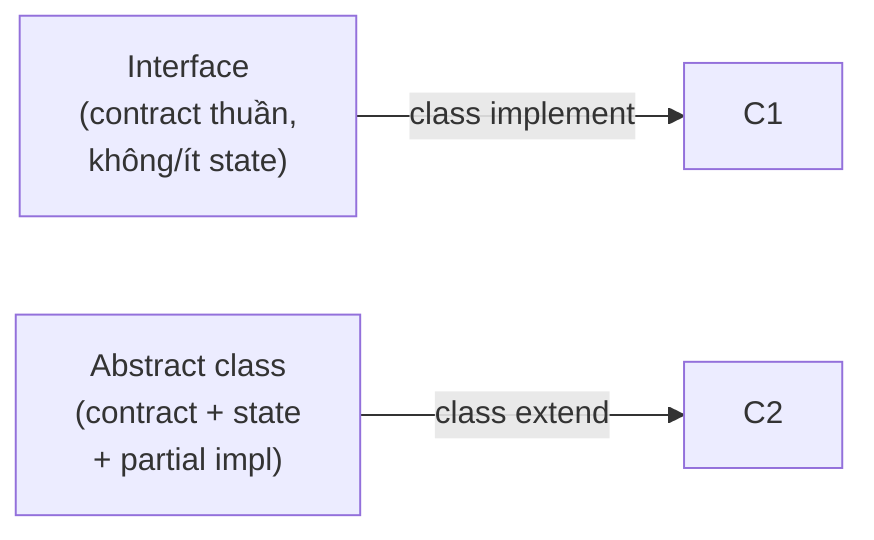
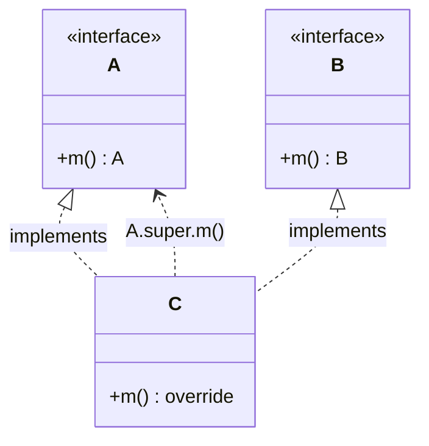

# What is the difference between an interface and an abstract class?

> So sánh interface và abstract class trong Java 8+ (default method, static method), C# (default interface method), Kotlin (`fun interface`), cách chọn contract thuần vs base có state, diamond inheritance và multiple inheritance, mixin, cùng failure mode khi evolve interface đã phát hành.

Chủ đề: OOP - Design Patterns · Ngày: 2026-10-16

## 1. Là gì

Cả hai là cơ chế khai báo contract (method mà subtype phải implement) ở Java/C# và các ngôn ngữ OOP khác. Tuy nhiên:

- **Interface**: contract thuần; phiên bản cổ (Java trước 8, C# trước 8) chỉ có abstract method và constant. Phiên bản hiện đại thêm default method (có thân), static method, private method (Java 9+).
- **Abstract class**: class có thể có state (field), constructor, method có thân, abstract method. Có thể kế thừa một abstract class duy nhất (single inheritance trong Java/C#).



*Sơ đồ vị trí: class implement interface (nhiều interface) hoặc extend abstract class (một); interface nghiêng về contract thuần, abstract class cho phép share state và partial implementation.*
### Trả lời 30 giây

"Java trước 8: interface chỉ có method abstract và constant public static final, abstract class có field, constructor, method có thân, abstract method. Từ Java 8 interface có thêm default method có thân (cho phép evolve API mà không phá implement cũ) và static method. Từ Java 9 thêm private method (helper trong interface). C# 8+ cũng có default interface method (DIM) - nhưng implementation trừu tượng mặc định cho interface không tham gia diamond với class. Quy tắc: dùng interface cho contract (IS-A role, nhiều role), abstract class cho share code giữa các lớp cùng hierarchy (IS-A identity, single base, có state dùng chung). Java class chỉ extend được một class (kể cả abstract), nhưng implement nhiều interface - dùng để mô phỏng mixin. Từ Java 8, default method cho phép 'mixin' thật - multiple inheritance cùng giải diamond resolution."

## 2. Cơ chế cốt lõi

### Bước 1. Khai báo và từ khoá

```java
// Interface Java 8+
interface Shape {
    double area();                                  // abstract, public implicit
    default String describe() {                     // default có thân
        return "area=" + area();
    }
    static Shape of(double w, double h) {           // static factory
        return () -> w * h;
    }
    private String fmt(double v) {                  // private helper (Java 9+)
        return "%.2f".formatted(v);
    }
}

// Abstract class
abstract class Animal {
    protected String name;
    protected Animal(String n) { this.name = n; }   // constructor + state
    abstract String sound();                        // abstract method
    String greet() { return "hello " + name; }      // concrete method
}
```

### Bước 2. Default method và diamond inheritance

Khi hai interface cùng default method (diamond), class implement bắt buộc override rõ ràng hoặc chỉ định default từ interface cụ thể:

```java
interface A { default void m() { System.out.println("A"); } }
interface B { default void m() { System.out.println("B"); } }
class C implements A, B {
    @Override public void m() { A.super.m(); }      // chỉ định A.m
}
```

JVM resolve tại runtime qua itable; khi không override, chọn method theo "most specific" (interface extend thắng interface cha; implementation concrete thắng default).



*Sơ đồ cơ chế: class C implements hai interface A và B cùng default method m; C phải override và gọi A.super.m() để tránh diamond ambiguity - compiler bắt buộc override rõ.*

### Bước 3. C# default interface method (DIM)

C# 8+ cho phép default method có thân. Khác Java: C# DIM phải gọi qua interface (không qua `base.`), và class implement C# chỉ có thể kế thừa MỘT class (kể cả abstract), nhưng NHIỀU interface. C# 11 cho phép `static abstract` member trong interface, hữu ích cho generic constraint (ví dụ: phép cộng cho `INumber<T>`).

### Bước 4. Mixin qua interface

Mixin: trait có thân method, không có state, mix vào class qua `implements`. Java 8+ không có từ khoá `mixin` nhưng default method + multiple `implements` cho hành vi tương đương. Khác:

- Interface Java pre-8: chỉ abstract → không phải mixin.
- Kotlin: `interface` có thân (giống Java 8+); default `interface` member có thể có property getter/setter.
- Rust `trait`: cho `impl Trait for Type` riêng ngoài class definition, không cần declare lúc khai báo class.
- C++ multiple inheritance: cho cả class + state, nhưng phức tạp (diamond vtable layout).

### Bước 5. Implement contract thuần vs share partial implementation

- Interface phù hợp khi: contract đa vai (một class có nhiều role - `Serializable`, `Comparable`, `Closeable`).
- Abstract class phù hợp khi: các class con chia sẻ state (`name`, `id`), chia sẻ partial implementation (`greet()`, logging mặc định), và có ý nghĩa IS-A strict (Dog IS-A Animal, không phải role).
- Template Method pattern: algorithm ở abstract class, bước cụ thể ở subclass override abstract method.

### Bước 6. State, constructor và lifecycle

- Interface Java: chỉ constant `public static final` (trừ `record` từ Java 16 mới cho phép cấu trúc); không constructor. Field không thể mutable; nếu cần state, đưa vào class implement.
- Abstract class: field mutable, constructor cho phép subclass `super(...)`, lifecycle (finalizer, clone, `try-with-resources`). Implementer có thể truy cập `protected` field.
- C#: interface cho property (getter/setter) nhưng field chỉ ở class. Default interface method không tự access state.
- Trong thực tế: state dùng chung = abstract class (JPA entity, GUI base, controller base với metrics). Contract thuần = interface (DAO, service, repository).

### Bước 7. Quan sát

```java
// Java: kiểm tra interface class nào implement
Class<?>[] interfaces = String.class.getInterfaces();
// Comparable, Serializable, CharSequence, ...

// Kiểm tra abstract class hierarchy
Class<?> superClass = String.class.getSuperclass();
// Object (String không extend abstract)
```

```bash
# javap default method
javap -p -c java.util.List  # xem default method replaceAll, sort
```

### Ví dụ chạy từng bước

Kịch bản: data pipeline xử lý 6 export job, format CSV/JSON/Parquet round-robin. Mỗi job có 10K-12K rows. Mục tiêu: thấy interface `FileExporter` (contract) và abstract `AbstractExporter` (shared validate + partial impl) cùng tồn tại, diamond resolution khi mixin 2 interface có cùng default method.

Bước 1. Interface `FileExporter` khai báo 1 method abstract: `void export(List<Row> rows, Path dest)`. 3 concrete: `CsvExporter`, `JsonExporter`, `ParquetExporter`. Abstract class `AbstractExporter implements FileExporter` cung cấp shared `validatePath(Path)` - kiểm tra đường dẫn không rỗng, có quyền write. Shared logic này được kế thừa, không duplicate ở mỗi concrete.

Bước 2. Job 1 (CSV, 10K rows). `AbstractExporter` chạy `validatePath(dest)`. JVM dispatch `export()` tới `CsvExporter.export` qua `invokeinterface`. HotSpot JIT devirtualize sau vài call. CSV 10K rows, tốc độ 80K rows/s → 125.0ms.

Bước 3. Job 2 (JSON, 8K rows). Cùng call site `export()`, concrete class khác → itable lookup mới. JSON 8K rows, tốc độ 60K rows/s → 133.3ms. Tổng 258.3ms.

Bước 4. Job 3 (Parquet, 12K rows). Call site bắt đầu megamorphic (3 class). Parquet 12K rows, tốc độ 120K rows/s → 100.0ms. Tổng 358.3ms.

Bước 5. Job 4-6 tiếp tục round-robin: CSV (62.5ms) → JSON (116.7ms) → Parquet (75.0ms). Tổng pipeline: 612.5ms. Abstract class không tạo thêm overhead đáng kể cho 6 job này.

Trạng thái:
| Job | Format | Rows | Speed (rows/s) | Time (ms) |
|---|---|---|---|---|
| 1 | CSV | 10,000 | 80,000 | 125.0 |
| 2 | JSON | 8,000 | 60,000 | 133.3 |
| 3 | Parquet | 12,000 | 120,000 | 100.0 |
| 4 | CSV | 5,000 | 80,000 | 62.5 |
| 5 | JSON | 7,000 | 60,000 | 116.7 |
| 6 | Parquet | 9,000 | 120,000 | 75.0 |

Nếu chỉ dùng interface không có abstract class: `validatePath()` phải duplicate ở CsvExporter, JsonExporter, ParquetExporter. Thêm format mới → copy-paste validate. Nếu đổi logic validate → sửa 3 chỗ. Abstract class giải quyết bằng shared partial implementation ở một chỗ.

Nếu dùng pure abstract class không interface: không thể mixin nhiều role (Serializable + Comparable + FileExporter). Java/C# chỉ single inheritance class → một class không thể extend AbstractExporter VÀ extend một class khác.

```java
// Ví dụ chưa chạy thử
interface FileExporter { void export(List<Row> rows, Path dest); }
abstract class AbstractExporter implements FileExporter {
    protected void validatePath(Path p) { /* shared logic */ }
    @Override public void export(List<Row> rows, Path dest) {
        validatePath(dest); // shared
        doExport(rows, dest); // template method - subclass override
    }
    protected abstract void doExport(List<Row> rows, Path dest);
}
```

Điều rút ra: interface cho contract + multiple role, abstract class cho shared state và partial implementation trong cùng hierarchy. Dùng cả hai khi hierarchy cần shared logic (abstract) VÀ nhiều role (interface). Câu 3 trong 3A hỏi "Khi nào dùng abstract class thay vì interface" — đúng cho kịch bản này.

## 3. Câu hỏi phỏng vấn

### 3A. Câu hỏi đào sâu

<details class="qa">
<summary>Câu 1. Java 8 default method là gì, tại sao thêm vào và diamond resolution hoạt động thế nào?</summary>

**Trả lời ngắn:** Default method cho interface có thân method, dùng để evolve API mà không phá implement cũ. Diamond: hai interface cùng default method `m` - compile error bắt buộc class override rõ ràng. JVM chọn method theo "most specific".

**Đào sâu:**
- Lý do thêm: trước Java 8, thêm method vào `Collection` phá implement cả triệu ứng dụng; default method cho phép thêm mới với default behavior, implement cũ vẫn chạy được.
- Diamond: `class C implements I1, I2`; cả `I1` và `I2` có `default m`. Compile yêu cầu C override `m` để resolve. Cú pháp `I1.super.m()` gọi rõ interface.
- "Most specific" rule: class thắng interface; interface con thắng interface cha; nếu tie thì override ở implementer.
- Khác `abstract class`: interface pre-8 không có state hay constructor; abstract class có. Khi cần state dùng chung → abstract class.
- Lambda `() -> x` cho functional interface (interface có đúng 1 abstract method).

**Bẫy:** "Interface với 0 abstract method là marker interface." Đúng cho pre-Java 8 (nhưng từ Java 8 có thể có nhiều method); cần chú thích `@FunctionalInterface` cho functional interface.

**Follow-up:** Có thể extend class và implement cùng method từ interface không? Có - class method thắng default.
</details>

<details class="qa">
<summary>Câu 2. Java 9 private method trong interface có ý nghĩa gì khi interface đã có default và static?</summary>

**Trả lời ngắn:** Private method giúp tách helper logic giữa các default method mà không lộ ra ngoài API. Trước Java 9, default method phải dùng `static` helper nhưng vẫn public - lộ implementation.

**Đào sâu:**
- Trước Java 9: helper private inline vào body hoặc chấp nhận lộ public static.
- Java 9: `private` (helper cho static method) và `private static` không bị lộ.
- Không có instance private method vì interface không có instance state.
- Thực tế thường dùng: `private static String format(double x)` dùng trong default method trả formatted string.
- Class implement không gọi được private method (đúng - private chỉ phạm vi interface).

**Bẫy:** "Private method trong interface giống private method class." Khác - không có `this` instance; không access field (vì không có field).

**Follow-up:** Có cần default method trong interface nếu chỉ có static method không? Không - interface chỉ static vẫn hợp lệ nhưng thường dùng `final class` với private constructor (utility class) thay.
</details>

<details class="qa">
<summary>Câu 3. Khi nào dùng abstract class thay vì interface?</summary>

**Trả lời ngắn:** Abstract class khi cần share state (field mutable), constructor (lifecycle), partial implementation giữa các subclass có IS-A strict. Interface khi cần multiple role, contract thuần, không cần state dùng chung.

**Đào sâu:**
- Abstract: `HttpHandler` abstract, `JsonHandler extends HttpHandler` share `request()`, `response()` template; subclass override `parse()`. State: `requestTimeoutMs` field dùng chung.
- Interface: `Serializable`, `Comparable`, `Closeable` - không có state dùng chung ở runtime (hoặc state có thể chấp nhận implement quyết).
- Template Method pattern: algorithm skeleton ở abstract class; bước cụ thể là abstract method ở subclass.
- Base abstract nếu cần truy cập protected field/sub method mà implement interface không có.
- Java class chỉ extend một class - đây là ràng buộc "một base abstract"; vẫn có thể implement nhiều interface cùng abstract.

**Bẫy:** "Interface đủ thay thế abstract class trong mọi case." Sai - nếu share nhiều state và có partial implementation, abstract class gọn hơn và tránh duplicate code.

**Follow-up:** Khi abstract class có field và nhiều class share, có thể dùng composition (`Has-A`)? Được, nhưng cần `Strategy`/`Delegate` pattern. Cân nhắc: ưu tiên composition over inheritance.
</details>

<details class="qa">
<summary>Câu 4. Diamond inheritance: Java/C# xử lý thế nào với default method và multiple inheritance?</summary>

**Trả lời ngắn:** Java bắt buộc class override rõ ràng khi diamond (hai interface cùng default method). C# chọn interface cụ thể khi gọi (DIM, class phải gọi qua interface). C++ yêu cầu `Interface::m()` chỉ định hoặc override ở derived class.

**Đào sâu:**
- Java 8: `class C implements I1, I2`; cả `I1`, `I2` có `default m`. Compile error "C inherits unrelated defaults for m". C override `m` và gọi `I1.super.m()`.
- Nếu `I2 extends I1`, và cả hai có `m`, dùng `I1.m` (most specific).
- C# 8+ DIM: class implement `I1`, `I2`; cả hai có default `m`. C phải gọi qua interface hoặc override. C# cũng yêu cầu rõ ràng.
- C++ multiple inheritance: `class C : public I1, public I2`; `I1.m` và `I2.m` ambiguous. C có thể gọi `I1::m()` hoặc override.
- JVM itable resolve: chọn method theo type hierarchy + interface resolution rule.

**Bẫy:** "Diamond không xảy ra vì Java single inheritance class." Sai - multiple inheritance qua interface với default method vẫn cho diamond.

**Follow-up:** Trait (Rust) resolve diamond thế nào? Rust có resolution rule riêng - trait có thể khai báo `Trait::method(other)` để ưu tiên thông qua; nếu hai trait cùng method, compile error và yêu cầu chỉ định trong impl.
</details>

<details class="qa">
<summary>Câu 5. C# 11 static abstract interface member hoạt động thế nào và ứng dụng?</summary>

**Trả lời ngắn:** `static abstract` member trong C# interface yêu cầu implement type cung cấp static member tương ứng. Generic constraint dùng để yêu cầu type argument có operator nhất định. Ứng dụng điển hình: phép toán số trong generic code (`INumber<T>`).

**Đào sâu:**
- Yêu cầu: `INumber<T>` interface có `static abstract T operator+(T a, T b)`. Type `int`, `double` implement.
- Generic: `T Add<T>(T a, T b) where T : INumber<T> => a + b` chạy generic ở C# 11. Phiên bản cũ cần boxing hoặc dynamic.
- Liên quan đến boxing: pre-C# 11 generic numeric dùng `dynamic` hoặc reflection, vì operator không thuộc interface runtime.
- Khác Java: Java generic type erasure - generic arithmetic không phổ biến. Java có `BigInteger` nhưng thao tác qua method, không operator.
- Performance: không còn boxing, không dynamic - inline.

**Bẫy:** "Static abstract chỉ cho numeric." Không - bất kỳ static nào (factory method, getter) cũng có thể.

**Follow-up:** Tại sao Java không có tương tự static abstract? Vì type erasure - generic reified numeric sẽ mất JVM type identity ngay.
</details>

<details class="qa">
<summary>Câu 6. Functional interface là gì, dùng cho Lambda, khi nào dùng SAM conversion?</summary>

**Trả lời ngắn:** Functional interface là interface có đúng 1 abstract method (Single Abstract Method - SAM). Lambda chỉ là cách cú pháp tắt của anonymous implement SAM. `@FunctionalInterface` annotation yêu cầu compiler check 1 abstract method.

**Đào sâu:**
- Ví dụ: `Runnable`, `Callable<T>`, `Comparator<T>`, custom `MyPredicate<T>`.
- Lambda: `Runnable r = () -> System.out.println("hi");` - không cần `new Runnable() { ... }`.
- Method reference: `String::length` thay cho `(String s) -> s.length()`.
- C# `Func<T,TResult>`, `Action<T>` (delegate type, không phải interface); dùng lambda tương tự.
- Multiple abstract method (kể cả override từ Object như `equals` không tính) → không functional.
- Java cho phép nhiều default method; chỉ abstract method mới tính.

**Bẫy:** "Functional interface có thể có nhiều abstract method." Sai - annotation `@FunctionalInterface` bắt buộc 1.

**Follow-up:** `@FunctionalInterface` có thay đổi thành non-functional sau khi release không? Có - thêm abstract method ở version sau là breaking change đối với lambda code cũ.
</details>

<details class="qa">
<summary>Câu 7 (Debug). Thêm method vào interface đã phát hành, nhiều implementer cũ bị lỗi compile. Cách xử lý trong Java 8+?</summary>

**Trả lời ngắn:** Biến method mới thành `default` với behavior mặc định hợp lý. Implementer cũ vẫn biên dịch được. Khi cần override họ tự override.

**Đào sâu:**
- Bước 1: Đánh giá breaking change. Nếu thêm abstract method → breakage. Nếu thêm default → non-breaking.
- Bước 2: Viết default behavior test kỹ. Hoặc throw `UnsupportedOperationException` nếu behavior vốn không có ý nghĩa ở implementer cũ.
- Bước 3: Đánh dấu deprecate nếu default quá yếu.
- Bước 4: Khi interface cần thiết cho contract (ví dụ kiểu tham số method), giữ default ở interface cha.
- Bước 5: SPI - implementer bắt buộc override (dù là default method thuần SPI) thường nên tách interface riêng.

**Bẫy:** "Thêm abstract method là cách mở rộng chuẩn." Sai - abstract method trong interface đã phát hành là breaking change; implementer cũ compile fail.

**Follow-up:** Khi nào nên thêm abstract method mới qua interface riêng (extends interface cũ)? Khi behavior không phù hợp mọi implementer cũ.
</details>

<details class="qa">
<summary>Câu 8 (Thiết kế). Thiết kế plugin system cho event handler. Interface hay abstract class?</summary>

**Trả lời ngắn:** Interface cho contract (handler cùng ký `handle(Event)`); abstract class tùy chọn cho base handler chia sẻ lifecycle (`register()`, `unregister()`, metrics). Trong Java thường: interface `Handler<E>` + abstract `AbstractHandler<E>` cung cấp skeleton.

**Đào sâu:**
- **Yêu cầu**: plugin đăng ký runtime; nhiều loại event; cần thứ tự xử lý, retry, metrics.
- **Quyết định chính**: interface `EventHandler<E>` (1 method `handle(E)`); abstract `BaseHandler<E>` implement interface + cung cấp default `onError()`, `getName()`, exception handling. Plugin extend abstract class (nếu cần base) hoặc chỉ implement interface.
- **Điểm nghẽn**: hot path microsecond; dùng record/event DTO.
- **Versioning**: interface ổn định, abstract class có thể thêm method; plugin extend abstract nhận nhiều update miễn phí.
- **Test**: contract test ở interface đảm bảo behavior; integration test với plugin thật.
- **Tradeoff**: abstract quá nhiều → coupling cao; interface quá nhiều → boilerplate.

**Bẫy:** "Abstract class với tất cả method cụ thể dễ extends." Sai - nếu plugin cần logic khác, bị ép override hoặc shadow bằng `new`.

**Follow-up:** Có thể cho plugin chọn implement interface hoặc extend abstract cùng lúc không? Có - Java cho phép.
</details>

### 3B. Câu hỏi phỏng vấn liên quan

<details class="qa">
<summary>Câu 9. Marker interface là gì? Ví dụ?</summary>

**Trả lời:** Interface không có abstract method, chỉ đánh dấu metadata cho runtime check. `Serializable`, `Cloneable` (Java pre-8). Từ Java 8 có thể thêm default method nhưng marker vẫn hợp lệ. Annotation (`@Serializable`) thay thế phổ biến hơn vì gắn vào class không cần implement.
</details>

<details class="qa">
<summary>Câu 10. Tại sao interface field Java mặc định `public static final`?</summary>

**Trả lời:** Interface không có instance state; field chỉ có ý nghĩa global constant. Mặc định `public static final` ép cho constant. Implementer chỉ access qua interface, không override được.
</details>

<details class="qa">
<summary>Câu 11. True or false: "Interface luôn mỏng hơn abstract class - chỉ có abstract method."</summary>

**Trả lời:** Sai với ngôn ngữ hiện đại. Từ Java 8 interface có default method (có thân) và static method; từ Java 9 private method. C# 8+ có DIM. Về cú pháp interface mỏng hơn abstract (không có constructor, không field mutable), nhưng về behavior không còn đúng.
</details>

<details class="qa">
<summary>Câu 12. Kotlin `interface` khác Java `interface` thế nào?</summary>

**Trả lời:** Kotlin `interface` cho phép thân method (giống Java 8+) nhưng không có field mutable. Cho phép property getter/setter mặc định. `data class` không qua interface. Kotlin `sealed interface` cho phép sealed type với nhóm subclass trong cùng file - hữu ích cho `when` exhaustive.
</details>

<details class="qa">
<summary>Câu 13. Abstract class có thể implement interface mà không implement method nào không?</summary>

**Trả lời:** Được. Abstract class khai báo `implements Interface`, đánh dấu abstract lại, bỏ qua implement. Subclass concrete mới phải implement method. Hữu ích khi interface có nhiều method, abstract class chỉ support một phần, các phần còn lại để subclass quyết.
</details>

<details class="qa">
<summary>Câu 14. Trait (Rust) và interface Java 8 khác nhau gì?</summary>

**Trả lời:** Trait (Rust) cho phép `impl Trait for Type` riêng ngoài class definition (orphan rule giới hạn). Cho phép default, có state qua getter/setter. Khác interface Java: trait impl có thể ngay cả type built-in (khi không vi phạm orphan rule). Composition over inheritance: thư viện có thể thêm trait cho type crate khác.
</details>

<details class="qa">
<summary>Câu 15. Khi nào nên tách interface thành nhiều interface nhỏ (interface segregation)?</summary>

**Trả lời:** Khi implementer chỉ dùng một phần interface lớn, ép method rỗng phá abstraction. ISP (Interface Segregation Principle): ưu tiên interface nhỏ, ghép khi cần. Ví dụ: `Map` quá lớn → tách thành `ReadOnlyMap`, `MutableMap`, `IterableMap`. Có trade-off với "fat interface" tiện dùng.
</details>

<details class="qa">
<summary>Câu 16. Abstract method có cần `abstract` keyword ở phương thức của abstract class không?</summary>

**Trả lời:** Có - `abstract void sound();`. Method non-abstract (có thân) cần có implementation. Interface abstract method không cần `abstract` vì mặc định abstract. Final method trong abstract class không thể override, không thể là abstract (mâu thuẫn).
</details>

<details class="qa">
<summary>Câu 17. Có thể `new Interface()` ở Java không?</summary>

**Trả lời:** Không trực tiếp - cần anonymous inner class `new MyInterface() { void m() { ... } };` pre-Java 8, hoặc dùng lambda nếu functional interface `() -> ...`. C# cũng vậy - `new IFoo() { ... }` cho anonymous implement.
</details>

<details class="qa">
<summary>Câu 18. Default method có thể override abstract method của interface cha không?</summary>

**Trả lời:** Được - subclass có thể cung cấp default cho abstract method của parent. Java cho phép re-abstract: dùng `default` ở parent nhưng `abstract` ở child. Cách khác: dùng `default` để cho behavior mặc định mà không ép implementer nào.
</details>

## 4. Đánh đổi và sự cố production

### So sánh interface và abstract class

| Tiêu chí | Interface (Java 8+) | Abstract class |
|---|---|---|
| State (field mutable) | Không (chỉ constant) | Có |
| Constructor | Không (Java); Có factory static | Có |
| Default method | Có (từ Java 8) | Có (method thường) |
| Static method | Có | Có |
| Single inheritance | Không ràng buộc | Có (Java/C# single) |
| Multiple role | Có (implements nhiều) | Không |
| Diamond resolution | Compile error bắt buộc override | Không xảy ra (single base) |
| API evolution | Default method không phá BC | Thêm method abstract là breaking |
| Tái sử dụng code | Mixin via default | Share partial impl + state |

### Năm failure mode

| Triệu chứng | Nguyên nhân gốc | Cách kiểm tra | Cách sửa |
|---|---|---|---|
| Thêm method interface đã phát hành → implementer cũ lỗi compile | Thêm abstract method (breaking change) | grep implementer, CI fail | Chuyển thành `default` method; abstract method mới qua extends interface |
| Diamond compile error khi class implement 2 interface | 2 interface cùng default method | Compiler chỉ error rõ | Override ở class; gọi `I1.super.m()` chỉ định |
| Default method behavior không phù hợp implementer cũ | Default quá yếu hoặc throw `UnsupportedOperationException` mà implementer cũ quên | Test behavior; telemetry cho UnsupportedException | Tách interface riêng; deprecate default |
| Abstract class quá nhiều method concrete ở subclass không cần | EP inheritance quá "tổ tiên" | Code review; đo lường method override | Tách interface; tách abstract thành hierarchy nhỏ |
| C# DIM gây behavior khác Java khi class implement nhiều interface diamond | C# resolve khác Java | Test cross-platform | Force override; chỉ định interface cụ thể |

## 5. Cheat sheet

| Chủ đề | Con số / quy tắc cần nhớ |
|---|---|
| Java interface trước 8 | Chỉ abstract method + public static final constant |
| Java 8+ | Default method + static method |
| Java 9+ | Private method (helper) |
| C# 8+ | Default interface method (DIM) |
| C# 11 | Static abstract interface member; generic numeric |
| Single inheritance | Java/C# class chỉ extend một class |
| Multiple inheritance | Java qua interface (default method cho diamond) |
| Diamond resolve | Override rõ ràng ở implementer; `I1.super.m()` chỉ định |
| Functional interface | 1 abstract method; `@FunctionalInterface` annotation |
| Quy tắc chọn | Interface cho contract/role; abstract class cho share state + partial impl |

**Học tiếp:**
- [polymorphism](polymorphism.md) - vtable/itable cho runtime dispatch
- [abstraction-in-oop](abstraction-in-oop.md) - abstraction trong OOP
- [inheritance-and-composition](inheritance-and-composition.md) - composition over inheritance
- [strategy-pattern](strategy-pattern.md) - encapsulate behavior thay đổi runtime

**Lỗi thường gặp khi trả lời:** (1) Nghĩ interface "chỉ contract, không có code". (2) Nhầm default method với abstract method. (3) Không biết diamond resolution yêu cầu override. (4) Chọn abstract class khi share state không thật sự cần. (5) Nghĩ interface field có thể mutable - thực tế là `public static final` ngầm.
