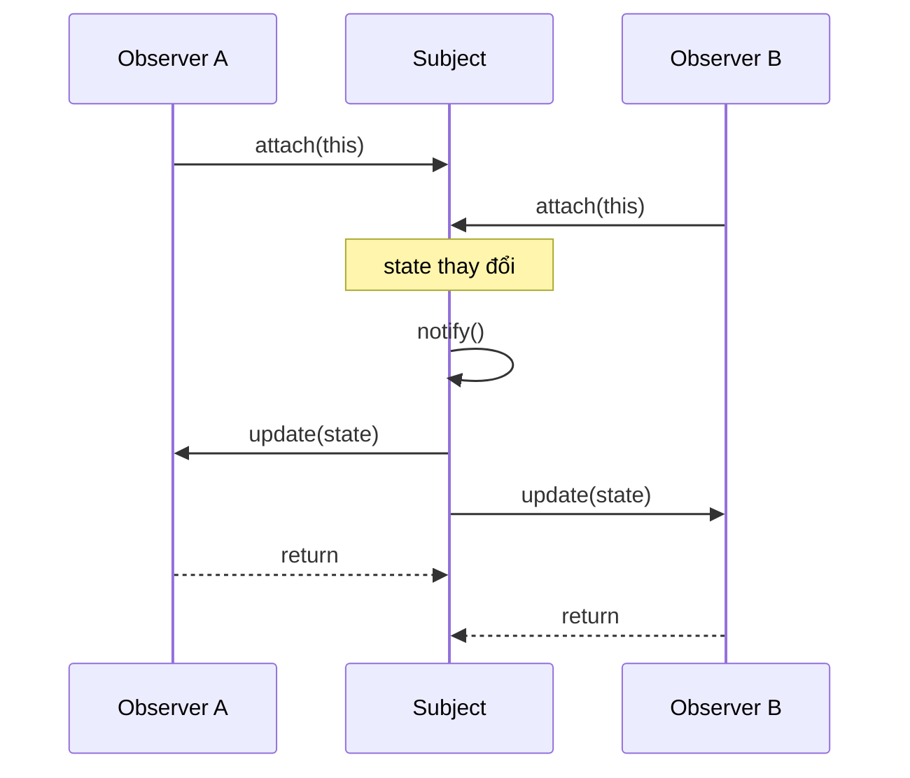

# Explain the observer design pattern.

> Observer là pattern behavioral cho phép một object (subject) giữ danh sách dependents (observers) và tự động thông báo khi trạng thái thay đổi, giúp loose coupling giữa nguồn sự kiện và nơi xử lý.

Chủ đề: OOP - Design Patterns · Ngày: 2026-10-16

## 0. Nền tảng trước khi đọc

**Bối cảnh:** Cách tổ chức code thành những đối tượng dễ thay đổi. Mục tiêu là giữ luật của nghiệp vụ rõ ràng và tránh code phụ thuộc chặt vào nhau.

**Nói đơn giản:** Observer cho phép một subject báo cho nhiều listener khi state thay đổi mà subject không cần biết chi tiết listener làm gì.

**Từ khóa cần biết:** class = khuôn; object = instance cụ thể; method = hành vi mà object cung cấp.

**Ví dụ dễ hình dung:** OrderCreated phát cho email, analytics và warehouse listener mà OrderService không gọi cứng từng dependency.

Khi đọc, luôn hỏi ba câu: nó giải quyết vấn đề gì, nó làm việc theo những bước nào, và khi nào không nên dùng?

**Cách học bài này:** Đọc phần này trước để nắm từ khóa; đọc phần 1 để lấy câu trả lời 30 giây; đọc phần 2 để hiểu cơ chế; cuối cùng mở từng câu hỏi ở phần 3 để luyện nói. Các con số và lệnh trong bài là bằng chứng cho câu trả lời, không cần học thuộc nếu chưa hiểu cơ chế.

## 1. Là gì

### Đọc nhanh trước khi đi sâu

**Ý chính:** Observer cho phép một subject báo cho nhiều listener khi state thay đổi mà subject không cần biết chi tiết listener làm gì.

**Ví dụ interview:** OrderCreated phát cho email, analytics và warehouse listener mà OrderService không gọi cứng từng dependency.

**Luồng 4 bước:**

1. Client gọi một contract dễ hiểu.
2. Object hoặc pattern chọn code thực hiện phía sau contract.
3. State và dependency được giữ ở nơi có trách nhiệm rõ ràng.
4. Khi requirement đổi, thay implementation mà giảm ảnh hưởng tới client.

**Nói như trong interview:** Observer cho phép một subject báo cho nhiều listener khi state thay đổi mà subject không cần biết chi tiết listener làm gì. Hãy nói theo bốn bước trên trước; nếu interviewer hỏi sâu, chuyển sang cơ chế **Bước 1. Thành phần và interface chuẩn GoF**, rồi nêu trade-off và failure mode ở các phần sau.

## 2. Cơ chế cốt lõi

### Bước 1. Thành phần và interface chuẩn GoF

1. **Subject (Observable)**: giữ state cốt lõi, cung cấp `attach(observer)`, `detach(observer)`, `notify()`.
2. **Observer**: interface với một method (GoF gọi `update(subject, arg)` hoặc `update(arg)`).
3. **ConcreteSubject**: implement Subject, lưu state, gọi `notify()` sau khi state đổi.
4. **ConcreteObserver**: implement Observer, đăng ký vào ConcreteSubject, phản ứng với `update()`.

### Bước 2. Luồng đăng ký và notify

1. Client tạo ConcreteSubject và các ConcreteObserver.
2. Mỗi observer gọi `subject.attach(this)` (hoặc qua factory / DI).
3. Khi state thay đổi (setter, internal event), ConcreteSubject gọi `notify()`.
4. `notify()` duyệt list observers, gọi `update()` trên từng cái. Tuỳ push/pull: push đẩy data kèm theo, pull để observer tự `subject.getState()`.
5. Observer xử lý (render UI, log, gửi alert) rồi trả về; subject không chờ.



*Sơ đồ cơ chế: hai observer đăng ký vào subject, subject notify tuần tự khi state đổi; mỗi observer xử lý và trả về, subject không chờ.*

### Bước 3. Push vs Pull

- **Push model**: subject đẩy data qua `update(arg)`. Observer không cần biết subject. Nhược: data truyền phải đủ cho mọi observer, khó thay đổi signature.
- **Pull model**: subject chỉ gọi `update(subject)`, observer tự `subject.getState()`. Linh hoạt hơn vì observer chỉ lấy phần cần. Nhược: coupling cao hơn vì observer biết type concrete subject.

### Bước 4. Đồng bộ và thread safety

- Notify không đồng bộ mặc định. Nếu observer thao tác GUI trong background thread, GUI framework (Swing, JavaFX, UIKit) yêu cầu marshal về main thread.
- Concurrent attach/detach trong khi notify đang chạy gây `ConcurrentModificationException` (Java) hoặc crash. Cách phổ biến:
  - Copy list observers sang snapshot trước khi duyệt.
  - Dùng `CopyOnWriteArrayList` (Java) hoặc immutable list per notify.
- Trong multi-thread, observer có thể nhận event ngoài thứ tự → cần version/sequence id nếu cần.

### Bước 5. Observer không thoát (leak) là failure mode số 1

- Subject giữ strong reference tới observer. Nếu observer là inner class của activity/UI, subject sống quá activity → activity không GC được.
- Java Android: leak qua `Activity` đăng ký `BroadcastReceiver`. Fix: `unregister` trong `onDestroy`, hoặc dùng `WeakReference` ở subject (nhưng vẫn phải unregister cho gọn).
- Reactive framework (RxJava) cung cấp `Disposable` để unsubscribe kèm `CompositeDisposable.clear()`.

### Bước 6. Quan sát

```java
// Java PropertyChangeListener (chuẩn, dùng được)
import java.beans.PropertyChangeListener;
import java.beans.PropertyChangeSupport;

public class Stock {
    private final PropertyChangeSupport pcs = new PropertyChangeSupport(this);
    private double price;
    public void addListener(PropertyChangeListener l) { pcs.addPropertyChangeListener(l); }
    public void setPrice(double p) {
        double old = this.price;
        this.price = p;
        pcs.firePropertyChange("price", old, p); // notify
    }
}
```

```js
// Node.js EventEmitter (chuẩn built-in)
const EventEmitter = require('events');
class Stock extends EventEmitter {}
const s = new Stock();
s.on('price', (p) => console.log('UI update', p));
s.emit('price', 100.5); // notify
```

### Bước 7. Reactive variant: hot vs cold Observable

Trong reactive framework (RxJava, Reactor), subject trở thành Observable, observer là Subscriber. Có hai biến thể quan trọng:

- **Cold Observable**: mỗi subscriber nhận một stream riêng; producer chạy lại từ đầu cho mỗi subscriber. Ví dụ: HTTP call wrapper.
- **Hot Observable**: stream multicast; subscriber mới chỉ nhận event từ lúc subscribe. Subject trong GoF giống hot Observable.

Cold dùng cho "fetch data on demand"; hot dùng cho "broadcast event". Trộn hai loại dễ bug: subscribe lúc observer chưa sẵn sàng → miss event; subject chia state giữa hai loại → event sai.

### Ví dụ chạy từng bước

Kịch bản: hệ thống bán vé sự kiện. `EventSubject` giữ giá vé (`price`), `EmailObserver` gửi email, `UIObserver` cập nhật web, `AnalyticsObserver` log analytics. Ban đầu giá 500.000 VNĐ. Sau đó giảm xuống 350.000 VNĐ (flash sale).

**Trạng thái ban đầu:** Subject.price = 500.000; observers = []

**Bước 1 — Đăng ký observers:**
- `emailObs.attach(subject)`: Subject.observers = [emailObs]
- `uiObs.attach(subject)`: Subject.observers = [emailObs, uiObs]
- `analyticsObs.attach(subject)`: Subject.observers = [emailObs, uiObs, analyticsObs]

Vì sao: mỗi observer implement interface `Observer` với method `update(price)`. Subject giữ `CopyOnWriteArrayList` để thread-safe khi attach/detach đồng thời notify.

**Bước 2 — Gọi notify lần đầu (giá 500k):**
- `subject.setPrice(500_000)` → gọi `notify()`
- `notify()` duyệt list: gọi `emailObs.update(500_000)` → log "Email: Giá vé 500.000đ"
- Gọi `uiObs.update(500_000)` → log "UI: Hiển thị 500.000đ"
- Gọi `analyticsObs.update(500_000)` → log "Analytics: price=500000"

Vì sao: subject không quan tâm observer làm gì bên trong, chỉ gọi `update()`. Mỗi observer độc lập xử lý.

| Observer | Trạng thái sau Bước 2 |
|---|---|
| EmailObserver | đã nhận price = 500.000, đã log |
| UIObserver | đã nhận price = 500.000, đã hiển thị |
| AnalyticsObserver | đã nhận price = 500.000, đã log |

**Bước 3 — Flash sale: giảm giá còn 350.000 VNĐ:**
- `subject.setPrice(350_000)` → gọi `notify()`
- Duyệt list 3 observers → cùng flow như Bước 2 nhưng với price = 350.000

| Observer | Trạng thái sau Bước 3 |
|---|---|
| EmailObserver | đã nhận price = 350.000, đã gửi email flash sale |
| UIObserver | đã nhận price = 350.000, đã cập nhật web |
| AnalyticsObserver | đã nhận price = 350.000, đã log event |

**Bước 4 — UI hủy đăng ký:**
- `uiObs.detach(subject)`: Subject.observers = [emailObs, analyticsObs]
- Từ giờ UI không nhận notify nữa, chỉ email và analytics nhận.

**Biến thể — Nếu notify trong multi-thread mà không dùng snapshot:**
- Thread A (attach) và Thread B (notify đang duyệt) đồng thời → `ConcurrentModificationException`.
- Fix đúng: `notify()` copy list: `for (Observer o : new ArrayList<>(observers))`.
- Hoặc dùng `CopyOnWriteArrayList`: read không block, write tạo copy mới.

Điều rút ra: Subject giữ observers qua interface, không biết concrete type. Thêm/không observer không ảnh hưởng subject. Cơ chế này chứng minh decoupling — cùng một event (price change) trigger 3 xử lý khác nhau mà subject không cần biết chi tiết, giúp trả lời câu "Subject có thể chuyển từ Stripe sang PayPal mà không sửa observer không?"

## 3. Câu hỏi phỏng vấn

### 3A. Câu hỏi đào sâu

<details class="qa">
<summary>Câu 1. Tại sao observer pattern giải quyết coupling giữa subject và observer?</summary>

**Trả lời ngắn:** Vì subject và observer giao tiếp qua interface chung, không qua concrete class. Subject chỉ biết "có method update()", không biết ai implement. Observer chỉ cần interface đó là đủ.

**Đào sâu:**
- Coupling giảm từ O(n×m) xuống O(n+m): subject không cần biết bao nhiêu loại observer, mỗi observer không cần biết subject nào đang gửi.
- Thêm observer mới chỉ cần implement interface và `attach()`. Không sửa subject.
- Subject có thể push data (push model) hoặc observer pull (pull model); cả hai đều giữ được decoupling về type.
- Thay subject cụ thể (StockSubject → CryptoSubject) chỉ cần cùng interface.

**Bẫy:** "Observer = publish-subscribe hoàn toàn giống nhau." Không đúng — Pub/Sub có message broker ở giữa (RabbitMQ, Kafka); subject và observer không biết nhau trực tiếp. Observer pattern là direct, synchronous, in-process.

**Follow-up:** Subject muốn biết event nào đã xử lý xong chưa? Không có cơ chế mặc định — cần Promise (async variant) hoặc return value từ mỗi observer.
</details>

<details class="qa">
<summary>Câu 2. Push model và pull model khác nhau thế nào, khi nào dùng cái nào?</summary>

**Trả lời ngắn:** Push model subject đẩy data qua `update(data)`. Pull model subject chỉ báo `update()` rồi observer tự lấy data. Pull linh hoạt hơn; push hiệu quả hơn khi biết trước data observer cần.

**Đào sâu:**
- Push: `update(newPrice, oldPrice, timestamp)` — subject biết observer cần gì. Tốt khi mọi observer cùng loại data (ví dụ: price change).
- Pull: `update()` — observer gọi `subject.getState()`. Tốt khi observer cần ít thông tin hoặc muốn lọc phía mình. Observer có thể truy cập partial state.
- RxJava/Observable: push dưới dạng `onNext(item)`, observer có thể `map()`/`filter()` để pull-chỗ-mình.
- Pull overhead thấp hơn khi observer không cần data đầy đủ; push tiện hơn khi nhiều observer cùng cần cùng data.

**Bẫy:** "Pull model bao giờ cũng tốt hơn vì ít coupling." Không — pull tạo coupling ngược vì observer phải cast subject về concrete type để getState.

**Follow-up:** Có cách lai ghép được không? Subject fire event kèm typed payload (push), nhưng observer chỉ xử lý phần mình quan tâm — đây là pattern "event payload" hay "event object" (dùng DTO/event object).
</details>

<details class="qa">
<summary>Câu 3 (Debug). App Android bị crash khi xoay màn hình. Trong log có "Activity has been destroyed". Phân tích và fix?</summary>

**Trả lời ngắn:** Đây là classic memory leak + lifecycle mismatch. Activity đăng ký observer vào Subject (thường là ViewModel, Repository, hoặc system manager). Sau khi bị destroy do config change, subject vẫn giữ strong reference tới activity. Khi subject notify, activity đã "chết" nhưng subject không biết → crash.

**Đào sâu:**
- Bước 1: Xác định subject giữ reference — thường là singleton, static field, hoặc LiveData không lifecycle-aware.
- Bước 2: Trong Activity, kiểm tra `onDestroy()` hoặc `onStop()` có `detach()` / `unregister()` không. Nếu thiếu → thêm vào.
- Bước 3: Với LiveData/ViewModel, dùng `observe(LifecycleOwner, observer)` thay vì `observeForever()`. LiveData tự remove observer khi LifecycleOwner destroy.
- Bước 4: Với LiveData, đặt data trong ViewModel thay vì singleton/Repository trực tiếp.
- Bước 5: Kiểm tra Memory Profiler (Android Studio) để xác nhận activity bị leak — snapshot trước/sau rotation.
- Bước 6: Nếu dùng RxJava: subscribe với `Disposable`, `CompositeDisposable.addAll()`, `clear()` trong `onDestroy`.

**Bẫy:** "Dùng WeakReference là đủ." WeakReference giúp GC nhưng subject có thể notify mà observer đã null → NPE. Phải unregister thủ công.

**Follow-up:** Nếu app dùng Kotlin Flow và coroutine scope là viewLifecycleScope thì sao? Tự động cancel khi destroy — không cần unregister.
</details>

<details class="qa">
<summary>Câu 4 (Thiết kế). Thiết kế hệ thống thông báo đa kênh: email, SMS, push notification khi order chuyển trạng thái.</summary>

**Trả lời ngắn:** Dùng observer pattern: OrderService là subject, các channel là observer đăng ký. Mỗi channel implement cùng interface `NotificationChannel`. Khi order đổi trạng thái → notify → mỗi channel xử lý riêng.

**Đào sâu:**
- **Yêu cầu**: nhiều loại thông báo (email, SMS, push), mỗi loại cần config riêng (template, throttle, retry).
- **Quyết định chính**: dùng observer pattern để thêm kênh mới không sửa OrderService. Mỗi channel = ConcreteObserver.
- **Điểm nghẽn**: notify đồng bộ có thể chậm (SMS API gọi mất 200ms). Giải pháp: notify đẩy event vào queue (Kafka/RabbitMQ), worker gửi async.
- **Retry logic**: mỗi channel worker retry với exponential backoff. Dùng outbox pattern để tránh lost event.
- **Throttling**: notification channel thường giới hạn tốc độ (SMS gateway 100 SMS/phút). Worker throttle bằng token bucket hoặc leaky bucket.
- **Unsubscribe**: observer có method `isEnabled(userId)` để skip notify nếu user tắt kênh.

**Bẫy:** "Subject nên gửi notification trực tiếp trong setter trạng thái." Sai — coupling cao, khó test, khó retry, không có async.

**Follow-up:** Nếu cần đảm bảo thứ tự notification (email trước SMS sau) thì sao? Không nên dùng observer đồng bộ; dùng message queue với ordering key = orderId.
</details>

<details class="qa">
<summary>Câu 5. Observer pattern và Mediator pattern khác nhau thế nào? Khi nào chọn cái nào?</summary>

**Trả lời ngắn:** Observer là quan hệ một-nhiều: subject notify nhiều observer. Mediator là quan hệ nhiều-nhiều: các object giao tiếp qua mediator trung gian thay vì biết nhau trực tiếp. Observer dùng khi object muốn phát sự kiện ra; Mediator dùng khi object cần điều phối lẫn nhau.

**Đào sâu:**
- Observer: subject → observer (1→n). Subject không biết observer là ai. Observer có thể subscribe/unsubscribe.
- Mediator: các object → Mediator → các object (n↔n). Mọi object đều biết Mediator. Dùng khi các object có nhiều mối quan hệ phức tạp (chat room, air traffic control, UI dialog coordination).
- Observer chỉ thông báo, không điều phối. Mediator có thể quyết định observer nào nhận event, hoặc transform event trước khi forward.
- Trong reactive programming: Observable (subject) + Operator + Subscriber. Operator hoạt động như mediator.

**Bẫy:** "Mediator là observer nâng cao." Không — mục đích khác. Mediator giảm coupling giữa các peer object bằng cách đưa về trung gian; Observer chỉ giải quyết 1→n notification.

**Follow-up:** Observer pattern có thread-safe không? Không tự nhiên — phải tự implement copy-on-write list hoặc dùng thread-safe collection.
</details>

<details class="qa">
<summary>Câu 6. Event Bus (LocalBroadcastManager, Otto, EventBus) khác observer pattern thế nào?</summary>

**Trả lời ngắn:** Event Bus mở rộng observer bằng cách thêm bus trung gian: sender gửi event vào bus, bus forward đến subscriber đã đăng ký tag/string. Giảm coupling hơn observer vì sender không cần biết bus là gì, nhưng mất type safety.

**Đào sâu:**
- Event Bus dùng string/tag để routing (EventBus.getDefault().register("ORDER_CREATED", handler)). Subject biến mất — event string là "subject".
- Observer: compile-time type safety qua interface. Event Bus: runtime dispatch qua string → dễ misspell, khó refactor.
- Event Bus phổ biến trong Android (LocalBroadcastManager, greenrobot EventBus) nhưng deprecated vì: khó debug, memory leak dễ xảy ra, ordering không rõ ràng.
- RxJava là observer pattern với type safety + operator chain — giải pháp hiện đại thay thế Event Bus.
- Quy tắc: dùng observer pattern khi có thể dùng interface/type (compile-time safety). Dùng Event Bus khi sender và receiver hoàn toàn decouple (cross-module) và ordering không quan trọng.

**Bẫy:** "Event Bus tốt hơn observer vì ít coupling." Không — mất type safety là tradeoff. Lỗi string misspell chỉ phát hiện lúc chạy.

**Follow-up:** Khi nào dùng Event Bus thay vì message queue? Event Bus cho in-process; message queue (Kafka, RabbitMQ) cho cross-service, persistent, distributed.
</details>

<details class="qa">
<summary>Câu 7. Subject notify nhiều observer đồng thời (parallel/concurrent) có an toàn không?</summary>

**Trả lời ngắn:** Mặc định không an toàn. Notify tuần tự là an toàn. Notify song song cần lock hoặc immutable data. Trong thực tế đa số observer pattern dùng tuần tự, không song song.

**Đào sâu:**
- Notify tuần tự: subject duyệt list, gọi `update()` trên từng observer. Nếu observer1 gây exception, observer2/3 vẫn nhận được (hoặc có thể dừng — tuỳ implementation).
- Race condition: một thread detach trong khi thread khác đang notify → `ConcurrentModificationException`. Fix: copy list trước duyệt (`new ArrayList<>(observers)`) hoặc dùng `CopyOnWriteArrayList`.
- Exception trong observer: nếu observer1 throw, subject có thể stop (tùy impl) hoặc catch và tiếp tục notify observer2. Best practice: bắt exception riêng từng observer, không crash toàn bộ.
- Concurrent notify hiếm khi cần; nếu cần, dùng lock trên list và immutable event payload.

**Bẫy:** "Chỉ cần synchronized trên notify là an toàn." Chưa đủ — attach/detach cũng cần synchronized, và synchronized trên notify có thể deadlock nếu observer callback cũng gọi subject.

**Follow-up:** Nếu cần ordering guarantee (observer A nhận trước B) thì sao? Không có cơ chế mặc định; phải implement sequence number trong event hoặc dùng sequential queue.
</details>

<details class="qa">
<summary>Câu 8. Làm sao test observer pattern được?</summary>

**Trả lời ngắn:** Inject mock observer vào subject, gọi trigger state change, verify mock được gọi đúng số lần và đúng argument.

**Đào sâu:**
- Dùng mock framework (Mockito cho Java, unittest.mock cho Python):
  ```java
  Observer mock = mock(Observer.class);
  subject.attach(mock);
  subject.setState(42);
  verify(mock, times(1)).update(eq(42));
  ```
- Test detach: attach mock, detach, trigger change → verify mock KHÔNG được gọi.
- Test exception handling: observer1 throw exception, verify observer2 vẫn được notify (nếu spec yêu cầu).
- Test ordering: attach A rồi B, trigger → verify thứ tự gọi bằng `InOrder`.
- Test thread safety: dùng concurrency test (javamelody stress test, thread sanitizer) — không đủ chỉ bằng unit test.

**Bẫy:** "Test được là không cần interface." Interface cho phép mock, không phải ngược lại. Concrete class vẫn test được bằng spy, nhưng khó hơn.

**Follow-up:** Có cần integration test không? Có — nếu subject notify async (queue), integration test xác nhận message thật sự được deliver.
</details>

### 3B. Câu hỏi phỏng vấn liên quan

<details class="qa">
<summary>Câu 9. Observer pattern là behavioral hay creational pattern?</summary>

**Trả lời:** Behavioral. GoF phân 11 behavioral pattern: observer, strategy, command, state, template method, chain of responsibility, interpreter, iterator, mediator, memento, visitor.
</details>

<details class="qa">
<summary>Câu 10. java.util.Observer đã deprecated từ Java 9. Thay thế bằng gì?</summary>

**Trả lời:** `java.beans.PropertyChangeListener` (fire event kèm property name + old/new value, từ Java 1.1, vẫn supported). Hoặc dùng `java.util.concurrent.Flow.Subscriber` (Java 9 reactive streams). Thực tế phổ biến hơn: RxJava 3 (`Observable`, `Flowable`), Spring `ApplicationEventPublisher`, EventEmitter trong Node.js.
</details>

<details class="qa">
<summary>Câu 11. Khi nào observer pattern trở thành anti-pattern?</summary>

**Trả lời:** Khi subject có hàng nghìn observer đăng ký, notify đồng bộ block subject quá lâu. Khi observer chain (A notify B notify C) gây hidden recursion. Khi debug khó vì event flow không rõ ràng (event bus thường là thủ phạm). Khi memory leak xảy ra trong long-lived subject → short-lived observer (lifecycle mismatch trong Android/ui).
</details>

<details class="qa">
<summary>Câu 12. Có thể có circular dependency giữa subject và observer không?</summary>

**Trả lời:** Có. Observer A có reference tới Subject, gọi `subject.getData()` trong `update()`. Nếu `update()` trigger subject.setState() → infinite loop. Fix: dùng flag/guard `isNotifying`, hoặc observer chỉ được phép đọc (pull), không được ghi (push) trong callback.
</details>

<details class="qa">
<summary>Câu 13. Observer pattern có đảm bảo thứ tự notification không?</summary>

**Trả lời:** Không có guarantee trong spec gốc. Implementation thường duyệt list theo thứ tự attach → thứ tự notify = thứ tự đăng ký. Không dùng được nếu cần guarantee thứ tự nghiêm ngặt; phải dùng message queue với partition key + sequence number.
</details>

<details class="qa">
<summary>Câu 14. True or false: "Observer pattern và Pub/Sub là hai tên gọi của cùng một pattern."</summary>

**Trả lời:** Sai. Observer là direct, synchronous, in-process: subject và observer biết nhau qua interface. Pub/Sub có message broker trung gian: publisher và subscriber hoàn toàn decouple, giao tiếp qua topic/string. Pub/Sub có thể persistent, cross-process, cross-service.
</details>

<details class="qa">
<summary>Câu 15. Sự khác nhau giữa Window.addEventListener và BroadcastChannel là gì?</summary>

**Trả lời:** `addEventListener` là observer pattern cục bộ trong một page (DOM event). `BroadcastChannel` là Pub/Sub cùng origin giữa các tab/window, giao tiếp qua browser broker. `BroadcastChannel` hữu ích khi tab A cập nhật login state, tab B cần phản ứng.
</details>

<details class="qa">
<summary>Câu 16. Có bao nhiêu observer có thể đăng ký vào một subject?</summary>

**Trả lời:** Phụ thuộc implementation. List-based: giới hạn bộ nhớ (hàng triệu observer vẫn được nếu list fit RAM). CopyOnWriteArrayList tốn copy memory mỗi attach. Set-based (Identity vs Equality): duplicate observer cần deduplicate. Thực tế: hàng trăm observer là bình thường; nếu cần hàng nghìn, cần pagination hoặc fan-out qua message queue.
</details>

<details class="qa">
<summary>Câu 17. Observer pattern có phải là functional reactive programming không?</summary>

**Trả lời:** Không, nhưng FRP xây dựa trên observer. FRP có thêm: declarative operator (map, filter, flatMap), lazy evaluation, backpressure, composition. RxJava, Reactor, RxJS là observer pattern + operator chain. Reactive Streams (Flow API) là interface chuẩn cho backpressure.
</details>

## 4. Đánh đổi và sự cố production

### So sánh observer với các cơ chế thông báo khác

| Tiêu chí | Observer trực tiếp | Event Bus (string) | Pub/Sub (Kafka) | Sync callback |
|---|---|---|---|---|
| Coupling | Trung bình (qua interface) | Thấp (qua string) | Rất thấp (qua topic) | Cao (trực tiếp gọi hàm) |
| Type safety | Cao (compile-time) | Thấp (runtime string) | Trung bình (schema) | Cao |
| Async | Tuỳ impl | Có | Có | Không |
| Persistent | Không | Không | Có | Không |
| Cross-process | Không | Không | Có | Không |
| Debug | Dễ (call stack rõ) | Khó (event flow mờ) | Khó (log broker) | Dễ |
| Memory leak risk | Cao nếu lifecycle sai | Cao | Thấp (broker quản lý) | Trung bình |

### Năm failure mode

| Triệu chứng | Nguyên nhân gốc | Cách kiểm tra | Cách sửa |
|---|---|---|---|
| Memory leak trong Android/iOS | Activity/View đăng ký observer, không unregister khi destroy | Heap dump trong Android Studio Profiler | Unregister trong `onDestroy`; dùng LiveData với `LifecycleOwner`; dùng `WeakReference` |
| `ConcurrentModificationException` | Notify đồng thời với attach/detach | Log stack trace | CopyOnWriteArrayList; snapshot trước duyệt; lock toàn bộ attach/notify/detach |
| Observer không được gọi | Subject lưu list cũ trước khi attach | Debug log trong attach/notify | Đảm bảo attach trước khi trigger; kiểm tra detach nhầm |
| NullPointerException sau destroy | Observer gọi `view` trong `update()` khi view đã null | Crash log với line `view.something()` | Null check trong update; dùng `view.ifPresent()`; Lifecycle observer |
| Stack overflow từ recursive notify | Observer A gọi subject notify lại trong update | Stack trace lặp method | Guard với `isNotifying` flag; observer chỉ đọc, không ghi trong callback |
| Event bị miss khi crash | Subject crash giữa notify, observer sau không được gọi | Log cho thấy notify một số observer rồi dừng | Dùng outbox pattern; persistent queue cho event quan trọng |

### Khi nào không nên dùng Observer

- Subject có vòng đời dài (singleton, static) trong khi observer vòng đời ngắn (UI, request scope) — leak hoặc callback sai ngữ cảnh. Thay bằng DI lifecycle hoặc message queue có TTL.
- Quan hệ 1:1 đơn giản: observer là overkill; gọi trực tiếp hàm dễ debug hơn.
- Cần đảm bảo delivery đúng một lần (exactly-once): observer đồng bộ không có persistence, dễ miss khi crash. Dùng hàng đợi có idempotency key (Kafka + idempotent producer, transactional outbox).
- Pipeline xử lý nặng và phụ thuộc thứ tự giữa observer: coupling ngầm cao, khó test; thay bằng message queue có partition key hoặc workflow engine.

## 5. Cheat sheet

| Chủ đề | Con số / quy tắc cần nhớ |
|---|---|
| Pattern group | Behavioral (GoF) |
| Thành phần | Subject, Observer interface, ConcreteSubject, ConcreteObserver |
| Push vs Pull | Push đẩy data; Pull observer tự getState |
| Memory leak | Subject giữ strong reference observer → lifecycle mismatch gây leak |
| Thread safety | CopyOnWriteArrayList, snapshot trước notify, hoặc lock toàn bộ |
| Deprecated API | `java.util.Observer` deprecated từ Java 9 |
| Modern alternatives | RxJava, Reactive Streams (Flow.Subscriber), Spring `ApplicationEventPublisher` |
| Pub/Sub khác Observer | Có broker trung gian, async, cross-process |
| Cold vs Hot Observable | Cold: stream riêng mỗi subscriber; Hot: multicast |
| Reactive backpressure | Cơ chế `request(n)` để subscriber kiểm soát tốc độ |

**Học tiếp:**
- [strategy-pattern](strategy-pattern.md) — encapsulate thuật toán thay đổi runtime
- [factory-pattern](factory-pattern.md) — encapsulate object creation
- [singleton-pattern](singleton-pattern.md) — chỉ một instance toàn cục
- [adapter-pattern](adapter-pattern.md) — giao tiếp giữa interface không tương thích

**Lỗi thường gặp khi implement:** (1) Quên unregister observer trong lifecycle method → memory leak. (2) Gọi `subject.attach()` sau khi đã trigger event đầu tiên → observer miss event đầu. (3) Để observer throw exception không catch → cascade fail toàn bộ notify. (4) Dùng `HashSet` thay vì `CopyOnWriteArrayList` cho observer trong multi-thread → `ConcurrentModificationException`. (5) Quên cleanup trong test (không detach mock observer) → test nhiễm lẫn nhau.
