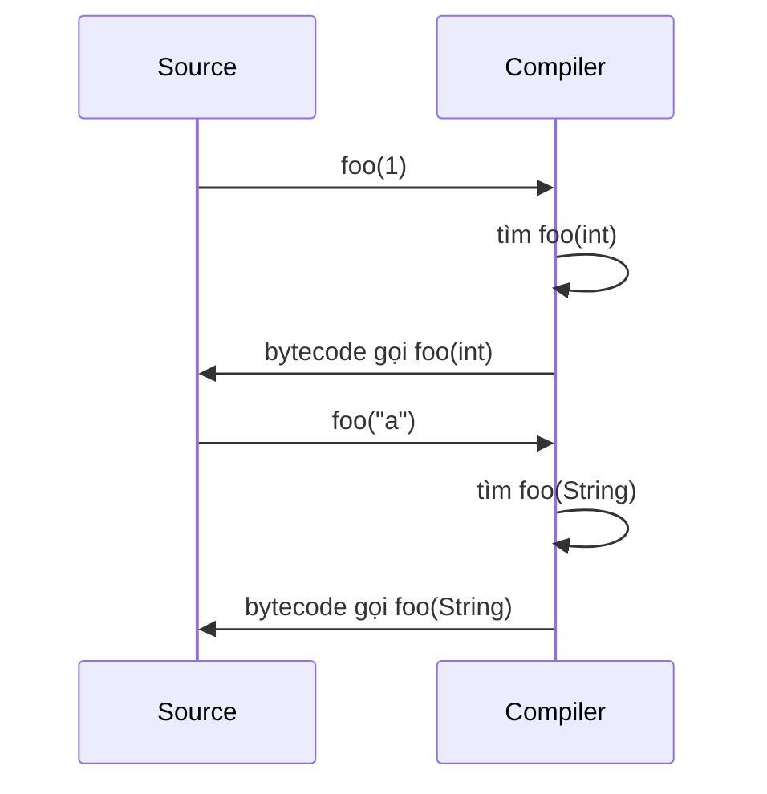

# What is polymorphism?

> Định nghĩa polymorphism (compile-time vs runtime) trong OOP, cách C++/JVM/C# implement dynamic dispatch qua vtable/itables/method table, overload resolution tại compile, LSP, downcast, và các failure mode thường gặp.

Chủ đề: OOP - Design Patterns · Ngày: 2026-10-16

## 0. Nền tảng trước khi đọc

**Bối cảnh:** Cách tổ chức code thành những đối tượng dễ thay đổi. Mục tiêu là giữ luật của nghiệp vụ rõ ràng và tránh code phụ thuộc chặt vào nhau.

**Nói đơn giản:** Polymorphism cho phép cùng một lời gọi method nhưng object thật có thể chọn cách thực hiện khác nhau.

**Từ khóa cần biết:** class = khuôn; object = instance cụ thể; method = hành vi mà object cung cấp.

**Ví dụ dễ hình dung:** Danh sách PaymentMethod có thể chứa CardPayment và BankTransfer; cùng gọi pay() nhưng mỗi object xử lý khác.

Khi đọc, luôn hỏi ba câu: nó giải quyết vấn đề gì, nó làm việc theo những bước nào, và khi nào không nên dùng?

**Cách học bài này:** Đọc phần này trước để nắm từ khóa; đọc phần 1 để lấy câu trả lời 30 giây; đọc phần 2 để hiểu cơ chế; cuối cùng mở từng câu hỏi ở phần 3 để luyện nói. Các con số và lệnh trong bài là bằng chứng cho câu trả lời, không cần học thuộc nếu chưa hiểu cơ chế.

## 1. Là gì

### Đọc nhanh trước khi đi sâu

**Ý chính:** Polymorphism cho phép cùng một lời gọi method nhưng object thật có thể chọn cách thực hiện khác nhau.

**Ví dụ interview:** Danh sách PaymentMethod có thể chứa CardPayment và BankTransfer; cùng gọi pay() nhưng mỗi object xử lý khác.

**Luồng 4 bước:**

1. Client gọi một contract dễ hiểu.
2. Object hoặc pattern chọn code thực hiện phía sau contract.
3. State và dependency được giữ ở nơi có trách nhiệm rõ ràng.
4. Khi requirement đổi, thay implementation mà giảm ảnh hưởng tới client.

**Nói như trong interview:** Polymorphism cho phép cùng một lời gọi method nhưng object thật có thể chọn cách thực hiện khác nhau. Hãy nói theo bốn bước trên trước; nếu interviewer hỏi sâu, chuyển sang cơ chế **Bước 1. Compile-time: overload resolution**, rồi nêu trade-off và failure mode ở các phần sau.

## 2. Cơ chế cốt lõi

### Bước 1. Compile-time: overload resolution



*Compile-time: compiler xem kiểu argument, chọn signature, bytecode đã resolved - không có dynamic dispatch.*

Java overload resolution theo 4 phase: exact match → widening primitive → boxing/unboxing → varargs. Phase nào có nhiều candidate → compile error "ambiguous". Java generics dùng type erasure: `List<String>` và `List<Integer>` tại runtime cùng `Class` (object giữ element, nhưng compiler không cho add sai kiểu). C++ template monomorphization sinh code riêng cho mỗi instantiation. C#/.NET reified generic giữ identity tại runtime cho reference type.

### Bước 2. Runtime: vtable và itable

Method tham gia dynamic dispatch nếu (a) Java: không `final`/`private`/`static`, hoặc (b) C++: khai báo `virtual`, hoặc (c) C#: base method `virtual`/`abstract`/`override` và derived method `override`. Compiler cấp class một vtable (C++), method table + itable (JVM), MethodTable (C#). Mỗi object giữ `vptr` ẩn trỏ tới vtable của class thật. Gọi `obj.method()`:

1. Tải `vptr` từ object header.
2. Tra vtable ở slot của method.
3. Nhảy tới function pointer.

JVM có hai cấu trúc: method table cho method trong class hierarchy, itable cho interface method. `invokeinterface` chạy itable; `invokevirtual` chạy method table. JIT trong HotSpot có thể devirtualize khi call site monomorphic (một class) hoặc `final` - chuyển thành direct call. Megamorphic call site (nhiều class) vẫn phải qua indirection.

### Bước 3. Field không có dynamic dispatch

Field không tham gia polymorphism. `Animal a = new Dog(); a.name;` đọc field `name` của kiểu khai báo, không phải subtype. Subtype có thể "hide" field bằng cách khai báo field cùng tên, nhưng đó là name hiding, không override. Best practice: đừng tạo field cùng tên ở base và derived.

### Bước 4. Default method (Java 8+) và multiple inheritance

Default method cho interface có thân method. Class implement có thể override hoặc dùng default. Nếu class implement hai interface cùng default method (diamond) - compile error bắt buộc override rõ ràng. JVM resolve qua itable; nếu không override, default method của interface được chọn theo "most specific".

### Bước 5. Downcast và kiểm tra kiểu

Khi reference kiểu cha giữ instance subtype, gọi method chỉ có ở subtype yêu cầu downcast. Compiler cho phép (compile-time hợp lệ) nhưng runtime có thể `ClassCastException`. An toàn:

- `instanceof` + cast (Java cũ).
- Pattern matching Java 16+: `if (animal instanceof Dog d) d.bark();` kiểm tra và bind luôn biến.
- C# `as`: `animal as Dog` trả null nếu fail, không throw.
- Multi-thread: đọc reference vào `final` local trước `instanceof` (tránh TOCTOU).

### Bước 6. Quan sát

```java
// Compile-time: overload resolution
static String fmt(int x)    { return "int:" + x; }
static String fmt(Object x) { return "obj:" + x; }
fmt(1);     // gọi fmt(int), exact match
fmt(null);  // compile error: ambiguous
```

```java
// Runtime dispatch
class Animal { String sound() { return "?"; } }
class Dog extends Animal { @Override String sound() { return "woof"; } }
Animal a = new Dog();
a.sound(); // "woof" - dynamic dispatch
```

```cpp
// C++ vtable - minh họa, chưa chạy
class Base { public: virtual void f() {} };
class Derived : public Base { public: void f() override {} };
Base* b = new Derived;
b->f();  // qua vtable -> Derived::f
```

(Các đoạn code chưa được chạy thử; chỉ minh họa cơ chế.)

### Ví dụ chạy từng bước

Kịch bản: payment pipeline xử lý 6 transaction, mỗi transaction qua một concrete `PaymentProcessor` khác nhau (Card ×2, Wallet ×2, Bank ×2). Mục tiêu: trace dynamic dispatch qua JVM itable, thấy overload resolution tại compile và subtype dispatch tại runtime trên cùng một call site.

Bước 1. Compile-time: source có 2 method `fee(int cents)` và `fee(BigDecimal amount)` cùng class. Compiler compile `fee(100)` (int literal) chọn `fee(int)` - exact match phase. Bytecode ghi `invokevirtual fee:(I)`. Không có indirection runtime - compile xong là xong.

Bước 2. Runtime: JVM load class `CardProcessor`, `WalletProcessor`, `BankProcessor`. Mỗi class có method table riêng cho method trong class hierarchy, itable riêng cho method từ interface `PaymentProcessor`. Object instance giữ object header chứa class pointer → itable.

Bước 3. Transaction #1 (Card, 100 USD). `processor.process(tx)` - `processor` reference kiểu `PaymentProcessor` (interface). JVM chạy `invokeinterface`, tra itable của concrete class (CardProcessor), slot cho method `process`, nhảy tới CardProcessor.process. Trả fee = 100 × 0.029 + 0.30 = 3.20.

Bước 4. Transaction #2 (Wallet, 50 USD). Call site CÙNG vị trí (`processor.process(tx)` trong loop) nhưng concrete class khác (WalletProcessor). JVM tra itable mới, nhảy tới WalletProcessor.process. Trả fee = 0.50. JIT ghi nhận 2 class tại call site - bắt đầu megamorphic.

Bước 5. Transaction #3-6 lần lượt Card → Wallet → Bank → Bank. Call site `processor.process` thấy 3 class khác nhau → JIT không devirtualize được (megamorphic > 2 type), vẫn qua indirection itable. 6 transaction, tổng gross 1925, tổng fee 18.45. (đã tính lại bằng script)

Trạng thái:
| Bước | Concrete class | Kiểu call site | Indirection | Fee |
|---|---|---|---|---|
| 1 (compile) | — | exact int match | 0ns (compile) | — |
| 2 | CardProcessor | monomorphic | itable ~3ns | 3.20 |
| 3 | WalletProcessor | bimorphic | itable ~3ns | 0.50 |
| 4-6 | Card+Wallet+Bank | megamorphic | itable ~3ns | tổng 18.45 |

Nếu `final` thêm vào method `process` ở `PaymentProcessor`: compiler devirtualize ngay tại compile - bytecode gọi trực tiếp concrete class, không qua itable. JIT có thể inline luôn. Trade-off: không thể override ở implementer, mất đa hình runtime. Ngược lại nếu `process` không `final` và quá nhiều class cùng call site, megamorphic penalty ngăn inline.

Điều rút ra: overload phân giải tại compile dựa trên kiểu khai báo argument (không phụ thuộc runtime), subtype dispatch phân giải tại runtime qua itable (vtable trong C++). Compiler tận dụng `final` để devirtualize; nếu không có `final` thì JIT xử lý. Câu 2 trong 3A hỏi "vtable in C++ work, why can't constructors be virtual" — cơ chế vtable này giải thích vì sao constructor không virtual được.

## 3. Câu hỏi phỏng vấn

### 3A. Câu hỏi đào sâu

<details class="qa">
<summary>Câu 1. What is the difference between compile-time polymorphism and runtime polymorphism?</summary>

**Trả lời ngắn:** Compile-time (overload, generics) compiler phân giải tại compile dựa trên kiểu argument; bytecode chứa cuộc gọi đã resolved - không có chi phí runtime. Runtime (subtype dispatch) gọi method qua reference kiểu cha nhưng resolve tại call site qua vtable/itables - có indirection (~1-2ns C++, ~2-5ns JVM).

**Đào sâu:**
- Compile-time: overload resolution Java theo 4 phase (exact → widening → boxing → varargs); generic có type erasure ở JVM nên `List<String>` và `List<Integer>` cùng `Class` tại runtime.
- Runtime: Java instance method mặc định virtual (trừ final/static/private); C++ method non-static mặc định non-virtual (cần `virtual`); C# cần `virtual` + `override`.
- Mix: `foo(Animal a)` có overload `foo(Dog d)` không virtual - overload resolution tại compile theo kiểu khai báo, không qua vtable.
- Overload chọn theo kiểu compile; override chọn theo kiểu runtime.

**Bẫy:** "Generic cho phép method subtype-specific của T." Sai - type erasure xoá T về Object; chỉ có thể cast thủ công với `instanceof`.

**Follow-up:** Tại sao `List<String>` và `List<Integer>` tại runtime cùng `Class`? Type erasure ở JVM - chọn lựa để tương thích với code pre-Java 5.
</details>

<details class="qa">
<summary>Câu 2. How does vtable in C++ work, and why can't constructors be virtual?</summary>

**Trả lời ngắn:** Compiler cấp class có virtual method một static vtable - mảng function pointer. Mỗi instance giữ `vptr` ẩn trỏ tới vtable của class. Gọi `obj.virtual()` qua base pointer: tải vptr, tra slot, nhảy. Constructor không virtual vì object chưa hình thành - vtable của subclass chưa được gán trong base constructor.

**Đào sâu:**
- Multiple inheritance: object có thể có nhiều vptr (mỗi base một); pointer adjustment khi upcast giữa các base khác nhau.
- Virtual destructor cần khi delete qua base pointer; nếu không virtual → chỉ destructor Base chạy, leak derived state.
- Trong constructor, virtual call dispatch theo vtable của class hiện tại chứ không phải class đang khởi tạo (Scott Meyers kinh điển).
- `final` (C++11) ở derived chặn override tiếp, cho compiler devirtualize.
- Pure virtual (`= 0`) có slot trong vtable, trỏ tới `__cxa_pure_virtual` stub in lỗi.

**Bẫy:** "Constructor có thể khai báo virtual." Sai - đa số compiler cảnh báo/error; vả lại vô nghĩa vì cần object trước khi gọi.

**Follow-up:** Object slicing ảnh hưởng vtable thế nào? Slice Derived by value thành Base → vtable "xuống cấp" về Base. Fix: dùng reference/pointer.
</details>

<details class="qa">
<summary>Câu 3. How does JVM implement dynamic dispatch? How do itables differ from method tables?</summary>

**Trả lời ngắn:** JVM có hai cấu trúc. Method table cho method trong class hierarchy; itable cho interface method. Mỗi class có một method table; cho mỗi interface implement có một itable chứa offset method trong interface, chỉ vào concrete method trong method table.

**Đào sâu:**
- `invokeinterface` xài itable; `invokevirtual` xài method table; `invokestatic` static; `invokespecial` super call.
- HotSpot inlines monomorphic call site (một class thực tế) hoặc final class → devirtualize, không qua indirection.
- Megamorphic call site (nhiều class) indirection vẫn còn, không inlining được.
- Final method cho compiler devirtualize tại compile (không thể override).
- Default method (Java 8+): class implement có thể override hoặc dùng default; itable trỏ tới default method trong interface nếu class không override.

**Bẫy:** "Interface method luôn virtual." Đúng - đó là điểm khác với class method non-virtual. Nhưng từ Java 8 field và static method không virtual trong interface.

**Follow-up:** Interface static method (Java 8+) có tham gia dynamic dispatch không? Không - static gắn với interface, không với instance.
</details>

<details class="qa">
<summary>Câu 4. What is the relationship between LSP and runtime polymorphism?</summary>

**Trả lời ngắn:** LSP yêu cầu subtype thay thế được base mà không phá tính đúng đắn. Trong runtime polymorphism, đây là điều kiện để dynamic dispatch an toàn - code viết theo base type vẫn chạy đúng khi instance là subtype.

**Đào sâu:**
- Precondition của subtype method không được mạnh hơn base; postcondition không được yếu hơn.
- Ví dụ vi phạm: Square extends Rectangle - `setWidth` của Square phải giữ width=height, phá invariant.
- Dynamic dispatch trả kết quả hoặc side effect không như code assume → bug chỉ xuất hiện ở concrete subtype, khó reproduce.
- Công cụ: design by contract, property-based test.
- Composition ép kiểu tại compile, ít nguy cơ silent override. Xem [inheritance-and-composition](inheritance-and-composition.md).

**Bẫy:** "Override method rồi là tuân LSP." Sai về semantic - phải kiểm contract.

**Follow-up:** Sealed class (Java 17, C#) có giảm rủi ro không? Có - chỉ subtype trong cùng file/module, dễ audit.
</details>

<details class="qa">
<summary>Câu 5 (Debug). Test pass trên base class nhưng fail ở production với concrete subtype. Phân tích và fix?</summary>

**Trả lời ngắn:** Khả năng cao vi phạm LSP - subtype có side effect hoặc postcondition khác base. Dynamic dispatch chọn method của subtype nhưng code base assume hành vi của base.

**Đào sâu:**
- Bước 1: Lấy concrete class từ log/dump; đọc method override xem side effect khác gì base.
- Bước 2: Reproduce bằng unit test gọi trực tiếp subtype; nếu pass → bug ở interaction.
- Bước 3: Contract test (jqwik, Java) mô tả pre/post condition; chạy với subtype; tìm violation.
- Bước 4: Log method call + argument + return + counter; chạy lại test; so sánh với base.
- Bước 5: Nếu subtype cố ý "vi phạm" (stub, mock), đánh dấu rõ trong code, comment contract.
- Bước 6: Kiểm tra `final`/`sealed` ở base; nếu base cho phép override thì base chấp nhận rủi ro.

**Bẫy:** "DI chọn subtype ngẫu nhiên là test bug." Sai - DI chọn subtype là đúng; bug nằm ở thiết kế subtype.

**Follow-up:** Sealed class giảm rủi ro ở production không? Có - compile biết tập subtype, dễ audit.
</details>

<details class="qa">
<summary>Câu 6. How do you downcast safely and how does Java 16+ pattern matching change the picture?</summary>

**Trả lời ngắn:** An toàn: kiểm `instanceof` rồi cast; C# `as` trả null; Java 16+ pattern matching `if (animal instanceof Dog d)` kiểm và bind luôn biến.

**Đào sâu:**
- Downcast tuỳ tiện dễ `ClassCastException`, khó debug ở production với subtype hiếm gặp.
- Visitor pattern: `accept(visitor)` ở mỗi subtype → `visit(this)` ở visitor (double dispatch). Java không có multiple dispatch native.
- Match expression Java 21: `switch(animal) { case Dog d -> ...; case Cat c -> ...; }` cú pháp exhaustive.
- Multi-thread: đọc reference vào `final` local trước `instanceof` (TOCTOU).
- C# pattern matching `is` không cần cast.

**Bẫy:** "`instanceof` rồi cast là safe multi-thread." Sai nếu đọc field trực tiếp - đọc vào local final trước.

**Follow-up:** Visitor vs pattern matching: pattern matching scale tốt hơn khi số subtype tăng.
</details>

<details class="qa">
<summary>Câu 7. How do default methods and multiple inheritance work in Java 8+?</summary>

**Trả lời ngắn:** Default method cho interface có thân method. Class implement có thể override hoặc dùng default. Multiple inheritance qua interface cho phép class implement nhiều interface và gộp default method; diamond problem buộc override rõ ràng.

**Đào sâu:**
- Diamond: `class C implements I1, I2`. Nếu `I1` và `I2` cùng default method `m`, compile error "C inherits unrelated defaults". C phải override `m`.
- Nếu `I1 extends I2` và cả hai có `m`, dùng `I1.m` (most specific).
- itable resolve chọn method theo "most specific" rule.
- Java không cho `super.m()` gọi default method của interface cụ thể; phải override và gọi qua class cha.
- Trait (Rust) cho phép `impl Trait for Type` riêng - linh hoạt hơn vì không cần class implement từ đầu.

**Bẫy:** "Diamond conflict chỉ Java phát hiện." C++ cũng phát hiện ambiguous base; nhưng C++ cho phép chỉ định `Base::m()` rõ ràng.

**Follow-up:** Tại sao Java không cho `super.m()` gọi default của interface? Vì multiple inheritance ambiguity - chỉ default method của `Object` (`toString`...) mặc định có thể gọi qua super.
</details>

<details class="qa">
<summary>Câu 8 (Thiết kế). Thiết kế plugin system cho phép module bên thứ ba đăng ký handler tại runtime. Cơ chế polymorphism nào phù hợp?</summary>

**Trả lời ngắn:** Interface + SPI hoặc DI. Interface khai báo contract (`Handler.process(Event)`); plugin implement interface và đăng ký qua ServiceLoader (Java), MEF (C#), hoặc DI container (Spring, Guice). Core gọi qua reference interface - dynamic dispatch chọn implementation plugin.

**Đào sâu:**
- **Yêu cầu**: plugin load runtime, không link tĩnh; cần versioning, isolation.
- **Quyết định chính**: ServiceLoader đơn giản cho MVP; OSGi cho isolation mạnh; DI container khi có sẵn Spring/Guice.
- **Điểm nghẽn**: indirection qua interface; hot path microsecond, JIT devirtualize nếu profile thấy cùng class. Megamorphic → indirection còn.
- **Versioning**: plugin có thể cần Java module (JPMS) hoặc C# namespace; classloader riêng.
- **Fail-safe**: plugin throw exception - catch ở dispatch wrapper, log, tiếp tục plugin khác.
- **Test**: contract test ở interface đảm bảo tuân LSP.

**Bẫy:** "Downcast từ Object sang concrete plugin class mỗi lần gọi." Lãng phí và unsafe; để dynamic dispatch qua interface.

**Follow-up:** Reflection (`Method.invoke`) cho plugin system có hiệu quả không? Chậm (10-100x direct call); benchmark trước khi dùng ở hot path.
</details>

### 3B. Câu hỏi phỏng vấn liên quan

<details class="qa">
<summary>Câu 9. What is the difference between parametric and ad-hoc polymorphism?</summary>

**Trả lời:** Ad-hoc (overload): nhiều method cùng tên, chữ ký khác; compiler chọn theo kiểu argument. Parametric (generics/template): một thân method cho nhiều kiểu; type parameter là biến. Java: type erasure. C#/.NET: reified (giữ identity cho reference type). C++: monomorphization tại compile.
</details>

<details class="qa">
<summary>Câu 10. Why don't static methods participate in dynamic dispatch?</summary>

**Trả lời:** Static method gắn với class, không với instance. Compiler resolve tại compile; không tải vtable. Trong Java, `Derived.method()` (hide base) chọn theo kiểu khai báo reference, không phải kiểu thực tế của object. C# cho phép cùng tên static method ở derived, gọi qua derived type chạy derived; qua base chạy base.
</details>

<details class="qa">
<summary>Câu 11. True or false: "Field overriding creates a separate field on the subtype accessible via subtype reference."</summary>

**Trả lời:** Nghe đúng nhưng sai về "overriding". Field không override, chỉ hide. `d.field` (subtype reference) truy cập field subtype; `((Animal)d).field` (base reference) truy cập field base. Name hiding, không qua vtable. Best practice: đừng tạo field cùng tên ở base và derived vì confuse.
</details>

<details class="qa">
<summary>Câu 12. Why does C# keep generic identity at runtime while Java erases it?</summary>

**Trả lời:** C#/.NET reified generic: JIT sinh code riêng cho mỗi instantiation (share cho reference type, monomorphization cho value type). Java type erasure để tương thích ngược với code pre-Java 5 và vì JVM không thiết kế cho generic ban đầu; tradeoff: `List<String>` cùng `List<Integer>` tại runtime. C++ template monomorphization tại compile, sinh code riêng cho mỗi type argument.
</details>

<details class="qa">
<summary>Câu 13. Can a virtual method be called from a constructor in Java?</summary>

**Trả lời:** Được gọi, nhưng không an toàn. Subclass constructor chaining gọi base constructor; nếu base constructor gọi overridable method, method chạy với field của subclass ở giá trị default (null/0). Bug chỉ xuất hiện ở concrete subclass. Best practice: đừng gọi overridable method trong constructor (Effective Java item 19).
</details>

<details class="qa">
<summary>Câu 14. How does C# `new` differ from `override`?</summary>

**Trả lời:** `override` tham gia vtable: gọi qua base reference vẫn chạy method derived. `new` hide: gọi qua base reference chạy method base. `new` dùng khi hai API không liên quan che nhau mà không muốn virtual; thường dùng `override`.
</details>

<details class="qa">
<summary>Câu 15. What is multiple dispatch and why doesn't Java support it natively?</summary>

**Trả lời:** Multiple dispatch chọn method dựa trên runtime type của cả hai tham số, không chỉ receiver. Ví dụ: `collide(Spaceship, Asteroid)` vs `collide(Asteroid, Asteroid)`. Java chỉ có single dispatch (chọn theo runtime type của receiver). Mô phỏng qua visitor pattern. Ngôn ngữ có multiple dispatch native: Common Lisp, Julia, Clojure, C++ (overload resolution + virtual).
</details>

<details class="qa">
<summary>Câu 16. How does sealed class (Java 17, C#) affect polymorphism?</summary>

**Trả lời:** Sealed chỉ cho phép subtype trong cùng file (Java `permits`) hoặc assembly (C# `sealed`). Compiler biết tập subtype hữu hạn - switch exhaustive; JIT devirtualize tốt hơn. Tradeoff: khó plugin runtime.
</details>

<details class="qa">
<summary>Câu 17. What is object slicing and how does it break polymorphism in C++?</summary>

**Trả lời:** Slice: chuyển Derived by value vào Base. Vtable "xuống cấp" về Base; method qua reference chạy method Base. Fix: luôn dùng reference/pointer cho polymorphic object. Phát hiện bằng `-Wclass-memaccess`.
</details>

<details class="qa">
<summary>Câu 18. What is covariance and contravariance in method override?</summary>

**Trả lời:** Override giữ signature giống hệt, hoặc covariant return (Animal.clone() ở base, Dog.clone() ở derived) - Java cho phép từ Java 5. Argument contravariance không khả dụng trong Java/C# (khác Kotlin, Scala cho phép). Phỏng vấn hỏi vì liên quan LSP - subtype input/output range phải không gây surprise.
</details>

## 4. Đánh đổi và sự cố production

### So sánh ba cơ chế polymorphism

| Tiêu chí | Compile-time (overload, generics) | Runtime subtype (vtable) | Runtime interface (itables) |
|---|---|---|---|
| Chi phí dispatch | 0 (compile xong) | 1-2ns C++, JIT devirtualize nếu monomorphic | 2-5ns JVM |
| Type identity tại runtime | Java: mất (erasure); C#: giữ; C++: riêng | Giữ | Giữ |
| Mở rộng runtime | Không (overload cố định) | Có (thêm subclass) | Có (thêm implementation) |
| Khả năng LSP violation | Thấp | Cao | Cao |
| Refactor an toàn | Cao | Trung bình | Trung bình |
| Công cụ tối ưu compiler | Constant folding | Devirtualize, inlining | Devirtualize, inlining |

### Năm failure mode

| Triệu chứng | Nguyên nhân gốc | Cách kiểm tra | Cách sửa |
|---|---|---|---|
| Test pass ở base, fail ở production subtype | Subtype vi phạm LSP (side effect, postcondition) | Contract test, log reproduction | Sửa subtype; tách API riêng cho subtype đó |
| `ClassCastException` ở production | Downcast không kèm `instanceof` | Stack trace, tìm nơi cast | Pattern matching Java 16+; `as` (C#) |
| Megamorphic call site chậm | Quá nhiều subtype implement cùng method ở hot path | JIT log `-XX:+PrintCompilation` | Visitor pattern; sealed class; tách call site |
| Generic warning "unchecked" | Java type erasure ép cast ngầm | `javac -Xlint:unchecked` | Bounded type parameter; CI bật warning thành error |
| Override bị "che" do `new` (C#) | C# subclass dùng `new` không `override` | Roslyn analyzer | Thay `new` bằng `override`; review PR |

## 5. Cheat sheet

| Chủ đề | Con số / quy tắc cần nhớ |
|---|---|
| 2 dạng polymorphism | Compile-time (overload, generics); Runtime (subtype, dynamic dispatch) |
| Overload resolution Java | 4 phase: exact → widening → boxing → varargs |
| Generic Java | Type erasure; `List<String>` cùng `List<Integer>` ở runtime |
| Dispatch C++ | vptr trỏ vtable (mỗi class một vtable) |
| Dispatch JVM | invokevirtual + method table; invokeinterface + itables |
| Dispatch C# | `virtual` + `override`; `new` là hide không virtual |
| Static method | Không tham gia dynamic dispatch |
| Field | Không override, chỉ hide theo tên |
| Final/sealed | Compiler devirtualize; giảm indirection |

**Học tiếp:**
- [inheritance-and-composition](inheritance-and-composition.md) - khi nào dùng kế thừa, khi nào composition
- [interface-vs-abstract-class](interface-vs-abstract-class.md) - chọn interface hay abstract class
- [observer-pattern](observer-pattern.md) - polymorphism runtime qua observer
- [strategy-pattern](strategy-pattern.md) - encapsulate behavior thay đổi runtime

**Lỗi thường gặp khi trả lời:** (1) Nhầm overload với override. (2) Nghĩ generic Java runtime có riêng Class cho mỗi instantiation. (3) Quên static method không virtual. (4) Nghĩ field override được. (5) Nghĩ dynamic dispatch miễn phí - indirection vẫn có chi phí.
