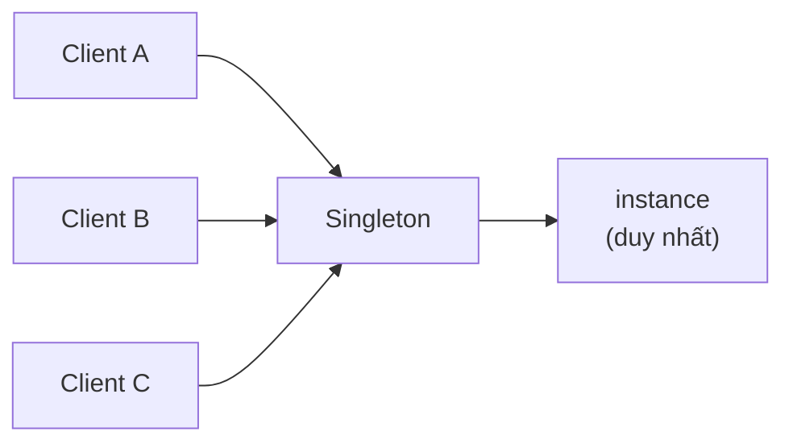
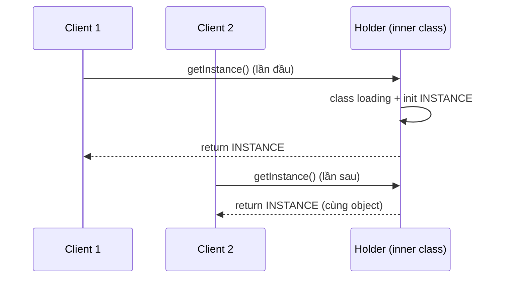

# What is the singleton design pattern?

> Singleton đảm bảo một class chỉ có đúng một instance trong toàn JVM/process và cung cấp một global access point, dùng cho các thành phần shared state như logger, config loader, cache manager.

Chủ đề: OOP - Design Patterns · Ngày: 2026-10-16

## 1. Là gì

Singleton là pattern creational đảm bảo class chỉ có duy nhất một instance và cung cấp một điểm truy cập toàn cục (global access point). Pattern giải quyết các tình huống cần shared state (logger, configuration, cache, thread pool) hoặc đối tượng tốn kém để khởi tạo (kết nối database, file system handle). Singleton thuộc nhóm creational trong GoF, nhưng cũng được xem là pattern "controversial" vì khó test và ẩn coupling toàn cục.

Trong thực tế, singleton có nhiều biến thể: eager init (tạo instance khi class load), lazy init (tạo khi cần), thread-safe (synchronized, double-checked locking, Bill Pughclass, enum). Mỗi biến thể có trade-off về thread safety, lazy init, performance, và serialization.



*Sơ đồ vị trí: nhiều client truy cập cùng một Singleton instance. Instance được khởi tạo một lần và tái sử dụng. Singleton giữ static reference tới instance duy nhất.*

### Trả lời 30 giây

"Singleton đảm bảo một class chỉ có một instance và cung cấp global access point. Cách implement phổ biến trong Java: enum singleton (Joshua Bloch khuyến nghị — thread-safe, serialization-safe, reflection-safe), hoặc Bill Pugh singleton (inner static class holder — lazy + thread-safe không cần synchronized). Trong Python dùng module-level variable; trong JS/TS không có class singleton chuẩn nhưng có thể dùng module cache hoặc global object. Nhược điểm chính: khó test (global state không thể reset), ẩn coupling toàn cục (thay đổi singleton ảnh hưởng mọi client), vi phạm Single Responsibility. Anti-pattern: dùng singleton cho mọi thứ chỉ vì 'dễ truy cập'. Thay thế hiện đại: DI container với scope singleton (Spring `@Service`), giữ testability."

## 2. Cơ chế cốt lõi

### Bước 1. Eager Initialization

Khởi tạo instance ngay khi class được load. Đơn giản nhất nhưng luôn tạo dù có dùng hay không.

```java
public class EagerSingleton {
    private static final EagerSingleton INSTANCE = new EagerSingleton();
    private EagerSingleton() {}
    public static EagerSingleton getInstance() { return INSTANCE; }
}
```

- Ưu: thread-safe (JVM đảm bảo static init atomic), đơn giản.
- Nhược: lãng phí nếu không dùng; có thể tạo trước cả khi class sử dụng.

### Bước 2. Lazy Initialization (không thread-safe)

Chỉ tạo khi `getInstance()` được gọi lần đầu. Nguy hiểm trong multi-thread.

```java
public class LazySingleton {
    private static LazySingleton instance;
    private LazySingleton() {}
    public static LazySingleton getInstance() {
        if (instance == null) instance = new LazySingleton();
        return instance;
    }
}
```

- Race condition: hai thread gọi đồng thời có thể tạo hai instance. KHÔNG dùng trong production.

### Bước 3. Thread-safe với synchronized

```java
public synchronized static LazySingleton getInstance() { ... }
```

- Ưu: an toàn.
- Nhược: synchronized trên mỗi lần gọi → overhead lớn (chỉ cần synchronization lần đầu).

### Bước 4. Double-Checked Locking (DCL)

```java
public static LazySingleton getInstance() {
    if (instance == null) {
        synchronized (LazySingleton.class) {
            if (instance == null) {
                instance = new LazySingleton();
            }
        }
    }
    return instance;
}
```

- Ưu: synchronized chỉ lần đầu, sau đó read không lock.
- Nhược: cần `volatile` cho `instance` (Java 5+ memory model). Phức tạp, dễ sai.

### Bước 5. Bill Pugh Singleton (khuyến nghị)

```java
public class BillPughSingleton {
    private BillPughSingleton() {}
    private static class Holder {
        private static final BillPughSingleton INSTANCE = new BillPughSingleton();
    }
    public static BillPughSingleton getInstance() { return Holder.INSTANCE; }
}
```

- Inner class Holder chỉ load khi `getInstance()` được gọi → lazy init.
- JVM đảm bảo static init của inner class thread-safe.
- Không cần `synchronized`, không cần `volatile`. Đơn giản, hiệu quả.

### Bước 6. Enum Singleton (Joshua Bloch khuyến nghị)

```java
public enum EnumSingleton {
    INSTANCE;
    public void doWork() { ... }
}
// sử dụng: EnumSingleton.INSTANCE.doWork();
```

- Ưu: thread-safe, serialization-safe, reflection-safe (JVM đảm bảo enum không thể bị reflect khởi tạo lại), chống multiple instance khi deserialize.
- Nhược: không thể extend class khác (enum không thể extend), có thể không linh hoạt bằng class thường cho một số use case.

### Bước 7. Sơ đồ cơ chế Bill Pugh



*Sơ đồ cơ chế: lần đầu gọi getInstance() kích hoạt JVM load inner class Holder, khởi tạo INSTANCE. Mọi lần sau trả về cùng instance mà không synchronize. JVM đảm bảo static init atomic.*

### Bước 8. Quan sát

```java
// Spring: @Service = singleton scope
@Service
public class UserService { /* ... */ }

// Python: module-level variable
class _SingletonHolder:
    pass
def get_logger():
    global _logger
    if not hasattr(_SingletonHolder, 'logger'):
        _SingletonHolder.logger = logging.getLogger("app")
    return _SingletonHolder.logger

// JavaScript: module pattern
let instance = null;
class Logger {
    constructor() { if (!instance) instance = this; return instance; }
}
```

### Bước 9. So sánh lazy vs eager init

- **Lazy init**: chỉ tạo instance khi cần → tiết kiệm thời gian khởi động và memory nếu class không phải lúc nào cũng dùng. Đặc biệt hữu ích nếu constructor tốn kém (đọc file lớn, kết nối DB).
- **Eager init**: tạo ngay khi class load → đơn giản, không cần synchronization. Phù hợp khi class chắc chắn được dùng (logger, config) hoặc eager init không tốn kém.
- Bill Pugh: lazy init "miễn phí" — class Holder chỉ load khi `getInstance()` được gọi, đảm bảo lazy + thread-safe.
- Anti-pattern: lazy init cho class đơn giản (chỉ có vài field primitive). Eager init cho class tốn kém nhưng luôn dùng.

### Bước 10. Phá vỡ Singleton và cách phòng

- **Reflection**: gọi `Constructor.setAccessible(true).newInstance()`. Enum JVM chặn. Class thường guard trong constructor.
- **Serialization**: `ObjectInputStream.readObject()` tạo instance mới. Enum an toàn. Class thường implement `readResolve()` trả về instance duy nhất.
- **Cloning**: nếu class implement `Cloneable`, `clone()` có thể tạo instance mới. Ghi đè `clone()` throw `CloneNotSupportedException`.
- **Multi-classloader**: mỗi classloader load class riêng → nhiều instance. Trong container, dùng singleton per context.
- **Deserialization via JSON**: nếu deserialize qua Jackson/Gson từ JSON, framework tạo instance mới (không qua constructor). Đảm bảo singleton không qua constructor mà qua getInstance(), hoặc dùng enum.

### Bước 11. Singleton trong distributed system

- GoF Singleton chỉ đảm bảo một instance trong một JVM. Trong cluster, mỗi JVM là process riêng, có thể tạo singleton riêng.
- Đảm bảo "một instance toàn cluster": distributed lock (ZooKeeper, Redis SETNX), leader election (Raft, Paxos), hoặc shared state bên ngoài (database, cache).
- Ví dụ: distributed cron job cần chạy trên đúng một node → leader election. Nếu không, N node cùng chạy → duplicate job.
- Cache singleton: mỗi JVM có cache riêng. Dùng shared cache (Redis, memcached) hoặc invalidation protocol giữa JVM.
- Trade-off: distributed coordination tốn latency và có thể có split-brain. Singleton cục bộ đơn giản hơn nhiều nếu state không cần đồng nhất tuyệt đối.

### Ví dụ chạy từng bước

Kịch bản: `AppConfig` Singleton dùng Bill Pugh pattern để đọc file `app.properties` (3 keys: db.url, db.pool.size, feature.flag). Mục tiêu: đảm bảo chỉ một instance, lazy init, thread-safe.

**Trạng thái ban đầu:** `AppConfig.class` đã được JVM load, nhưng inner class `Holder` chưa được load. `AppConfig.class` chưa có instance.

**Bước 1 — Lần đầu gọi `AppConfig.getInstance()` từ Main thread:**
- JVM trigger load class `Holder` (inner static class).
- JVM chạy static init: `Holder.INSTANCE = new AppConfig()`.
- Constructor AppConfig: đọc file `app.properties`, set fields: `dbUrl="jdbc:postgres://prod/db"`, `poolSize=20`, `featureFlag=true`.
- Trả về `Holder.INSTANCE`.

| Field | Trạng thái sau Bước 1 |
|---|---|
| AppConfig.INSTANCE | = Holder.INSTANCE (đã tạo) |
| dbUrl | "jdbc:postgres://prod/db" |
| poolSize | 20 |
| featureFlag | true |

Vì sao thread-safe: JVM đảm bảo static init của class atomic. Nếu thread B gọi `getInstance()` cùng lúc, JVM serialize static init của Holder.

**Bước 2 — Thread B (worker thread) gọi `AppConfig.getInstance()`:**
- JVM thấy class Holder đã được load → không init lại.
- Trả về cùng reference `Holder.INSTANCE`.
- `dbUrl == "jdbc:postgres://prod/db"` (cùng giá trị).

| Field | Trạng thái sau Bước 2 |
|---|---|
| Thread B nhận | cùng instance với Thread A |
| poolSize | 20 (chia sẻ giữa 2 thread) |

Vì sao: instance duy nhất đã được tạo ở Bước 1. Mọi lần gọi `getInstance()` sau đều trả về cùng reference. Overhead = O(1), không synchronize.

**Bước 3 — Test muốn reset singleton để test config khác:**
- Gọi `AppConfig.getInstance()` → vẫn trả về instance cũ, không reset được.
- Test phải dùng `resetForTest()` package-private method (nếu có) hoặc dùng DI container với `@MockBean AppConfig`.

**Biến thể — Nếu reflection gọi private constructor:**
- `Constructor<AppConfig> c = AppConfig.class.getDeclaredConstructor();`
- `c.setAccessible(true); c.newInstance();`
- Bill Pugh KHÔNG có guard trong constructor → tạo instance thứ hai → phá singleton.
- Enum Singleton: JVM ném `Cannot reflectively create enum objects` → an toàn.
- Fix cho Bill Pugh: thêm check `if (Holder.INSTANCE != null) throw new IllegalStateException();` trong constructor.

**Biến thể — Cluster 3 JVM, mỗi JVM một singleton riêng:**
- JVM-1, JVM-2, JVM-3 mỗi cái tạo AppConfig riêng → 3 instance "singleton" khác nhau.
- Mỗi JVM đọc file `app.properties` riêng → nếu config khác nhau giữa các JVM → bug runtime.
- Fix: load config từ config server (Spring Cloud Config) để đồng nhất.

Điều rút ra: Singleton GoF chỉ đảm bảo một instance trong một JVM, dùng Bill Pugh hoặc Enum để có lazy + thread-safe. Cơ chế này chứng minh câu "Enum Singleton an toàn hơn Bill Pugh" — vì Enum được JVM bảo vệ khỏi reflection attack, còn Bill Pugh cần tự guard.

## 3. Câu hỏi phỏng vấn

### 3A. Câu hỏi đào sâu

<details class="qa">
<summary>Câu 1. Tại sao Singleton thường được xem là anti-pattern?</summary>

**Trả lời ngắn:** Vì ẩn global state, vi phạm Single Responsibility Principle, khó test, và tạo coupling ngầm. Mọi client phụ thuộc singleton đều khó thay thế hoặc reset trong test.

**Đào sâu:**
- Global state: singleton là biến toàn cục. Hai test chạy đồng thời hoặc tuần tự có thể ảnh hưởng nhau qua state của singleton.
- Vi phạm SRP: class vừa quản lý logic nghiệp vụ, vừa quản lý lifecycle (đảm bảo một instance). Hai trách nhiệm.
- Khó test: không thể inject mock singleton vào client mà không dùng PowerMock hoặc thay đổi code.
- Coupling ngầm: code không có tham số singleton vẫn dùng nó (qua static reference) → dependency bị ẩn.
- DI container với singleton scope giải quyết phần lớn vấn đề: vẫn một instance, nhưng có thể inject mock trong test.

**Bẫy:** "Singleton luôn xấu." Không — dùng hợp lý cho stateless service (logger, config loader). Vấn đề là dùng cho stateful object phức tạp.

**Follow-up:** Làm sao reset singleton trong test? Tạo method `resetForTest()` package-private, hoặc dùng DI với scope test (Spring `@DirtiesContext`).
</details>

<details class="qa">
<summary>Câu 2. Enum Singleton và Bill Pugh Singleton khác nhau thế nào? Khi nào chọn cái nào?</summary>

**Trả lời ngắn:** Enum Singleton dùng enum, JVM đảm bảo duy nhất một instance và chống reflection/serialization attack. Bill Pugh dùng inner static class holder, JVM đảm bảo thread-safe static init, nhưng cần tự bảo vệ chống reflection và serialization.

**Đào sâu:**
- Enum Singleton: `enum E { INSTANCE; ... }`. JVM đảm bảo chỉ một instance. Reflection không thể gọi constructor enum (ném exception). Serialization đảm bảo cùng instance sau deserialize.
- Bill Pugh: inner static class Holder chỉ load khi `getInstance()`. JVM đảm bảo static init thread-safe. Nhưng reflection có thể gọi private constructor → cần guard bằng check `instance == null`.
- Enum không thể extend class khác, có thể là ràng buộc nếu class cần kế thừa.
- Bill Pugh cho phép tự do thiết kế hơn (implements interface, generic type), nhưng dài hơn.
- Joshua Bloch (Effective Java) ưu tiên Enum Singleton vì đơn giản và an toàn nhất.

**Bẫy:** "Enum Singleton không phải singleton theo nghĩa đen." Sai — JVM đảm bảo một instance duy nhất, đó là singleton.

**Follow-up:** Enum Singleton có thể lazy init không? Không — enum load khi class được reference, instance tạo ngay. Nếu cần lazy, dùng Bill Pugh.
</details>

<details class="qa">
<summary>Câu 3. Singleton có đảm bảo thread safety không? Cách đảm bảo?</summary>

**Trả lời ngắn:** Phụ thuộc cách implement. Eager init, Bill Pugh, Enum đều thread-safe nhờ JVM đảm bảo static init atomic. Lazy init đơn giản KHÔNG thread-safe; cần `synchronized`, double-checked locking với `volatile`, hoặc Bill Pugh.

**Đào sâu:**
- Eager init: thread-safe (static final init trong class loading).
- Bill Pugh: thread-safe (JVM class loading của inner static class atomic).
- Enum: thread-safe (JVM enum init đặc biệt).
- Lazy init đơn giản: KHÔNG an toàn. Hai thread race → hai instance.
- DCL với `volatile`: an toàn trong Java 5+; `volatile` đảm bảo visibility.
- Synchronized method: an toàn nhưng chậm.
- Cảnh báo: ngay cả khi instance creation thread-safe, method bên trong singleton vẫn cần thread-safe nếu có shared mutable state.

**Bẫy:** "Singleton = thread-safe." Sai — chỉ creation thread-safe. Nếu singleton có mutable state, method phải tự synchronize.

**Follow-up:** Nếu singleton phải thread-safe cho cả method, dùng cơ chế nào? `synchronized` method, `ReentrantLock`, hoặc thiết kế stateless (logger chỉ forward, không lưu state).
</details>

<details class="qa">
<summary>Câu 4 (Debug). App trong cluster chạy 3 instance (3 JVM). Mỗi JVM có singleton riêng. Tính năng "đảm bảo một instance" bị phá vỡ. Phân tích.</summary>

**Trả lời ngắn:** Singleton GoF chỉ đảm bảo một instance trong một JVM/classloader. Trong cluster/distributed system, mỗi JVM có classloader riêng và có thể tạo singleton riêng. Đây là "distributed singleton" — không tồn tại theo nghĩa GoF.

**Đào sâu:**
- Bước 1: Xác nhận singleton trong từng JVM/process — đúng. Trong cluster, mỗi JVM là một process độc lập, mỗi cái có classloader riêng → mỗi cái tạo singleton riêng.
- Bước 2: Nếu cần "một instance toàn cluster", phải dùng distributed lock (ZooKeeper, Redis SETNX, etcd) hoặc chọn leader (Raft, Paxos).
- Bước 3: Hoặc chấp nhận multi-instance và dùng shared state bên ngoài (database, Redis cache). Mỗi JVM có singleton cục bộ nhưng state chia sẻ qua database.
- Bước 4: Ví dụ: cache singleton trong 3 JVM. Mỗi JVM có cache riêng → cache không đồng nhất. Giải pháp: Redis hoặc memcached làm shared cache.
- Bước 5: Logger singleton trong 3 JVM — vẫn OK vì logger ghi ra file/network. Mỗi JVM có logger riêng, output tổng hợp ở aggregator.

**Bẫy:** "Singleton = distributed singleton." Sai — GoF singleton chỉ trong một JVM. Distributed consistency là vấn đề khác (CAP theorem).

**Follow-up:** Singleton cho connection pool database — mỗi JVM có connection pool riêng. Có ảnh hưởng gì? Tổng connection count = pool_size × số JVM. Quản lý pool size để không vượt DB max connection.
</details>

<details class="qa">
<summary>Câu 5 (Thiết kế). Hệ thống cần config loader đọc file config một lần, cache trong memory, cho phép mọi service truy cập. Thiết kế singleton hay không?</summary>

**Trả lời ngắn:** Dùng DI container với scope singleton. Bean `ConfigLoader` được Spring/Guice tạo một lần, inject vào mọi service. Trong test, có thể inject `MockConfigLoader`. Đây là cách hiện đại, thay thế singleton thủ công.

**Đào sâu:**
- **Yêu cầu**: đọc config một lần, cache, truy cập global.
- **Quyết định chính**: Spring `@Service` hoặc `@Component` (mặc định singleton scope) cho `ConfigLoader`. Inject qua constructor vào service cần dùng.
- **Test**: `@MockBean ConfigLoader` cho unit test. Service nhận mock qua constructor injection.
- **Hot reload**: nếu cần reload config mà không restart, dùng `@RefreshScope` (Spring Cloud) hoặc watch file system và invalidate cache.
- **Cluster**: nếu có 3 JVM, mỗi JVM có ConfigLoader riêng. Config có thể load từ config server (Spring Cloud Config, Consul) để đồng nhất.
- **Singleton thủ công**: chỉ dùng khi không có DI container (thư viện, script, code base cũ).

**Bẫy:** "Singleton thủ công cho mọi service shared." Sai — DI container với singleton scope đã giải quyết. Singleton thủ công chỉ dùng khi thật cần thiết.

**Follow-up:** ConfigLoader có cần thread-safe không? Có nếu có method thay đổi config (reload). Method chỉ đọc thì không cần.
</details>

<details class="qa">
<summary>Câu 6. Reflection có thể phá Singleton không? Cách phòng?</summary>

**Trả lời ngắn:** Có. Reflection có thể gọi `setAccessible(true)` rồi invoke private constructor → tạo instance thứ hai. Enum Singleton không bị phá (JVM cấm). Các cách khác cần tự guard.

**Đào sâu:**
- Reflection attack: `Constructor<Singleton> c = Singleton.class.getDeclaredConstructor(); c.setAccessible(true); Singleton s2 = c.newInstance();` → instance mới, phá singleton.
- Enum Singleton: JVM ném `Cannot reflectively create enum objects` — an toàn.
- Bill Pugh / DCL: cần guard trong constructor:
  ```java
  private BillPughSingleton() {
      if (Holder.INSTANCE != null) {
          throw new IllegalStateException("Singleton already initialized");
      }
  }
  ```
- Serialization attack: `readObject()` có thể tạo instance mới. Enum an toàn. Class thường cần implement `readResolve()`:
  ```java
  protected Object readResolve() { return getInstance(); }
  ```
- Reflection attack hiếm trong production (cần ý đồ xấu), nhưng nên phòng cho class library.

**Bẫy:** "Enum singleton là overkill." Không — nó đơn giản và an toàn nhất. Trade-off: không extend class khác.

**Follow-up:** Phòng reflection có ảnh hưởng performance không? Check `instance != null` trong constructor là O(1), không đáng kể.
</details>

<details class="qa">
<summary>Câu 7. Singleton và global static variables khác nhau thế nào?</summary>

**Trả lời ngắn:** Singleton là class chỉ tạo một instance, có thể implement interface, lazy init, thread-safe. Global static variable là một biến static đơn lẻ, không có cơ chế đảm bảo tính duy nhất, không có method truy cập có kiểm soát.

**Đào sâu:**
- Global static: `public static final int MAX = 100;` hoặc `public static Logger logger = ...;`. Không có khái niệm "instance" — chỉ là giá trị.
- Singleton: class có state và method, đảm bảo một instance qua constructor private + static getInstance().
- Singleton có thể implement interface, kế thừa class (trừ enum), có thể có constructor logic.
- Singleton có thể lazy init; static field thường eager (class load).
- Singleton có thể inject qua interface; static field không thể (compile-time).
- Trong test: Singleton có thể mock qua interface (với DI); static field không thể.
- Effective Java ưu tiên Singleton (qua enum/Bill Pugh) cho class cần state. Static field cho hằng số và utility method.

**Bẫy:** "Singleton chỉ là fancy global variable." Sai — singleton có thể lazy init, implement interface, kế thừa, mock được (qua DI). Global variable thì không.

**Follow-up:** Spring `@Autowired` field có phải singleton không? Phụ thuộc scope. Mặc định singleton; có thể đổi prototype, request, session.
</details>

### 3B. Câu hỏi phỏng vấn liên quan

<details class="qa">
<summary>Câu 8. Singleton trong multi-classloader có hoạt động không?</summary>

**Trả lời:** Không đảm bảo. Mỗi classloader load class riêng, tạo static field riêng, có thể tạo nhiều instance "singleton". Trong container (Tomcat, JBoss), web app có classloader riêng; singleton trong web app A khác với web app B.
</details>

<details class="qa">
<summary>Câu 9. Serialization có thể phá Singleton không?</summary>

**Trả lời:** Có, với Bill Pugh/DCL. `readObject()` mặc định tạo instance mới qua reflection bypass constructor private. Fix: implement `readResolve()` trả về instance duy nhất. Enum Singleton không bị ảnh hưởng.
</details>

<details class="qa">
<summary>Câu 10. Tại sao Singleton vi phạm Single Responsibility Principle?</summary>

**Trả lời:** Class vừa quản lý business logic riêng, vừa quản lý instance lifecycle (đảm bảo một instance). Hai trách nhiệm trộn vào một class. Factory class riêng có thể tách trách nhiệm lifecycle, nhưng GoF Singleton làm cả hai.
</details>

<details class="qa">
<summary>Câu 11. Multiton là gì? Khác Singleton thế nào?</summary>

**Trả lời:** Multiton cho phép N instance theo key (ví dụ `getInstance("user")` và `getInstance("order")`). Mỗi key có một instance. Singleton là Multiton với N=1. Multiton phù hợp cho cache theo category (logger per module, connection pool per database).
</details>

<details class="qa">
<summary>Câu 12. Singleton và static method class khác nhau thế nào?</summary>

**Trả lời:** Static method class (utility class) chỉ chứa method static, không có state instance. Singleton có state, có thể implement interface, có thể inject, có thể kế thừa (trừ enum). Utility class thường final + private constructor.
</details>

<details class="qa">
<summary>Câu 13. Spring bean scope "singleton" có khác GoF Singleton không?</summary>

**Trả lời:** Spring singleton là một instance per IoC container (một JVM), tương đương GoF singleton. Spring còn có prototype (mỗi lần inject là instance mới), request (một instance per HTTP request), session (per HTTP session). Đây là scope chứ không phải pattern khác.
</details>

<details class="qa">
<summary>Câu 14. True or false: "Enum Singleton có thể bị phá bởi reflection."</summary>

**Trả lời:** Sai. JVM cấm reflectively tạo enum object (`Cannot reflectively create enum objects` exception). Đây là một trong những lý do Joshua Bloch khuyến nghị Enum Singleton.
</details>

<details class="qa">
<summary>Câu 15. Khi nào KHÔNG nên dùng Singleton?</summary>

**Trả lời:** Khi state cần được thay thế linh hoạt trong test (mock), khi cần multi-instance cho cluster/distributed, khi class có thể được extend nhiều subclass (mỗi subclass là "singleton" riêng dễ gây nhầm), khi DI container đã có sẵn.
</details>

## 4. Đánh đổi và sự cố production

### So sánh các cách implement Singleton trong Java

| Tiêu chí | Eager init | Lazy (no sync) | DCL + volatile | Bill Pugh | Enum |
|---|---|---|---|---|---|
| Thread-safe | Có | Không | Có | Có | Có |
| Lazy init | Không | Có | Có | Có | Không |
| Reflection-safe | Tự guard | Tự guard | Tự guard | Tự guard | JVM bảo vệ |
| Serialization-safe | Tự `readResolve` | Tự `readResolve` | Tự `readResolve` | Tự `readResolve` | Có |
| Độ phức tạp code | Thấp | Thấp | Trung bình | Trung bình | Thấp |
| Hiệu năng getInstance() | O(1) | O(1) | O(1) sau init | O(1) | O(1) |
| Khuyến nghị | Cho class đơn giản | Không dùng production | Legacy code | Modern Java | Joshua Bloch khuyến nghị |

### Năm failure mode

| Triệu chứng | Nguyên nhân gốc | Cách kiểm tra | Cách sửa |
|---|---|---|---|
| Test chạy tuần tự bị ảnh hưởng bởi singleton state | Singleton giữ state giữa các test | Test isolation check (state leak) | Dùng DI với `@MockBean`, hoặc method `resetForTest()` |
| Reflection tạo instance thứ hai | Private constructor không guard | Test reflection attack | Guard `instance != null` trong constructor, hoặc dùng Enum |
| Serialization tạo instance mới | `readObject()` bypass constructor | Test serialize/deserialize | Implement `readResolve()` |
| Multi-classloader tạo nhiều instance | Web container có classloader riêng | Log classloader hash | Dùng singleton per context (JNDI lookup, Spring bean) |
| Deadlock khi singleton A init cần singleton B | Static init circular | Stack trace deadlock | Refactor: dùng lazy init (Bill Pugh), tránh static init gọi nhau |
| Memory leak qua singleton | Singleton giữ strong reference tới object lớn | Heap dump | Dùng WeakReference, scope rõ ràng, lifecycle method |

## 5. Cheat sheet

| Chủ đề | Con số / quy tắc cần nhớ |
|---|---|
| Pattern group | Creational (GoF) |
| Mục đích | Đảm bảo một instance + global access point |
| Enum Singleton | Joshua Bloch khuyến nghị — thread/serialization/reflection-safe |
| Bill Pugh | Inner static class holder — lazy + thread-safe, không cần volatile |
| DCL | Cần `volatile` cho field instance (Java 5+) |
| Eager init | Đơn giản nhất, lãng phí nếu không dùng |
| Reflection attack | Enum an toàn; class thường cần guard |
| Serialization attack | Enum an toàn; class thường cần `readResolve()` |
| Cluster không tồn tại singleton | Mỗi JVM một instance; cần distributed lock |
| DI container thay thế | Spring `@Service` (default singleton scope) |

**Học tiếp:**
- [factory-pattern](factory-pattern.md) — encapsulate object creation
- [strategy-pattern](strategy-pattern.md) — encapsulate thuật toán thay đổi runtime
- [adapter-pattern](adapter-pattern.md) — dịch interface không tương thích
- [observer-pattern](observer-pattern.md) — thông báo sự kiện tới dependents

**Lỗi thường gặp:** (1) Singleton giữ state giữa các test → test nhiễm lẫn nhau. Dùng DI với `@MockBean`. (2) Multi-classloader trong container (Tomcat) tạo nhiều singleton → dùng JNDI lookup hoặc Spring bean. (3) Eager init trong static block gây ExceptionInInitializerError nếu khởi tạo fail → app crash. (4) Singleton A init gọi singleton B init → circular dependency, deadlock. (5) Singleton cho stateful service → state bị share giữa các user/session, bảo mật rủi ro.