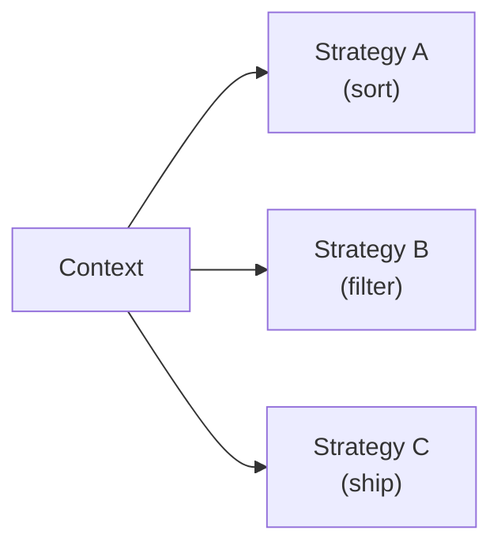
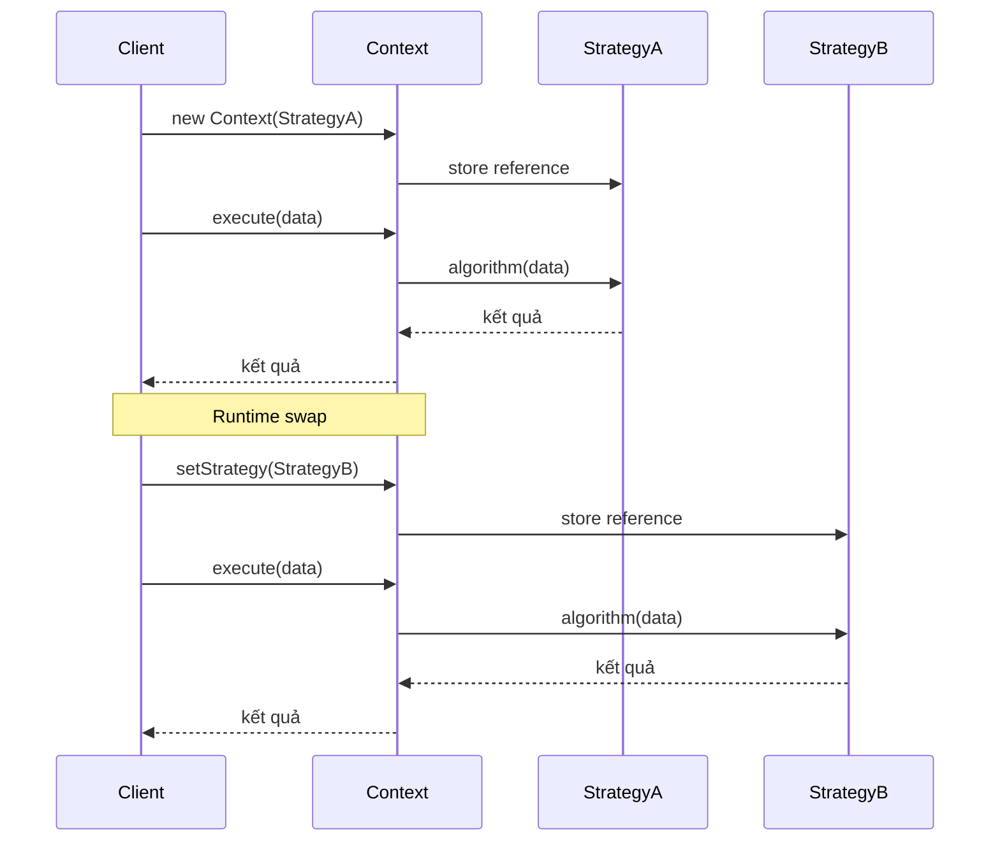

# What is the strategy design pattern?

> Strategy là pattern behavioral cho phép định nghĩa một họ thuật toán, đóng gói mỗi cái và tách rời để chúng có thể thay thế cho nhau ở runtime, giúp tránh if-else/switch khổng lồ khi logic phân nhánh theo hành vi.

Chủ đề: OOP - Design Patterns · Ngày: 2026-10-16

## 1. Là gì

Strategy pattern thuộc nhóm behavioral trong GoF, định nghĩa một họ thuật toán, đóng gói mỗi thuật toán và làm cho chúng có thể thay thế lẫn nhau. Pattern cho phép thuật toán thay đổi độc lập với client sử dụng nó. Thay vì dùng if-else hoặc switch-case dài để chọn hành vi, mỗi hành vi trở thành một class riêng (ConcreteStrategy) implement cùng interface (Strategy).

Strategy giải quyết vấn đề "code thay đổi theo context": ví dụ tính giá shipping theo vùng, sort theo nhiều tiêu chí, nén file theo format. Mỗi strategy là một thuật toán hoàn chỉnh có thể thay thế. Pattern này cũng là nền tảng cho dependency injection: client chỉ biết Strategy interface, có thể inject strategy khác nhau theo config.



*Sơ đồ vị trí: Context giữ reference tới Strategy interface; có thể thay đổi ConcreteStrategy runtime. Mỗi ConcreteStrategy đóng gói một thuật toán độc lập.*

### Trả lời 30 giây

"Strategy pattern giải quyết vấn đề có nhiều cách làm một việc và cần chọn linh hoạt runtime. Thay vì if-else/switch phân nhánh, mỗi nhánh trở thành một class implement cùng Strategy interface; client giữ reference Strategy, có thể thay strategy runtime. Ví dụ thực tế: PaymentStrategy (CreditCard, PayPal, Crypto); SortStrategy (QuickSort, MergeSort theo data size); CompressionStrategy (Zip, Gzip); ShippingStrategy (Standard, Express, SameDay). Strategy khác Command: Command encapsulate request để queue/log; Strategy chọn thuật toán. Khác State: State có state machine, state nào quyết định hành vi tiếp theo; Strategy độc lập, chuyển qua lại tự do. Lợi ích chính: tránh code phình to khi thêm thuật toán mới chỉ cần tạo class mới, không sửa client; tuân thủ Open/Closed."

## 2. Cơ chế cốt lõi

### Bước 1. Ba thành phần chuẩn

1. **Strategy (interface)**: định nghĩa method chung cho tất cả thuật toán, ví dụ `execute(data)` hoặc `calculate(input)`.
2. **ConcreteStrategy**: implement Strategy, đóng gói một thuật toán cụ thể. Ví dụ `CreditCardPayment`, `PaypalPayment`.
3. **Context**: giữ reference tới Strategy, delegate công việc cho strategy hiện tại qua `setStrategy()` hoặc constructor injection.

### Bước 2. Cấu trúc cơ bản

```java
interface SortStrategy {
    void sort(int[] data);
}
class QuickSort implements SortStrategy {
    public void sort(int[] data) { /* quicksort */ }
}
class MergeSort implements SortStrategy {
    public void sort(int[] data) { /* mergesort */ }
}
class Sorter {
    private SortStrategy strategy;
    public Sorter(SortStrategy s) { this.strategy = s; }
    public void setStrategy(SortStrategy s) { this.strategy = s; }
    public void sort(int[] data) { strategy.sort(data); }
}
```

- Client: `new Sorter(new QuickSort()).sort(arr)` hoặc `setStrategy(new MergeSort())` runtime.
- Mỗi strategy độc lập, có thể test riêng, có state riêng (nếu cần).

### Bước 3. Lựa chọn strategy theo data

Một số hệ thống tự chọn strategy theo kích thước data:

```java
class AdaptiveSorter {
    public void sort(int[] data) {
        SortStrategy s = (data.length < 1000)
            ? new InsertionSort()
            : new QuickSort();
        s.sort(data);
    }
}
```

- Đây là "meta-strategy" — strategy chọn strategy khác theo input.
- Khác State: State có state machine bên ngoài quyết định; meta-strategy tự chọn theo property input.

### Bước 4. Strategy vs if-else trong class

```java
// Anti-pattern: if-else
class OldSorter {
    public void sort(int[] data, String algo) {
        if (algo.equals("quick")) quickSort(data);
        else if (algo.equals("merge")) mergeSort(data);
        else if (algo.equals("heap")) heapSort(data);
        // thêm thuật toán mới phải sửa class này
    }
}

// Strategy: mỗi nhánh tách class
class Sorter {
    private SortStrategy strategy;
    public void sort(int[] data) { strategy.sort(data); }
}
// thêm thuật toán mới: viết class mới, không sửa Sorter
```

- Strategy: mỗi algorithm có thể test riêng, có thể inject mock, có thể swap runtime.
- If-else: gọn hơn cho 2 nhánh, nhưng khi phình to (>5 nhánh hoặc logic phức tạp) thì strategy tốt hơn.

### Bước 5. Sơ đồ cơ chế Strategy



*Sơ đồ cơ chế: Context giữ reference Strategy; client gọi Context.execute() → delegate cho Strategy hiện tại. Runtime swap: client gọi setStrategy() để đổi thuật toán, lần gọi execute() tiếp theo dùng strategy mới. Context không biết chi tiết thuật toán.*

### Bước 6. Stateless vs Stateful strategy

- **Stateless**: strategy không có field thay đổi; chỉ là method. Có thể là singleton (chỉ một instance cho tất cả client). Ví dụ: `QuickSort` algorithm.
- **Stateful**: strategy có state (counter, config, cache). Mỗi context cần instance riêng. Ví dụ: `RetryStrategy` với attempt counter.
- Strategy stateless thường implement như singleton hoặc utility class.

### Bước 7. Quan sát

```java
// Java Comparator = Strategy pattern chuẩn
List<User> users = ...;
users.sort(Comparator.comparing(User::getAge));  // strategy: sort by age
users.sort(Comparator.comparing(User::getName).reversed()); // đổi strategy

// Spring: @Autowired inject Strategy interface
@Service
class OrderService {
    private final PaymentStrategy payment;
    public OrderService(@Qualifier("stripePayment") PaymentStrategy p) {
        this.payment = p;
    }
}

// Lambda trong Java 8+ = functional strategy
Runnable r = () -> System.out.println("hi");
Comparator<String> cmp = (a, b) -> a.length() - b.length();
```

### Bước 8. Các quyết định thiết kế khi dùng Strategy

- **Strategy field ở Context hay ở method?**: Context giữ reference → stateful, đổi setStrategy() mới có hiệu lực. Method parameter → stateless, mỗi lần gọi chọn strategy. Context field phù hợp khi strategy ít đổi; method param phù hợp khi cần chọn linh hoạt từng request.
- **Constructor injection vs setter injection**: Constructor bắt buộc có strategy từ đầu, fail fast nếu thiếu. Setter cho phép đổi runtime. Constructor tốt cho strategy cố định; setter cho plugin.
- **Default strategy**: nếu không chỉ định, Context có default (ví dụ `QuickSort` mặc định). Cần fallback để tránh null.
- **Strategy discovery**: client tự tạo strategy, hay Context có factory tạo theo key, hay DI container chọn? DI là phổ biến nhất cho app lớn.
- **Multi-strategy composition**: Context có thể giữ nhiều strategy field (sort + filter + transform) — cần design cẩn thận thứ tự áp dụng.

### Ví dụ chạy từng bước

Kịch bản: hệ thống tính phí shipping cho đơn hàng e-commerce. Có 3 strategy: `StandardShipping` (20.000đ/kg), `ExpressShipping` (50.000đ/kg + 30.000 phụ phí), `SameDayShipping` (100.000đ/kg + 50.000 phụ phí). `ShippingCalculator` là Context giữ reference `ShippingStrategy`.

**Trạng thái ban đầu:** `ShippingCalculator.strategy = StandardShipping()`; đơn hàng: 3kg, nội thành.

**Bước 1 — Tính phí đơn Standard:**
- `calculator.calculate(order)` → `strategy.calculate(order)`
- `StandardShipping`: 3kg × 20.000 = 60.000 VNĐ
- Trả về client: 60.000 VNĐ

| Object | Trạng thái sau Bước 1 |
|---|---|
| calculator.strategy | StandardShipping |
| StandardShipping | đã tính 60.000 |
| order | fee = 60.000 |

**Bước 2 — Khách chọn Express (setStrategy runtime):**
- `calculator.setStrategy(new ExpressShipping())`
- `calculator.strategy` = ExpressShipping instance mới.
- `calculator.calculate(order)`: 3 × 50.000 + 30.000 = 180.000 VNĐ

| Object | Trạng thái sau Bước 2 |
|---|---|
| calculator.strategy | ExpressShipping (đã đổi) |
| order | fee = 180.000 |

Vì sao: swap runtime qua `setStrategy()` cho phép client chuyển thuật toán mà không tạo `ShippingCalculator` mới.

**Bước 3 — Khách chọn SameDay (2kg, đổi địa chỉ):**
- `calculator.setStrategy(new SameDayShipping())`
- `calculator.calculate(newOrder_2kg)`: 2 × 100.000 + 50.000 = 250.000 VNĐ

**Bước 4 — Strategy là lambda (functional):**
```java
ShippingStrategy vipStrategy = order ->
    order.weight * 50_000 - 30_000;
calculator.setStrategy(vipStrategy);
calculator.calculate(order_3kg) → 120.000 VNĐ (VIP discount)
```
Lambda phù hợp khi strategy đơn giản, không cần state.

**Biến thể — Nếu strategy reference bị set null:**
- `calculator.setStrategy(null)` → `calculator.strategy = null`
- `calculator.calculate(order)` → NullPointerException.
- Fix đúng: trong `setStrategy`, throw nếu null: `if (s == null) throw new IllegalArgumentException();`
- Hoặc dùng constructor injection bắt buộc strategy, không cho set null.

**Biến thể — Nếu strategy singleton có mutable state:**
- `StandardShipping` là singleton (stateless), tái sử dụng cho mọi context → OK.
- `RetryStrategy` có field `attempt = 0`, singleton → mọi context share cùng `attempt` → bug: thread A retry 3 lần, thread B bắt đầu retry nhưng thấy attempt = 3 rồi → fail.
- Fix: strategy stateful phải tạo mới mỗi context (prototype scope), không dùng singleton.

Điều rút ra: Strategy pattern tách thuật toán thành class riêng, Context delegate. Swap runtime qua `setStrategy()` mà không sửa Context. Cơ chế này chứng minh Open/Closed — thêm `DroughtShippingStrategy` không sửa `ShippingCalculator`, giúp trả lời câu "Tại sao Comparator trong Java là Strategy pattern?" vì `List.sort(Comparator)` cho phép chọn thuật toán sort runtime.

## 3. Câu hỏi phỏng vấn

### 3A. Câu hỏi đào sâu

<details class="qa">
<summary>Câu 1. Strategy khác gì State pattern? Cùng là đổi hành vi runtime.</summary>

**Trả lời ngắn:** Strategy là thuật toán thay thế độc lập, chuyển qua lại tự do do client quyết định. State có state machine — state hiện tại quyết định state tiếp theo và hành vi tương ứng. State tự biết khi nào chuyển sang state khác.

**Đào sâu:**
- Strategy: client chọn strategy (qua constructor, factory, config). Strategy không biết về nhau. Chuyển qua lại tự do.
- State: context có state hiện tại; state có method xử lý request và đồng thời quyết định state tiếp theo (transition). Ví dụ: Order state machine (Pending → Confirmed → Shipped → Delivered) — mỗi state quyết định transition.
- Ví dụ Strategy: SortStrategy (QuickSort, MergeSort); ShippingStrategy (Standard, Express). Ví dụ State: VendingMachine state (HasCoin, Selecting, Dispensing).
- Strategy phù hợp khi có nhiều thuật toán độc lập cùng làm một việc. State phù hợp khi có workflow/statemachine có transition rõ ràng.
- Cả hai đều dùng polymorphism và delegation, nhưng mục đích khác nhau.

**Bẫy:** "State là chiến lược có transition." Đúng một phần. State transition có thể do state nội tại quyết định (thuần State) hoặc do client (Strategy-like). Phân biệt qua câu hỏi: "Ai quyết định chuyển state? Nếu client → Strategy. Nếu state machine → State."

**Follow-up:** State pattern có thể dùng DI container không? Có — Spring state machine (Spring StateMachine) implement pattern này.
</details>

<details class="qa">
<summary>Câu 2. Strategy khác gì Command pattern?</summary>

**Trả lời ngắn:** Strategy chọn thuật toán để thực hiện. Command đóng gói request (parameters + action) thành object để queue, log, undo/redo. Strategy tập trung vào "làm thế nào"; Command tập trung vào "làm gì, khi nào, có undo không".

**Đào sâu:**
- Strategy: `algorithm(data)` — focus chọn implementation. Cùng input, output giống nhau về mặt ngữ nghĩa nhưng cách làm khác.
- Command: `execute()` — encapsulate một request với parameters, có thể queue, replay, undo. Ví dụ: `PlaceOrderCommand` chứa orderId, userId, items.
- Strategy thường stateless hoặc stateful đơn giản; Command thường immutable, có undo/redo state.
- Strategy chọn "cách nén" (Gzip vs Zip); Command đóng gói "nén file X với Gzip" và queue lại.
- Cùng có thể dùng lambda (functional interface). Strategy thường `Function<T,R>`; Command thường `Runnable` hoặc có undo.

**Bẫy:** "Command và Strategy là một." Sai — mục đích khác. Command cho invocation lifecycle; Strategy cho algorithm selection.

**Follow-up:** Macro command (nhiều command) có phải Strategy không? Không — macro command vẫn là command (queue + execute + undo). Strategy chọn implementation.
</details>

<details class="qa">
<summary>Câu 3. Khi nào nên dùng Strategy thay vì if-else?</summary>

**Trả lời ngắn:** Khi có ≥3 nhánh logic có thể tách thành class độc lập, khi logic phức tạp (>10 dòng mỗi nhánh), khi cần thêm nhánh runtime, hoặc khi cần test từng nhánh riêng biệt.

**Đào sâu:**
- Dùng Strategy: nhánh có logic phức tạp (sort algorithm, payment processing, validation rule); cần mock một nhánh trong test; nhánh có thể được thêm runtime (plugin).
- Giữ if-else: nhánh đơn giản (chọn error message, đơn vị hiển thị); ít nhánh (2-3); nhánh không có logic thuần (chỉ return value).
- Anti-pattern: tách strategy cho 2 nhánh đơn giản (`getTrue()` và `getFalse()`) → over-engineering.
- Anti-pattern: strategy có if-else bên trong → quay về vấn đề ban đầu.
- Trade-off: strategy thêm indirection (một method gọi qua interface). Profiler overhead thường không đáng kể (JIT inline), nhưng code phức tạp hơn cho người mới.

**Bẫy:** "Strategy luôn tốt hơn if-else." Sai — cho 2 nhánh đơn giản, if-else rõ ràng hơn. Strategy chỉ tốt khi phức tạp hoặc mở rộng.

**Follow-up:** Khi nào dùng enum thay cho Strategy? Enum phù hợp khi số strategy cố định, đơn giản, và không cần DI runtime. Strategy class phù hợp khi logic phức tạp hoặc cần inject dependency.
</details>

<details class="qa">
<summary>Câu 4 (Debug). Service gọi `paymentStrategy.charge(amount)` trả về `null`. Log không có exception. Nguyên nhân có thể là gì?</summary>

**Trả lời ngắn:** Strategy reference có thể chưa được inject, hoặc strategy được set về null, hoặc DI container không bind đúng qualifier, hoặc bean lifecycle sai trong test.

**Đào sâu:**
- Bước 1: Kiểm tra strategy reference lúc runtime (`System.out.println(strategy.getClass())`). Có thể null.
- Bước 2: Trong Spring: kiểm tra `@Qualifier` có khớp bean name không. Nếu có nhiều bean implement cùng interface, phải dùng `@Qualifier` hoặc `@Primary`.
- Bước 3: Trong test: `@MockBean` có thể trả null nếu chưa stub. Stub bằng `when(mock.charge(any())).thenReturn(result)`.
- Bước 4: NullPointerException chỉ xảy ra nếu gọi method trên null. Nếu return null từ strategy (mà không throw) → null object bug.
- Bước 5: Nếu strategy có lazy init qua `Optional<Strategy>`, kiểm tra `isPresent()` trước khi dùng. Nếu không, NullPointer.
- Bước 6: Strategy setter bị gọi với null từ một nơi khác → tìm tất cả chỗ gọi `setStrategy`.

**Bẫy:** "Null từ strategy là do strategy throw exception và nuốt." Có thể, nhưng thường là null reference. Kiểm tra null trước khi gọi method.

**Follow-up:** Nếu strategy là singleton và throw exception trong constructor, cả app crash. Cách phòng? Lazy init, hoặc try/catch wrap, hoặc default fallback strategy.
</details>

<details class="qa">
<summary>Câu 5 (Thiết kế). Hệ thống e-commerce cần tính phí shipping theo vùng (Việt Nam, quốc tế), theo tốc độ (Standard, Express), và theo loại khách (VIP, thường). Tổ hợp nhiều biến thể. Thiết kế sao?</summary>

**Trả lời ngắn:** Tách thành nhiều strategy dimension: `ShippingRegionStrategy` (chọn theo vùng), `ShippingSpeedStrategy` (chọn theo tốc độ), `CustomerTierStrategy` (chọn theo loại khách). Context tính phí = base × region_multiplier + speed_fee - tier_discount. Mỗi strategy độc lập, có thể thêm dimension mới.

**Đào sâu:**
- **Yêu cầu**: phí = region_multiplier × weight × distance + speed_fee - tier_discount. Nhiều chiều độc lập.
- **Quyết định chính**: tách strategy theo dimension (region, speed, tier). Mỗi dimension là một Strategy interface riêng. Context combine.
- **Implementation**:
  ```java
  interface RegionStrategy { double baseFee(double weight, String country); }
  interface SpeedStrategy { double speedFee(); }
  interface TierStrategy { double discount(double fee); }

  class VietnamRegion implements RegionStrategy { /* 50k + 5k/kg */ }
  class ExpressSpeed implements SpeedStrategy { /* +30k */ }
  class VipTier implements TierStrategy { /* -20% */ }
  ```
- **Context**: `ShippingCalculator` inject cả 3 strategy, combine công thức.
- **Test**: mỗi strategy test riêng, test tổ hợp dễ dàng (inject mock).
- **Điểm nghẽn**: nếu business muốn tổ hợp động theo config (ví dụ khuyến mãi), cần rule engine. Nếu chỉ cố định vài tổ hợp, đơn giản.

**Bẫy:** "Một Strategy class cho cả 3 dimension, switch 3 chiều." Sai — complexity O(n×m×k), strategy phình to. Tách dimension.

**Follow-up:** Nếu có 100 tổ hợp cần test? Bảng test (parameterized test) cho mỗi tổ hợp. Hoặc property-based test cho công thức.
</details>

<details class="qa">
<summary>Câu 6. Strategy có thể là lambda/function không? Khi nào nên dùng?</summary>

**Trả lời ngắn:** Có. Java 8+ functional interface, TypeScript arrow function, Python lambda/closure đều là "strategy thuần". Phù hợp khi strategy chỉ là một method đơn giản, không có state phức tạp.

**Đào sâu:**
- Lambda strategy gọn cho logic ngắn: `Comparator.comparing(User::getAge)` = strategy sort theo age.
- Lambda không phù hợp khi: cần state (counter, cache); cần nhiều method (`init()`, `cleanup()`); cần inject dependency khác.
- Trong Java: dùng `@FunctionalInterface` cho Strategy interface có 1 method. Spring inject lambda bean không tự nhiên, dùng class riêng.
- Trong Kotlin: `fun interface` cho functional interface.
- Trong TypeScript: `type Strategy = (data: Data) => Result` là strategy thuần.
- Lambda strategy dễ test hơn (gọi trực tiếp) nhưng khó mock qua DI (vì DI cần bean).

**Bẫy:** "Lambda là anti-pattern, phải dùng class." Sai — lambda là strategy pattern, gọn và đẹp cho logic đơn giản.

**Follow-up:** Strategy pattern trong reactive programming như thế nào? `Flow.map { strategy(it) }` là strategy. `Flow.transform` với operator chain là strategy composition.
</details>

<details class="qa">
<summary>Câu 7. Strategy pattern ảnh hưởng performance thế nào?</summary>

**Trả lời ngắn:** Ảnh hưởng nhỏ. Mỗi method call qua interface thêm indirection (vài nanosecond). JVM JIT inline sau vài lần gọi. Performance gần như direct call.

**Đào sâu:**
- Method call qua interface: virtual dispatch, JIT có thể devirtualize nếu biết concrete type (class hierarchy analysis).
- Nếu strategy thay đổi runtime (mỗi request khác nhau), JIT không inline được → profile-guided optimization giảm overhead ~5-10%.
- Allocation: tạo strategy object tốn memory, nhưng cache singleton strategy tái sử dụng được.
- Trade-off: abstraction overhead < microsecond, so với business logic (sort O(n log n), network call ms) → không đáng kể.
- Nếu performance critical (high-frequency trading, real-time): benchmark trước. Đa số case Strategy không ảnh hưởng.

**Bẫy:** "Strategy làm app chậm." Sai — chỉ chậm nếu logic bên trong strategy chậm, không phải do pattern.

**Follow-up:** Sealed class (Java 17+) cho phép exhaustive switch — có thể dùng thay cho Strategy? Được, nhưng chỉ khi số strategy cố định và compile-time biết. Strategy linh hoạt hơn cho runtime addition.
</details>

### 3B. Câu hỏi phỏng vấn liên quan

<details class="qa">
<summary>Câu 8. Strategy pattern là behavioral hay creational?</summary>

**Trả lời:** Behavioral. Tập trung vào hành vi (thuật toán), không phải tạo object (creational) hay cấu trúc (structural).
</details>

<details class="qa">
<summary>Câu 9. Template Method khác Strategy như thế nào?</summary>

**Trả lời:** Template Method định nghĩa skeleton thuật toán trong base class, subclass override vài bước. Strategy delegate toàn bộ thuật toán cho strategy object. Template Method dùng inheritance; Strategy dùng composition. Strategy linh hoạt hơn (swap runtime), Template Method đơn giản hơn (không cần DI).
</details>

<details class="qa">
<summary>Câu 10. Ví dụ thực tế của Strategy pattern trong JDK?</summary>

**Trả lời:** `java.util.Comparator` (sort strategy cho `Collections.sort`, `List.sort`). `java.util.concurrent.ThreadPoolExecutor` chọn rejection strategy (`AbortPolicy`, `CallerRunsPolicy`, `DiscardPolicy`). `javax.servlet.FilterChain` không phải strategy nhưng chain tương tự. `java.nio.charset.Charset` (encoding strategy).
</details>

<details class="qa">
<summary>Câu 11. Strategy và Dependency Injection liên quan thế nào?</summary>

**Trả lời:** DI là cách inject strategy vào Context. Spring `@Autowired` cho phép inject Strategy interface; runtime chọn implementation qua `@Qualifier` hoặc `@Profile`. Strategy là mục đích; DI là cách thực hiện. Hai khái niệm bổ sung, không thay thế.
</details>

<details class="qa">
<summary>Câu 12. Khi nào Strategy trở thành over-engineering?</summary>

**Trả lời:** Khi chỉ có 2 nhánh đơn giản (if-else sẽ rõ hơn); khi strategy chỉ wrap một hàm (lambda đủ); khi class hierarchy không có lý do (chỉ vì "có thể thêm sau"). YAGNI — đợi đến khi thật sự có 3+ nhánh hoặc logic phức tạp.
</details>

<details class="qa">
<summary>Câu 13. Strategy có thể kết hợp với Decorator không?</summary>

**Trả lời:** Có. Decorator bọc Strategy để thêm hành vi (logging, caching, retry) mà không sửa Strategy. Ví dụ: `LoggingPaymentStrategy` bọc `StripePaymentStrategy`. Client inject Decorator; Decorator delegate cho inner Strategy. Đây là kết hợp phổ biến.
</details>

<details class="qa">
<summary>Câu 14. True or false: "Strategy pattern yêu cầu interface."</summary>

**Trả lời:** Sai. Strategy chỉ cần polymorphism — có thể dùng abstract class, sealed interface, duck typing (Python, JS). Trong ngôn ngữ dynamically typed, không cần interface chính thức. Trong Java/C#, cần interface hoặc abstract class để có đa hình.
</details>

<details class="qa">
<summary>Câu 15. Một Context có thể có nhiều Strategy không?</summary>

**Trả lời:** Có. Context có thể giữ nhiều strategy field (ví dụ `SortStrategy`, `FilterStrategy`). Mỗi strategy độc lập, swap riêng. Đây là composition nhiều strategy. Phù hợp khi behavior có nhiều dimension (sort + filter + transform).
</details>

## 4. Đánh đổi và sự cố production

### So sánh Strategy với các pattern behavioral liên quan

| Tiêu chí | Strategy | State | Command | Template Method |
|---|---|---|---|---|
| Mục đích | Chọn thuật toán | State machine transition | Đóng gói request | Skeleton + tuỳ biến bước |
| Ai chuyển đổi | Client | State machine | Client (queue) | Compile-time (subclass) |
| Có state riêng | Tuỳ | Có (state hiện tại) | Thường không | Không |
| Có undo | Không | Không | Thường có | Không |
| Khi nào dùng | Nhiều thuật toán cùng task | Workflow có transition | Cần queue/replay/undo | Skeleton ổn định, bước linh hoạt |

### Năm failure mode

| Triệu chứng | Nguyên nhân gốc | Cách kiểm tra | Cách sửa |
|---|---|---|---|
| NullPointerException khi gọi strategy | Strategy reference null (chưa inject, set null, qualifier sai) | Log null check trước method call | Inject bắt buộc, fail fast nếu null |
| Strategy không đổi khi gọi setStrategy | Context giữ reference cũ, hoặc strategy immutable | Debug print reference trước/sau | Đảm bảo `setStrategy` cập nhật field; verify trong test |
| Strategy phình to, nhiều nhánh bên trong | Tách strategy không đúng dimension; mỗi strategy lại if-else | Đếm số nhánh trong strategy method | Tách strategy theo dimension thật (region, speed, tier) |
| DI không bind đúng implementation | `@Qualifier` thiếu/sai, nhiều bean cùng interface | Application context debug log bean names | Dùng `@Primary` cho default, `@Qualifier` cho explicit |
| Performance giảm do strategy call overhead | Quá nhiều method call nhỏ qua interface | JMH benchmark | JIT inline sau warm-up; cache reference nếu cần |
| Strategy chứa state bị share giữa nhiều context | Singleton strategy có mutable state | Test isolation | Đổi sang prototype scope, hoặc stateless strategy |

## 5. Cheat sheet

| Chủ đề | Con số / quy tắc cần nhớ |
|---|---|
| Pattern group | Behavioral (GoF) |
| Thành phần | Strategy interface, ConcreteStrategy, Context |
| Mục đích | Tách thuật toán để chọn linh hoạt runtime |
| Strategy vs State | Strategy chọn do client; State do state machine |
| Strategy vs Command | Strategy chọn cách làm; Command đóng gói request |
| Strategy vs if-else | Strategy khi ≥3 nhánh phức tạp hoặc cần mock |
| JDK ví dụ | `Comparator`, `ThreadPoolExecutor.RejectedExecutionHandler` |
| Lambda strategy | `Comparator.comparing(...)`, `Function<T,R>` |
| DI kết hợp | Spring `@Autowired` + `@Qualifier` chọn implementation |
| Open/Closed | Thêm strategy mới không sửa Context |

**Học tiếp:**
- [observer-pattern](observer-pattern.md) — thông báo sự kiện tới dependents
- [factory-pattern](factory-pattern.md) — encapsulate object creation
- [adapter-pattern](adapter-pattern.md) — dịch interface không tương thích
- [singleton-pattern](singleton-pattern.md) — chỉ một instance toàn cục

**Lỗi thường gặp:** (1) Strategy reference null khi DI chưa bind → fail fast với constructor injection. (2) Strategy singleton có mutable state → share state giữa các context, dùng prototype scope. (3) Tách strategy không đúng dimension → mỗi strategy vẫn if-else bên trong. Tách theo behavior thật sự khác nhau. (4) Over-engineering: 2 nhánh đơn giản → if-else đủ. (5) Strategy throw exception không catch ở Context → crash caller. Wrap exception hoặc trả Result.