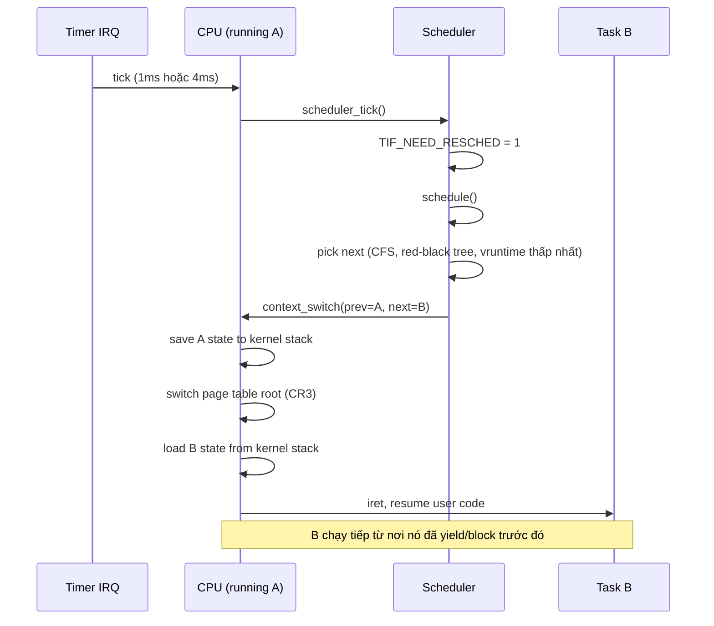

# Explain context switching.

> Context switch là lưu trạng thái CPU của task đang chạy (thanh ghi, RIP, RSP, FPU state, page table root) và nạp trạng thái task khác. Chi phí từ ~1 µs (cùng process) tới ~10 µs (khác process, do TLB flush, cache miss). Trigger: time slice hết, syscall blocking, IRQ, `sched_yield`, mutex wait. Linux CFS scheduler dùng red-black tree theo vruntime; cùng process thì switch rẻ (cùng page table), khác process thì switch đắt.

Chủ đề: Operating Systems · Ngày: 2026-10-16

## 0. Nền tảng trước khi đọc

**Bối cảnh:** Lớp phần mềm quản lý CPU, bộ nhớ, tiến trình và thiết bị. Ứng dụng gọi OS thay vì tự điều khiển phần cứng trực tiếp.

**Nói đơn giản:** Context switch lưu trạng thái của việc đang chạy rồi nạp trạng thái việc khác, giúp CPU chia thời gian giữa các task.

**Từ khóa cần biết:** process = chương trình đang chạy; thread = luồng thực thi; kernel = phần lõi có quyền điều khiển máy.

**Ví dụ dễ hình dung:** CPU lưu thanh ghi của request A rồi nạp thanh ghi của request B để B tiếp tục đúng chỗ đã dừng.

Khi đọc, luôn hỏi ba câu: nó giải quyết vấn đề gì, nó làm việc theo những bước nào, và khi nào không nên dùng?

**Cách học bài này:** Đọc phần này trước để nắm từ khóa; đọc phần 1 để lấy câu trả lời 30 giây; đọc phần 2 để hiểu cơ chế; cuối cùng mở từng câu hỏi ở phần 3 để luyện nói. Các con số và lệnh trong bài là bằng chứng cho câu trả lời, không cần học thuộc nếu chưa hiểu cơ chế.

## 1. Là gì

### Đọc nhanh trước khi đi sâu

**Ý chính:** Context switch lưu trạng thái của việc đang chạy rồi nạp trạng thái việc khác, giúp CPU chia thời gian giữa các task.

**Ví dụ interview:** CPU lưu thanh ghi của request A rồi nạp thanh ghi của request B để B tiếp tục đúng chỗ đã dừng.

**Luồng 4 bước:**

1. Scheduler quyết định task hiện tại phải nhường CPU.
2. Kernel lưu register, program counter và state của task đó.
3. Kernel nạp state của task tiếp theo và có thể đổi address space.
4. CPU chạy tiếp task mới; chi phí là thời gian lưu/nạp và cache/TLB bị ảnh hưởng.

**Nói như trong interview:** Context switch lưu trạng thái của việc đang chạy rồi nạp trạng thái việc khác, giúp CPU chia thời gian giữa các task. Hãy nói theo bốn bước trên trước; nếu interviewer hỏi sâu, chuyển sang cơ chế **Bước 1. Trigger switch**, rồi nêu trade-off và failure mode ở các phần sau.

## 2. Cơ chế cốt lõi

### Bước 1. Trigger switch

1. Time slice hết: timer IRQ tới, scheduler tick handler `scheduler_tick()` xử lý; nếu task đã dùng hết time slice và có task khác RUNNABLE, set `TIF_NEED_RESCHED`, return.
2. Syscall blocking: task gọi `read()` trên socket chưa có data, `mutex_lock()` không có lock; scheduler chuyển task sang trạng thái `TASK_INTERRUPTIBLE` hoặc `TASK_UNINTERRUPTIBLE`, gọi `schedule()`.
3. IRQ wake higher-priority task: NIC IRQ wake softirq, softirq wake task; trong IRQ return path `nhoevegret`, scheduler chạy.
4. `sched_yield()`: task tự nhường CPU, scheduler chọn task khác nếu có.

### Bước 2. Save state của task cũ

1. Kernel xác định task cũ (`prev`) và task mới (`next`). Lưu user stack RIP, RSP, RBP, RFLAGS, segment vào `pt_regs` trên kernel stack của `prev`.
2. Lưu các thanh ghi chung còn lại vào `task_struct->thread` (struct `thread_struct` chứa callee-saved registers).
3. Lưu FPU/SIMD state qua `xsave` instruction hoặc lazy save (chỉ khi task khác dùng FPU lần đầu).
4. Lưu FS_BASE/GS_BASE (TLS pointer) vào `task_struct->thread`.

### Bước 3. Switch page table nếu khác process

1. So sánh `prev->mm` và `next->mm`. Nếu cùng (thread cùng process), giữ CR3.
2. Nếu khác, ghi `next->mm->pgd` vào CR3 (x86-64). CPU tự flush TLB entries tương ứng với ASID; ASID khác nhau không bị flush.
3. Linux dùng ASID (Address Space ID) hoặc PCID (Process Context ID) trên CPU có hỗ trợ (Intel Westmere+) để giảm TLB flush. PCID cho phép 4096 ASID, cache TLB entry theo ASID.

### Bước 4. Load state của task mới

1. Nạp `task_struct->thread` vào thanh ghi callee-saved.
2. Nạp FPU/SIMD state qua `xrestore`.
3. Nạp FS_BASE/GS_BASE qua `wrmsr` (x86-64).
4. Switch kernel stack từ `prev`'s stack sang `next`'s stack. Đây là điểm mà compiler không thấy — assembly thuần (`__switch_to`).
5. Return qua `ret`, nạp `next`'s user RIP, RSP từ pt_regs; iret về user mode.

### Bước 5. Scheduler chọn task



*Luồng thời gian context switch từ timer tick: IRQ → scheduler_tick → schedule → context_switch → iret sang task mới. Mỗi bước tốn vài trăm ns đến vài µs.*

### Bước 6. CFS scheduler

1. CFS (Completely Fair Scheduler) theo dõi `vruntime` (virtual runtime) của mỗi task. `vruntime += delta_exec * (NICE_0_LOAD / weight)`.
2. Task có `vruntime` thấp nhất được chọn. Red-black tree `cfs_rq->tasks_timeline` chứa các task RUNNABLE, sắp theo `vruntime`.
3. Pick next: O(log n) để tìm node trái nhất. Min vruntime được cập nhật mỗi tick.
4. Time slice: scheduler cấp `sched_slice` cho mỗi task tuỳ weight và số RUNNABLE. Ví dụ: 5 task chạy, mỗi cái ~20% CPU, slice ~5-50 ms.
5. Real-time task (FIFO, RR) ưu tiên hơn CFS; kernel config `CONFIG_PREEMPT_RT` cho phép preemption mạnh hơn.

### Bước 7. Voluntary vs involuntary cost

| Khía cạnh | Voluntary (syscall block) | Involuntary (preempt) |
|---|---|---|
| Trigger | Task gọi syscall blocking, mutex wait | Time slice hết, IRQ preempt |
| Save state | Rõ ràng, scheduler biết | Phải save full state |
| Pick next | Thường có task khác sẵn | Có thể không có → idle loop |
| | Cost thấp | Cost cao hơn |

Ngoài ra, scheduler có thể gặp **idle switch**: không có task RUNNABLE → chạy idle task (PID 0), CPU rảnh. Idle task chỉ tick scheduler.

### Bước 8. TLB flush optimization

- **PCID** (x86-64): mỗi process có ID riêng, TLB entry gắn ID, switch process không flush. Linux dùng `mmu_notifier` để quản lý.
- **Lazy TLB**: kernel thread (kworker) không switch page table; nếu user thread tới, kernel schedule CPU khác để tránh TLB flush.
- **ASID** (ARM): tương tự PCID.
- **TLB shootdown**: khi một CPU unmap page, phải IPI (Inter-Processor Interrupt) tới các CPU khác để flush TLB entry. Tốn vài µs mỗi lần. Đây là lý do `munmap` và `madvise(MADV_DONTNEED)` đôi khi gây latency spike.

### Quan sát

```bash
# Linux: đếm context switch toàn hệ thống
cat /proc/stat | grep ctxt
# ctxt 1234567890

# Linux: đếm context switch của process
cat /proc/PID/status | grep voluntary_ctxt_switches
# voluntary_ctxt_switches:	1234
cat /proc/PID/status | grep nonvoluntary_ctxt_switches
# nonvoluntary_ctxt_switches:	567

# Linux: đo context switch per second
vmstat 1
# procs ---memory--- ---swap-- ... --system--
# r  b   swpd  free   buff  cache ... cs us sy id
# 2  0      0 123456  7890 456789 ... 1234 5  2 93

# Linux: xem thread nào switch nhiều
perf sched record -a
perf sched latency -sort max
```

### Ví dụ chạy từng bước

Kịch bản: 3 process chạy trên 2-core CPU. P1 và P2 là CPU-bound (nice 0), P3 là I/O-bound (nice +10). Mục tiêu: thấy CFS chọn task theo vruntime, thấy involuntary switch khi P1 time slice hết, thấy TLB flush khi switch giữa P1 và P2 (khác process), và thấy vì sao P3 có latency tốt dù nice cao.

Giả định: kernel 6.x, CPU x86-64 có PCID, HZ=1000 (tick 1 ms), 2 CPU core, CFS fair period 6 ms. Mỗi bước dùng số liệu minh họa đã tính lại bằng script.

| Bước | Thời gian | Ai làm gì | Vì sao | Trạng thái |
|---|---|---|---|---|
| 0 | t0 | P1 (nice 0, weight 1024) và P2 (nice 0) chạy trên CPU 0 và CPU 1. | CFS pick leftmost (vruntime thấp nhất) → cả hai fair. | P1 vruntime=0, P2 vruntime=0 |
| 1 | t0 + 3 ms | Timer IRQ 0 trên CPU 0: `scheduler_tick` thấy P1 dùng hết slice. Set `TIF_NEED_RESCHED`. | P1 dùng 3 ms = 50% fair period, P2 cũng 3 ms. CFS preempt. | P1 sẽ bị preempt khi kernel return |
| 2 | t0 + 3.001 ms | IRQ return path: `schedule()` chạy. `context_switch(P1, P2)`. | Scheduler chọn P2 vì P1 vruntime = P2 vruntime = 3 ms. | CPU 0: save P1 state; CR3 switch (P1≠P2), TLB flush entries khác PCID |
| 3 | t0 + 3.005 ms | P2 chạy tiếp trên CPU 0. P1 nằm RUNNABLE. | P1 vruntime = 3 ms, P2 vruntime = 3 ms. | P1 blocked |
| 4 | t0 + 3.01 ms | P3 gọi `read()` block trên socket. Scheduler đổi P3 → `TASK_INTERRUPTIBLE`, gọi `schedule()`. | Voluntary switch: P3 chủ động block. | P3 sleeping; CPU 1 vẫn chạy P2 |
| 5 | t0 + 6 ms | Fair period end. CFS rebalance: cả P1 và P2 cùng vruntime ~6 ms. P1 resume trên CPU 0. | CFS pick leftmost; P1 và P2 cùng vruntime. | P1 back; TLB refill P1 pages |

Trạng thái sau 1 giây (đã tính lại bằng script, 3 process × ~333 ms CPU mỗi cái):
- ~333 involuntary switch trên mỗi CPU (P1↔P2 trên CPU 0). `cat /proc/1/status` xem `nonvoluntary_ctxt_switches`.
- P3 có voluntary ~1000 switch/s (mỗi `read()` = 1 block), nhưng mỗi lần wake P3 nhả CPU ngay. P3 dùng ít CPU thực tế vì I/O latency (~5 ms).

Biến thể sai thứ tự: nếu P1 có nice -10 (weight ~54.000), P2 nice 0 (weight ~1.024), CFS sẽ cho P1 chạy gấp ~50 lần nhiều hơn P2 trong cùng period. P1 nhận ~98% CPU, P2 chỉ ~2%. Check: `chrt -p PID` xem priority, `ps -eo pid,ni,comm` xem nice value.

Điều rút ra: context switch giữa P1 và P2 (khác process) tốn thêm ~2-5 µs vì CR3 switch và TLB flush; switch cùng process chỉ tốn ~1 µs. Nice weight không thay đổi vruntime tối thiểu mà thay đổi tốc độ tăng vruntime, nên task nice cao vẫn được chạy khi idle. Nối sang câu 1, câu 3 và câu 5 ở 3A để chứng minh vì sao TLB flush là overhead lớn và vì sao "nice ảnh hưởng priority tuyệt đối" là bẫy.

## 3. Câu hỏi phỏng vấn

### 3A. Câu hỏi đào sâu

<details class="qa">
<summary>Câu 1. Context switch tốn bao nhiêu và overhead ở đâu?</summary>

**Trả lời ngắn:** Cùng process (hai thread): ~1 µs; khác process: ~5-10 µs. Overhead gồm: save/restore thanh ghi và FPU (~hundreds ns), switch kernel stack (~hundreds ns), switch CR3 và TLB flush (~1-5 µs), cache miss L1/L2/L3 cho code mới (~tens-hundreds ns), scheduler logic (~hundreds ns). Đo thực tế bằng `perf stat -e context-switches`.

**Đào sâu:**
- Save/restore thanh ghi: ~20 thanh ghi chung + FPU state (XSAVE ~512 byte). Cùng process hai thread FPU thường share, switch nhanh. Khác process FPU state có thể khác.
- Switch kernel stack: chuyển từ prev's kernel stack sang next's kernel stack. Mỗi thread có stack ~16 KB. Tốn vài trăm ns.
- CR3 switch + TLB: nếu CPU có PCID, TLB không flush toàn bộ, chỉ entries khác ASID bị evict. Nếu không có PCID, full flush → page fault đầu tiên cho mỗi page task mới.
- Cache miss: task mới có code path khác; L1i miss cho instruction fetch đầu tiên. L2/L3 cũng miss. Warm-up ~tens µs.
- Scheduler: pick next O(log n) trên red-black tree. Với n=10 task, ~100 ns. Với n=10k task, ~500 ns.
- Direct cost (kernel-only): 1-5 µs. Indirect cost (cache, TLB): 1-10 µs thêm. Tổng ~5-15 µs cho khác process.

**Bẫy:** "Context switch tốn vài ns." Sai — cùng process ~1 µs, khác process ~10 µs. Sai số 100-1000x.

**Follow-up:** Kernel-bypass (DPDK) có context switch không? Không — kernel-bypass giữ task chạy busy poll, kernel không switch. Trade-off: CPU 100% cho một core, nhưng không context switch.
</details>

<details class="qa">
<summary>Câu 2. TLB flush trong context switch ảnh hưởng thế nào?</summary>

**Trả lời ngắn:** Khác process, switch CR3 khiến TLB entries cũ invalid. CPU phải refill TLB từ page table cho page fault đầu tiên. Tốn ~1-5 µs cho lần fault đầu, các fault tiếp theo nhanh hơn vì TLB đã warm. PCID (Intel Westmere+) cho phép cache TLB theo ASID, không flush toàn bộ.

**Đào sâu:**
- TLB (Translation Lookaside Buffer): cache virtual-to-physical page mapping, kích thước nhỏ (L1 TLB ~64-128 entry, L2 ~256-2048). Miss tốn ~10-30 cycles (page walk trên page table).
- Khác process: page table root đổi, TLB entries cũ không còn đúng (process khác có page table khác). CPU flush toàn bộ entries nếu không có ASID.
- PCID (Process Context ID, x86-64): mỗi process có ID 12-bit, TLB entry gắn PCID. Switch process ghi PCID mới vào CR3; entries khác PCID được giữ (không flush). Vài trăm ns thay vì vài µs.
- ASID (Application Space ID, ARM): tương tự PCID.
- Linux mặc định bật PCID từ kernel 4.x trên CPU hỗ trợ.
- TLB shootdown: khi CPU unmap page, phải IPI tới các CPU khác để flush TLB entry cho page đó. Tốn vài µs cho mỗi shootdown. `munmap` và `madvise(MADV_DONTNEED)` gây shootdown.

**Bẫy:** "TLB flush chỉ tốn vài cycles." Sai — full TLB flush tốn hundreds cycles; shootdown qua IPI tốn µs.

**Follow-up:** Huge page giảm TLB miss thế nào? 2 MB page (x86-64 huge page) hoặc 1 GB huge page, TLB entry phủ nhiều memory hơn. Database dùng huge page để giảm TLB miss, throughput tăng 5-20%.
</details>

<details class="qa">
<summary>Câu 3. CFS scheduler chọn task thế nào?</summary>

**Trả lời ngắn:** CFS (Completely Fair Scheduler) theo dõi vruntime cho mỗi task. Task có vruntime thấp nhất được chọn. Red-black tree tổ chức RUNNABLE task, pick next O(log n). Weight từ nice (-20 đến +19) ảnh hưởng đến tốc độ tăng vruntime.

**Đào sâu:**
- `vruntime = wall_time * NICE_0_LOAD / weight`. NICE_0_LOAD = 1024. nice -20 (cao nhất) weight = 88761, vruntime tăng chậm → task chạy nhiều CPU. nice +19 (thấp nhất) weight = 15, vruntime tăng nhanh → ít CPU.
- Cùng nice: tất cả task tiến vruntime đều nhau; CFS fair.
- khác tree cùng cfs_rq: vruntime scale theo weight. Task nice cao có vruntime thấp hơn → nhiều CPU hơn.
- Time slice: `sched_slice = period * weight / sum_weight`. Period ~6-100 ms tuỳ load. Ví dụ 4 task cùng nice: period 24 ms, slice 6 ms mỗi cái.
- Red-black tree node sorted by vruntime. Pick leftmost = vruntime min. O(log n).
- Real-time (FIFO, RR): ưu tiên hơn CFS. `chrt -f 50 ./app` set FIFO priority 50.
- Idle task: chạy khi không có task nào RUNNABLE. Cũng làm rebalance cho load balancing giữa CPU.

**Bẫy:** "nice ảnh hưởng priority tuyệt đối." Sai — nice ảnh hưởng weight, tỉ lệ CPU; task nice cao vẫn chạy khi không có task nào khác.

**Follow-up:** BFS (Brain Fuck Scheduler) khác CFS? BFS từ Con Kolivas, single run queue, không red-black tree. Đơn giản hơn nhưng không scale tốt cho nhiều task.
</details>

<details class="qa">
<summary>Câu 4. Voluntary và involuntary context switch khác nhau thế nào?</summary>

**Trả lời ngắn:** Voluntary: task tự nhường khi syscall blocking, mutex wait. Scheduler không cần save full state preemptively. Involuntary: time slice hết, scheduler preempt, save full state. Voluntary rẻ hơn involuntary vì scheduler biết trước và pick next nhanh.

**Đào sâu:**
- Voluntary trigger: `read()` block, `mutex_lock` không có lock, `nanosleep`, `sched_yield`. Task set state INTERRUPTIBLE, gọi schedule(). Kernel pick next; state trong prev's task_struct đã INTERRUPTIBLE nên scheduler không cần update.
- Involuntary trigger: timer IRQ, `scheduler_tick()` thấy task đã dùng hết slice; set TIF_NEED_RESCHED; return qua IRQ return path gọi schedule. Kernel pick next.
- Cost khác biệt: voluntary không cần save FPU preemptively (lazy save). Involuntary full save.
- `cat /proc/PID/status` cho thấy `voluntary_ctxt_switches` và `nonvoluntary_ctxt_switches`. Ratio cao voluntary = task I/O-bound hoặc ngủ nhiều. Ratio cao involuntary = CPU-bound, time slice thường hết.
- Hiệu năng: ứng dụng voluntary switch thường latency tốt (task chủ động). Involuntary nhiều nghĩa scheduler áp lực.

**Bẫy:** "Voluntary switch luôn rẻ hơn." Sai — voluntary switch cho blocker I/O phải đợi, scheduler có thể phải load task khác vào CPU, vẫn tốn cost tương đương.

**Follow-up:** Tăng time slice giảm involuntary switch nhưng latency tăng. Trade-off: time slice lớn → batch CPU-bound; time slice nhỏ → interactive tốt.
</details>

<details class="qa">
<summary>Câu 5. Làm sao giảm context switch overhead?</summary>

**Trả lời ngắn:** Pin thread tới CPU (affinity), dùng thread pool thay tạo task mới, dùng coroutine cho I/O-bound, tăng time slice (latency trade-off), batch I/O (io_uring), giảm số thread RUNNABLE.

**Đào sâu:**
- Affinity: pin thread tới CPU cố định. TLB và cache locality tốt, scheduler không rebalance. Nhược: nếu CPU bận, thread đợi.
- Thread pool: tái sử dụng thread, không tạo/hủy mỗi request. Cấu hình số thread theo số core.
- Coroutine: mỗi request một coroutine (~1 KB), single thread xử lý. Switch cost ~100 ns so với thread ~1 µs. Phù hợp high-concurrency I/O (10k+ connection).
- Batch I/O: io_uring, writev/readv, sendfile syscall. Một syscall xử lý nhiều thao tác, giảm switch.
- Time slice: `sysctl kernel.sched_latency_ns` tăng slice → ít switch hơn. Trade-off: latency cho interactive.
- `isolcpus`: kernel cmdline, cô lập CPU khỏi scheduler, dành riêng cho IRQ hoặc thread đặc biệt.
- `cgroup cpu.shares` hoặc `cpu.max` (cgroup v2): giới hạn CPU cho nhóm task; scheduler tôn trọng quota.

**Bẫy:** "Tạo càng nhiều thread càng tốt." Sai — quá nhiều thread RUNNABLE gây switch nhiều, cache miss, throughput giảm.

**Follow-up:** Real-time kernel (PREEMPT_RT) ảnh hưởng context switch thế nào? PREEMPT_RT cho phép preempt hầu hết kernel code, giảm latency cho real-time task nhưng context switch nhiều hơn, throughput có thể giảm 5-10%.
</details>

<details class="qa">
<summary>Câu 6 (Debug). Server throughput giảm do context switch rate cao (>50k/s). Cách điều tra?</summary>

**Trả lời ngắn:** Rate cao thường do thread pool over-sized, mutex contention, hoặc I/O block rồi wake liên tục. Trình tự: đo switch rate bằng `vmstat` và `perf sched`, xác định task nào switch nhiều, kiểm tra lock contention bằng `perf lock contention`.

**Đào sâu:**
- Bước 1: `vmstat 1` xem `cs` (context switch per second). >50k/s bất thường cho 8-core.
- Bước 2: `perf stat -e context-switches sleep 10` đếm switch toàn hệ thống.
- Bước 3: `cat /proc/PID/status | grep ctxt_switches` cho từng process. Sort theo PID để tìm process switch nhiều nhất.
- Bước 4: `perf sched record -a` capture scheduler events; `perf sched latency` phân tích latency, `perf sched timehist` xem timeline mỗi task.
- Bước 5: `perf lock contention -a -g sleep 10` đo thời gian block trên mutex/rwlock. Contention cao → giảm số thread dùng cùng lock.
- Bước 6: Nếu voluntary switch nhiều, kiểm tra I/O pattern: thread poll socket rồi block rồi wake? Có thể cần NIO/epoll thay blocking I/O.
- Bước 7: Nếu involuntary switch nhiều, time slice quá ngắn cho workload. Tăng `kernel.sched_latency_ns`.

**Bẫy:** Giảm số thread về 1. Sai — single thread có thể không đủ CPU. Cân bằng giữa số thread và switch rate.

**Follow-up:** Kernel scheduler switch có thể được bypass không? Có — busy poll, DPDK, hoặc set CPU affinity để giảm rebalance.
</details>

<details class="qa">
<summary>Câu 7 (Thiết kế). Thiết kế scheduler cho hệ thống high-frequency trading: latency p99 < 10 µs. Cơ chế nào?</summary>

**Trả lời ngắn:** Pin task tới core riêng (isolcpus), disable IRQ trên core đó, dùng kernel-bypass (DPDK) hoặc real-time kernel (PREEMPT_RT), kernel scheduler tối thiểu. Tránh context switch hoàn toàn nếu có thể.

**Đào sâu:**
- Yêu cầu: market data tới, order phải đi trong 10 µs. Default kernel context switch 1-10 µs, IRQ latency ~10 µs, scheduler tick 1-4 ms (HZ). Không đạt được với default config.
- Isolcpus: kernel cmdline `isolcpus=2,3` cô lập CPU 2,3 khỏi general scheduler. Chỉ task explicit gắn vào (qua taskset) mới chạy.
- IRQ affinity: pin NIC IRQ tới core riêng (không phải core HFT), hoặc dùng core riêng cho NIC, core HFT chỉ poll từ shared memory.
- Kernel-bypass: DPDK poll NIC ring buffer trong user-space, không qua kernel. Latency 1-5 µs.
- Real-time kernel (PREEMPT_RT): kernel preemptible hơn, IRQ thread, latency thấp hơn default kernel. Nhưng vẫn cần isolcpus.
- Busy poll: `SO_BUSY_POLL` trên socket, thread busy spin đợi packet. Latency ~5-10 µs nhưng tốn 100% CPU.
- Time source: TSC clock (`clock_gettime(CLOCK_MONOTONIC_RAW)` qua vDSO) ~10 ns; không qua `gettimeofday` syscall.
- Co-design: NIC + driver + application + kernel scheduler đều phải tuned. Đo từ đầu cuối bằng hardware timestamp (PTP).

**Bẫy:** Default kernel + nice -20. Sai — default kernel có scheduler tick ~1 ms, IRQ có thể preempt task HFT, context switch vẫn xảy ra.

**Follow-up:** Co-location (server cùng DC với exchange) và proximity hosting cải thiện latency bao nhiêu? Cross-DC 50-150 ms RTT; cùng DC ~0.5 ms; co-location ~10-100 µs. Network latency là yếu tố lớn nhất.
</details>

### 3B. Câu hỏi phỏng vấn liên quan

<details class="qa">
<summary>Câu 8. Thread switch và process switch khác nhau ở đâu?</summary>

**Trả lời:** Thread switch (cùng process) chỉ đổi thanh ghi, stack, FPU, FS_BASE; page table root giữ nguyên (cùng CR3). Cost ~1 µs. Process switch phải đổi CR3 (page table root), flush TLB entries khác ASID, kernel cache miss khi load task mới. Cost ~5-10 µs.
</details>

<details class="qa">
<summary>Câu 9. `sched_yield()` khác sleep thế nào?</summary>

**Trả lời:** `sched_yield()` task tự nhường CPU, scheduler chọn task khác; task có thể chạy lại ngay nếu là task duy nhất RUNNABLE. Sleep (nanosleep, mutex wait) task vào trạng thái INTERRUPTIBLE/UNINTERRUPTIBLE, scheduler không chọn cho tới khi wake.
</details>

<details class="qa">
<summary>Câu 10. Real-time scheduler (FIFO, RR) khác CFS thế nào?</summary>

**Trả lời:** FIFO: chạy tới khi block, exit, hoặc task RT priority cao hơn preempt. RR: giống FIFO nhưng có time slice, task round-robin với task cùng priority. Cả hai ưu tiên hơn CFS. Priority 0-99 (Linux); 0 cho CFS, 1-99 cho RT. `chrt -f 50 ./app` set FIFO priority 50. Real-time có SCHED_RR từ kernel 2.6.x.
</details>

<details class="qa">
<summary>Câu 11. CPU load average là gì?</summary>

**Trả lời:** Linux load average là số task RUNNABLE + UNINTERRUPTIBLE trung bình 1, 5, 15 phút (`uptime`, `cat /proc/loadavg`). Load 4 trên 4-core = CPU 100%; load 8 = 200% (over-subscribe). Load > số core = queue, latency tăng. Load không tính voluntary sleep; chỉ task đang chờ CPU.
</details>

<details class="qa">
<summary>Câu 12. Stack switching trong kernel hoạt động thế nào?</summary>

**Trả lời:** Mỗi thread có kernel stack riêng (~16 KB). Khi trap từ user, kernel switch sang kernel stack. Trong context switch, kernel switch từ prev's kernel stack sang next's kernel stack bằng assembly (`__switch_to`). Compiler không thấy switch stack; chỉ assembly code thao tác trực tiếp RSP.
</details>

<details class="qa">
<summary>Câu 13. True or false: "Context switch luôn lưu toàn bộ thanh ghi."</summary>

**Trả lời:** Sai. Caller-saved registers không cần save (ABI compiler lưu nếu cần). Chỉ callee-saved (rbx, rbp, r12-r15) phải save. FPU/SIMD có thể lazy save (chỉ khi task khác dùng FPU). Tối ưu hoá kernel: switch cùng process chỉ save thực sự cần.
</details>

<details class="qa">
<summary>Câu 14. Idle task là gì?</summary>

**Trả lời:** Idle task (PID 0, swapper) là task chạy khi không có task nào RUNNABLE. Mỗi CPU có idle thread riêng. Idle task thực hiện tick scheduling, balance load giữa CPU, sleep bằng `hlt` instruction để tiết kiệm điện (HLT idle).
</details>

<details class="qa">
<summary>Câu 15. Làm sao đo latency context switch chính xác?</summary>

**Trả lời:** `perf sched latency` capture scheduler events, phân tích. `lmbench` benchmark có test `lat_ctx` đo context switch latency. Hoặc tự viết: hai thread, pipe, signal, đo thời gian round-trip. `perf stat -e context-switches` đếm; thêm `-e cs` để đo cycle. Microbenchmark nhân tạo không phản ánh workload thật.
</details>

## 4. Đánh đổi và sự cố production

Voluntary switch rẻ vì scheduler biết trước và pick next sẵn; involuntary switch đắt hơn vì preempt full state. Cùng process thread switch giữ page table root, TLB không flush; khác process tốn thêm ~5 µs cho TLB miss và cache miss. Linux CFS phù hợp general purpose; BFS đơn giản hơn cho desktop; MuQSS (Multiple Queue Skiplist Scheduler) scale tốt cho nhiều CPU. PREEMPT_RT giảm kernel latency nhưng tăng switch rate, throughput giảm 5-10%. Trong high-frequency trading hoặc low-latency audio, kernel-bypass (DPDK, XDP) hoặc user-space scheduling (LMAX Disruptor pattern) vượt trội kernel scheduler. Trade-off lớn nhất: tăng time slice giảm switch overhead nhưng latency interactive tăng. Default `kernel.sched_latency_ns` ~6 ms phù hợp interactive; tăng lên 24 ms cho CPU-bound batch.

### So sánh cost theo loại switch

| Loại switch | Cost ước tính | TLB flush | Cache miss |
|---|---|---|---|
| Thread cùng process | ~1 µs | Không | Ít |
| Process khác (cùng NUMA) | ~5-10 µs | Có (có PCID: chỉ entries khác ASID) | Vừa |
| Process khác (khác NUMA) | ~10-20 µs | Có + cache miss nặng | Nặng |
| Kernel thread (kworker) | ~1-2 µs | Không (chung page table root) | Ít |
| IRQ return → schedule | ~2-5 µs | Tuỳ task được wake | Tuỳ task |

### Năm failure mode

| Triệu chứng | Nguyên nhân gốc | Cách kiểm tra | Cách sửa |
|---|---|---|---|
| Throughput giảm, latency tăng | Quá nhiều thread RUNNABLE | `vmstat`, `perf sched` | Giảm thread count, tăng slice |
| Latency tail spike (p99) | Mutex contention, lock convoy | `perf lock contention` | Sharding lock, RCU |
| CPU 0 luôn 100%, các core khác idle | IRQ hoặc kthread pin core | `mpstat`, `/proc/irq` | IRQ balance, offload |
| Application hang sau fork bomb | `fork()` không giới hạn | `pstree`, cgroup | `ulimit -u`, cgroup `pids.max` |
| Soft lockup (kernel) | Task giữ CPU quá lâu (>20s) | `dmesg` | Watchdog, break long loop |

Hai bài học: (1) context switch cost đến từ cache miss và TLB flush nhiều hơn là save/restore thanh ghi; (2) preemptible kernel + thread pool over-size là root cause của switch storm. Xem [process-vs-thread](process-vs-thread.md) cho cấu trúc task, và [interrupt-handling](interrupt-handling.md) cho IRQ-induced preempt.

## 5. Cheat sheet

| Chủ đề | Con số / quy tắc cần nhớ |
|---|---|
| Cost thread switch (cùng process) | ~1 µs |
| Cost process switch | ~5-10 µs |
| FPU/SIMD state size | ~512 byte (XSAVE area) |
| Kernel stack | ~16 KB per thread |
| CFS time slice | ~5-50 ms tuỳ load |
| Scheduler tick (default) | 1 ms (HZ=1000) hoặc 4 ms (HZ=250) |
| Linux nice range | -20 (cao nhất) đến +19 (thấp nhất) |
| CFS weight ratio | nice -20 = 88761, +19 = 15 |
| Load average | `cat /proc/loadavg` 1/5/15 phút |
| vmstat `cs` column | Context switch per second |

**Học tiếp:**
- [process-vs-thread](process-vs-thread.md) — cấu trúc task bị switch
- [interrupt-handling](interrupt-handling.md) — IRQ-induced preempt
- [system-call-and-kernel-mode](system-call-and-kernel-mode.md) — syscall blocking thread
