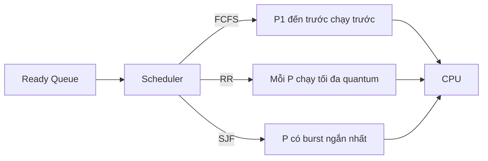
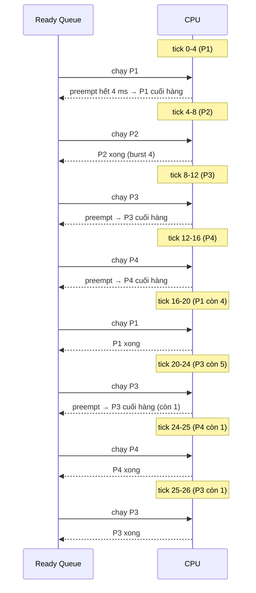

# Compare round-robin and FCFS CPU scheduling.

> So sánh hai thuật toán lập lịch CPU cơ bản FCFS (First-Come, First-Served) và Round-Robin, kèm SJF (Shortest-Job-First) và starvation, minh họa tính waiting time bằng ví dụ số, nêu đánh đổi response time vs throughput và khi nào OS/Linux thật dùng.

Chủ đề: Operating Systems · Ngày: 2026-10-16

## 1. Là gì

Lập lịch CPU chọn process nào chạy tiếp khi CPU rảnh. FCFS (First-Come, First-Served) xếp hàng theo thứ tự đến, không preempt (một process giữ CPU đến khi xong hoặc tự nhường cho I/O). Round-Robin (RR) cũng xếp hàng theo thứ tự đến nhưng preempt theo quantum (vd 4-100 ms): chạy đủ quantum thì đưa về cuối hàng. SJF (Shortest-Job-First, còn gọi SJN) chọn process có burst time (thời gian CPU cần) ngắn nhất, có thể preempt (SRTF) hoặc không.

*Sơ đồ vị trí: scheduler đọc ready queue và chọn một process theo policy (FCFS / RR / SJF) rồi dispatch lên CPU.*

### Trả lời 30 giây

"FCFS xếp hàng theo thứ tự đến, chạy đến khi xong hoặc nhường do I/O, không preempt — dễ implement nhưng một process dài có thể khiến process ngắn chờ lâu (convoy effect). Round-Robin cũng xếp theo thứ tự đến nhưng chia thời gian thành quantum (10-100 ms), preempt theo clock tick, đưa về cuối hàng — fair, response time tốt cho hệ tương tác. SJF chọn burst ngắn nhất, tối ưu average waiting time nhưng cần dự đoán burst và dễ gây starvation cho process dài. Linux CFS dùng weighted fair queueing (red-black tree theo vruntime) chứ không dùng RR thuần; Round-Robin vẫn thấy trong hệ thời gian thực mềm và trong lý thuyết phỏng vấn OS."

## 2. Cơ chế cốt lõi

### Bước 1. Mô hình process và burst time

Giả định: 4 process P1-P4 với arrival time và CPU burst (ms):

| Process | Arrival | Burst |
|---|---|---|
| P1 | 0 | 8 |
| P2 | 1 | 4 |
| P3 | 2 | 9 |
| P4 | 3 | 5 |

Waiting time = thời gian trong ready queue chờ được CPU. Turnaround time = thời điểm hoàn thành - arrival.

### Bước 2. FCFS chạy

Xếp theo arrival, chạy đến khi xong. Thứ tự: P1, P2, P3, P4.

- P1: chạy 0-8. P2 chờ 7 ms (từ 1 đến 8).
- P2: chạy 8-12. P3 chờ 10 ms (từ 2 đến 12).
- P3: chạy 12-21. P4 chờ 18 ms (từ 3 đến 21).
- P4: chạy 21-26.

Waiting time: P1=0, P2=7, P3=10, P4=18. Trung bình = (0+7+10+18)/4 = 8.75 ms.

Convoy effect: nếu P1 = 100 ms, P2 = 5 ms đến ở ms 1, P2 phải chờ 99 ms dù chỉ cần 5 ms CPU.

### Bước 3. Round-Robin chạy

Quantum q = 4 ms (giả định cho ví dụ). Cùng 4 process, thứ tự P1, P2, P3, P4 nhưng preempt mỗi 4 ms.

*Luồng thời gian Round-Robin với quantum 4 ms: mỗi process chạy tối đa q, hết q hoặc xong thì đưa về cuối hàng.*

Kết quả: completion time P1=20, P2=8, P3=26, P4=25. Waiting = completion - burst - arrival: P1=20-8-0=12, P2=8-4-1=3, P3=26-9-2=15, P4=25-5-3=17. Trung bình = (12+3+15+17)/4 = 11.75 ms.

Quan sát: RR làm tăng average waiting so với FCFS trong ví dụ này (8.75 vs 11.75) nhưng giảm response time của job ngắn. Ví dụ: P2 đến ở ms 1, FCFS phải đợi đến 8 (7 ms chờ); RR chạy ở 4 (3 ms chờ).

### Bước 4. SJF chạy

Khi scheduler chọn, lấy process ready có burst nhỏ nhất. Non-preemptive SJF: tại thời điểm CPU rảnh, chọn process ready nhỏ nhất. Preemptive SJF (SRTF): process mới đến có burst nhỏ hơn thời gian còn lại của process hiện tại thì preempt.

Cùng ví dụ 4 process với SJF non-preemptive (cần dự đoán burst):

- t=0: chỉ P1 (burst 8) → chạy P1 đến t=8.
- t=8: P2 (4), P3 (9), P4 (5) đã đến → chọn P2 (burst 4 nhỏ nhất).
- t=12: còn P3 (9), P4 (5) → chọn P4 (5).
- t=17: còn P3 (9) → chạy P3 đến t=26.

Waiting: P1=0, P2=8-1-4=3, P3=26-2-9=15, P4=17-3-5=9. Trung bình = (0+3+15+9)/4 = 6.75 ms — tốt nhất trong ba policy.

SJF tối ưu average waiting time trên lý thuyết nhưng cần biết burst trước. Trong thực tế OS dùng ước lượng exponential moving average: `τ(n+1) = α * t(n) + (1-α) * τ(n)` với α ~0.5.

### Bước 5. Starvation

SJF / SRTF có thể để process dài chờ vô tận nếu luôn có process ngắn mới đến. Giải pháp: aging — tăng priority của process theo thời gian chờ, hoặc mix SJF với priority scheduler có điều chỉnh dynamic.

Round-Robin không starvation cùng mức (mỗi process trong queue được chạy trong vòng N*q). FCFS cũng không starvation (queue FIFO) nhưng có convoy effect.

### Ví dụ chạy từng bước

Kịch bản: backend payment processor xử lý 4 job đến gần nhau (P1-P4) với burst time khác nhau, scheduler policy đổi từ FCFS sang RR quantum 4 để bạn so sánh response time của job ngắn — đây là lý do chính production chọn RR cho interactive workload.

Cùng dataset Phần 2 (P1=0/8, P2=1/4, P3=2/9, P4=3/5).

Bước 1. Queue t=0 chỉ có P1. FCFS cho P1 chạy 0→8 (toàn bộ burst 8). Trong lúc đó P2 đến lúc t=1, P3 lúc t=2, P4 lúc t=3 — phải xếp hàng.
Bước 2. t=8 hết P1. Scheduler chạy P2 (đã chờ 7 ms).
Bước 3. t=12 xong P2. P3 chạy 12→21. P4 đã chờ 18 ms kể từ lúc đến.
Bước 4. t=21 P4 chạy 21→26.

Trạng thái FCFS: completion P1=8, P2=12, P3=21, P4=26. Waiting P1=0, P2=7, P3=10, P4=18. Avg = 8.75 ms (đã tính lại bằng script).

| Job | Arrival | Burst | FCFS wait | RR wait |
|---|---|---|---|---|
| P1 | 0 | 8 | 0 | 12 |
| P2 | 1 | 4 | 7 | 3 |
| P3 | 2 | 9 | 10 | 15 |
| P4 | 3 | 5 | 18 | 17 |
| Avg | | | 8.75 | 11.75 |

Bước 5. Đổi sang RR quantum 4. Queue lúc t=0: [P1]. P1 chạy 0→4, rem=4, đưa cuối hàng. Queue: [P2, P3, P4 (đã đến), P1]. P2 chạy 4→8 và xong luôn (burst 4). P3 8→12 rem=5. P4 12→16 rem=1. P1 16→20 rem=0 xong. P3 20→24 rem=1. P4 24→25 rem=0 xong. P3 25→26 rem=0 xong.

Trạng thái RR: completion P2=8, P1=20, P4=25, P3=26. Waiting P1=12, P2=3, P3=15, P4=17. Avg = 11.75 ms (đã tính lại bằng script mô phỏng RR, arrival đưa vào hàng trước process vừa bị preempt).

Bước 6. So sánh response time job ngắn nhất (P2). FCFS: P2 phải đợi P1 chạy xong mới tới lượt → response = 7 ms. RR: P2 chạy ngay tick thứ 2 → response = 3 ms. Giảm 57 % độ trễ phản hồi cho job ngắn — đó là động lực production chọn RR cho server xử lý request hỗn hợp. Đổi lại average waiting tệ hơn vì job dài (P1, P3) chịu thêm context switch overhead.

Biến thể "nếu sai thứ tự": nếu scheduler nhầm áp dụng FCFS khi workload là request API phản hồi nhanh, P2-P4 phải đợi P1 chạy 8 ms dù chỉ cần vài ms CPU. Triệu chứng: p99 latency của payment endpoint tăng vọt. Cách bảo vệ: đo p99 latency per endpoint trước/sau khi đổi scheduler; giám sát `perf stat -e context-switches` để chặn overhead.

Điều rút ra: RR làm tăng average waiting nhưng giảm response time của job ngắn — đúng như câu hỏi 12 ở phần 3B ("trade fairness cho response time"). "Công bằng" phụ thuộc metric: avg waiting hay response time.

## 3. Câu hỏi phỏng vấn

### 3A. Câu hỏi đào sâu

Câu 1. Tính waiting time cho 4 process theo FCFS.

**Trả lời ngắn:** FCFS waiting: P1=0, P2=7, P3=10, P4=18. Average = 8.75 ms. Convoy effect xảy ra khi process dài đến trước.

**Đào sâu:**
- Điều kiện FCFS tối ưu: tất cả process đến cùng lúc (arrival=0) và burst tăng dần → average waiting tối ưu bằng SJF. Thứ tự arrival quyết định hoàn toàn.
- Convoy effect: một process burst=100ms đến ms 0, process burst=5ms đến ms 1 → avg waiting ~97.5ms cho job ngắn.
- Convoy effect còn làm CPU underutilized: process dài chạy I/O-bound process phía sau bị block, CPU idle trong khi I/O chưa xong.

**Bẫy:** "FCFS luôn tệ." Không — FCFS tốt khi burst ngắn trước, hoặc workload đồng nhất. Scheduler Linux dùng CFS không phải FCFS.

**Follow-up:** Tính turnaround time cho FCFS? Turnaround = waiting + burst. P1=8, P2=7+4=11, P3=10+9=19, P4=18+5=23. Average = 15.25 ms.

Câu 2. Round-Robin quantum quá nhỏ hoặc quá lớn thì sao?

**Trả lời ngắn:** Quantum quá nhỏ → overhead quá lớn (context switch thường xuyên), CPU chỉ switch thay vì làm việc. Quantum quá lớn → RR trở gần FCFS, response time tệ, mất ưu điểm fairness.

**Đào sâu:**
- Quantum nhỏ (vd 1ms): context switch tốn ~1-5 µs overhead, có thể chiếm 0.1-0.5% CPU time nếu hợp lý, nhưng với hàng nghìn context switch/s thì overhead đáng kể. Linux default quantum cho desktop ~6-100 ms.
- Quantum lớn (vd 500ms): mỗi process chạy rất lâu trước khi preempt. Response time cho process tương tác bị tệ: user gõ phím phải chờ 500ms.
- Best practice: quantum ~40% của burst trung bình. Nếu avg burst = 100ms, quantum ~40ms.
- Linux CFS không dùng RR thuần; priority weight ảnh hưởng share của CPU time. Interactive process có weight cao hơn → chạy nhiều hơn.

**Bẫy:** "Quantum càng lớn càng tốt vì ít switch." Sai — quantum lớn → high response time, unfair cho interactive workload.

**Follow-up:** Context switch tốn bao nhiêu? Phụ thuộc kiến trúc. Linux: ~1-5 µs cho switch đơn giản, ~10-50 µs khi có TLB flush. macOS XNU: tương tự.

Câu 3. SJF có thực sự tối ưu không? Điều kiện nào?

**Trả lời ngắn:** SJF non-preemptive tối ưu average waiting time khi biết trước burst chính xác và tất cả process cùng arrival time. Khi arrival khác nhau hoặc burst không biết trước, tối ưu không còn đảm bảo.

**Đào sâu:**
- Proof: swap argument — nếu có một đoạn chạy P-long rồi P-short, đổi thứ tự P-short trước → waiting P-short giảm, P-long tăng ít hơn → average giảm.
- Điều kiện: tất cả arrival = 0, burst chính xác. Thực tế không thỏa mãn.
- Ước lượng burst: exponential moving average với α=0.5 phổ biến. Sai số lớn → scheduler chọn sai process.
- SRTF (preemptive SJF) còn tối ưu hơn vì có thể preempt khi process mới đến ngắn hơn remaining time. Nhưng starvation nghiêm trọng hơn.
- Trong thực tế không có OS nào dùng SJF thuần vì không biết burst trước.

**Bẫy:** "SJF luôn tối ưu average waiting time." Đúng chỉ khi cùng arrival và burst chính xác. Sai trong hầu hết trường hợp thực tế.

**Follow-up:** Exponential moving average ước lượng burst tốt không? Tốt cho workload ổn định, kém khi workload burst thay đổi đột ngột (vd job mới khác hẳn job cũ).

Câu 4. Starvation trong SJF là gì? Cách giải quyết?

**Trả lời ngắn:** Starvation = process dài không bao giờ được CPU nếu luôn có process ngắn đến. Giải quyết bằng aging: tăng priority theo thời gian chờ, hoặc dùng multi-level feedback queue (MLFQ).

**Đào sâu:**
- Ví dụ: P1 burst=1000ms đến ms 0. P2-P100 mỗi burst=1ms đến lần lượt ms 1-99. P1 phải chờ đến ms 1099 (chạy sau tất cả). Nếu P101 đến ở ms 1100 → P1 tiếp tục chờ.
- Aging trong MLFQ: process dùng nhiều CPU time → giảm priority (xuống queue thấp hơn, quantum lớn hơn). Process chờ lâu → tăng priority. BSD Unix dùng biến `cpu_usage` và decay.
- MLFQ: nhiều queue, mỗi queue có quantum khác nhau. Interactive process ở queue cao (quantum nhỏ, response nhanh). CPU-bound ở queue thấp. Linux CFS không dùng MLFQ mà dùng weighted fair queueing.
- Priority ceiling / priority inheritance: giải quyết priority inversion (process thấp giữ lock mà process cao chờ), không phải starvation SJF.

**Bẫy:** "Starvation chỉ xảy ra trong SJF." Sai — FCFS không starvation, RR không starvation, nhưng priority scheduling không aging cũng starvation.

**Follow-up:** Linux CFS có starvation không? Không trên lý thuyết — red-black tree đảm bảo mỗi process nhận weight% CPU time. Tuy nhiên trên hệ thực có thể bị system daemons chiếm CPU.

Câu 5 (Debug). CPU 100% nhưng throughput thấp, response time cao. Lập lịch có vấn đề gì?

**Trả lời ngắn:** Kiểm tra quantum vs context switch overhead, xem có convoy effect không, kiểm tra scheduler policy hiện tại. Bước: `top`/`htop` xem load, `vmstat 1` xem CPU idle, `cat /proc/sched_debug` trên Linux xem scheduler state.

**Đào sâu:**
- Bước 1: `vmstat 1` — nếu `r` (runnable) >> CPU count và `id` = 0 → CPU-bound nhưng có thể scheduler không cho process đúng CPU.
- Bước 2: `cat /proc/<pid>/sched` — xem `se.vruntime`, `nr_switches`. Process chạy nhiều nhưng `vruntime` cao bất thường → bị throttling.
- Bước 3: kiểm tra CFS scheduler: `cat /proc/sys/kernel/sched_min_granularity_ns`, `sched_latency_ns`. Quantum quá nhỏ → context switch overhead chiếm nhiều. Quantum quá lớn → high latency.
- Bước 4: `perf sched latency` — xem latency distribution của scheduler. Nếu max latency cao → có process bị starve.
- Bước 5: kiểm tra CPU throttling (`cat /proc/cpuinfo | grep MHz`, `turbostat`). Intel P-state throttling gây 100% load nhưng throughput thấp.

**Bẫy:** "Tăng nice value sẽ giải quyết." Nice chỉ thay đổi priority, không giải quantum. Nếu workload CPU-bound, nice không giúp nếu tất cả cùng nice.

**Follow-up:** Làm sao đổi scheduler cho process cụ thể? `chrt -f 99 <pid>` đặt FIFO scheduler với priority cao nhất. `schedtool` hoặc `taskset` affinity.

Câu 6 (Thiết kế). Thiết kế scheduler cho web server xử lý 10.000 request/giây.

**Trả lời ngắn:** Mỗi web server dùng worker process/thread per connection (Apache prefork) hoặc event-loop (nginx). Scheduler OS chịu trách nhiệm process/thread scheduling; app-level dùng epoll/kqueue + non-blocking I/O. Cần cân bằng latency (interactive) vs throughput (batch).

**Đào sâu:**
- Yêu cầu: low latency per request (~50-200ms), high throughput (10K req/s), fairness giữa client.
- Quyết định 1: event-driven (nginx/node) vs thread pool (Apache). Event-driven: 1 process, many connections, scheduler OS ít context switch. Thread pool: many threads, OS scheduler quản.
- Quyết định 2: request scheduling.nginx dùng round-robin ở app-level qua epoll — mỗi cycle gửi cho worker một connection mới. Linux epoll_wait() trả về fd ready, worker xử lý.
- Điểm nghẽn: nếu worker bị block (slow DB query), connection phải chờ. Giải pháp: connection pool, async I/O (io_uring trên Linux 5.1+), load shedding khi overload.
- Giám sát: p99 latency > threshold → kiểm tra scheduler latency qua `perf sched`. Nếu `wait_response` cao → có request chờ lâu trong run queue.

**Bẫy:** "Dùng RR ở OS level cho request fair." OS scheduler không biết request, chỉ biết process/thread. Nếu mỗi request là thread riêng, OS RR dùng được. Nhưng context switch overhead rất lớn ở 10K req/s.

**Follow-up:** io_uring giúp gì? Giảm syscall overhead, cho phép async I/O mà không block thread. Linux 5.1+. nginx hỗ trợ từ 1.25+.

### 3B. Câu hỏi phỏng vấn liên quan

Câu 7. FCFS vs RR vs SJF: khi nào dùng cái nào?

**Trả lời:** FCFS cho batch job không cần response time (compile, render). RR cho hệ tương tác (desktop, server) cần fairness và low latency. SJF/MFQ cho workload biết burst hoặc cần tối ưu throughput dài hạn. Thực tế OS dùng hybrid: Linux CFS (weighted fair queue), macOS/XNU (multi-level feedback).

Câu 8. Context switch tốn bao nhiêu? Ai làm gì?

**Trả lời:** Context switch tốn ~1-10 µs trên phần cứng hiện đại. Kernel lưu/restore: registers, program counter, stack pointer, FPU/SIMD state (nếu có). TLB và cache bị flush partial — đây là cost lớn nhất. Linux x86: ~5-20 µs. macOS XNU: tương tự. TLB flush: 100-1000 cycles (~0.1-1 µs) nhưng miss penalty sau đó ~10-100 µs.

Câu 9. Multi-level Feedback Queue (MLFQ) hoạt động thế nào?

**Trả lời:** Nhiều queue, queue cao có quantum nhỏ (interactive), queue thấp quantum lớn (batch). Process mới vào queue cao. Dùng nhiều CPU time → xuống queue thấp hơn. Chờ lâu → lên queue cao. BSD và Windows Classic dùng MLFQ. Linux CFS không phải MLFQ.

Câu 10. Priority scheduling có starvation không?

**Trả lời:** Có nếu không có aging. Process priority thấp có thể không bao giờ chạy nếu process priority cao liên tục đến. Giải quyết: aging tăng priority theo thời gian chờ, hoặc dùng fair share scheduling (Linux CFS).

Câu 11. Convoy effect là gì? Cho ví dụ.

**Trả lời:** Convoy effect: một process dài chạy trước khiến nhiều process ngắn phải chờ. Ví dụ: xe tải lớn đến trước ở góc phố, xe máy phải xếp hàng sau dù chỉ cần qua điểm giao. Trong FCFS: P1 burst=100ms đến ms0, P2-P10 mỗi burst=5ms đến ms1-9 → tất cả phải chờ P1 xong, avg waiting = ~47ms.

Câu 12. True or false: "Round-Robin luôn công bằng hơn FCFS."

**Trả lời:** Đúng về fairness (mỗi process được chạy trong N*q ms), nhưng average waiting time có thể tệ hơn FCFS (xem ví dụ 4 process: 11.75 vs 8.75 ms). RR trade fairness cho response time. "Công bằng" cần định nghĩa: nếu công bằng = mỗi process nhận equal CPU time → RR; nếu công bằng = avg waiting tối ưu → SJF.

Câu 13. Linux CFS dùng thuật toán gì?

**Trả lời:** Completely Fair Scheduler (CFS) dùng weighted fair queueing với red-black tree. Mỗi process có `vruntime` (virtual runtime = wall time / weight). Scheduler luôn chạy process có `vruntime` thấp nhất. Weight tỉ lệ nghịch với nice value (-20 to +19). Không dùng RR hay FCFS thuần. Introduced in Linux 2.6.23 (2007).

Câu 14. Soft real-time vs hard real-time scheduling khác nhau thế nào?

**Trả lời:** Hard real-time: deadline không được miss (ví dụ: ABS brake, pacemaker). OS dùng rate-monotonic hoặc earliest-deadline-first (EDF). Linux không đảm bảo hard real-time. Soft real-time: deadline nên meet nhưng miss được (ví dụ: video playback, audio). Linux hỗ trợ SCHED_FIFO, SCHED_RR, SCHED_DEADLINE (từ 3.14). macOS XNU có dispatch queues với QoS.

Câu 15. Điều gì xảy ra khi quantum = 0?

**Trả lời:** Quantum = 0 có nghĩa là process bị preempt ngay lập tức sau mỗi lần được CPU. Hệ thống không làm gì ngoài context switch — CPU utilization ~0%. Không OS nào cho phép quantum = 0. Quantum tối thiểu thường = 1 tick (~1 ms trên Linux x86 với HZ=1000).

## 4. Đánh đổi và sự cố production

### So sánh FCFS, RR, SJF

| Tiêu chí | FCFS | Round-Robin | SJF/SRTF |
|---|---|---|---|
| Average waiting time | Trung bình | Cao hơn FCFS | Thấp nhất (lý thuyết) |
| Response time | Cao (process dài) | Thấp, đồng đều | Khó đoán |
| Throughput | Tốt (ít switch) | Thấp hơn FCFS | Tốt |
| Fairness | Không công bằng (convoy) | Công bằng | Không công bằng (starvation) |
| Context switch | Ít | Nhiều | Trung bình |
| Implement | Rất đơn giản | Đơn giản | Cần ước lượng burst |
| Starvation | Không | Không | Có |
| Phù hợp | Batch, burst đồng nhất | Interactive, server | Known burst, batch |

### Năm failure mode

| Triệu chứng | Nguyên nhân gốc | Cách kiểm tra | Cách sửa |
|---|---|---|---|
| High response time cho interactive task | Quantum quá lớn | `perf sched latency` max high | Giảm quantum hoặc dùng MLFQ |
| CPU 100% nhưng throughput thấp | Convoy effect (FCFS) | `vmstat 1`, xem run queue | Đổi sang RR hoặc CFS |
| Process bị starve | SJF không aging hoặc priority cao | `cat /proc/<pid>/sched` vruntime | Bật aging, dùng CFS |
| Context switch quá nhiều | Quantum quá nhỏ | `vmstat 1` cs/col, `perf stat -e context-switches` | Tăng quantum |
| Priority inversion | Process thấp giữ lock mà cao cần | `cat /proc/lock_stat` | Priority inheritance (Linux: PI mutex) |

## 5. Cheat sheet

| Chủ đề | Con số / quy tắc |
|---|---|
| FCFS avg waiting | Tối ưu khi burst tăng dần, cùng arrival |
| RR quantum | ~40% avg burst; quá nhỏ = overhead, quá lớn = convoy |
| SJF avg waiting | Tối ưu nhất khi burst chính xác |
| Starvation | SJF/SRTF, priority không aging |
| Aging | Tăng priority theo thời gian chờ |
| CFS (Linux) | Red-black tree, vruntime, weight = 1/nice |
| Context switch | ~1-10 µs + TLB/cache miss penalty |
| MLFQ | Queue cao quantum nhỏ, queue thấp quantum lớn |

**Học tiếp:**
- [context-switching](context-switching.md) — chi tiết context switch
- [process-vs-thread](process-vs-thread.md) — process và thread trong scheduler
- [priority-inversion](priority-inversion.md) — khi priority thấp chặn priority cao