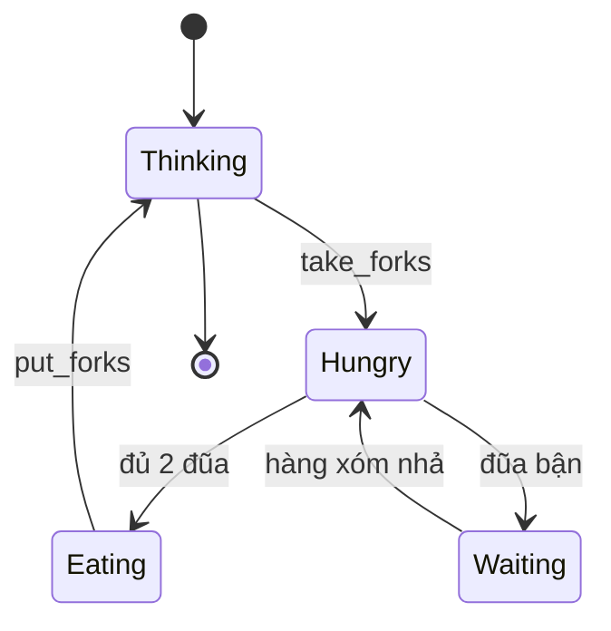

# What is the dining philosophers problem?

> Bài này mô tả bài toán N triết gia ngồi quanh bàn với N đũa, mỗi người cần hai chiếc đũa để ăn, minh họa deadlock và starvation, rồi so sánh bốn giải pháp kinh điển: tránh deadlock (lock theo thứ tự), phá hold-and-wait (xin cả hai đũa), phá no preemption (try-and-back), và giải pháp của Dijkstra với semaphore có trạng thái. Bài [os-deadlock](os-deadlock.md) giải thích nền tảng deadlock; bài [mutex-vs-semaphore](mutex-vs-semaphore.md) bàn về mutex và semaphore; bài [priority-inversion](priority-inversion.md) liên quan scheduling.

Chủ đề: Operating Systems · Ngày: 2026-10-16

## 0. Nền tảng trước khi đọc

**Bối cảnh:** Lớp phần mềm quản lý CPU, bộ nhớ, tiến trình và thiết bị. Ứng dụng gọi OS thay vì tự điều khiển phần cứng trực tiếp.

**Nói đơn giản:** Bài toán dining philosophers mô phỏng nhiều task cùng cần tài nguyên, cho thấy deadlock và starvation có thể xuất hiện thế nào.

**Từ khóa cần biết:** process = chương trình đang chạy; thread = luồng thực thi; kernel = phần lõi có quyền điều khiển máy.

**Ví dụ dễ hình dung:** Năm worker cần hai resource; nếu mỗi worker giữ một resource rồi chờ resource kia, cả nhóm có thể deadlock.

Khi đọc, luôn hỏi ba câu: nó giải quyết vấn đề gì, nó làm việc theo những bước nào, và khi nào không nên dùng?

**Cách học bài này:** Đọc phần này trước để nắm từ khóa; đọc phần 1 để lấy câu trả lời 30 giây; đọc phần 2 để hiểu cơ chế; cuối cùng mở từng câu hỏi ở phần 3 để luyện nói. Các con số và lệnh trong bài là bằng chứng cho câu trả lời, không cần học thuộc nếu chưa hiểu cơ chế.

## 1. Là gì

### Đọc nhanh trước khi đi sâu

**Ý chính:** Bài toán dining philosophers mô phỏng nhiều task cùng cần tài nguyên, cho thấy deadlock và starvation có thể xuất hiện thế nào.

**Ví dụ interview:** Năm worker cần hai resource; nếu mỗi worker giữ một resource rồi chờ resource kia, cả nhóm có thể deadlock.

**Luồng 4 bước:**

1. Mỗi worker cần hai resource để làm việc.
2. Mỗi worker lấy resource thứ nhất rồi chờ resource thứ hai.
3. Nếu tất cả cùng làm vậy, tạo vòng chờ và deadlock.
4. Đổi thứ tự lấy resource, giới hạn worker hoặc dùng trylock để phá vòng.

**Nói như trong interview:** Bài toán dining philosophers mô phỏng nhiều task cùng cần tài nguyên, cho thấy deadlock và starvation có thể xuất hiện thế nào. Hãy nói theo bốn bước trên trước; nếu interviewer hỏi sâu, chuyển sang cơ chế **Bước 1. Phát biểu chính thức**, rồi nêu trade-off và failure mode ở các phần sau.

## 2. Cơ chế cốt lõi

### Bước 1. Phát biểu chính thức

- Có N triết gia P[0..N-1] và N đũa C[0..N-1].
- Triết gia i dùng đũa C[i] (bên trái) và C[(i+1) mod N] (bên phải).
- Mỗi triết gia thực hiện vòng lặp: `think() → take_forks() → eat() → put_forks()`.
- `take_forks` phải đảm bảo: hai đũa đều có sẵn, mutual exclusion (mỗi đũa chỉ một người giữ), không deadlock, không starvation.

### Bước 2. Giải pháp ngây thơ (gây deadlock)

```c
void *philosopher(void *arg) {
    int i = (int)arg;
    for (;;) {
        think();
        pthread_mutex_lock(&chopstick[i]);            // trái
        pthread_mutex_lock(&chopstick[(i+1) % N]);    // phải
        eat();
        pthread_mutex_unlock(&chopstick[(i+1) % N]);
        pthread_mutex_unlock(&chopstick[i]);
    }
}
```

Khi N triết gia đồng thời cầm đũa trái, tất cả sẽ chờ đũa phải — chuỗi circular wait. Hệ thống treo.

### Bước 3. Giải pháp 1 — Lock ordering (phá circular wait)

```c
void take_forks(int i) {
    int first = i < (i+1) % N ? i : (i+1) % N;     // đũa có chỉ số nhỏ trước
    int second = (i == first) ? (i+1) % N : i;
    pthread_mutex_lock(&chopstick[first]);
    pthread_mutex_lock(&chopstick[second]);
}
```

Mọi triết gia đều khóa đũa chỉ số nhỏ trước. Không thể tồn tại chuỗi chờ vòng tròn: triết gia i phải giữ đũa i và chờ đũa i+1, nhưng nếu triết gia i+1 cũng đang chờ đũa i+2, chuỗi đi theo một chiều. Không quay về.

### Bước 4. Giải pháp 2 — Tránh hold-and-wait (xin cả hai đũa một lúc)

Dùng một semaphore `room` cho phép tối đa N-1 triết gia vào phòng cùng lúc. Triết gia vào phòng, lấy cả hai đũa (đã đủ điều kiện vì chỉ có ≤ N-1 người cạnh tranh N đũa), ăn, ra. Lập luận: nếu chỉ N-1 người trong phòng, luôn có ít nhất một đũa rảnh trong nhóm đang chờ → không deadlock.

### Bước 5. Giải pháp 3 — Trylock với backoff ngẫu nhiên

```c
void take_forks(int i) {
    for (;;) {
        pthread_mutex_lock(&chopstick[i]);
        if (pthread_mutex_trylock(&chopstick[(i+1) % N]) == 0) return;
        pthread_mutex_unlock(&chopstick[i]);
        usleep(1000 + rand() % 1000);  // jitter tránh livelock
    }
}
```

Triết gia thử lấy đũa phải không block; nếu không được thì nhả đũa trái, đợi ngẫu nhiên, thử lại. Phá no preemption một phần (đũa trái được "tự nguyện" trả). Nhược: có thể starvation nếu một triết gia luôn thua.

### Bước 6. Giải pháp 4 — Dijkstra với state machine

```c
#define N 5
#define THINKING 0
#define HUNGRY   1
#define EATING   2
int state[N];
pthread_mutex_t mutex = PTHREAD_MUTEX_INITIALIZER;  // bảo vệ state[]
sem_t sem[N];                                        // mỗi triết gia một semaphore

void test(int i) {
    if (state[i] == HUNGRY &&
        state[(i+N-1)%N] != EATING &&
        state[(i+1)%N] != EATING) {
        state[i] = EATING;
        sem_post(&sem[i]);
    }
}
void take_forks(int i) {
    pthread_mutex_lock(&mutex);
    state[i] = HUNGRY;
    test(i);
    pthread_mutex_unlock(&mutex);
    sem_wait(&sem[i]);    // block nếu chưa được cấp
}
void put_forks(int i) {
    pthread_mutex_lock(&mutex);
    state[i] = THINKING;
    test((i+N-1)%N);
    test((i+1)%N);
    pthread_mutex_unlock(&mutex);
}
```

Semaphore `sem[i]` chỉ `post` khi `state[i] = EATING` (đủ cả hai đũa). Khi nhả đũa, kiểm tra hai hàng xóm có đang đói và có khả năng ăn không. Critical section ngắn (chỉ truy cập `state[]`), deadlock tránh nhờ mutex toàn cục.

### Bước 7. State diagram cho mỗi triết gia



*Máy trạng thái: Thinking → Hungry → Eating → Thinking. Nếu đũa kẹt, triết gia vào Waiting cho tới khi hàng xóm nhả. Với giải pháp Dijkstra, Waiting không bao giờ kéo dài vĩnh viễn (liveness đảm bảo).*

### Bước 8. Quan sát

```bash
# Linux: chạy chương trình philosophers có debug output
./philosophers 5
# P0 thinking P1 hungry P2 eating P3 waiting P4 thinking

# Java: xem thread state
jstack <pid> | grep -E "BLOCKED|WAITING"
# java.lang.Thread.State: WAITING (parking) — chờ đũa
```

### Ví dụ chạy từng bước

Kịch bản: 5 triết gia P0–P4 ngồi quanh bàn tròn với 5 đũa C0–C5. Mỗi triết gia dùng đũa C[i] (trái) và C[(i+1) mod 5] (phải). Critical section ăn mất 50 ms. Dùng giải pháp ngây thơ (mỗi người cầm đũa trái trước), hệ thống sẽ deadlock khi mọi triết gia cùng bắt đầu đồng thời.

**Bước 1 (t = 0):** Scheduler đánh thức cả 5 triết gia. Mỗi người gọi `think()` xong, gọi `pthread_mutex_lock(&chopstick[i])` cho đũa trái. Tất cả 5 mutex lấy thành công gần như đồng thời (P0 giữ C0, P1 giữ C1, P2 giữ C2, P3 giữ C3, P4 giữ C4).

**Bước 2 (t = 0+):** Mỗi triết gia tiếp tục gọi `pthread_mutex_lock(&chopstick[(i+1)%5])` cho đũa phải. P0 xin C1 (giữ bởi P1), P1 xin C2 (giữ bởi P2), ..., P4 xin C0 (giữ bởi P0). Tất cả 5 thread block tại đây — chuỗi circular wait P0 → P1 → P2 → P3 → P4 → P0 hoàn tất.

**Trạng thái:**

| triết gia | đũa trái | đũa phải | trạng thái |
|---|---|---|---|
| P0 | C0 (giữ) | C1 (chờ, giữ bởi P1) | BLOCKED |
| P1 | C1 (giữ) | C2 (chờ, giữ bởi P2) | BLOCKED |
| P2 | C2 (giữ) | C3 (chờ, giữ bởi P3) | BLOCKED |
| P3 | C3 (giữ) | C4 (chờ, giữ bởi P4) | BLOCKED |
| P4 | C4 (giữ) | C0 (chờ, giữ bởi P0) | BLOCKED |

Không triết gia nào ăn, không ai nhả. Hệ thống treo.

**Bước 3:** `jstack <pid>` in 5 thread ở trạng thái `WAITING` hoặc `BLOCKED`, mỗi stack trace dừng tại `pthread_mutex_lock`. Số người đang ăn = 0. Có thể tái hiện deterministic bằng `CountDownLatch` đồng bộ 5 thread vào critical section cùng lúc.

**Bước 4 (fix: lock ordering):** Đổi thành `int first = min(i, (i+1)%5); int second = max(i, (i+1)%5);` rồi khóa `first` trước. P0 khóa C0 → C1; P1 khóa C1 → C2. Khi P1 khóa C1, P0 đang giữ C0 và chờ C1 — không ảnh hưởng. Không tồn tại chuỗi vòng vì thứ tự khóa là C0 → C1 → C2 → C3 → C4, không quay về.

**Bước 5 (kết quả sau fix):** Với N = 5 và lock ordering, tối đa `⌊N/2⌋ = 2` triết gia ăn cùng lúc (đã tính lại bằng script). Throughput giảm so với N = 5 nhưng không deadlock.

**Biến thể "nếu lỗi":** nếu dùng trylock với jitter nhỏ (1 ms) và N = 5, 5 triết gia có thể đồng thời retry cùng pattern — CPU 100% nhưng throughput = 0 (livelock). Tăng jitter lên 5–20 ms ngẫu nhiên giảm nhưng không triệt để; Dijkstra state machine là cách đúng.

Điều rút ra: ví dụ cho thấy lock ordering phá circular wait bằng quy ước thứ tự cố định, trả lời câu 3 phần 3A về thiết kế lock ordering trong hệ thống lớn.

## 3. Câu hỏi phỏng vấn

### 3A. Câu hỏi đào sâu

<details class="qa">
<summary>Câu 1. Phát biểu bài toán Dining Philosophers và chỉ ra điều kiện deadlock nào thỏa?</summary>

**Trả lời ngắn:** N triết gia ngồi vòng tròn với N đũa. Mỗi triết gia cần đũa trái + phải để ăn. Bốn điều kiện Coffman cùng thỏa: (1) mutual exclusion — mỗi đũa chỉ một người giữ; (2) hold-and-wait — triết gia cầm đũa trái rồi xin đũa phải; (3) no preemption — không ai cướp đũa; (4) circular wait — P0 chờ đũa 1 (của P1), P1 chờ đũa 2 (của P2), ..., P_{N-1} chờ đũa 0 (của P0).

**Đào sâu:**
- Mỗi đũa là mutex một instance → mutual exclusion tự nhiên.
- Triết gia không nhả đũa trái cho tới khi ăn xong → hold-and-wait không thể tránh nếu cứ pick tuần tự.
- Không cơ chế cưỡng đoạt → no preemption.
- Vòng tròn đảm bảo circular wait xuất hiện khi mọi người đồng thời cầm đũa trái.
- Ngay khi bốn điều kiện đồng thời đúng, deadlock xảy ra.

**Bẫy:** "Giải pháp lock ordering chỉ hoạt động nếu N chẵn". Sai — lock ordering hoạt động với mọi N; chỉ cần quy ước "đũa chỉ số nhỏ trước".

**Follow-up:** Tại sao N phải bằng số đũa? Nếu N < số đũa, có thể có nhiều triết gia ăn cùng lúc. Nếu N > số đũa, không phải deadlock mà starvation (một số triết gia không bao giờ có đủ đũa).
</details>

<details class="qa">
<summary>Câu 2. So sánh bốn giải pháp: lock ordering, hold-and-wait, trylock, Dijkstra state machine.</summary>

**Trả lời ngắn:** (1) Lock ordering: khóa đũa chỉ số nhỏ trước, phá circular wait. Đơn giản, hiệu năng tốt. (2) Hold-and-wait avoidance: semaphore `room` giới hạn N-1 người vào, phá điều kiện hold-and-wait. (3) Trylock + backoff: phá no preemption một phần; có thể livelock và starvation. (4) Dijkstra state machine: trạng thái + semaphore mỗi triết gia, đảm bảo correctness tuyệt đối; phức tạp hơn.

**Đào sâu:**
- Lock ordering: chi phí thấp, dễ kiểm tra, nhưng đòi hỏi quy ước đồng nhất. Nếu có 2 loại đũa (đũa ngắn/dài), thứ tự phức tạp hơn.
- Hold-and-wait: đảm bảo correctness tuyệt đối với N đũa, N-1 người, nhưng throughput giảm 1/N.
- Trylock: triển khai dễ nhất, nhưng không đảm bảo fairness. Hai triết gia có thể luân phiên thua lẫn nhau (livelock); jitter (backoff ngẫu nhiên) giảm nhưng không triệt.
- Dijkstra: critical section rất ngắn, chỉ truy cập `state[]`. Phù hợp N nhỏ (≤ 100). Đảm bảo không deadlock và liveness.

**Bẫy:** "Trylock + backoff luôn tránh được deadlock". Sai — có thể deadlock nếu hai triết gia lặp lại pattern cầm-trái, không-lấy-phải, nhả-trái, đợi, lặp lại đúng thời điểm. Hiếm nhưng có.

**Follow-up:** Giải pháp nào phù hợp production nhất? Lock ordering với mutex là phổ biến nhất; Dijkstra cho hệ thống yêu cầu correctness tuyệt đối (RTOS, kernel).
</details>

<details class="qa">
<summary>Câu 3. Giải pháp Dijkstra đảm bảo starvation-free thế nào?</summary>

**Trả lời ngắn:** Khi triết gia i nhả đũa, hàm `put_forks` kiểm tra cả hai hàng xóm (i-1 và i+1) có thể ăn được không. Nếu hàng xóm đang HUNGRY và hàng xóm của họ không EATING, semaphore của họ được `post`. Theo cảm ứng FIFO của semaphore, triết gia đợi lâu nhất được ưu tiên. Không có đảm bảo chính thức về thời gian chờ, nhưng liveness đảm bảo (nếu có triết gia HUNGRY mãi, sẽ tới lúc hàng xóm nhả).

**Đào sâu:**
- Semaphore `sem[i]` là counting semaphore khởi tạo 0; chỉ được `post` khi `state[i] = EATING`. Triết gia `wait` trên semaphore cá nhân này khi HUNGRY.
- `put_forks` kiểm tra hai hàng xóm vì nhả đũa trái là đũa phải của i-1, và nhả đũa phải là đũa trái của i+1.
- Tính đối xứng: nếu bạn thay đổi hàm kiểm tra, có thể phá fairness. Ví dụ chỉ kiểm tra một hàng xóm, hàng xóm kia có thể không bao giờ được phục vụ.
- Nếu dùng mutex Java thay semaphore, có thể dùng `ConditionVariable.signalAll()` thay vì kiểm tra thủ công.

**Bẫy:** "FIFO semaphore luôn công bằng". Phụ thuộc implementation — pthread semaphore có thể không FIFO trên một số hệ thống. POSIX chuẩn không bắt buộc FIFO.

**Follow-up:** Nếu thay Dijkstra state sensor bằng compare-and-swap có được không? Được — dùng CAS trên `state[]`, không cần mutex. Tuy nhiên, test() phải đảm bảo atomic giữa "đọc state hai hàng xóm" và "cập nhật state mình" — phức tạp hơn mutex.
</details>

<details class="qa">
<summary>Câu 4. Tại sao hold-and-wait avoidance cần N-1 người trong phòng, không phải N-2?</summary>

**Trả lời ngắn:** Vì có N đũa, nếu có N-1 người trong phòng, lập luận pigeonhole: mỗi người cần 2 đũa, tổng cầu là 2(N-1) = 2N-2, nhiều hơn N đũa. Nhưng điều đó không đảm bảo deadlock-free — quan trọng là "khi ai đó xin, luôn có đũa rảnh cho họ". Với N-1 người, tối đa N-1 người đang giữ 1 đũa, vẫn còn ít nhất 1 đũa rảnh. Triết gia vào luôn có thể lấy đủ 2 đũa (nếu đợi).

**Đào sâu:**
- Giảm từ N-1 xuống N-2: tối đa N-2 người giữ 2 đũa → 4 đũa bận, N-4 đũa rảnh, nhưng có N-3 người đang chờ. Không đảm bảo ai đó luôn có đủ đũa.
- Thực tế: dùng semaphore binary `room` cho phép N-1 thread vào. Triết gia vào `wait(&room)`, lấy cả hai đũa, ăn, nhả đũa, `post(&room)`.
- Nhược điểm: chỉ tối đa N-1 triết gia ăn cùng lúc (một người chờ ngoài phòng), throughput giảm. Với N lớn, vẫn đủ tốt.
- Đây là kỹ thuật tránh deadlock thật (phá hold-and-wait), không phải prevention hay avoidance.

**Bẫy:** "Semaphore room với giá trị N-2 cũng đúng". Sai — giảm quá nhiều, không còn đảm bảo ai cũng có thể vào.

**Follow-up:** Có thể tăng concurrency không? Có — kết hợp với lock ordering: vẫn giới hạn N-1 người trong phòng nhưng tận dụng tốt đũa; throughput vẫn ≤ N-1 vì 1 người chờ.
</details>

<details class="qa">
<summary>Câu 5. Dining Philosophers ánh xạ sang bài toán thực tế nào?</summary>

**Trả lời ngắn:** Mọi hệ thống nhiều thread cạnh tranh trên tập tài nguyên dùng chung theo cấu trúc vòng tròn: hai thread trao đổi message (cần lock hai channel), hai transaction update hai account (database), hai luồng ghi vào hai file qua cùng API. Bài toán gốc của Dijkstra chính là tổng quát của mọi deadlock nhiều tài nguyên.

**Đào sâu:**
- Database deadlock: hai transaction khóa hai row theo thứ tự ngược — chính là Dining với N=2.
- File system: hai process mở file A và B, sau đó flush theo thứ tự ngược.
- Network: hai thread gửi message qua hai channel lock riêng.
- Banking: hai account chuyển tiền cho nhau, mỗi bên lock account mình trước khi đọc bên kia → deadlock.
- Lesson: mọi hệ thống multi-resource có cấu trúc "vòng" đều có nguy cơ deadlock tương tự.

**Bẫy:** "Dining Philosophers chỉ là bài toán lý thuyết". Sai — nó là mô hình rút gọn của deadlock database (xem [database-deadlock](../Database/database-deadlock.md)).

**Follow-up:** Có variant nào khác không? Có — Producers-Consumers (một resource queue), Readers-Writers (nhiều reader, ít writer), Cigarette Smokers (ba resource với hai người).
</details>

<details class="qa">
<summary>Câu 6 (Debug). Code mô phỏng Dining Philosophers treo sau vài phút chạy. Bạn debug thế nào?</summary>

**Trả lời ngắn:** Lấy thread dump (`jstack` hoặc SIGQUIT → `gdb thread apply all bt`), kiểm tra tất cả các thread có đang chờ `pthread_mutex_lock` trên đũa nào. Nếu đúng N thread cùng chờ, xác nhận deadlock. Kiểm tra code: khóa theo thứ tự nào, có semaphore `room` không, có jitter không.

**Đào sâu:**
- Bước 1: `kill -3 <pid>` (SIGQUIT) trên JVM → in thread dump ra stderr. Tìm thread BLOCKED trên monitor của đũa nào.
- Bước 2: Nếu N thread cùng giữ 1 đũa và chờ 1 đũa khác → classic deadlock.
- Bước 3: Đếm số thread đang ăn; nếu 0 và không ai thoát → deadlock.
- Bước 4: Kiểm tra có semaphore `room` không. Nếu không → lỗi.
- Bước 5: Nếu dùng trylock + backoff, kiểm tra jitter có đủ lớn không. Jitter 1ms với N=5 có thể đồng bộ lại.
- Bước 6: Chạy với TSan hoặc Helgrind để xác nhận lock order.
- Bước 7: Tăng N lên 100 trong test song song — deadlock hiện ra nhanh hơn.

**Bẫy:** "Treo một lần là do race hiếm, không cần fix". Sai — race đã quan sát được là bug thật, fix trước khi vào production.

**Follow-up:** Làm sao viết test tái hiện deadlock? Dùng CountDownLatch để các thread vào critical section cùng lúc; lặp lại 10000 lần với random delay nhỏ.
</details>

<details class="qa">
<summary>Câu 7 (Thiết kế). Thiết kế một message broker nhiều luồng. Tránh deadlock kiểu Dining?</summary>

**Trả lời ngắn:** Chia resource theo layer: producer chỉ khóa producer queue, consumer chỉ khóa consumer queue. Nếu cần trao đổi giữa hai queue, dùng một message bus thread (single-threaded) hoặc dùng lock-free queue. Tránh cấu trúc vòng: nếu hai thread phải trao đổi, làm một chiều.

**Đào sâu:**
- **Producer-consumer pattern**: producer đẩy vào queue, consumer lấy từ queue. Nếu queue là thread-safe (concurrent queue), không có deadlock vì không có lock chéo.
- **Single-threaded dispatcher**: tất cả message qua một goroutine/channel (như Go) hoặc một actor; concurrency ở mức dispatcher đơn.
- **Pipeline không vòng**: thread A xử lý → đẩy cho thread B → thread C. Mỗi thread lock một tài nguyên riêng, không khóa chéo.
- **Tránh reentrancy**: nếu một hàm trong khi giữ lock gọi sang hàm khác cũng giữ lock khác, nguy cơ deadlock cao. Phân tích call graph.
- **Observability**: log mỗi lần thread lock và unlock; metric `lock_wait_time` qua Micrometer.

**Bẫy:** Mỗi producer khóa queue của mình, mỗi consumer khóa queue riêng — nhưng khi consumer cần gửi kết quả sang queue của producer khác, lock chéo xảy ra.

**Follow-up:** Khi nào nên dùng actor model (Akka, Erlang)? Khi hệ thống có nhiều state và message phức tạp; actor đảm bảo message xử lý tuần tự trong actor, loại bỏ lock phần lớn.
</details>

### 3B. Câu hỏi phỏng vấn liên quan

<details class="qa">
<summary>Câu 8. Dining Philosophers có thể mở rộng cho hơn N triết gia / N đũa không?</summary>

**Trả lời:** Có. Nếu N triết gia và M đũa với M > N: có thể nhiều triết gia ăn cùng lúc. Nếu N > M: không thể tất cả ăn, một số starve vĩnh viễn. Bài toán gốc N=N là điểm cân bằng critical. Thực tế ít dùng N>M; mọi giải pháp đều generalize dễ.
</details>

<details class="qa">
<summary>Câu 9. Tại sao semaphore cần ở giải pháp Dijkstra mà không cần ở lock ordering?</summary>

**Trả lời:** Lock ordering phá circular wait bằng quy tắc code, mỗi mutex xử lý độc lập — không cần semaphore. Dijkstra giữ nguyên cấu trúc (mỗi triết gia vẫn pick tuần tự) nhưng thêm một semaphore cá nhân để mỗi triết gia "chờ có đủ đũa" thay vì block trên mutex từng chiếc. Semaphore giúp triết gia yield CPU khi chưa đủ đũa, tránh busy-spin.
</details>

<details class="qa">
<summary>Câu 10. Trong giải pháp Dijkstra, vai trò của mutex `mutex` là gì?</summary>

**Trả lời:** Mutex `mutex` bảo vệ mảng `state[]` và lời gọi `test()`. Critical section cực ngắn. Nó đảm bảo khi một triết gia đổi state và test hàng xóm, không race với triết gia khác cũng đang đổi state. Không dùng `mutex` để khóa đũa — đũa vẫn là mutex riêng hoặc biến điều kiện.
</details>

<details class="qa">
<summary>Câu 11. True or false: "Trylock với backoff jitter là giải pháp tốt nhất cho Dining Philosophers production."</summary>

**Trả lời:** Sai (nghe đúng nhưng sai). Trylock + jitter dễ implement, tránh deadlock trong hầu hết trường hợp, nhưng không đảm bảo fairness — một triết gia có thể luôn thua race khi N lớn và contention cao. Trong production ưu tiên lock ordering (đơn giản, có thể verify) hoặc Dijkstra (đảm bảo liveness) thay vì trylock. Trylock là lưới an toàn, không phải giải pháp chính.
</details>

<details class="qa">
<summary>Câu 12. Bài toán Cigarette Smokers khác Dining Philosophers thế nào?</summary>

**Trả lời:** Cigarette Smokers (Patil) có 3 smoker mỗi người cần 2 trong 3 nguyên liệu, 1 agent đặt 2 nguyên liệu ngẫu nhiên lên bàn. Khác Dining: resource là "combo" chứ không phải từng chiếc đũa, deadlock do signaling. Cùng lesson: tránh lock chéo, ưu tiên lock ordering hoặc điều phối viên.
</details>

<details class="qa">
<summary>Câu 13. Có thể giải Dining Philosophers hoàn toàn lock-free không?</summary>

**Trả lời:** Có — dùng compare-and-swap (CAS) trên `state[]` và atomic flag cho mỗi đũa. Mỗi triết gia thử CAS state từ HUNGRY sang EATING với điều kiện cả hai hàng xóm không EATING; fail thì retry. Ưu: không cần mutex, không deadlock. Nhược: livelock có thể xảy ra, cần backoff. JVM có `AtomicReferenceArray` phù hợp.
</details>

<details class="qa">
<summary>Câu 14. Cài đặt mutex theo thứ tự ưu tiên khác lock ordering thế nào?</summary>

**Trả lời:** Lock ordering là quy ước code (mọi thread khóa theo thứ tự). Mutex priority là cơ chế lock nội tại (priority inheritance — mutex "nâng" priority của thread giữ lock lên bằng thread cao nhất đang chờ). Priority inheritance giải priority inversion (xem [priority-inversion](priority-inversion.md)), không trực tiếp giải deadlock. Hai kỹ thuật bổ sung cho nhau.
</details>

<details class="qa">
<summary>Câu 15. Tại sao Java dùng `ReentrantLock.tryLock` thay vì Dijkstra semaphore trong thư viện chuẩn?</summary>

**Trả lời:** `ReentrantLock` đơn giản, đủ cho hầu hết use case. Semaphore cá nhân (mỗi triết gia một semaphore) chỉ phù hợp với mô hình "chờ có đủ điều kiện mới chạy", ví dụ producer-consumer bounded queue. Java `Semaphore` class không có FIFO guarantee trên mọi JVM, nên người ta thường dùng `ConditionVariable` thay (cũng dùng underlying lock).
</details>

## 4. Đánh đổi và sự cố production

### So sánh bốn giải pháp

| Giải pháp | Độ phức tạp | Throughput | Đảm bảo liveness | Phù hợp khi |
|---|---|---|---|---|
| Lock ordering | Thấp | Cao | Không đảm bảo (vẫn có thể chờ lâu) | Hầu hết ứng dụng |
| Hold-and-wait (room) | Trung bình | Trung bình (N-1 ăn) | Có | Hệ thống yêu cầu đảm bảo |
| Trylock + backoff | Thấp | Trung bình | Không (livelock) | Quick prototype |
| Dijkstra state machine | Cao | Trung bình | Có (FIFO sem) | RTOS, kernel |

### Năm failure mode

| Triệu chứng | Nguyên nhân gốc | Cách kiểm tra | Cách sửa |
|---|---|---|---|
| Treo từng đợt dù test thường pass | Lock order ngược giữa hai module | TSan, code review | Quy ước lock ordering chung |
| Một triết gia luôn đợi lâu nhất | Trylock + jitter nhỏ, livelock | Profiler đo wait time | Tăng jitter hoặc chuyển Dijkstra |
| Throughput giảm 50% khi N tăng | Semaphore `room` giới hạn N-1 | Đếm số thread đang ăn | Bỏ `room` dùng lock ordering |
| Deadlock khi thêm resource mới | Code mới vi phạm lock ordering | Code review checklist | Thêm test, CI TSan |
| Livelock khi load cao | Trylock fail liên tục, jitter không đủ | CPU cao nhưng throughput thấp | Exponential backoff, Dijkstra |

## 5. Cheat sheet

| Chủ đề | Con số / quy tắc cần nhớ |
|---|---|
| 4 điều kiện deadlock | ME, Hold-and-wait, No preemption, Circular wait |
| Giải pháp 1 | Lock ordering: khóa đũa chỉ số nhỏ trước |
| Giải pháp 2 | Semaphore room cho phép N-1 triết gia vào |
| Giải pháp 3 | Trylock + jitter ngẫu nhiên |
| Giải pháp 4 | Dijkstra: state THINKING/HUNGRY/EATING + semaphore cá nhân |
| Bài toán tổng quát | N triết gia, N đũa, mỗi người cần 2 đũa |
| Variant | Cigarette Smokers, Readers-Writers, Producers-Consumers |
| Công cụ debug | TSan, Helgrind, jstack, lockdep |

**Bài liên quan:**
- [os-deadlock](os-deadlock.md) — nền tảng bốn điều kiện Coffman
- [mutex-vs-semaphore](mutex-vs-semaphore.md) — mutex và semaphore khác nhau
- [priority-inversion](priority-inversion.md) — deadlock "gián tiếp" qua scheduler
- [database-deadlock](../Database/database-deadlock.md) — deadlock kiểu Dining trong database
