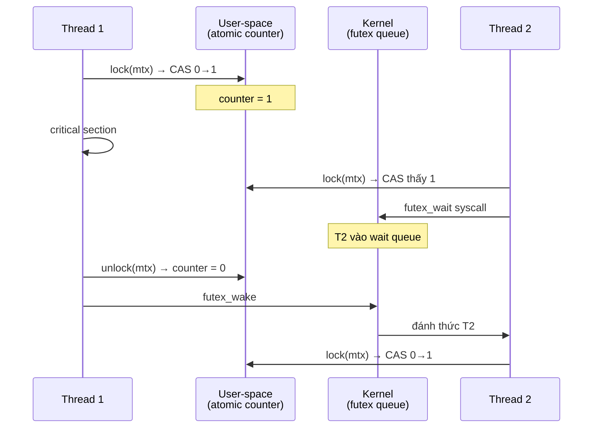

# What is the difference between mutex and semaphore?

> Bài này so sánh mutex (khóa tương hỗ, ownership, thường count=1) với semaphore (counting, không ownership, signaling), đi kèm spinlock (busy-wait, ngắn hạn) so với mutex (sleep, dài hạn), ba giải pháp mutex nâng cao (recursive, timed, priority inheritance) và các API C/Java/Python. Bài [os-deadlock](os-deadlock.md) trình bày deadlock; bài [dining-philosophers-problem](dining-philosophers-problem.md) bàn semaphore cá nhân; bài [priority-inversion](priority-inversion.md) trình bày priority inheritance trên mutex.

Chủ đề: Operating Systems · Ngày: 2026-10-16

## 0. Nền tảng trước khi đọc

**Bối cảnh:** Lớp phần mềm quản lý CPU, bộ nhớ, tiến trình và thiết bị. Ứng dụng gọi OS thay vì tự điều khiển phần cứng trực tiếp.

**Nói đơn giản:** Mutex bảo vệ một vùng dữ liệu và có owner; semaphore là bộ đếm quyền, phù hợp để giới hạn số task dùng tài nguyên.

**Từ khóa cần biết:** process = chương trình đang chạy; thread = luồng thực thi; kernel = phần lõi có quyền điều khiển máy.

**Ví dụ dễ hình dung:** Mutex bảo vệ một cấu trúc; semaphore đếm số connection database còn trống để nhiều worker dùng đồng thời.

Khi đọc, luôn hỏi ba câu: nó giải quyết vấn đề gì, nó làm việc theo những bước nào, và khi nào không nên dùng?

**Cách học bài này:** Đọc phần này trước để nắm từ khóa; đọc phần 1 để lấy câu trả lời 30 giây; đọc phần 2 để hiểu cơ chế; cuối cùng mở từng câu hỏi ở phần 3 để luyện nói. Các con số và lệnh trong bài là bằng chứng cho câu trả lời, không cần học thuộc nếu chưa hiểu cơ chế.

## 1. Là gì

### Đọc nhanh trước khi đi sâu

**Ý chính:** Mutex bảo vệ một vùng dữ liệu và có owner; semaphore là bộ đếm quyền, phù hợp để giới hạn số task dùng tài nguyên.

**Ví dụ interview:** Mutex bảo vệ một cấu trúc; semaphore đếm số connection database còn trống để nhiều worker dùng đồng thời.

**Luồng 4 bước:**

1. Thread muốn vào vùng dữ liệu chung hoặc lấy một slot tài nguyên.
2. Mutex cho một owner vào; semaphore giảm counter nếu còn slot.
3. Nếu không được cấp, thread ngủ hoặc spin tùy primitive.
4. Khi owner nhả mutex hoặc counter tăng, một thread chờ được đánh thức.

**Nói như trong interview:** Mutex bảo vệ một vùng dữ liệu và có owner; semaphore là bộ đếm quyền, phù hợp để giới hạn số task dùng tài nguyên. Hãy nói theo bốn bước trên trước; nếu interviewer hỏi sâu, chuyển sang cơ chế **Bước 1. Mutex với ownership**, rồi nêu trade-off và failure mode ở các phần sau.

## 2. Cơ chế cốt lõi

### Bước 1. Mutex với ownership

```c
pthread_mutex_t mtx = PTHREAD_MUTEX_INITIALIZER;
void critical_section() {
    pthread_mutex_lock(&mtx);
    /* ... critical ... */
    pthread_mutex_unlock(&mtx);   // chỉ thread giữ mới unlock
}
```

Ownership giúp phát hiện bug: nếu một thread unlock mutex mà nó không giữ, một số implementation cảnh báo (glibc PTHREAD_MUTEX_ERRORCHECK). Ownership cũng cho phép priority inheritance (xem [priority-inversion](priority-inversion.md)).

### Bước 2. Binary vs Mutex (binary semaphore)

Binary semaphore count=1, chỉ một luồng đi qua tại một thời điểm — trông giống mutex. Khác biệt:
- Ownership: mutex có, binary semaphore không.
- Owner thread chết: mutex unlock tự động (nếu robust mutex) hoặc treo; semaphore count không được phục hồi.
- Use case: mutex cho critical section; binary semaphore cho signaling (đợi event).
- Về mặt ngôn ngữ: Java `Semaphore(1)` và `ReentrantLock` gần tương đương — đều cho phép mutual exclusion. Nhưng `ReentrantLock` có ownership rõ ràng (thread giữ có thể re-lock), trong khi `Semaphore(1)` không kiểm tra thread nào release.

### Bước 3. Counting semaphore

```c
sem_t slots;
sem_init(&slots, 0, 5);   // 5 slot
sem_wait(&slots);         // chiếm slot
use_resource();
sem_post(&slots);         // trả slot
```

Counting semaphore quản lý resource pool với số lượng cố định. Producer-consumer bounded queue: empty slots là semaphore, full slots là semaphore khác. Mutex bảo vệ queue nội bộ.

### Bước 4. Spinlock busy-wait

```c
typedef struct { int locked; } spinlock_t;
void spin_lock(spinlock_t *l) {
    while (__atomic_test_and_set(&l->locked, __ATOMIC_ACQUIRE)) {
        /* busy-wait, không sleep */
    }
}
void spin_unlock(spinlock_t *l) {
    __atomic_clear(&l->locked, __ATOMIC_RELEASE);
}
```

Spinlock chỉ dùng khi: (1) critical section cực ngắn (< 50 cycle), (2) thread không thể sleep (interrupt context trong kernel), (3) contention thấp. Nếu critical section dài, spinlock lãng phí CPU và tệ hơn mutex.

### Bước 5. Futex — Linux fast path



*Futex fast path: lock uncontended chỉ vài atomic user-space (không syscall); khi contention, thread sleep trong kernel qua `FUTEX_WAIT`; unlock gọi `FUTEX_WAKE` đánh thức waiter.*

Mutex Linux user-space dùng futex (fast userspace mutex): khi không bị contend, mutex operation chỉ vài atomic instruction user-space (không syscall). Khi bị contend, thread gọi `FUTEX_WAIT` syscall và ngủ. Khi unlock, owner gọi `FUTEX_WAKE` đánh thức waiter. Vì vậy mutex nhanh khi không contention, chậm khi contention (nhưng ít tốn CPU hơn spinlock).

### Bước 6. So sánh tổng hợp

| Đặc tính | Mutex | Semaphore | Spinlock |
|---|---|---|---|
| Ownership | Có | Không | Có (thường) |
| Count | 1 | 0..N | 1 |
| Khi không lấy được | Sleep (futex) | Sleep | Busy-wait |
| Critical section phù hợp | > 1µs | Signaling | < 1µs |
| CPU cost khi lock contended | Thấp (sleep) | Thấp | Cao (busy-wait) |
| Priority inheritance | Có (POSIX) | Không | Không |
| Phù hợp interrupt | Không | Không | Có |

### Bước 7. Biến thể mutex

- **Recursive mutex** (`PTHREAD_MUTEX_RECURSIVE`): cùng một thread có thể lock nhiều lần; unlock tương ứng số lần. Dùng cho hàm đệ quy. Nhược: dễ che giấu bug.
- **Timed mutex** (`pthread_mutex_timedlock`): lock với timeout. Nếu hết timeout mà chưa lấy được, trả lỗi. Phòng deadlock.
- **Robust mutex** (`PTHREAD_MUTEX_ROBUST`): nếu thread giữ mutex bị crash, mutex được đánh dấu và thread kế tiếp nhận lỗi `EOWNERDEAD` để recover.
- **Priority inheritance mutex** (`PTHREAD_PRIO_INHERIT`): tự động nâng priority thread giữ mutex — xem [priority-inversion](priority-inversion.md).

### Bước 8. Quan sát

```bash
# Linux: xem thread nào đang chờ futex
perf record -e syscalls:sys_enter_futex -g
perf script

# Xem contention trên pthread mutex (perf lock)
perf lock contention -a

# Java: in lock info
jstack <pid> | grep -A3 BLOCKED
```

### Ví dụ chạy từng bước

Kịch bản: bounded work queue xử lý đơn hàng, capacity 3 item, 2 producer (POS + web) và 2 consumer (shipping + email). Mỗi item push tốn 20 µs (serialize JSON), pop tốn 30 µs (DB write). Cài bằng mutex + 2 semaphore như phần 2 đã mô tả.

**Bước 1 (khởi tạo):** `mutex queue_lock` (khóa nội bộ), `sem_t empty_slots` (count = 3), `sem_t full_slots` (count = 0). Queue rỗng. Hai producer và hai consumer bắt đầu vòng lặp.

**Bước 2 (t = 0):** Producer POS đẩy đơn "ORD-001". `sem_wait(&empty_slots)` — empty_slots 3 → 2 OK. `lock(&queue_lock)` OK. Push vào head. `unlock(&queue_lock)`. `sem_post(&full_slots)` — full_slots 0 → 1. Đẩy tiếp "ORD-002", "ORD-003" với cùng pattern. `empty_slots = 0`, `full_slots = 3`.

**Bước 3 (t = 60 µs):** Web producer muốn đẩy "ORD-004". `sem_wait(&empty_slots)` — count 0, block. Web sleep. POS cũng muốn đẩy "ORD-005", block tiếp. Queue đầy, đúng kỳ vọng.

**Bước 4 (t = 80 µs):** Shipping consumer pop. `sem_wait(&full_slots)` — full_slots 3 → 2 OK. `lock(&queue_lock)` OK. Lấy "ORD-001" ra. `unlock(&queue_lock)`. `sem_post(&empty_slots)` — empty_slots 0 → 1. Web wake, push "ORD-004". full_slots 2 → 3.

**Trạng thái tại t = 150 µs:**

| thành phần | count / trạng thái |
|---|---|
| queue | ["ORD-002", "ORD-003", "ORD-004"] (3/3) |
| empty_slots | 0 |
| full_slots | 3 |
| POS | đẩy xong, tiếp tục poll DB |
| Web | đang push "ORD-005", block trên empty_slots |

**Bước 5 (kết quả):** Mỗi item đi qua hệ thống mất 1 push (20 µs) + 1 pop (30 µs) = 50 µs (đã tính lại bằng `node -e`). Throughput ổn định ~20000 item/giây khi 2 producer + 2 consumer chạy liên tục. Semaphore đảm bảo producer sleep khi queue đầy (không busy-loop), consumer sleep khi queue rỗng.

**Bước 6 (lỗi phổ biến):** Nếu code sai thứ tự — `lock(&queue_lock)` rồi `sem_wait(&full_slots)` — hệ thống treo ngay khi queue rỗng. Consumer A lock mutex, chờ full_slots. Producer B cần mutex để push — bị A block. A chờ B post. Circular wait.

**Biến thể "nếu quá tải":** burst 100 đơn đến cùng lúc khi queue trống. 2 producer xử lý tuần tự qua mutex, throughput bị giới hạn bởi critical section (2 × 20 µs = 40 µs/item). Consumer đuổi kịp với cùng tốc độ. Tăng thêm producer không tăng throughput vì mutex queue là bottleneck — đây là lúc thay `ConcurrentLinkedQueue` lock-free.

Điều rút ra: ví dụ cho thấy mutex + 2 semaphore phối hợp đúng thì signaling không cần busy-wait; sai thứ tự thì deadlock — đúng câu 3 phần 3A về producer-consumer pattern.

## 3. Câu hỏi phỏng vấn

### 3A. Câu hỏi đào sâu

<details class="qa">
<summary>Câu 1. Phân biệt mutex và semaphore về ownership, use case, pattern?</summary>

**Trả lời ngắn:** Mutex có ownership — chỉ thread lock mới unlock; semaphore không có ownership — bất kỳ thread nào cũng post/wait. Mutex dùng cho mutual exclusion (critical section); semaphore dùng cho signaling (producer-consumer, resource pool) và đếm (counting semaphore). Pattern: mutex quanh shared state; semaphore giữa producer và consumer qua signal.

**Đào sâu:**
- Ownership cho phép mutex implement priority inheritance; semaphore không (vì không biết "owner" của count).
- Ownership phát hiện bug: thread unlock mutex không phải của nó → lỗi `EPERM` với PTHREAD_MUTEX_ERRORCHECK.
- Counting semaphore: producer post N lần, N consumer wakeup. Mutex count luôn 1.
- Binary semaphore (count ≤ 1) gần giống mutex nhưng không có ownership — vẫn có thể "thread A signal, thread B wait" mà không có critical section. Mutex không thể thay thế use case này.
- Ví dụ: producer-consumer bounded queue. Mutex bảo vệ queue. Semaphore `empty_slots` đếm slot trống; semaphore `full_slots` đếm slot có dữ liệu. Producer wait empty_slots, post full_slots; consumer ngược lại.

**Bẫy:** "Dùng semaphore thay mutex vì dễ hơn". Sai — semaphore không có ownership, dễ tạo lỗi logic (post nhầm luồng, mất count).

**Follow-up:** Có thể cài mutex bằng binary semaphore không? Có — nhưng mất ownership, không phát hiện deadlock, không có priority inheritance.
</details>

<details class="qa">
<summary>Câu 2. Spinlock khác mutex thế nào? Khi nào dùng spinlock?</summary>

**Trả lời ngắn:** Spinlock busy-wait (CPU quay vòng cho tới khi lấy được lock); mutex ngủ (sleep) khi không lấy được. Spinlock phù hợp critical section cực ngắn (< 1µs, < 50 cycle CPU) và khi thread không thể sleep (interrupt handler, kernel preemption disable). Mutex phù hợp critical section dài hơn (vài µs trở lên) trong user-space code.

**Đào sâu:**
- CPU cost: spinlock tiêu CPU trong khi chờ; mutex nhường CPU cho thread khác (qua scheduler).
- Multi-core: spinlock dùng atomic CAS (`test_and_set`, `compare_exchange`) trên cache line. Hai thread trên hai core liên tục "ping-pong" cache line — memory traffic lớn nếu chờ lâu.
- Single-core: spinlock không có ý nghĩa (không ai nhả lock khi CPU quay vòng) — kernel thường preempt_disable thay.
- Linux kernel: spinlock dùng trong interrupt context (không thể sleep); `rt_mutex` (priority inheritance) dùng khi cần ngủ.
- Khi nào chọn spinlock: (1) critical section < 50 cycle; (2) thread giữ lock ngắn (< vài µs); (3) contention hiếm (không phải bottleneck). Ngược lại: mutex.
- Hybrid: một số implementation (Linux `qspinlock`, MCS lock) giảm cache ping-pong bằng lock per-thread.

**Bẫy:** "Dùng spinlock trong user-space để nhanh hơn". Sai — user-space sleep rẻ (futex), busy-wait lãng phí CPU và ngăn scheduler chạy thread khác.

**Follow-up:** Adaptive mutex là gì? Mutex bắt đầu bằng spin (vài cycle), nếu không lấy được thì sleep. Cân bằng giữa latency và CPU cost.
</details>

<details class="qa">
<summary>Câu 3. Producer-consumer bounded queue cần mutex và semaphore kết hợp thế nào?</summary>

**Trả lời ngắn:** Mutex bảo vệ queue nội bộ (push/pop). Hai semaphore: `empty_slots` đếm slot trống (ban đầu = N), `full_slots` đếm slot có dữ liệu (ban đầu = 0). Producer: wait empty_slots → lock mutex → push → unlock mutex → post full_slots. Consumer: wait full_slots → lock mutex → pop → unlock mutex → post empty_slots. Hai semaphore signal mà không cần thread phải lock mutex trước.

**Đào sâu:**
- Mutex bảo vệ tính toàn vẹn của queue (head/tail index, count). Nếu không có, push/pop race có thể push đè lên nhau.
- Semaphore `empty_slots` chặn producer khi queue đầy — không cần busy-loop check. Semaphore `full_slots` chặn consumer khi queue rỗng.
- Nếu chỉ dùng mutex, producer phải busy-loop `while (queue.full()) sleep();` — lãng phí CPU. Semaphore là cơ chế sleep "tự động".
- Java `BlockingQueue` cài sẵn pattern này (`ArrayBlockingQueue`, `LinkedBlockingQueue`). Không cần tự viết semaphore.
- POSIX: `sem_t empty_slots, full_slots`. `pthread_mutex_t queue_mutex`.
- Lỗi hay gặp: thứ tự wait/lock sai. Phải wait semaphore TRƯỚC khi lock mutex, ngược lại dễ deadlock.

**Bẫy:** "Lock mutex trước rồi wait semaphore". Sai — thread A lock mutex + wait full_slots (queue rỗng); thread B cùng lock mutex + push → không push được vì A giữ mutex. A không nhả mutex. Deadlock.

**Follow-up:** Tại sao Java dùng `ReentrantLock` thay vì semaphore cho BlockingQueue? Vì ReentrantLock hỗ trợ condition variable — wait/notify thay cho semaphore; code gọn hơn.
</details>

<details class="qa">
<summary>Câu 4. Mutex có thể thay bằng semaphore không? Ngược lại?</summary>

**Trả lời ngắn:** Mutex có thể cài bằng binary semaphore + ownership discipline — code quy ước "chỉ thread đã wait mới post". Nhưng mất kiểm tra ownership tự động, dễ bug. Semaphore không thể thay mutex hoàn toàn vì mutex hỗ trợ priority inheritance, recursive lock, robust mutex — các tính năng semaphore không có.

**Đào sâu:**
- Cài mutex bằng semaphore: dùng binary semaphore, thread lock = wait, thread unlock = post. Thêm biến `owner` để kiểm tra ownership. Mất lợi ích futex fast path trên Linux.
- Cài semaphore bằng mutex + counter: mutex + count + condition variable. Code phức tạp hơn, performance thường kém semaphore native.
- Trong Java: `Semaphore` class có constructor `fair=true` đảm bảo FIFO; mutex (`ReentrantLock` với fair=true) cũng vậy. Performance tương đương.
- POSIX: mutex có PTHREAD_MUTEX_RECURSIVE (cùng thread lock nhiều lần). Semaphore không có khái niệm tương tự.
- POSIX: mutex có priority inheritance (PTHREAD_PRIO_INHERIT). Semaphore POSIX không có. Vì priority inheritance cần biết owner.
- Robust mutex: nếu owner chết, mutex recover. Semaphore không có cơ chế tương tự.

**Bẫy:** "Dùng semaphore thay mutex cho code portable". Sai — thiếu priority inheritance, robust mutex, recursive lock. Chỉ dùng semaphore khi count > 1 hoặc signaling.

**Follow-up:** Windows SRWLOCK (Slim Reader/Writer Lock) khác gì mutex? SRWLOCK là rwlock nhẹ, không recursive, không có priority inheritance. Mutex Windows có priority inheritance.
</details>

<details class="qa">
<summary>Câu 5. Futex trong Linux hoạt động thế nào? Vai trò của nó trong pthread mutex?</summary>

**Trả lời ngắn:** Futex (fast userspace mutex) là syscall Linux cho phép pthread mutex "fast path" thuần user-space khi không có contention. Khi lock bị contend, thread gọi `FUTEX_WAIT` để sleep trong kernel; khi unlock, owner gọi `FUTEX_WAKE` đánh thức waiter. Nhờ vậy, mutex uncontended chỉ vài atomic instruction user-space — không syscall, rất nhanh.

**Đào sâu:**
- Fast path: lock xem counter (4 bytes atomic). Nếu 0 → CAS thành 1, thành công. Nếu 1 → chậm path.
- Slow path: thread gọi futex_wait syscall, kernel đặt thread vào wait queue trên address đó.
- Unlock: nếu counter giảm về 0 và có waiter → futex_wake, kernel đánh thức một waiter.
- Ưu điểm: mutex uncontended tốn ~10ns (chỉ atomic CAS). Mutex contended tốn ~1µs (syscall).
- Mutex không dùng futex (vd: spinlock thuần): uncontended vẫn nhanh nhưng contended vẫn busy-wait — tốn CPU.
- Priority inheritance mutex (PTHREAD_PRIO_INHERIT): dùng `PI-futex` extension (FUTEX_LOCK_PI, FUTEX_UNLOCK_PI) cho kernel-space priority inheritance.
- macOS không có futex — dùng `ulock` tương tự.

**Bẫy:** "Mutex trên macOS chậm hơn Linux". Không chắc — macOS cũng có cơ chế fast path riêng. Performance qua benchmark chứ không qua lý thuyết.

**Follow-up:** Adaptive mutex kết hợp spin + futex như thế nào? Thử spin vài chục cycle trước; nếu vẫn lock → futex_wait. Cân bằng latency uncontended và cost contended.
</details>

<details class="qa">
<summary>Câu 6 (Debug). Một service Java có thread BLOCKED trên mutex tới vài giây. Điều tra thế nào?</summary>

**Trả lời ngắn:** Lấy thread dump (`jstack <pid>`), tìm thread BLOCKED trên monitor. Xác định thread đang giữ monitor và stack trace của nó. Nếu thread giữ đang chờ resource khác → deadlock; nếu thread giữ đang chạy critical section dài → contention. Kiểm tra JFR (Java Flight Recorder) cho lock instance.

**Đào sâu:**
- Bước 1: `jstack <pid>` → tìm `java.lang.Thread.State: BLOCKED (on object monitor)`.
- Bước 2: tìm "locked <0x...>" của thread khác — thread đang giữ monitor.
- Bước 3: nếu thread giữ đang chờ monitor khác (cũng BLOCKED) → deadlock. Xác nhận bằng `jstack -l` (tự phát hiện).
- Bước 4: nếu thread giữ đang RUNNABLE nhưng lâu → critical section dài. Đo thời gian trong stack trace.
- Bước 5: bật JFR (`-XX:+FlightRecorder -XX:StartFlightRecording=duration=60s`) → xem `jdk.JavaMonitorEnter`, `jdk.JavaMonitorWait`. Thấy lock nào contention cao.
- Bước 6: nếu BLOCKED > 1 giây, có thể priority inversion. Kiểm tra priority các thread.
- Bước 7: nếu vẫn không rõ, dùng async-profiler với event `lock`.

**Bẫy:** "Restart service là xong". Sai — không tìm root cause, lần sau lại xảy ra.

**Follow-up:** Làm sao tái hiện contention trong test? Dùng tool như JCStress (Java concurrency stress test) chạy nhiều thread cùng truy cập mutex; viết JUnit với timeout dài.
</details>

<details class="qa">
<summary>Câu 7 (Thiết kế). Thiết kế connection pool với 100 kết nối database, nhiều worker thread. Dùng mutex, semaphore, hay spinlock?</summary>

**Trả lời ngắn:** Dùng counting semaphore (100) cho pool, mutex cho bảo vệ cấu trúc dữ liệu queue nội bộ. Không dùng spinlock vì critical section lấy/trả connection có thể > 1µs. Java có sẵn `Semaphore` + `ConcurrentLinkedQueue`; không cần tự cài.

**Đào sâu:**
- **Semaphore** giới hạn concurrent user: count ban đầu 100. Worker `acquire()` lấy connection, `release()` trả.
- **Mutex** bảo vệ queue pool nội bộ (nếu pool là stack/queue thường). Hoặc dùng `ConcurrentLinkedQueue` (lock-free) để tránh mutex.
- **Spinlock**: không phù hợp. Lấy connection có thể cần check health, đợi timeout — critical section dài.
- **Robust pattern**: dùng `tryAcquire(timeout)` để tránh chờ vô hạn. Trả về Optional.
- **Cleanup**: thread chết giữ semaphore → connection không trả. Cần `try`/finally hoặc watchdog kiểm tra connection idle quá lâu.
- **Java**: `Semaphore` + `BlockingQueue<Connection>`. Hoặc dùng HikariCP (production-ready).
- **Observability**: metric `pool_wait_time` để cảnh báo khi worker đợi lâu.

**Bẫy:** Dùng mutex để giới hạn concurrent — phải check-then-act, race condition giữa check và lock. Semaphore atomic, không race.

**Follow-up:** Khi nào connection pool cần timeout? Khi DB đang quá tải, trả lỗi 503 nhanh cho client tốt hơn để request xếp hàng chờ vài phút.
</details>

### 3B. Câu hỏi phỏng vấn liên quan

<details class="qa">
<summary>Câu 8. POSIX binary semaphore khác gì POSIX mutex?</summary>

**Trả lời:** Binary semaphore count ≤ 1, không có ownership. Mutex count = 1, có ownership. Semaphore không kiểm tra thread post có phải thread wait không; mutex (với ERRORCHECK) kiểm tra. Mutex hỗ trợ priority inheritance; semaphore POSIX không. Mutex robust tự phục hồi khi owner chết; semaphore không.
</details>

<details class="qa">
<summary>Câu 9. Condition variable kết hợp mutex dùng khi nào?</summary>

**Trả lời:** Khi cần đợi một điều kiện logic (ví dụ queue không rỗng). Producer push → signal. Consumer wait trong khi giữ mutex + check condition + wait condvar. Tương đương semaphore cho signaling, nhưng linh hoạt hơn (condition là biểu thức bất kỳ, không phải count). Java `ReentrantLock.newCondition()`, POSIX `pthread_cond_wait`.
</details>

<details class="qa">
<summary>Câu 10. Read-write lock (rwlock) khác mutex thế nào?</summary>

**Trả lời:** Rwlock cho phép nhiều reader đồng thời, nhưng chỉ một writer (và không reader trong lúc writer). Mutex chỉ một thread đọc/ghi tại một thời điểm. Rwlock phù hợp workload đọc nhiều (cache, config); mutex phù hợp workload ghi nhiều. Nhược rwlock: writer có thể starve nếu reader liên tục; giải bằng fair rwlock.
</details>

<details class="qa">
<summary>Câu 11. Tại sao POSIX semaphore không có priority inheritance?</summary>

**Trả lời:** Vì semaphore không có ownership — không biết thread nào "chịu trách nhiệm" cho count hiện tại. Priority inheritance cần biết owner để nâng priority. POSIX thêm PI-futex (FUTEX_LOCK_PI2) cho mutex mới có priority inheritance; semaphore không có cơ chế tương tự. Một số RTOS (VxWorks) hỗ trợ PI cho cả semaphore, nhưng POSIX chuẩn không.
</details>

<details class="qa">
<summary>Câu 12. True or false: "Mutex nhanh hơn semaphore vì chỉ atomic CAS."</summary>

**Trả lời:** Sai (nghe đúng nhưng sai). Mutex uncontended nhanh như semaphore (cả hai dùng atomic). Mutex contended mới nhanh hơn vì futex fast path + ownership. Nhưng semaphore binary trên Linux cũng dùng futex. Performance gần như nhau trong thực tế. Chọn mutex hay semaphore dựa trên semantics (ownership, count), không phải performance.
</details>

<details class="qa">
<summary>Câu 13. Recursive mutex dùng khi nào?</summary>

**Trả lời:** Khi một hàm cần lock mutex và gọi chính nó (đệ quy) hoặc gọi hàm khác cũng lock cùng mutex. Ví dụ: linked list với method `add()` và `addAll()` cùng lock list mutex. Dùng `PTHREAD_MUTEX_RECURSIVE` hoặc `ReentrantLock` (Java). Nhược: dễ che giấu design tệ (mutex nên ở layer thấp nhất). Nếu thấy cần recursive mutex, thường nên refactor.
</details>

<details class="qa">
<summary>Câu 14. Java `synchronized` khác `ReentrantLock` thế nào?</summary>

**Trả lời:** `synchronized` là monitor lock built-in vào JVM — keyword trên method/block. `ReentrantLock` là class explicit. `synchronized` tự động unlock khi exception; `ReentrantLock` cần finally. `ReentrantLock` hỗ trợ `tryLock`, `lockInterruptibly`, fair lock, multiple condition variables; `synchronized` chỉ có `wait`/`notify`. Hiệu năng tương đương trên JVM hiện đại. Chọn `ReentrantLock` khi cần tính năng nâng cao; `synchronized` cho code đơn giản.
</details>

<details class="qa">
<summary>Câu 15. Tại sao deadlock giữa mutex và semaphore khó debug hơn deadlock giữa hai mutex?</summary>

**Trả lời:** Vì semaphore không có owner — không stack trace chỉ ra "thread nào giữ semaphore". Công cụ như jstack chỉ thấy thread WAITING trên semaphore; thread owner (đã post rồi) có thể đã làm việc khác. Mutex deadlock thường thấy cả hai stack: thread A locked mutex1 waiting mutex2, thread B locked mutex2 waiting mutex1. Vì vậy production code ưu tiên mutex trừ khi cần counting.
</details>

## 4. Đánh đổi và sự cố production

### So sánh ba cơ chế

| Tiêu chí | Mutex | Semaphore | Spinlock |
|---|---|---|---|
| Critical section lý tưởng | > 1µs | Signaling | < 50 cycle |
| CPU khi contended | Thấp | Thấp | Cao (busy-wait) |
| Ownership | Có | Không | Có |
| Hỗ trợ priority inheritance | Có (POSIX) | Không | Không |
| Phù hợp interrupt | Không | Không | Có |
| Use case điển hình | Critical section | Resource pool, signal | Kernel preemption |

### Năm failure mode

| Triệu chứng | Nguyên nhân gốc | Cách kiểm tra | Cách sửa |
|---|---|---|---|
| Thread BLOCKED > 1 giây | Mutex contention cao hoặc deadlock | jstack, JFR | Tăng granularity, lock ordering |
| CPU 100% dù throughput thấp | Spinlock trong user-space | perf cpu-cycles | Đổi sang mutex |
| Connection pool treo | Worker giữ semaphore giữa lock | Log acquire/release | try-finally, watchdog |
| Mutex không được unlock khi exception | Thiếu finally | Code review | Dùng scope guard (RAII) |
| Deadlock giữa hai module | Lock order ngược | TSan, code review | Lock ordering toàn cục |

## 5. Cheat sheet

| Chủ đề | Con số / quy tắc cần nhớ |
|---|---|
| Mutex ownership | Chỉ thread lock mới unlock |
| Semaphore count | 0..N, không ownership |
| Spinlock | Busy-wait, critical section < 50 cycle |
| Mutex uncontended | ~10ns user-space (futex fast path) |
| Mutex contended | Sleep qua FUTEX_WAIT syscall |
| Producer-consumer | Mutex + 2 semaphore (empty/full) |
| Robust mutex | Recover khi owner chết (EOWNERDEAD) |
| Priority inheritance | Chỉ mutex POSIX không có semaphore |

**Học tiếp:**
- [os-deadlock](os-deadlock.md) — nền tảng deadlock
- [dining-philosophers-problem](dining-philosophers-problem.md) — bài toán liên quan qua semaphore cá nhân
- [priority-inversion](priority-inversion.md) — priority inheritance trên mutex
- [database-deadlock](../Database/database-deadlock.md) — deadlock giữa các transaction
