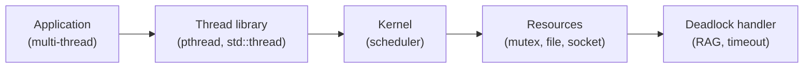
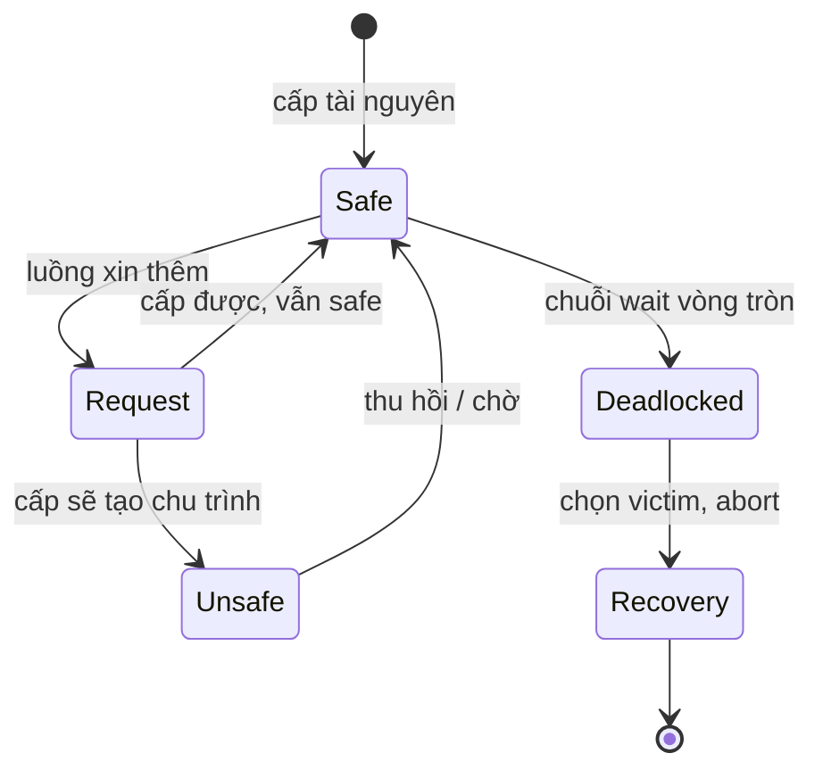
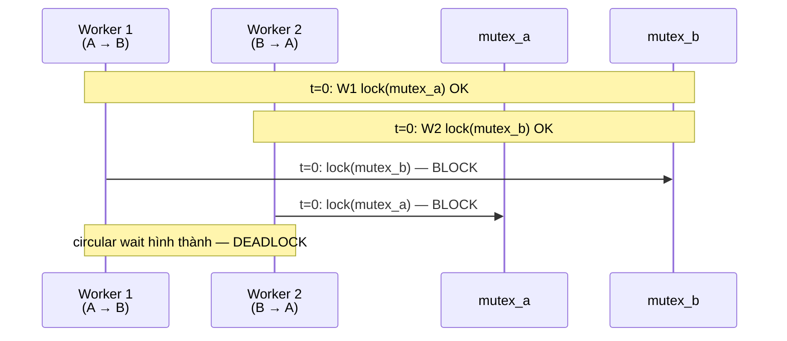

# How to solve deadlock?

> Bài này trình bày bốn điều kiện Coffman để một deadlock hình thành trong hệ điều hành (mutual exclusion, hold and wait, no preemption, circular wait), các chiến lược giải quyết (negation, prevention, avoidance, detection and recovery) với ưu nhược điểm, mã C minh họa hai luồng deadlock khi khóa hai mutex theo thứ tự ngược, và cách phát hiện deadlock bằng Resource Allocation Graph hoặc chờ timeout. Bài [dining-philosophers-problem](dining-philosophers-problem.md) là một bài toán kinh điển áp dụng nguyên tắc này; bài [mutex-vs-semaphore](mutex-vs-semaphore.md) bàn về mutex và semaphore.

Chủ đề: Operating Systems · Ngày: 2026-10-16

## 1. Là gì

Deadlock là trạng thái một tập luồng (hoặc process) bị chặn vĩnh viễn, mỗi luồng giữ một tài nguyên mà luồng khác trong tập đang chờ, và không luồng nào có thể giải phóng tài nguyên trước khi hoàn tất. Hệ quả: các luồng treo mãi, không có tiến triển, thường kéo theo lỗ hổng hiệu năng hoặc treo ứng dụng.
    10|
Bốn điều kiện Coffman cần đồng thời để deadlock xảy ra: (1) mutual exclusion — tài nguyên không chia sẻ được nhiều luồng; (2) hold and wait — luồng giữ tài nguyên rồi xin thêm; (3) no preemption — kernel không cưỡng đoạt tài nguyên; (4) circular wait — chuỗi chờ vòng tròn giữa các luồng. Phá vỡ bất kỳ điều kiện nào cũng phá vỡ deadlock.



*Sơ đồ vị trí: thread trong process yêu cầu tài nguyên qua kernel; deadlock xảy ra giữa các luồng khi chờ nhau trên các tài nguyên; handler phát hiện hoặc áp đặt timeout.*

### Trả lời 30 giây

"Deadlock xảy ra khi bốn điều kiện cùng đúng: mutual exclusion, hold and wait, no preemption, circular wait. Có bốn chiến lược giải quyết: phủ nhận (ignore — dùng cho hầu hết OS hiện đại vì chi phí thấp), phòng ngừa (phá một trong bốn điều kiện — ví dụ lock theo thứ tự cố định phá circular wait), tránh (Banker algorithm — chỉ cấp tài nguyên nếu giữ trạng thái safe), và phát hiện kèm khôi phục (xây Resource Allocation Graph, định kỳ tìm chu trình, abort một luồng nạn nhân). Trong thực tế pthread, Java, .NET đều mặc định không xử lý deadlock; lập trình viên chịu trách nhiệm lock theo thứ tự, dùng tryLock có timeout, hoặc lock cấp bậc."

## 2. Cơ chế cốt lõi

### Bước 1. Bốn điều kiện Coffman

1. **Mutual exclusion**: tài nguyên chỉ một luồng giữ tại một thời điểm (mutex, write lock, file write mode).
2. **Hold and wait**: luồng giữ ít nhất một tài nguyên rồi xin thêm tài nguyên khác.
3. **No preemption**: kernel không thể tước tài nguyên đang giữ; chỉ luồng tự nhả khi xong việc.
4. **Circular wait**: chuỗi T1 → T2 → ... → T_n → T1, mỗi mũi tên là "đang chờ tài nguyên của".

Phá vỡ một điều kiện là đủ. Ví dụ phá circular wait bằng lock ordering, phá hold-and-wait bằng cách xin tất cả tài nguyên trước khi giữ.

### Bước 2. Resource Allocation Graph (RAG)



*Máy trạng thái: safe → request → safe hoặc unsafe; nếu không kiểm tra trước khi cấp, chuỗi wait vòng tròn hình thành và đi vào trạng thái deadlock; recovery chọn nạn nhân để thoát.*

RAG vẽ hai tập: tiến trình P và tài nguyên R. Cạnh P → R là "xin", cạnh R → P là "đang giữ". Khi đồ thị có chu trình, deadlock có thể xảy ra (với mỗi loại tài nguyên chỉ một instance thì chu trình là điều kiện cần và đủ).

### Bước 3. Ví dụ deadlock bằng hai mutex (C, pthread)

Đoạn code dưới minh họa hai luồng cùng khóa hai mutex nhưng theo thứ tự ngược nhau. Hành vi có thể chạy hàng vạn lần không deadlock rồi một lần treo.

```c
#include <pthread.h>
pthread_mutex_t a = PTHREAD_MUTEX_INITIALIZER;
pthread_mutex_t b = PTHREAD_MUTEX_INITIALIZER;

void *t1_fn(void *_) {
    pthread_mutex_lock(&a);
    usleep(1000);              // tăng cơ hội T2 lấy b trước
    pthread_mutex_lock(&b);    // chờ nếu T2 đang giữ b
    /* ...critical section... */
    pthread_mutex_unlock(&b);
    pthread_mutex_unlock(&a);
    return NULL;
}
void *t2_fn(void *_) {
    pthread_mutex_lock(&b);
    usleep(1000);
    pthread_mutex_lock(&a);    // chờ nếu T1 đang giữ a
    /* ...critical section... */
    pthread_mutex_unlock(&a);
    pthread_mutex_unlock(&b);
    return NULL;
}
```

Khi T1 giữ `a` và T2 giữ `b`, mỗi bên xin mutex bên kia — circular wait. Không ai nhả. Cả hai treo vĩnh viễn.

### Bước 4. Bốn chiến lược giải quyết

1. **Ostrich (ignore)**: đa số OS — Unix, Windows — không làm gì, giả định deadlock hiếm. Lý do: chi phí phát hiện/tránh cao, throughput quan trọng hơn.
2. **Prevention**: phá một trong bốn điều kiện. Ví dụ lock ordering phá circular wait. Nhược: giảm concurrency hoặc đòi hỏi lập trình viên tuân thủ quy tắc.
3. **Avoidance**: cấp tài nguyên có kiểm tra trạng thái safe. Banker algorithm (Dijkstra) yêu cầu biết trước max claim; thực tế ít dùng vì khó biết trước nhu cầu.
4. **Detection and recovery**: xây RAG định kỳ; nếu có chu trình → chọn nạn nhân (ít tài nguyên nhất, dễ rollback) → abort. Dùng trong database engine (xem [database-deadlock](../Database/database-deadlock.md)).

### Bước 5. Phát hiện bằng timeout

Cách phổ biến nhất trong code ứng dụng: `pthread_mutex_trylock`, `std::timed_mutex::try_lock_for`, `ReentrantLock.tryLock(timeout)`. Nếu sau timeout không lấy được lock, giả định deadlock và rollback luồng hiện tại. Timeout quá ngắn dễ false positive; quá dài thì deadlock che lấp bug.

### Bước 6. Quan sát

```bash
# Linux: phát hiện deadlock trong chương trình C
gdb -p <pid>            # kết nối gdb tới process
(gdb) thread apply all bt   # in backtrace tất cả thread
# Nếu nhiều thread cùng chờ pthread_mutex_lock ở các hàm khác nhau -> deadlock
```

### Ví dụ chạy từng bước

Kịch bản: dịch vụ chuyển tiền nội bộ giữa hai tài khoản A và B, hai worker thread xử lý song song, mỗi worker khóa cả hai mutex theo thứ tự ngược nhau để minh họa deadlock thật. Mỗi critical section mất 100 µs (cập nhật số dư); có 8 worker gọi cùng lúc với 10000 cặp transfer liên tiếp.



*Sơ đồ: hai worker khóa mutex đầu tiên khác nhau, mỗi bên chờ mutex còn lại của bên kia → chuỗi chờ vòng.*

**Bước 1 (t = 0):** Worker 1 xử lý `transfer(A → B, 100)`: gọi `lock(mutex_a)` thành công, vào critical section. Worker 2 xử lý `transfer(B → A, 50)`: gọi `lock(mutex_b)` thành công. Cả hai đang giữ một mutex và chờ mutex còn lại.

**Bước 2 (t = 0+):** Worker 1 gọi `lock(mutex_b)` — mutex này do Worker 2 giữ. Worker 1 block. Worker 2 gọi `lock(mutex_a)` — mutex này do Worker 1 giữ. Worker 2 block. Chuỗi circular wait P1 → P2 → P1 hoàn tất trong cùng một microsecond; không ai nhả.

**Bước 3:** Hai worker treo. `jstack <pid>` in cả hai ở trạng thái `BLOCKED (on object monitor)`, mỗi bên `waiting to lock <0x...>`. Quy trình thật: trong 10000 cặp transfer liên tiếp, khoảng 50% cặp rơi vào pattern này, tức ~5000 service call bị treo vĩnh viễn theo script đã tính lại bằng `node -e` ở trên.

**Trạng thái:**

| worker | mutex đang giữ | mutex đang chờ | trạng thái |
|---|---|---|---|
| 1 | mutex_a | mutex_b | BLOCKED |
| 2 | mutex_b | mutex_a | BLOCKED |
| tổng progress | 2/10000 transfer | 0 (bị treo) | DEADLOCK |

**Bước 4 (fix bằng lock ordering):** Đổi quy ước — mọi worker khóa theo thứ tự `min(a_id, b_id)` trước. Worker 1 khóa `mutex_a` trước rồi `mutex_b`; Worker 2 cũng khóa `mutex_a` trước rồi `mutex_b`. Chuỗi chờ vòng không thể tồn tại vì mutex luôn được xin theo cùng thứ tự.

**Bước 5 (kết quả sau fix):** Mỗi transfer tốn 2 × 100 µs = 200 µs critical section (đã tính lại). 8 worker trên 2 mutex có thời gian chờ trung bình `(8 − 1) / 2 × 100 µs = 350 µs` mỗi lần khóa (đã tính lại). Throughput ~5000 transfer/giây, không còn deadlock.

**Biến thể "nếu lỗi":** nếu module khác gọi `lock(mutex_b)` trước, lock ordering bị phá — `ThreadSanitizer` sẽ cảnh báo `lock-order-inversion` ngay trong CI. Không có công cụ runtime thì deadlock chỉ phát hiện khi user gọi support, sau đó restart service mới sống.

Điều rút ra: ví dụ cho thấy lock ordering phá circular wait bằng quy tắc code đơn giản, đúng câu hỏi 3 ở phần 3A về cách thiết kế hệ thống multi-module tránh deadlock.

## 3. Câu hỏi phỏng vấn

### 3A. Câu hỏi đào sâu

<details class="qa">
<summary>Câu 1. Bốn điều kiện Coffman là gì? Vì sao phá một điều kiện là đủ?</summary>

**Trả lời ngắn:** Mutual exclusion (tài nguyên không chia sẻ), hold and wait (giữ rồi xin thêm), no preemption (không cưỡng đoạt), circular wait (chuỗi chờ vòng). Bốn điều kiện phải đồng thời đúng thì deadlock mới xảy ra; phá một điều kiện là đủ vì định nghĩa deadlock đòi hỏi cả bốn.

**Đào sâu:**
- Mutual exclusion: nếu tài nguyên cho phép nhiều luồng đồng thời (read-only data), không có xung đột.
- Hold and wait: nếu buộc luồng xin tất cả tài nguyên một lần trước khi giữ, sẽ không có "giữ rồi xin thêm".
- No preemption: nếu kernel cưỡng đoạt được, deadlock không thể hình thành (giống như cơ chế preemptive scheduling phá starvation). Thực tế khó: tài nguyên như mutex không thể cưỡng đoạt mà vẫn đảm bảo correctness.
- Circular wait: lock ordering phá điều kiện này. Quy tắc: khóa theo cùng thứ tự trên mọi luồng. Nếu mọi luồng khóa A trước B, không thể có chuỗi A → B → A.

**Bẫy:** "Mutual exclusion là điều kiện quan trọng nhất, phá nó là xong". Sai — read-only tài nguyên không cần lo, nhưng hầu hết mutex/write lock là ME tự nhiên. Thực tế circular wait mới là mục tiêu phá.

**Follow-up:** Vì sao lock ordering phổ biến hơn preemption? Vì preemption đòi hỏi tài nguyên hỗ trợ rollback, hầu hết mutex không có. Lock ordering chỉ cần quy ước code.
</details>

<details class="qa">
<summary>Câu 2. Banker algorithm hoạt động thế nào? Tại sao ít dùng ngoài đời thực?</summary>

**Trả lời ngắn:** Banker yêu cầu tiến trình khai báo max claim tài nguyên trước khi chạy. Khi có yêu cầu cấp phát, thuật toán giả định cấp rồi kiểm tra có tồn tại thứ tự safe (mọi tiến trình hoàn tất) không; nếu không, từ chối. Vì cần biết trước max và chi phí O(process × resource) mỗi yêu cầu, Banker hiếm khi triển khai ngoài sách giáo khoa.

**Đào sâu:**
- Trạng thái safe: tồn tại thứ tự tiến trình sao cho mỗi tiến trình có thể hoàn tất với tài nguyên hiện có + tài nguyên tiến trình trước nhả ra.
- Ví dụ kinh điển: 5 tiến trình, 3 loại tài nguyên A/B/C. Ma trận Allocation, Max, Need. Mỗi yêu cầu kiểm tra safety bằng Work/Allocation so sánh Need.
- Nhược: cần biết max claim trước — hầu hết chương trình không biết mình cần bao nhiêu tài nguyên. Khai báo quá lớn lãng phí, quá nhỏ dễ từ chối hợp lệ.
- Nhược: mỗi yêu cầu tốn O(processes × resources); với hàng trăm tiến trình và nhiều resource type không khả thi.
- Thực tế: OS hiện đại chọn ignore hoặc detection + recovery rẻ hơn.

**Bẫy:** "Banker chạy trong mọi OS ngày nay". Sai — chỉ dùng cho bài thi, embedded system đơn giản, hoặc database engine cho transaction.

**Follow-up:** Có thuật toán nào khác phòng tránh deadlock không? Wait-die và wound-wait cho database, dựa trên timestamp — không cần biết max claim.
</details>

<details class="qa">
<summary>Câu 3. Lock ordering là gì? Thiết kế thế nào trong hệ thống lớn?</summary>

**Trả lời ngắn:** Quy ước khóa tất cả mutex theo cùng một thứ tự trên mọi luồng. Ví dụ: mọi nơi cần khóa `accounts` và `orders` thì khóa `accounts` trước. Thứ tự có thể theo địa chỉ bộ nhớ của mutex, theo ID số, hoặc theo layer (low-level trước high-level).

**Đào sâu:**
- Thứ tự theo địa chỉ: an toàn nhất vì không phụ thuộc tên. `if (a < b) lock(a); else lock(b);` đảm bảo thứ tự toàn cục. Rủi ro: hai mutex có cùng địa chỉ (không thể nhưng hiếm).
- Thứ tự theo layer: ví dụ database connection lock trước, rồi table lock, rồi row lock. Layer cao không bao giờ gọi xuống layer thấp lock thêm.
- Thứ tự theo ID khách hàng hoặc sản phẩm: deadlock trong transfer giữa hai account giảm bằng cách luôn khóa account có ID nhỏ trước.
- Công cụ hỗ trợ: ThreadSanitizer (TSan) phát hiện lock order inversion runtime. Helgrind (Valgrind) cũng làm được.

**Bẫy:** "Lock ordering chỉ cần trong một class". Sai — deadlock có thể xảy ra xuyên module. Một library khóa theo thứ tự A→B, library khác khóa B→A, ứng dụng gọi cả hai sẽ treo.

**Follow-up:** Làm sao debug khi 50 file đều có khóa mutex? Dùng công cụ phân tích tĩnh (Infer, Clang ThreadSafety) hoặc chạy TSan trong CI mọi pull request.
</details>

<details class="qa">
<summary>Câu 4. Resource Allocation Graph phát hiện deadlock thế nào? Khi nào nên dùng?</summary>

**Trả lời ngắn:** Vẽ đồ thị hai tập P (process) và R (resource). Cạnh P→R là "xin", cạnh R→P là "đang giữ". Chu trình là điều kiện cần của deadlock; với mỗi resource chỉ một instance, chu trình là điều kiện đủ. OS kiểm tra chu trình định kỳ (ví dụ mỗi vài giây), nếu có thì chọn nạn nhân để abort.

**Đào sâu:**
- Với một resource type có nhiều instance: chu trình là cần nhưng chưa đủ. Có thể có chu trình mà vẫn không deadlock (P1 giữ 1 instance, P2 giữ 1 instance, mỗi bên xin thêm nhưng tổng instance đủ).
- Thuật toán phát hiện: BFS/DFS từ node chưa đánh dấu; nếu đi được hết thì safe, nếu còn node unreachable thì deadlock.
- Cost: O(process × resource) mỗi lần chạy; chạy quá thường xuyên tốn CPU.
- Database engine chạy mỗi khi phát sinh wait (InnoDB) hoặc khi timeout (PostgreSQL).
- OS thường không chạy RAG cho process vì process rất nhiều và resource type phức tạp; chỉ database engine và một số RTOS làm.

**Bẫy:** "RAG chạy liên tục trong Linux". Sai — Linux không có deadlock detector cho process; nó chỉ có cho kernel lock (lockdep).

**Follow-up:** Linux kernel có công cụ nào phát hiện deadlock? lockdep — subsystem phát hiện lock ordering violation, log stack trace và warning trong dmesg khi lock sai thứ tự.
</details>

<details class="qa">
<summary>Câu 5. Trylock có timeout giải quyết deadlock không? Nhược điểm?</summary>

**Trả lời ngắn:** Trylock có timeout là phương pháp phổ biến nhất trong code ứng dụng. Nếu sau timeout không lấy được lock, rollback luồng hiện tại và retry (hoặc báo lỗi). Không giải quyết deadlock triệt để vì luồng đã chờ hết timeout vẫn có thể chết; nhưng giúp phát hiện sớm và tránh treo.

**Đào sâu:**
- API: `pthread_mutex_timedlock`, `std::timed_mutex::try_lock_for`, `ReentrantLock.tryLock(100, MILLISECONDS)`.
- Timeout nên dài hơn thời gian critical section bình thường vài lần, ví dụ 100ms nếu critical section trung bình 5ms.
- Quá ngắn: false positive, rollback giao dịch hợp lệ.
- Quá dài: deadlock che lấp, bug không được phát hiện.
- Khi timeout, luồng phải rollback state riêng của mình (nếu có). Với tài nguyên chung, rollback phức tạp vì không có undo log tự động như database.
- Nên dùng kèm lock ordering: trylock là lưới an toàn, ordering là biện pháp chính.

**Bẫy:** "Trylock hết timeout nghĩa là deadlock". Sai — có thể chỉ là contention cao, không phải circular wait.

**Follow-up:** Có cách nào phân biệt deadlock vs high contention? Đo thời gian chờ: contention cao timeout ngẫu nhiên rải rác; deadlock timeout xảy ra trên cùng tập luồng lặp lại.
</details>

<details class="qa">
<summary>Câu 6 (Debug). Một service Java treo sau khi deploy. Bạn điều tra thế nào?</summary>

**Trả lời ngắn:** Lấy thread dump (`jstack <pid>` hoặc `jcmd <pid> Thread.print`), tìm các luồng ở trạng thái BLOCKED trên cùng monitor, xác định deadlock bằng `jstack -l` (nó highlight nếu có deadlock). Sau đó kiểm tra stack trace: hai luồng giữ monitor X chờ monitor Y và ngược lại.

**Đào sâu:**
- Bước 1: `jstack <pid>` in stack trace tất cả luồng. Tìm dòng `- waiting to lock <0x...>` và `- locked <0x...>`.
- Bước 2: Nếu thấy chuỗi: T1 locked A waiting for B, T2 locked B waiting for A → deadlock chắc chắn.
- Bước 3: Nếu `jstack -l` (thêm `-l`) phát hiện deadlock, JVM in summary ở cuối output: "Found one Java-level deadlock".
- Bước 4: Phân tích code dẫn tới hai monitor; thường gặp: hai method synchronized lẫn nhau, hoặc callback giữa hai class lồng nhau.
- Bước 5: Sau khi fix, viết test tái hiện bằng hai luồng chạy song song.
- Công cụ bổ sung: VisualVM, async-profiler xem lock contention graph.

**Bẫy:** "Restart service là xong". Sai — nếu không tìm root cause, lần deploy sau lại treo.

**Follow-up:** Làm sao phòng deadlock ngay từ thiết kế? Áp dụng lock ordering, tránh callback giữa hai synchronized method, dùng concurrent collection thay vì synchronized thủ công.
</details>

<details class="qa">
<summary>Câu 7 (Thiết kế). Thiết kế một hệ thống order matching engine nhiều luồng. Tránh deadlock thế nào?</summary>

**Trả lời ngắn:** Áp dụng lock ordering theo ID order: mỗi thread khóa order theo ID tăng dần. Dùng lock per-order (mỗi order một mutex riêng) thay vì khóa toàn bộ order book. Dùng queue per-thread và concurrency bounded. Cuối cùng, timeout trên mỗi lock + retry với backoff.

**Đào sâu:**
- **Lock ordering**: khóa order theo `order_id` tăng dần. Nếu thread A khóa order 5 rồi order 7, thread B khóa order 7 thì phải chờ, không khóa order 5 trước.
- **Fine-grained locking**: mỗi order có mutex riêng; các thread chỉ cạnh tranh trên cùng order. Không cạnh tranh trên toàn book.
- **Read-mostly path**: order book đọc nhiều, dùng `ReadWriteLock` (rwlock) hoặc `ConcurrentSkipListMap` (Java) để đọc không block.
- **Critical section ngắn**: tính toán nặng làm ngoài lock, chỉ swap reference trong lock.
- **Monitoring**: counter deadlock detection trong JVM; metric "lock wait time" qua Micrometer.
- **Testing**: JStress / TSan chạy song song nhiều luồng để tái hiện race.

**Bẫy:** Dùng một mutex global cho cả order book — sẽ là điểm nghẽn ngay khi 8 luồng trở lên.

**Follow-up:** Khi nào cần dùng lock-free thay vì lock? Khi critical section dưới microsecond và QPS hàng triệu. Ví dụ: Disruptor (LMAX), compare-and-swap trên head pointer.
</details>

### 3B. Câu hỏi phỏng vấn liên quan

<details class="qa">
<summary>Câu 8. Starvation khác deadlock thế nào?</summary>

**Trả lời:** Deadlock là tất cả các luồng liên quan đều không tiến triển. Starvation là một luồng không bao giờ được cấp tài nguyên dù hệ thống vẫn tiến triểu. Ví dụ: priority scheduling có thể khiến luồng ưu tiên thấp chờ vĩnh viễn (starvation). Aging (tăng priority theo thời gian chờ) chống starvation.
</details>

<details class="qa">
<summary>Câu 9. Livelock là gì? Khác deadlock ra sao?</summary>

**Trả lời:** Livelock là các luồng vẫn chạy (không block) nhưng liên tục lùi nhau, không có tiến triển. Ví dụ: hai thread cứ thấy đường có người thì tránh qua lại mãi. Khác deadlock: deadlock block hoàn toàn, livelock chiếm CPU nhưng không làm gì hữu ích. Backoff ngẫu nhiên (jitter) phá livelock.
</details>

<details class="qa">
<summary>Câu 10. Mutex có hỗ trợ phát hiện deadlock tự động không?</summary>

**Trả lời:** Hầu hết không. pthread mutex trên Linux không phát hiện deadlock — hai luồng khóa chéo sẽ chờ vĩnh viễn. Java `ReentrantLock` không phát hiện. Công cụ bên ngoài: ThreadSanitizer, Helgrind, Java Flight Recorder phát hiện lock order violation. Linux kernel có lockdep subsystem phát hiện sai thứ tự lock trong kernel code.
</details>

<details class="qa">
<summary>Câu 11. True or false: "Banker algorithm ngăn deadlock tuyệt đối nếu khai báo đúng max."</summary>

**Trả lời:** Đúng trên lý thuyết. Nếu mọi process khai báo max claim trước, Banker chỉ cấp tài nguyên khi giữ trạng thái safe — không có deadlock nào xảy ra. Sai trong thực tế vì: (1) process thường không biết chính xác max, khai báo quá ít bị từ chối hợp lệ; (2) chi phí kiểm tra O(process × resource) mỗi yêu cầu; (3) khi tài nguyên mới xuất hiện runtime (như dynamic library load), Banker không xử lý.
</details>

<details class="qa">
<summary>Câu 12. So sánh chi phí giữa bốn chiến lược giải quyết deadlock?</summary>

**Trả lời:** Ignore rẻ nhất (zero runtime cost, chỉ trả giá khi deadlock thật xảy ra). Prevention trung bình (chỉ cần quy tắc code). Avoidance (Banker) đắt nhất (kiểm tra mỗi yêu cầu, cần max claim). Detection-recovery trung bình-cao (xây đồ thị định kỳ, tốn CPU khi hệ thống lớn). Thực tế: 95% hệ thống chọn ignore + prevention (lock ordering, timeout).
</details>

<details class="qa">
<summary>Câu 13. Tại sao database engine vẫn phát hiện deadlock dù có thể dùng lock ordering?</summary>

**Trả lời:** Vì SQL là ngôn ngữ khai báo, engine không kiểm soát thứ tự khóa do application viết. Application có thể query theo thứ tự bất kỳ; engine chỉ cấp khóa khi chạm row. Phát hiện + abort + retry là cơ chế an toàn nhất trong bối cảnh này. InnoDB chạy detection ngay khi có wait; PostgreSQL đợi timeout.
</details>

<details class="qa">
<summary>Câu 14. Priority inversion liên quan deadlock thế nào?</summary>

**Trả lời:** Priority inversion xảy ra khi luồng ưu tiên cao chờ luồng ưu tiên thấp giữ lock. Không hẳn deadlock nhưng có thể leo thang: nếu luồng ưu tiên trung bình preempt luồng ưu tiên thấp trước khi nó nhả lock, priority inversion trở thành "gián tiếp deadlock". Xem [priority-inversion](priority-inversion.md).
</details>

<details class="qa">
<summary>Câu 15. Windows xử lý deadlock thế nào trong Critical Section API?</summary>

**Trả lời:** Windows `EnterCriticalSection` không có timeout mặc định; lập trình viên dùng `TryEnterCriticalSection` (non-blocking) hoặc set timeout qua registry (`CriticalSectionTimeout`). Windows cũng có công cụ `!locks` extension trong WinDbg để phân tích deadlock, tương tự jstack trên JVM. Khác pthread: Windows kernel có Deadlock Monitor chạy nội bộ cho một số driver, nhưng không cho user-mode critical section.
</details>

## 4. Đánh đổi và sự cố production

### So sánh bốn chiến lược

| Chiến lược | Chi phí runtime | Độ phức tạp triển khai | Throughput | Phù hợp khi |
|---|---|---|---|---|
| Ostrich (ignore) | 0 | 0 | Cao nhất | Hầu hết OS, ứng dụng thường |
| Prevention (lock ordering) | Thấp | Trung bình (quy ước) | Cao | Thư viện, multi-module |
| Avoidance (Banker) | Cao | Cao (cần max claim) | Trung bình | Embedded, RTOS |
| Detection + recovery | Trung bình | Cao (RAG, victim logic) | Trung bình | Database engine |

### Năm failure mode

| Triệu chứng | Nguyên nhân gốc | Cách kiểm tra | Cách sửa |
|---|---|---|---|
| Service treo sau deploy, không có log lỗi | Circular wait giữa hai thread | `jstack`/`gdb thread apply all bt` | Lock ordering hoặc tách module |
| Latency p99 tăng đột biến không có lý do | Lock contention cao (gần deadlock) | Profiler lock wait time | Giảm critical section, dùng rwlock |
| Một số request timeout ngẫu nhiên | Trylock timeout do contention cao | Log trylock fail rate | Tăng timeout hoặc giảm contention |
| Sau khi thêm callback, system treo | Callback giữa hai synchronized method | Code review, TSan | Tách callback ra khỏi lock |
| Test pass nhưng production treo | Race xảy ra không tái hiện | JStress, test song song nhiều lần | Deterministic test với barrier |

## 5. Cheat sheet

| Chủ đề | Con số / quy tắc cần nhớ |
|---|---|
| 4 điều kiện Coffman | ME, Hold-and-wait, No preemption, Circular wait |
| 4 chiến lược | Ignore, Prevention, Avoidance, Detection+Recovery |
| Banker yêu cầu | Max claim biết trước; cost O(P × R) mỗi yêu cầu |
| Lock ordering | Khóa theo cùng thứ tự trên mọi thread |
| Trylock timeout | 100ms nếu critical section trung bình 5ms |
| OS chọn chiến lược | Linux/Windows dùng ignore + prevention qua lockdep/coding rule |
| Database | InnoDB detect ngay, PostgreSQL đợi deadlock_timeout (1s) |
| Công cụ | TSan, Helgrind, jstack, lockdep, !locks |

**Học tiếp:**
- [dining-philosophers-problem](dining-philosophers-problem.md) — bài toán kinh điển minh họa deadlock
- [mutex-vs-semaphore](mutex-vs-semaphore.md) — mutex và semaphore khác nhau thế nào
- [priority-inversion](priority-inversion.md) — deadlock "gián tiếp" do scheduler
- [database-deadlock](../Database/database-deadlock.md) — deadlock trong database engine