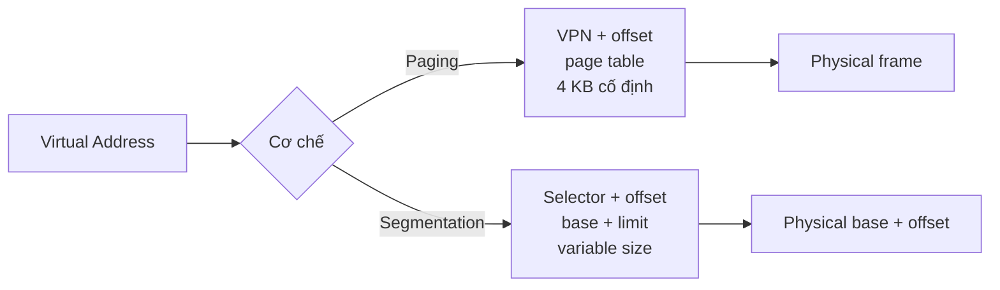
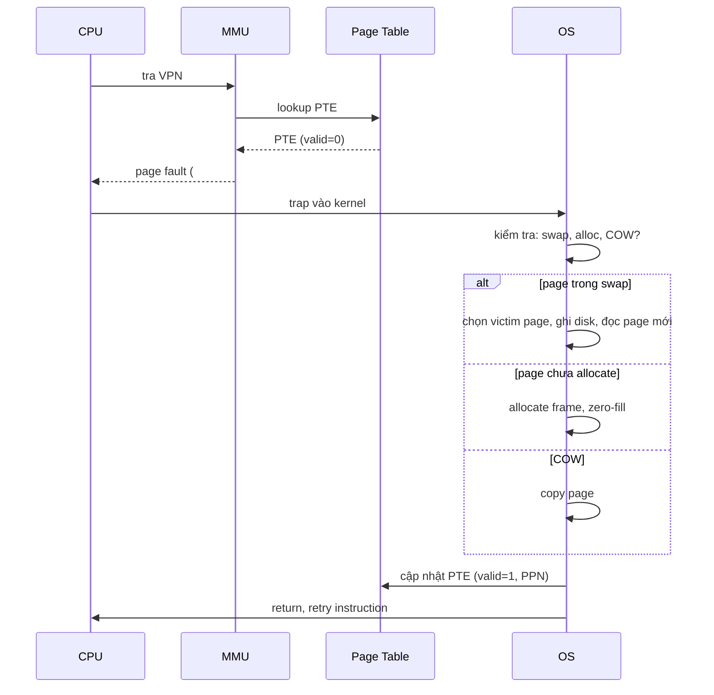

# Explain the difference between paging and segmentation.

> So sánh paging và segmentation: cơ chế chia bộ nhớ (cố định vs variable-size), translation overhead, phân mảnh ngoài/trong, hardware support (x86 có cả hai, segmentation chỉ còn cho kernel mode), và khi nào paging thắng (multiprogramming, virtual memory). Kèm cơ chế page fault và segmentation fault để thấy cách OS trap.

Chủ đề: Operating Systems · Ngày: 2026-10-16

## 1. Là gì

Paging chia bộ nhớ vật lý thành các frame kích thước cố định (thường 4 KB), bộ nhớ ảo thành page cùng kích thước; OS quản lý page table ánh xạ page → frame. Segmentation chia bộ nhớ thành các đoạn (segment) kích thước thay đổi theo nhu cầu logic (code, stack, heap); mỗi segment có base + limit; địa chỉ ảo = segment selector + offset.



*Sơ đồ vị trí: virtual address đi qua một trong hai cơ chế dịch; paging dùng page table lookup, segmentation dùng base+limit. x86-64 hiện đại dùng paging thuần cho user mode.*

### Trả lời 30 giây

"Paging chia bộ nhớ thành page cố định (4 KB hoặc 2 MB); translation qua page table tra cứu O(1) trong TLB hit. Segmentation chia thành segment variable size (code, stack, data); translation qua base+limit, nhưng khó swap vì fragment. Paging thắng vì không có external fragmentation, dễ ảo hoá, dễ swap. x86-64 hiện đại vẫn có segment register (CS, DS) nhưng flat mode — base=0, limit=full — segmentation chỉ còn phân biệt user/kernel qua ring level. Page fault (~1-10 µs) xảy ra khi page không trong RAM, OS swap từ disk. Segmentation fault (Unix) là một dạng page fault khi truy cập vượt limit hoặc segment không hợp lệ."

## 2. Cơ chế cốt lõi

### Bước 1. Paging — địa chỉ ảo và page table

Virtual address (VA) = VPN (virtual page number) + offset. Ví dụ x86-64 4 KB page: VA 48 bit, VPN 36 bit, offset 12 bit.

MMU tra page table: page table là mảng các entry (PTE), mỗi PTE chứa PPN (physical page number), valid bit, dirty bit, accessed bit, permission. PTE kích thước 4-8 byte.

Multi-level page table (x86-64): PML4 → PDPT → PD → PT → physical page. 4 level, mỗi level 512 entry (9 bit), tổng 36 bit VPN. Ảo hoá toàn bộ 48-bit VA với chi phí page table chỉ ~2 MB cho process 512 GB virtual.

Page table entry tra cứu qua TLB: hit ~1-2 cycles, miss buộc page walker ~50-500 ns.

### Bước 2. Segmentation — segment selector và base+limit

Virtual address = segment selector (16 bit) + offset. Selector chỉ index vào segment descriptor table (GDT/LDT). Descriptor chứa base (32 bit), limit (20 bit + granularity), permission.

MMU cộng base + offset → linear address. Nếu offset > limit → segmentation fault (#GP, general protection fault).

Ví dụ x86 protected mode:
- Selector 0x10 → kernel data segment, base 0, limit 0xFFFFFFFF.
- Selector 0x18 → user code segment, base 0, limit 0xFFFFFFFF.
- Selector 0x23 → user data segment, base 0, limit 0xFFFFFFFF.

Trong flat mode (x86-64 long mode), base = 0 cho mọi user segment; segmentation chỉ còn dùng để phân biệt ring (kernel vs user).

### Bước 3. Page fault và segmentation fault



*Page fault: MMU tra page table không có valid PTE; CPU trap OS; OS swap/allocate; cập nhật PTE; CPU retry. Latency ~1-10 µs (RAM) hoặc ~1-10 ms (disk swap).*

Segmentation fault (#GP): selector invalid hoặc offset vượt limit hoặc permission vi phạm. Trên x86-64 long mode, "segmentation fault" thực ra là page fault khi selector = null hoặc offset vượt canonical address range (47-bit user, 48-bit kernel).

Trong Unix/Linux, khi chương trình C++/Rust crash với "Segmentation fault (core dumped)" trên Linux/macOS thực chất thường là page fault với access violation. Tên gọi là di sản từ thời segmentation-only.

### Bước 4. Phân mảnh

- **External fragmentation** (segmentation): segment variable size → khi allocate/deallocate, RAM bị chia nhỏ thành nhiều vùng rời rạc. Tổng free RAM đủ nhưng không allocate được segment lớn. Giải pháp: compaction (đắt), paging (cố định size).
- **Internal fragmentation** (paging): page 4 KB, nếu segment 4 KB + 1 byte → chiếm 2 page, lãng phí 1 byte trong page. Với page lớn (2 MB) → lãng phí nhiều hơn.

Paging có internal fragmentation trung bình 50% page size (mean ~2 KB). Segmentation có external fragmentation có thể khiến vài GB RAM không dùng được.

### Bước 5. Hỗ trợ hardware

| Kiến trúc | Paging | Segments | Mode chính |
|---|---|---|---|
| x86-16 (8086) | Không | Real mode 20-bit segment | 16-bit real |
| x86-32 | Có | Protected mode GDT/LDT | 32-bit protected, paging bật tắt |
| x86-64 | Có | Flat mode, base=0, chỉ phân biệt ring | 64-bit long mode |
| ARMv7 | Có | Không (trong AArch32) | Paging 2-level |
| ARMv8/AArch64 | Có (4-level) | Không | Paging 4-level, 4 KB/16 KB/64 KB page |
| RISC-V | Có (Sv32/Sv39/Sv48) | Không | Paging thuần |
| MIPS | Có (TLB thủ công) | Không | Paging |

Trong hầu hết ISA hiện đại, segmentation đã biến mất ở user mode; x86 giữ lại segment register cho backward compatibility và ring protection.

### Bước 6. Tại sao paging thắng

1. **Không external fragmentation**: page cố định → bất kỳ frame nào cũng dùng được. Allocation O(1) với free list.
2. **Dễ swap**: page là đơn vị I/O. OS swap page vào/ra disk cùng kích thước.
3. **Dễ phân quyền và sharing**: page table entry có bit R/W/X; share page read-only giữa process (vd shared library).
4. **Dễ ảo hoá**: hypervisor (VT-x, AMD-V) dùng nested page table (NPT/EPT) — paging 2-level.
5. **TLB tận dụng locality**: working set của process thường fit trong vài MB; TLB có thể cache nhiều page.

### Quan sát

```bash
# Linux: xem page size và số page
getconf PAGESIZE
# 4096 (4 KB)

# Xem page table entry size (x86-64)
getconf PAGE_SIZE
# 4096

# Trên Linux x86-64, segment register flat
# Kiểm tra bằng cách in CS, DS từ user space
cat /proc/self/maps | head -5
# Mỗi dòng là một vùng virtual memory, vd:
# 00400000-00452000 r-xp ... /usr/bin/cat
# 7fff... rw-p ... [stack]

# macOS: kiểm tra page fault counter
vm_stat | grep -i page
```

### Ví dụ chạy từng bước

Kịch bản: web server xử lý một HTTP request, instruction pointer (RIP) của handler trỏ tới virtual address `0x0000 82a4 1234`. Bạn xem page table của process server này và dịch VA → PA từng bước để thấy cách 4-level page table trên x86-64 hoạt động.

Giả định: x86-64 long mode, page 4 KB, mỗi level 9 bit. CR3 = 0x1000.

Bước 1. Tách VA `0x000082a41234` theo 9-9-9-9-12 bit từ MSB. PML4 idx = bit 47..39 = 0. PDPT idx = bit 38..30 = 2. PD idx = bit 29..21 = 0x15 (21). PT idx = bit 20..12 = 0x41 (65). Offset = bit 11..0 = 0x234 (564). Đã tính bằng script.
Bước 2. CR3 (PML4 base) = 0x1000. Đọc PTE tại `0x1000 + 0×8 = 0x1000`. Entry: `0x0000 0000 6000 0023` → PPN = 0x6000, valid (bit 0 = 1).
Bước 3. PDPT base = 0x6000. Đọc PTE `0x6000 + 2×8 = 0x6010`. Entry: `0x0000 0000 7000 0023` → PPN = 0x7000, valid.
Bước 4. PD base = 0x7000. Đọc PTE `0x7000 + 0x15×8 = 0x70a8`. Entry: `0x0000 0000 8000 0023` → PPN = 0x8000, valid.
Bước 5. PT base = 0x8000. Đọc PTE `0x8000 + 0x41×8 = 0x8208`. Entry: `0x0000 0000 1234 5123` (PFN 0x12345 + R/W + valid). PPN = 0x12345.

Trạng thái: đã có PPN 0x12345, offset 0x234. Ghép lại: PA = `(0x12345 << 12) | 0x234 = 0x0000 0001 2345 2234`. Đây là physical frame trong RAM nơi instruction thực sự nằm.

| Bước | Base | Index | PPN kế tiếp |
|---|---|---|---|
| 1 PML4 | 0x1000 | 0 | 0x6000 |
| 2 PDPT | 0x6000 | 2 | 0x7000 |
| 3 PD | 0x7000 | 0x15 | 0x8000 |
| 4 PT | 0x8000 | 0x41 | 0x12345 |

Bước 6. Nếu TLB hit, CPU tra ngay 1-2 cycles và trả PA. Cold TLB: page walk 4 bảng như trên — chi phí CPU trả khi process start hoặc sau context switch flush.

Biến thể "nếu PTE không valid": nếu ở bước 5 PTE trả về `valid=0`, CPU trap page fault (#PF). OS tra VMA thấy VA thuộc vùng file-mapped code → đọc page 4 KB từ file binary vào frame, zero-fill, cập nhật PTE, return. Latency major fault ~1-10 ms (disk); minor ~100 ns – 1 µs (page cache). Trong log server, "first request slow" là do cold start page fault lần đầu; "warmed-up server" là sau khi TLB đầy và page table cache hit.

Điều rút ra: paging dịch VA bằng cây 4 cấp, mỗi cấp 1 RAM access; TLB che phần lớn chi phí này. Câu hỏi 1 ở 3A: paging dùng page table walk (lookup), segmentation dùng base+limit (cộng và so sánh). Đó là khác biệt cốt lõi.

## 3. Câu hỏi phỏng vấn

### 3A. Câu hỏi đào sâu

<details class="qa">
<summary>Câu 1. Paging khác segmentation ở những điểm nào?</summary>

**Trả lời ngắn:** Paging: page kích thước cố định (4 KB, 2 MB); translation qua page table tra cứu. Segmentation: segment kích thước variable; translation qua base+limit. Paging không có external fragmentation, dễ swap, dễ ảo hoá. Segmentation phù hợp với cấu trúc logic (code/stack/heap) nhưng khó quản lý.

**Đào sâu:**
- Paging translation: VPN → PPN qua page table walk. TLB cache translation. Multilevel page table giảm chi phí lưu trữ.
- Segmentation translation: selector → base+limit. Mỗi segment có permission, type (code/data). Linear address table.
- Kết hợp: x86 cho phép cả hai. Selector trỏ tới descriptor có base, limit, và trườm "page granularity" (G) — nếu G=1 thì segment 4 KB granularity, paging bật lên cho page-level protection.
- Segmentation giảm overhead virtual address: code selector + offset nhỏ hơn flat 32-bit. Nhưng trên 64-bit flat, không cần.

**Bẫy:** "Segmentation tốt hơn vì khớp logic code/stack/heap." Sai — segmentation có external fragmentation, không swap được segment > RAM. Paging thắng trong hầu hết workload thực.

**Follow-up:** Vì sao x86 giữ segment register trong long mode? Backward compatibility (CS chứa ring level selector cho syscall `syscall`/`sysret`); pointer canonical check cho user (47-bit sign-extended).
</details>

<details class="qa">
<summary>Câu 2. Page fault xảy ra khi nào? OS xử lý thế nào?</summary>

**Trả lời ngắn:** Page fault khi MMU tra page table không có valid PTE (valid bit = 0). OS kiểm tra nguyên nhân: page chưa allocate (zero-fill on demand), page trong swap (đọc từ disk), copy-on-write (copy page), hoặc access violation (gửi SIGSEGV tới process).

**Đào sâu:**
- Hardware page fault (#PF): CPU trap vào kernel, đẩy error code (present, write, user) và saved RIP. OS dùng saved RIP để biết instruction nào gây fault.
- Minor page fault (page đã trong page cache, không cần I/O): ~100 ns - 1 µs. Zero-fill page hoặc COW.
- Major page fault (page phải đọc từ disk): ~1-10 ms (SSD) hoặc ~5-20 ms (HDD). Swap hoặc demand load từ file.
- Invalid page fault (access violation, present=0, page không có swap entry): SIGSEGV (Linux/macOS) hoặc BSOD (Windows). Process crash.
- Linux dùng `handle_mm_fault()` → `__handle_mm_fault()` → page fault handler. VM subsystem swap page in/out qua `swap_readpage()`.

**Bẫy:** "Page fault luôn chậm vì cần disk." Sai — minor page fault (zero-fill, COW) chỉ tốn RAM, có thể nhanh hơn 1 µs.

**Follow-up:** Khi nào page fault xảy ra nhiều? Working set > RAM → thrashing: process liên tục swap in/out, hệ thống đứng. Xem [virtual-memory](virtual-memory.md).
</details>

<details class="qa">
<summary>Câu 3. Segmentation fault trên Linux/macOS là gì?</summary>

**Trả lời ngắn:** Segmentation fault (SIGSEGV) trên Linux/macOS là kernel signal gửi cho process khi truy cập bộ nhớ không hợp lệ. Trên x86-64 long mode, nguyên nhân thường là page fault với access violation, không phải segmentation violation thực sự.

**Đào sâu:**
- Nguyên nhân phổ biến: dereference NULL pointer, dereference wild pointer, stack overflow, write vào read-only memory (vd .rodata, code segment), access sau free() (use-after-free).
- Kernel trap #PF hoặc #GP, kiểm tra fault address, nếu không hợp lệ → SIGSEGV. Process nhận signal, nếu không có handler thì kernel in "Segmentation fault" và core dump.
- Trên Linux: `dmesg` xem kernel log; nếu trong container: `coredumpctl` để xem core dump. `gdb` chạy lại với core file để xem stack trace.
- macOS: Console.app hoặc `lldb` đọc core dump.
- Phân biệt SIGSEGV (segmentation) với SIGBUS (bus error, vd unaligned access trên ARM strict-alignment).

**Bẫy:** "Segmentation fault luôn do NULL pointer." Sai — có thể do stack overflow, write read-only, use-after-free. Cần đọc core dump để xác định.

**Follow-up:** Làm sao tìm dòng code gây SIGSEGV? Compile với `-g`, dùng `gdb ./binary core`, lệnh `bt` (backtrace). AddressSanitizer (`-fsanitize=address`) bắt nhiều lỗi bộ nhớ tại runtime.
</details>

<details class="qa">
<summary>Câu 4. Multi-level page table tại sao cần? Chi phí?</summary>

**Trả lời ngắn:** Page table đơn cấp (1 level) cho VA 48-bit tốn 2^48 × 8 byte = 256 PB. Multi-level (x86-64 4 level) giảm xuống vài MB cho process bình thường. Chi phí: 4 memory access cho page walk 4 level (nếu không có TLB hit).

**Đào sâu:**
- 1-level page table: PTE cho mỗi page. Với VA 48-bit, page 4 KB: 2^36 entries = 64 G entries × 8 byte = 512 GB page table. Không thực tế.
- Multi-level: 4 level × 9 bit = 36 bit VPN. Mỗi level 512 entry (4 KB). Page table top-level (PML4) luôn 4 KB. Sub-table chỉ allocate cho vùng virtual thực dùng → sparse, tiết kiệm.
- Chi phí page walk: 4 cache access, mỗi ~1-5 ns nếu cache hit → 4-20 ns total. Worst case 4 RAM access ~200-400 ns. TLB hit ~1-2 ns.
- Linux: PTE 8 byte trên x86-64, 4 byte trên ARM (cho 32-bit VA), variable trên RISC-V.
- inverted page table (PowerPC, IA-64): 1 entry cho mỗi physical frame, tìm qua hash table. Tiết kiệm page table memory nhưng hash table miss chậm.

**Bẫy:** "Multi-level page table luôn chậm." Sai — multi-level + TLB hit 95%+ vẫn nhanh. Chỉ chậm khi TLB miss liên tục.

**Follow-up:** Vì sao 64 KB page trên ARM có PTE size khác? PTE size không thay đổi theo page size; số level giảm (3 level cho 64 KB page ARM).
</details>

<details class="qa">
<summary>Câu 5 (Debug). Process chậm bất thường, I/O disk tăng vọt. Nghi thrashing. Cách xác nhận và xử lý?</summary>

**Trả lời ngắn:** Thrashing = working set > RAM, OS liên tục swap in/out. Triệu chứng: CPU util thấp nhưng I/O 100%, latency tăng vọt. Cách xác nhận: `vmstat 1` xem `si`/`so` (swap in/out) liên tục >0. Xử lý: tăng RAM, giảm working set, giảm số process.

**Đào sâu:**
- Bước 1: `vmstat 1` — nếu `si` (swap in) hoặc `so` (swap out) liên tục >0 vài KB/s → thrashing.
- Bước 2: `sar -B 1` — xem `pgpgin/s`, `pgpgout/s`. Cao → page I/O nhiều.
- Bước 3: `cat /proc/meminfo | grep -E 'MemTotal|MemFree|MemAvailable|SwapTotal|SwapFree'`. Swap usage cao → RAM cạn.
- Bước 4: top processes qua `top -o %MEM` hoặc `ps aux --sort -%mem`. Tìm process chiếm nhiều RAM nhất.
- Bước 5: cân nhắc tăng RAM, hoặc OOM killer sẽ giết process.
- Linux có `vm.swappiness` (0-200, mặc định 60): giảm xuống 10 nếu muốn OS ít swap hơn (giữ cache). Tăng nếu muốn swap aggressive.

**Bẫy:** "Tăng swap là giải pháp." Sai — swap trên SSD nhanh hơn HDD nhưng vẫn chậm hơn RAM ~1000x. Tăng swap chỉ trì hoãn thrashing. Giải pháp thật là tăng RAM hoặc giảm working set.

**Follow-up:** swappiness = 0 có nghĩa là OS không bao giờ swap? Không hẳn — swappiness = 0 chỉ giảm thiên vị swap; trong OOM, OS vẫn swap. Để tắt hẳn: `swapoff -a` (không khuyến nghị).
</details>

<details class="qa">
<summary>Câu 6 (Thiết kế). Thiết kế memory layout cho database server có buffer pool 64 GB, 16 process worker.</summary>

**Trả lời ngắn:** Bật huge page 2 MB cho buffer pool, dùng NUMA-local allocation, theo dõi TLB miss rate, cân nhắc 1 GB page cho vùng đặc biệt nóng (vd hash index).

**Đào sâu:**
- Yêu cầu: 64 GB buffer pool, 16 worker process, mỗi process truy cập ngẫu nhiên. TLB 4 KB page phủ ~6 MB → miss rate cao. Cần huge page.
- Quyết định 1: `vm.nr_hugepages=32768` (64 GB / 2 MB). Hoặc dùng THP cho allocation tự động, nhưng database thường tắt THP và dùng explicit huge page (Oracle, MySQL InnoDB).
- Quyết định 2: NUMA. NUMA node 0 có RAM local 0-128 GB, NUMA node 1 có 128-256 GB. Mỗi worker bind vào NUMA node của nó: `numactl --membind=0 ./worker`.
- Quyết định 3: mỗi process có buffer pool riêng (InnoDB buffer pool per instance) thay vì share giữa các process qua shared memory. Trade-off: copy overhead vs lock contention.
- Quyết định 4: 1 GB page cho hash index (InnoDB adaptive hash index) để TLB phủ toàn bộ index.
- Điểm nghẽn: nếu dùng shared memory (System V shm) cho buffer pool, IPC và TLB shootdown giữa process sẽ tăng. Per-process pool tốt hơn cho truy cập nóng.

**Bẫy:** "THP là giải pháp tốt nhất." Sai — THP có defragmentation overhead, có thể gây latency spike. Database thường tắt THP (`/sys/kernel/mm/transparent_hugepage/enabled = never`).

**Follow-up:** MySQL InnoDB có nên dùng huge page? Có — `innodb_use_large_pages=ON` và pre-allocate huge page pool. Đo TLB miss rate trước/sau.
</details>

### 3B. Câu hỏi phỏng vấn liên quan

<details class="qa">
<summary>Câu 7. Paging có external fragmentation không?</summary>

**Trả lời:** Không — page cố định kích thước nên bất kỳ frame trống nào cũng dùng được. Paging chỉ có internal fragmentation (trung bình nửa page size, ~2 KB cho 4 KB page). Segmentation có external fragmentation.
</details>

<details class="qa">
<summary>Câu 8. Inverted page table là gì? Khi nào dùng?</summary>

**Trả lời:** Inverted page table: 1 entry cho mỗi physical frame (thay vì mỗi virtual page). Tìm entry qua hash table trên (PID, VPN). Tiết kiệm page table memory khi VA rất lớn (64-bit). PowerPC, IA-64 dùng. Nhược điểm: hash table miss chậm, không cache locality tốt như multi-level.
</details>

<details class="qa">
<summary>Câu 9. Vì sao page size là 4 KB mà không 1 KB hoặc 16 KB?</summary>

**Trả lời:** 4 KB là trade-off giữa internal fragmentation (page càng nhỏ càng ít lãng phí) và page table overhead (page càng lớn càng ít entry trong page table, TLB càng phủ rộng). 4 KB phổ biến từ IBM 360 (1970), đã thành chuẩn. ARM hỗ trợ 4 KB, 16 KB, 64 KB page tùy workload.
</details>

<details class="qa">
<summary>Câu 10. Page table entry có những bit gì?</summary>

**Trả lời:** x86-64 PTE: PPN (52 bit), present (valid), R/W (read-only hoặc read-write), U/S (user/supervisor), A (accessed), D (dirty), PWT, PCD, PAT, G (global), XD (no-execute), protection key (PKRU). 64-bit PTE chứa flag và PPN. Linux chỉ dùng subset.
</details>

<details class="qa">
<summary>Câu 11. Segmentation vẫn dùng trong OS nào?</summary>

**Trả lời:** x86 vẫn dùng segment register cho ring protection (kernel vs user) và fs/gs cho thread-local storage (TLS). Ngoài ra, một số embedded system và OS cũ dùng segmentation (MULTICS, IBM OS/2). Hầu hết OS hiện đại dùng paging thuần.
</details>

<details class="qa">
<summary>Câu 12. True or false: "Paging tốt hơn segmentation cho mọi trường hợp."</summary>

**Trả lời:** Nghe đúng nhưng sai trong một số trường hợp. Segmentation phù hợp cho hệ thống embedded rất nhỏ, đơn giản (1 process, không có swap). Paging thắng cho multiprogramming, virtual memory, và đa số workload hiện đại. Nhưng segmentation có ưu ở chỗ: protection ở segment level (1 fault thay vì scan page table), và natural mapping cho code/stack/heap.
</details>

<details class="qa">
<summary>Câu 13. Demand paging là gì?</summary>

**Trả lời:** Demand paging: page chỉ load từ disk khi CPU truy cập lần đầu. Process bắt đầu với page table rỗng; page fault đầu tiên OS allocate frame, đọc từ file, zero-fill, cập nhật PTE. Giảm startup time và memory usage.
</details>

<details class="qa">
<summary>Câu 14. Prepaging là gì?</summary>

**Trả lời:** Prepaging: OS load trước nhiều page vào RAM dự đoán trước khi process cần. Dùng khi OS biết access pattern (vd sequential read qua madvise(MADV_WILLNEED)). Linux readahead: tự động load trang kế tiếp khi đọc tuần tự.
</details>

<details class="qa">
<summary>Câu 15. Address space layout randomization (ASLR) liên quan paging thế nào?</summary>

**Trả lời:** ASLR: OS randomize vị trí load của code, stack, heap, library mỗi lần exec. Paging cho phép load bất kỳ đâu trong virtual address space; ASLR thêm randomization để chống ROP/buffer overflow. Linux ASLR từ kernel 2.6.12.
</details>

## 4. Đánh đổi và sự cố production

Bảng dưới so sánh paging và segmentation theo fragmentation, swap, protection, và hỗ trợ hardware. Paging thắng hầu hết metric trên workload multiprogramming hiện đại; segmentation chỉ còn dùng trong ring protection và TLS.

Quan điểm: lựa chọn giữa paging và segmentation không phải câu hỏi thiết kế ngày nay; hầu hết OS dùng paging. Câu hỏi thực tế là page size nào (4 KB, 2 MB, 1 GB), có dùng huge page không, và có nên tắt THP không.

### So sánh: paging vs segmentation

| Tiêu chí | Paging | Segmentation |
|---|---|---|
| External fragmentation | Không | Có |
| Internal fragmentation | ~50% page size | Không |
| Swap dễ | Có (page = I/O unit) | Khó (segment variable size) |
| Translation overhead | 1 page walk + TLB | 1 cộng + limit check |
| Hardware support | Mọi ISA hiện đại | x86 (flat mode), legacy |
| Protection granularity | Page (4 KB hoặc 2 MB) | Segment (variable) |
| Sharing | Page table entry share (vd shared lib) | Segment descriptor share |
| Virtualization | Dễ (nested page table) | Khó |
| Phù hợp | Đa số workload | Embedded, legacy, ring protection |

### Năm failure mode

Bảng dưới tóm tắt 5 failure mode phổ biến: thrashing, SIGSEGV sai, OOM, swap storm, page table corruption.

| Triệu chứng | Nguyên nhân gốc | Cách kiểm tra | Cách sửa |
|---|---|---|---|
| I/O disk tăng vọt, CPU idle | Thrashing | `vmstat 1`, `si`/`so` >0 | Tăng RAM, giảm working set |
| SIGSEGV ở dòng code hợp lệ | Stack overflow hoặc heap corruption | `gdb` backtrace | Tăng stack size, dùng AddressSanitizer |
| OOM killer giết process | RAM cạn | `dmesg`, `journalctl` | Tăng RAM, giảm allocation, dùng swap |
| Swap storm sau deploy | Working set mới > RAM | `cat /proc/meminfo` | Pre-warm cache, tăng RAM |
| Page table corruption | Bug kernel/driver | `dmesg` segfault kernel | Báo upstream, cập nhật kernel |

## 5. Cheat sheet

Bảng cheat sheet tóm tắt con số và quy tắc cần nhớ: page size, page table entry, page walk cycles, page fault latency, fragmentation trade-off.

| Chủ đề | Con số / quy tắc |
|---|---|
| Page size phổ biến | 4 KB (x86-64), 2 MB / 1 GB huge |
| x86-64 page table | 4 level, 9 bit mỗi level, 36 bit VPN |
| Page walk cycles | 4 memory access, ~50-500 ns (TLB miss) |
| Page fault latency | ~100 ns - 1 µs (minor), ~1-10 ms (major) |
| TLB hit | 1-2 cycles |
| TLB entries | L1 64-128, L2 256-1536 |
| Internal fragmentation | ~50% page size |
| External fragmentation | Chỉ segmentation |

**Học tiếp:**
- [virtual-memory](virtual-memory.md) — virtual memory và thrashing
- [tlb](tlb.md) — TLB cache
- [cpu-scheduling](cpu-scheduling.md) — CPU scheduling