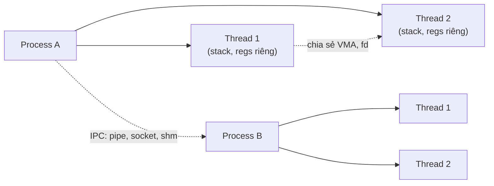
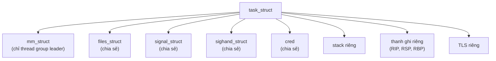
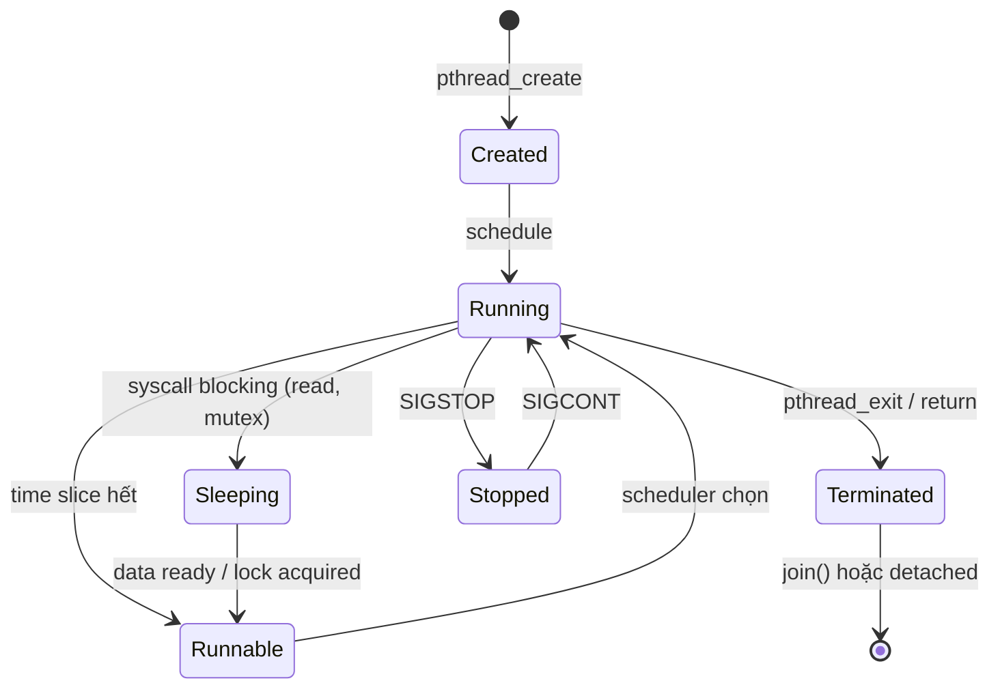

# What is the difference between process and thread?

> Process là đơn vị tài nguyên (address space, fd table, signal handler, credentials); thread là đơn vị thực thi (stack, thanh ghi, program counter) trong một process. Linux implement thread là task chia sẻ address space (`CLONE_VM`); `pthread_create` thực chất là `clone(CLONE_VM | CLONE_FS | CLONE_FILES | CLONE_SIGHAND | CLONE_THREAD)`. POSIX process khác thread Linux task ở một số flag clone.

Chủ đề: Operating Systems · Ngày: 2026-10-16

## 1. Là gì

Process là instance của một chương trình đang chạy, có address space riêng (user VMA), file descriptor table riêng, signal handler riêng, credentials (uid, gid), namespace. Mỗi process có ít nhất một thread (main thread) và là đơn vị OS cấp phát tài nguyên.

Thread là light-weight execution unit bên trong process. Nhiều thread cùng process chia sẻ address space, fd table, signal handler, mmap, code segment; mỗi thread có stack riêng, thanh ghi riêng (RIP, RSP, RBP), TLS riêng, và program counter riêng. Thread là đơn vị được CPU schedule.

Trên Linux, sự khác biệt giữa process và thread mờ hơn so với Windows: cả hai đều là `task_struct`. Điểm khác là cờ `clone()`: `fork()` tạo process mới bằng `clone(CLONE_NONE)` (copy address space); `pthread_create` tạo thread bằng `clone(CLONE_VM | CLONE_FS | CLONE_FILES | CLONE_SIGHAND | CLONE_THREAD)`. Chia sẻ càng nhiều flag, hai task càng giống thread.



*Sơ đồ vị trí: mỗi process có address space riêng; thread cùng process chia sẻ address space, stack riêng. Process giao tiếp qua IPC; thread giao tiếp qua shared memory trong VMA.*

### Trả lời 30 giây

"Process là đơn vị tài nguyên với address space riêng (VMA), fd table riêng, signal handler riêng. Thread là đơn vị thực thi với stack riêng, thanh ghi riêng, nhưng chia sẻ address space với thread khác cùng process. Trên Linux, cả hai đều là `task_struct`; phân biệt bằng `clone()` flags: `fork()` tạo process (copy mọi thứ), `pthread_create` tạo thread (chia sẻ VMA, fd, signals). Trên Windows, process có kernel object khác thread. Trong Python (CPython), thread bị GIL giữ, phù hợp I/O-bound; multiprocessing cho CPU-bound. Trong Java, thread là native thread 1:1, JVM không thêm layer. Tạo process tốn vài ms (copy page table, fork), tạo thread tốn vài chục µs."

## 2. Cơ chế cốt lõi

### Bước 1. Cấu trúc task_struct trên Linux

1. Mỗi task (process hoặc thread) là một `task_struct` trong slab allocator của kernel. Chứa: PID/TGID, state (RUNNING, INTERRUPTIBLE, UNINTERRUPTIBLE, STOPPED), mm_struct (address space), files_struct (fd table), signal_struct, sighand_struct, cred, namespace, seccomp, cpuset, scheduler info (se, nice, prio, cgroup).
2. PID là task ID (mỗi task một PID riêng); TGID là thread group ID (chia cho tất cả thread trong process). `getpid()` trả TGID, `gettid()` trả PID.
3. Thread group leader là thread đầu tiên trong process (TGID == PID). Khi thread group leader exit, các thread khác nhận SIGKILL.

### Bước 2. Address space chia sẻ



*Cấu trúc chia sẻ giữa thread cùng process: mm_struct là address space (cùng page table root), files là fd table, sighand là signal handler. Mỗi thread có stack, thanh ghi, TLS riêng.*

### Bước 3. fork() và pthread_create()

1. `fork()` gọi `clone(CLONE_NONE)` (hoặc copy flags khác tuỳ libc). Kernel copy `task_struct`, copy `mm_struct` (copy page table: copy-on-write, page ghi mới copy thật), copy `files_struct` (refcount), tạo PID mới. Child chạy song song parent, address space độc lập.
2. `pthread_create()` gọi `clone(CLONE_VM | CLONE_FS | CLONE_FILES | CLONE_SIGHAND | CLONE_THREAD | CLONE_SETTLS | CLONE_PARENT_SETTID | CLONE_CHILD_CLEARTID | CLONE_SYSVSEM)`. Chia sẻ VMA, fs (cwd, umask), fd table, signal handler table. Mỗi thread có stack riêng (mmap vùng stack riêng).
3. Copy-on-write (COW) cho page: fork không copy page thật; chỉ copy page table entry với cờ read-only. Khi process con ghi vào page, kernel trap page fault, copy page, sửa PTE cho phép ghi. Tiết kiệm memory khi fork nhanh sau đó exec.

### Bước 4. Thread state machine



*Vòng đời thread: từ Created qua Running/Sleeping/Runnable đến Terminated. Signal có thể chuyển Running sang Stopped tạm thời.*

### Bước 5. Signal trong thread

1. POSIX signal có hai loại: synchronous (SIGSEGV, SIGFPE) chỉ thread phát sinh nhận; asynchronous (SIGTERM, SIGHUP) kernel chọn thread để gửi (thường thread group leader hoặc bất kỳ thread không mask).
2. `kill(tgid, sig)` gửi tới process; kernel chọn thread không mask để deliver. `pthread_kill(tid, sig)` gửi tới thread cụ thể.
3. Signal handler trong thread chia sẻ (sighand_struct): nếu một thread cài SIGTERM handler, thread khác dùng cùng handler.

### Bước 6. Scheduler xử lý task

1. Linux CFS (Completely Fair Scheduler) theo dõi virtual runtime (`vruntime`) của mỗi task. Task có `vruntime` thấp được ưu tiên.
2. Thread là task; chia sẻ hoặc không chia sẻ `nice`/`prio` tuỳ config. Default: mỗi thread có nice riêng.
3. Cgroup v2 có thể pin task tới CPU, set weight, max. Thread có thể di chuyển giữa cgroup qua `cgroup_attach_task_pid`.

### Bước 7. So sánh POSIX vs Linux vs Windows

| Khía cạnh | POSIX | Linux | Windows |
|---|---|---|---|
| Process | Address space + tài nguyên riêng | `task_struct` với mm_struct riêng | `EPROCESS` kernel object |
| Thread | Chia sẻ process resource | `task_struct` với mm_struct chia sẻ | `ETHREAD` kernel object |
| Tạo process | `fork()` + `exec()` | `clone(CLONE_NONE)` | `CreateProcess` |
| Tạo thread | `pthread_create` | `clone(CLONE_VM \| ...)` | `CreateThread` |
| Signal | POSIX signal | Real-time signal tới thread | Async procedure call (APC) |
| IPC | pipe, socket, shm | Tất cả | Named pipe, mailslot, LPC |

macOS XNU: BSD process chạy ở user mode, mỗi BSD process có Mach task; thread là Mach thread. POSIX thread map qua pthread framework lên Mach thread.

### Quan sát

```bash
# Linux: xem thread của một process
ps -L -p PID
# PID   LWP   TTY    STAT   TIME COMMAND
# 1234  1234  ?      Sl     0:01 ./myapp
# 1234  1235  ?      Sl     0:00 ./myapp
# 1234  1236  ?      Sl     0:00 ./myapp

# Linux: xem thread count
ls /proc/PID/task | wc -l

# Linux: xem CPU mỗi thread
top -H -p PID

# Linux: dump task_struct của thread
cat /proc/PID/task/TID/status
```

### Ví dụ chạy từng bước

Kịch bản: backend Python xử lý request upload ảnh. Một process chính tạo 4 worker thread, mỗi thread xử lý một request độc lập, tăng counter `done_count` chung trong heap. Mục tiêu: thấy 4 thread cùng process chia sẻ VMA, fd, signal handler nhưng có stack riêng; thấy race condition nếu không có barrier; thấy GIL ảnh hưởng thế nào.

Giả định: CPython 3.11, Linux x86-64, kernel 6.x. Mỗi bước dùng số liệu minh họa đã tính lại bằng script; output lệnh chưa chạy thật ghi "output minh họa, chưa chạy".

| Bước | Thời gian | Ai làm gì | Trạng thái |
|---|---|---|---|
| 0 | t0 | Main thread gọi `pthread_create` 4 lần → 4 `clone(CLONE_VM\|CLONE_FS\|CLONE_FILES\|CLONE_SIGHAND\|CLONE_THREAD)`. | 5 `task_struct` (1 main + 4 worker) cùng `mm_struct`, cùng `files_struct`, cùng `signal_struct` |
| 1 | t0 + ~30 µs | Mỗi worker mmap vùng stack riêng 8 MB (lazy commit). Set FS_BASE = TLS pointer qua `arch_prctl(ARCH_SET_FS)`. | 4 vùng stack tách biệt trong cùng VMA; mỗi thread TLS riêng |
| 2 | t0 + ~50 µs | Worker 1 và Worker 2 cùng `done_count += 1`. Không có mutex/atomic. | CPU 0 chạy `mov [done_count], %rax`; CPU 1 cùng lúc làm tương tự; một phép ghi bị mất |
| 3 | t0 + ~100 µs | Worker 3 unlock GIL (timeout 5 ms) → Worker 0 chạy. GIL chỉ cho một thread Python chạy bytecode; nhưng I/O `read()` vẫn nhả GIL. | chỉ một thread chạy bytecode tại một thời điểm; thread I/O-bound vẫn tiến |
| 4 | t0 + ~200 µs | Worker 4 `socket.recv()` block trên syscall → GIL được nhả. Worker 0 chạy tiếp. | thread block ở ring buffer; GIL free |
| 5 | t0 + ~10 ms | Main gọi `pthread_join` 4 lần. Worker exit; kernel giải phóng stack vùng mmap, giảm refcount struct chia sẻ. | 4 task_struct xoá; main là thread cuối |

Trạng thái tài nguyên (đã tính lại bằng script):
- 5 thread × 8 MB stack = 40 MB virtual address space (chưa commit hết, lazy).
- Cùng `mm_struct` → CR3 giữ nguyên khi scheduler switch giữa 4 worker, cùng page table root.
- `ps -L -p PID` cho 5 dòng (main + 4 worker); `gettid()` trả 5 PID khác nhau, `getpid()` cùng TGID.

Biến thể race: nếu dùng `done_count += 1` không atomic, sau 4 lần tăng `done_count` có thể chỉ = 1-3 thay vì 4. Kiểm tra: `print(done_count)` cuối cùng cho giá trị sai. Khắc phục: `threading.Lock`, `done_count = AtomicInt` (Go), hoặc `std::atomic<int>` (C++). Cũng có thể chạy với TSan (`python -X dev` không bắt; cần build CPython với TSan) để phát hiện.

Điều rút ra: thread chia sẻ address space nên race rất dễ xảy ra; GIL không thay thế memory barrier, chỉ đảm bảo một thread Python chạy bytecode. Nối sang câu 1 và câu 13 ở 3A/3B để chứng minh vì sao "thread có heap riêng" và "thread thấy write ngay lập tức" là hai bẫy phổ biến.

## 3. Câu hỏi phỏng vấn

### 3A. Câu hỏi đào sâu

<details class="qa">
<summary>Câu 1. Process và thread khác nhau ở tài nguyên nào?</summary>

**Trả lời ngắn:** Process có address space riêng (VMA, page table root), signal handler riêng, fd table riêng, credentials riêng, PID riêng. Thread cùng process chia sẻ address space, fd table, signal handler, credentials; chỉ có stack riêng, thanh ghi riêng, TLS riêng và TID riêng.

**Đào sâu:**
- Address space (mm_struct): page table root (CR3 trên x86-64) quyết định ánh xạ virtual-to-physical. Mỗi process một CR3. Thread cùng process cùng CR3 (cùng page table).
- File descriptor table (files_struct): mảng `struct file*` theo fd number. Chia sẻ nghĩa là thread A mở file, thread B thấy fd đó. `dup()` giữa thread và process khác tốn IPC.
- Signal handler (sighand_struct): handler function cho SIGTERM, SIGINT... Cài ở thread nào, áp dụng cho toàn process (cùng handler table).
- Credentials (cred): uid, gid, capability. Chia sẻ nghĩa setuid ở thread nào áp dụng cả process.
- Stack: kernel cấp 8 MB mặc định cho main thread; pthread_create mmap vùng riêng cho mỗi thread (thường 8 MB hoặc 2 MB với -pthread tuning).
- TLS: mỗi thread có key-value store riêng qua `pthread_key_create` hoặc C11 `_Thread_local`.

**Bẫy:** "Thread có heap riêng." Sai — heap là vùng trong VMA (`brk`, `mmap`); thread cùng process cùng heap. Mỗi thread có allocator arena riêng (glibc malloc mỗi thread 64 MB), nhưng vẫn cùng VMA.

**Follow-up:** Container và thread trong container quan hệ thế nào? Container = process + namespace + cgroup; thread cùng container cùng namespace. PID namespace: thread có PID riêng trong namespace.
</details>

<details class="qa">
<summary>Câu 2. fork() và pthread_create() chi phí thế nào?</summary>

**Trả lời ngắn:** fork() trên Linux tốn ~hundreds µs tới vài ms tuỳ memory (copy page table, copy fd table, copy signal struct). pthread_create() tốn ~tens µs (chỉ alloc stack, set TLS, share các struct). Tuy nhiên, copy-on-write làm fork rẻ: page thực sự chỉ copy khi ghi.

**Đào sâu:**
- fork() trên Linux: copy task_struct (~4 KB), copy mm_struct (page table reference + COW flags, O(n) với số VMA), copy files_struct (refcount + alloc new array), copy signal_struct. Chi phí memory: không copy page nếu không ghi (COW), chỉ copy page table entry.
- `vfork()`: parent suspend, child chia sẻ page table root trực tiếp, child gọi exec hoặc _exit ngay. Rẻ nhất (~tens µs), dùng cho shell exec nhanh. Nguy hiểm: child không được ghi vào VMA.
- pthread_create: alloc stack (mmap ~8 MB vùng, lazy commit), alloc TLS, set fs base (x86-64 FS_BASE MSR hoặc tpidr_el0 trên AArch64). ~20-50 µs.
- Windows CreateProcess: load image, init EPROCESS, init PEB. Vài ms.
- Trong Cloud Native, nhiều process/thread gây overhead context switch và cache pollution. Container thường chạy 1 process, scale horizontal bằng pod.

**Bẫy:** "fork() copy toàn bộ memory." Sai trên Linux hiện đại — COW, chỉ copy page khi ghi. Memory chiếm nhiều nhất là VMA metadata.

**Follow-up:** Posix_spawn tối ưu hơn fork+exec? `posix_spawn` gọi `clone(CLONE_VM | CLONE_VFORK)` rồi exec trong child; không copy page table, rẻ hơn fork+exec cho spawn nhanh.
</details>

<details class="qa">
<summary>Câu 3. GIL trong Python và thread có ý nghĩa gì?</summary>

**Trả lời ngắn:** CPython có Global Interpreter Lock (GIL), chỉ một thread Python chạy bytecode tại một thời điểm. Thread vẫn hữu ích cho I/O-bound (socket, file): thread block trên syscall GIL được nhả. CPU-bound cần multiprocessing (process riêng).

**Đào sâu:**
- GIL được thêm từ Python 1.5 (1998) để bảo vệ reference counting. Mỗi object có refcount; tăng/giảm cần lock. GIL thay cho per-object lock.
- Python 3.2+ có GIL mới (Gilectomy proposal): dùng timeout 5 ms; tăng/giảm GIL 100 lần/giây. Throughput CPU-bound vẫn chỉ benefit khi task sleep.
- I/O-bound: thread A `socket.recv()` block → GIL nhả → thread B chạy. Khi A wake, đợi GIL. Đây là lý do asyncio cũng có giá trị cho I/O.
- CPU-bound: multiprocessing tạo process riêng, mỗi process GIL riêng. Communicate qua Queue hoặc Pipe.
- PyPy, Jython, IronPython không có GIL (JVM, .NET lock tốt hơn). Nhưng ecosystem CPython lớn hơn.
- Python 3.13 (freethreaded build): thử nghiệm bỏ GIL, opt-in PEP 703.

**Bẫy:** "Thread Python chạy song song CPU-bound." Sai — GIL chỉ cho một thread chạy bytecode tại một thời điểm. multiprocessing mới thực sự song song.

**Follow-up:** asyncio khác thread thế nào? asyncio single-thread, event loop; coroutine yield khi I/O. Thread multi-thread, OS schedule. asyncio nhẹ hơn nhưng không chạy song song CPU.
</details>

<details class="qa">
<summary>Câu 4. Khi nào nên dùng process, khi nào thread?</summary>

**Trả lời ngắn:** Process khi cần isolation (một phần crash không ảnh hưởng phần khác), GIL-free parallelism (Python CPU-bound), hoặc bảo mật (sandbox). Thread khi task chia sẻ state nhiều, I/O-bound, hoặc cần chi phí thấp.

**Đào sâu:**
- Dùng process: web server (Apache prefork), browser (Chrome mỗi tab một process), database connection pooler (PgBouncer), shell pipeline. Isolation: một tab crash không kill browser.
- Dùng thread: web server (Nginx worker thread), I/O bound server (thread pool xử lý request), GUI app (UI thread + worker thread), game engine (physics thread, render thread).
- Dùng coroutine/asyncio: high-concurrency I/O (10k+ connection), single thread nhưng non-blocking.
- Chia sẻ state: thread dễ (cùng VMA, cùng heap), process khó (IPC, shm, socket).
- Failure isolation: process mạnh hơn. Thread crash cả process (`SIGSEGV` trong thread kill tất cả).
- Debug: process dễ hơn; thread debug cần tool đặc biệt (gdb thread apply all bt).

**Bẫy:** "Thread luôn nhanh hơn process." Sai với Python GIL; process có multiprocessing qua IPC đắt hơn nhưng song song thật.

**Follow-up:** Coroutine vs thread khác nhau cốt lõi? Coroutine là user-mode, scheduler là event loop trong process; thread là kernel-mode, scheduler là kernel. Coroutine rẻ (vài µs), thread đắt hơn (tens µs).
</details>

<details class="qa">
<summary>Câu 5. Thread crash (segfault) ảnh hưởng thread khác thế nào?</summary>

**Trả lời ngắn:** Một thread segfault gửi SIGSEGV tới thread đó. Default action là terminate process — toàn bộ thread group chết. Có cơ chế signal handler riêng cho thread, nhưng phải rất cẩn thận.

**Đào sâu:**
- SIGSEGV do page fault unhandled. Kernel gửi tới thread đang chạy (per-thread signal pending). Nếu thread không có handler, default terminate process.
- `pthread_kill(tid, SIGSEGV)` gửi tới thread cụ thể; thread có thể cài handler riêng. Tuy nhiên, khi handler return, kernel vẫn dump core và exit.
- Multi-thread process và signal mask: mỗi thread có signal mask riêng (`pthread_sigmask`). Asynchronous signal được gửi tới thread có mask không block signal đó.
- `sigaltstack()` cho thread có signal stack riêng (alternative stack), tránh crash nếu stack overflow.
- Trong Java, `Thread.UncaughtExceptionHandler` xử lý exception trong thread; default in stack trace rồi terminate JVM. Production phải set handler để log và shutdown graceful.
- Trong Erlang/Elixir, process isolation mạnh: một process crash không ảnh hưởng supervision tree.

**Bẫy:** Bắt SIGSEGV và tiếp tục. Không an toàn — handler chỉ nhận signal, không thể recover memory; process đã ở trạng thái không nhất quán.

**Follow-up:** Go goroutine crash xử lý thế nào? Go runtime panic trong goroutine; nếu không recover(), toàn bộ process exit. `recover()` trong deferred func bắt panic trong goroutine đó; các goroutine khác vẫn chạy.
</details>

<details class="qa">
<summary>Câu 6 (Debug). Multi-thread app có memory leak hoặc race; cách debug?</summary>

**Trả lời ngắn:** Race: `ThreadSanitizer` (TSan), `helgrind` (Valgrind). Memory leak: `valgrind --tool=memcheck`, heaptrack, AddressSanitizer. Thread contention: `perf lock contention`, `mutrace`.

**Đào sâu:**
- Bước 1: xác định triệu chứng (số tăng dần, throughput giảm, crash bất thường).
- Bước 2: `ps -o nlwp,rss,vsz PID` xem thread count và memory. So với baseline.
- Bước 3: ThreadSanitizer (`gcc -fsanitize=thread`) — compile chương trình, chạy, TSan phát hiện data race. Output cho biết hai thread nào, biến nào, stack trace.
- Bước 4: AddressSanitizer (`-fsanitize=address`) — memory leak, use-after-free, stack-buffer-overflow. Heap track từng allocation.
- Bước 5: `helgrind` (Valgrind) — race detector, lock order check. Chậm hơn TSan nhưng không cần recompile.
- Bước 6: Nếu app production không có debug build, dùng eBPF: `bpftool`, `bpftrace -e 'kprobe:mutex_lock { @[arg0] = count(); }'`.
- Bước 7: Heap snapshot theo thread (`/proc/PID/task/TID/smaps`).

**Bẫy:** Chạy TSan trên production. Sai — TSan chậm 5-15x, chỉ dùng test. Production dùng sampling profiler (`perf`) hoặc eBPF.

**Follow-up:** Deadlock debug thế nào? `gdb attach PID`, `thread apply all bt` để xem tất cả thread stack. Nếu thấy nhiều thread ở pthread_mutex_lock → deadlock. Tool: `tdb` (Thread Debugger).
</details>

<details class="qa">
<summary>Câu 7 (Thiết kế). Thiết kế thread pool cho backend: bao nhiêu thread, queue nào, cách xử lý task?</summary>

**Trả lời ngắn:** Số thread ≈ số CPU core (CPU-bound) hoặc 2-4x core (I/O-bound). Queue bounded để giới hạn memory, có back-pressure. Task phải cancelable, timeout, và không chia sẻ state nhạy cảm.

**Đào sâu:**
- Yêu cầu: backend xử lý 10k request/s, p99 latency < 100ms, mỗi request ~5ms CPU hoặc ~20ms I/O.
- Số thread (CPU-bound, blocking I/O): `n_threads = n_cpu * U_cpu / (1 - U_cpu)`. U_cpu là utilization mong muốn. Hoặc đơn giản `n_cpu + 1` cho pure CPU, `2 * n_cpu` cho mixed.
- Số thread (I/O-bound, non-blocking): coroutine/asyncio phù hợp hơn. Nếu thread, `n_cpu * 2..4`.
- Queue: bounded queue (RingBuffer hoặc ArrayBlockingQueue). Khi đầy, reject task (trả 503) hoặc block producer (back-pressure). Không dùng unbounded queue (OOM risk).
- Task lifecycle: enqueue → worker pick → execute với timeout (vd 30s) → result/exception. Task phải cancelable qua context (Go `context.Context`, Java `CompletableFuture`, Python `concurrent.futures`).
- Health: monitor `pool.active_count`, `pool.queue_size`, `pool.rejected_count`. Alert khi queue > 80% capacity.
- Naming: thread có tên (Java `setName`, Python `threading.Thread.name`) để log và stack trace dễ đọc.

**Bẫy:** Tạo thread mới cho mỗi request — pool miss, thread đội overhead. Bounded queue đầy → memory leak hoặc OOM.

**Follow-up:** ThreadPoolExecutor (Java) vs tokio (Rust) so sánh? Java thread pool là native thread, blocking I/O; tokio là coroutine, non-blocking I/O, throughput cao hơn cho I/O-bound.
</details>

### 3B. Câu hỏi phỏng vấn liên quan

<details class="qa">
<summary>Câu 8. Coroutine, goroutine, fiber khác gì với thread?</summary>

**Trả lời:** Coroutine/goroutine/fiber là user-mode thread, scheduler là user-space (event loop hoặc Go runtime). Chi phí tạo thấp (~1 µs so với thread ~20 µs), context switch nhanh (~100 ns so với thread ~1-10 µs). Nhược: blocking syscall block toàn bộ process (trừ khi dùng scheduler thông minh như Go scheduler với syscall hook). Khi dùng: high-concurrency I/O, mỗi connection một coroutine.
</details>

<details class="qa">
<summary>Câu 9. Kernel thread và user thread khác nhau thế nào?</summary>

**Trả lời:** Kernel thread (KThread) là task trong kernel, schedule bởi kernel scheduler (Linux `kthread`, Windows system thread). User thread là thread POSIX/Java; mỗi user thread map 1:1 với kernel thread trên Linux/Windows (native thread). Ngoài ra có user-level thread (NPTL ngày nay không dùng nữa): user thread map M:N với kernel thread, scheduler ở user-space.
</details>

<details class="qa">
<summary>Câu 10. Zombie process là gì? Khi nào xảy ra?</summary>

**Trả lời:** Zombie là process đã exit nhưng parent chưa `wait()`. Process giữ PID và entry trong process table; chiếm ~4 KB memory. Khi parent gọi `wait()`, kernel đọc exit status và giải phóng. Nếu parent không wait (vd bash script bug), PID bị leak; sau vài ngàn zombie, `fork()` fail do hết PID.
</details>

<details class="qa">
<summary>Câu 11. Orphan process (cha chết trước con) xử lý?</summary>

**Trả lời:** Khi parent exit trước khi child, kernel set parent của child thành PID 1 (init/systemd). Init chịu trách nhiệm `wait()` cho orphan. Tránh được zombie. Trong container, PID 1 là entrypoint process; phải wait cho child.
</details>

<details class="qa">
<summary>Câu 12. `fork()` và `exec()` tách ra vì sao?</summary>

**Trả lời:** UNIX shell cần chạy `ls | grep foo` mà không tốn image load hai lần: shell fork, child exec `ls`, fork nữa cho `grep`, exec `grep`, pipe giữa hai. Tách `fork` (copy process) và `exec` (replace image) cho phép chuỗi này chạy hiệu quả. Nếu gộp `spawn` (giống Windows `CreateProcess`), đơn giản hơn nhưng không có được flexibility.
</details>

<details class="qa">
<summary>Câu 13. True or false: "Thread thấy memory write của thread khác ngay lập tức."</summary>

**Trả lời:** Sai. Thread A ghi biến X; thread B đọc X có thể thấy giá trị cũ do CPU cache (mỗi core có L1 riêng) và compiler/CPU reordering. Cần memory barrier (`__sync_synchronize`, `_mm_mfence`, `std::atomic`) hoặc mutex để đảm bảo visibility. Java `volatile` tương đương memory barrier. Đây là cốt lõi của memory model (C++ memory model, JMM, Linux kernel memory model).
</details>

<details class="qa">
<summary>Câu 14. Daemon thread là gì?</summary>

**Trả lời:** Daemon thread (Java, Python) là thread không ngăn process exit. Khi tất cả non-daemon thread exit, JVM/Python exit luôn, daemon thread bị kill giữa chừng. Dùng cho background service: GC thread, log appender, scheduler. Không dùng cho task phải hoàn thành (file write, network commit).
</details>

<details class="qa">
<summary>Câu 15. Làm sao pin thread tới CPU core?</summary>

**Trả lời:** `pthread_setaffinity_np` set CPU affinity cho thread. Linux `taskset -c 0-3 ./app` pin process. Java không có API trực tiếp nhưng có thể dùng JNA/JNI. Ảnh hưởng: cache locality tốt hơn, jitter thấp; nhược nếu core đó bận, thread đợi.
</details>

## 4. Đánh đổi và sự cố production

Process có isolation mạnh (crash một process không kill process khác) nhưng IPC đắt (vài µs cho pipe/socket, page fault cho shm). Thread rẻ hơn (tạo nhanh hơn 10-100x), chia sẻ state dễ (cùng VMA), nhưng race condition phức tạp và crash toàn process. Trong high-concurrency I/O (10k+ connection), coroutine hoặc event loop vượt trội thread (1 coroutine ~1 KB so với thread ~1 MB stack, 1 coroutine ~100 ns switch so với thread ~1-10 µs). Coroutine trade-off: blocking syscall block toàn bộ event loop; cần dùng async I/O hoặc scheduler thread riêng. Về memory: nhiều thread tiêu nhiều stack (8 MB default × 1000 thread = 8 GB virtual, chưa tính commit). Container nên set stack size rõ ràng và dùng coroutine cho high-concurrency.

### So sánh process, thread, coroutine

| Tiêu chí | Process | Thread | Coroutine |
|---|---|---|---|
| Tạo | ~hundreds µs | ~tens µs | ~µs |
| Stack memory | VMA + heap | 1-8 MB | 1-64 KB |
| Context switch | ~1-10 µs | ~1-10 µs | ~100 ns |
| Isolation | Mạnh (VM, PID) | Yếu (cùng VM) | Yếu (cùng thread) |
| Blocking syscall OK | OK | OK | Block toàn loop |
| Song song thật | Có | Có (trừ GIL) | Không (1 thread) |
| Phù hợp | Worker process, sandbox | Thread pool, GUI | 10k+ I/O connection |

### Năm failure mode

| Triệu chứng | Nguyên nhân gốc | Cách kiểm tra | Cách sửa |
|---|---|---|---|
| Race condition xảy ra ngẫu nhiên | Không có memory barrier | TSan, helgrind | `std::atomic`, mutex |
| Thread pool queue đầy | Producer nhanh hơn consumer | Monitor queue depth | Bounded queue, reject task, scale |
| Memory leak từ thread local | TID re-use, cleanup sai | Heaptrack, ASan | Destructor chạy join, RAII |
| Zombie process | Parent không wait | `ps -o stat` | SIGCHLD handler, reaping thread |
| Fork bomb | Recursive fork không giới hạn | `pstree`, cgroup | `ulimit -u`, cgroup `pids.max` |

Hai bài học: (1) thread không phải lúc nào cũng nhanh hơn process — trong Python GIL, process cho CPU-bound; (2) coroutine không thay thế thread cho mọi workload — blocking syscall cần thread hoặc async I/O. Xem [context-switching](context-switching.md) cho chi phí context switch, và [system-call-and-kernel-mode](system-call-and-kernel-mode.md) cho trap syscall.

## 5. Cheat sheet

| Chủ đề | Con số / quy tắc cần nhớ |
|---|---|
| Linux thread = task với clone flags | Vẫn là `task_struct` |
| `fork()` | `clone(CLONE_NONE)` |
| `pthread_create` | `clone(CLONE_VM \| CLONE_FS \| CLONE_FILES \| CLONE_SIGHAND \| CLONE_THREAD)` |
| COW | Copy page thật khi ghi |
| Stack thread | 8 MB default (Linux), 1 MB (Windows) |
| Thread tạo | ~tens µs |
| Process tạo (fork) | ~hundreds µs |
| Context switch thread | ~1-10 µs |
| GIL release | 100 lần/giây (Python 3.10+) |
| Zombie PID | ~4 KB mỗi cái |

**Học tiếp:**
- [context-switching](context-switching.md) — chi phí khi chuyển thread
- [interrupt-handling](interrupt-handling.md) — interrupt trả về code đang chạy
- [system-call-and-kernel-mode](system-call-and-kernel-mode.md) — syscall blocking thread