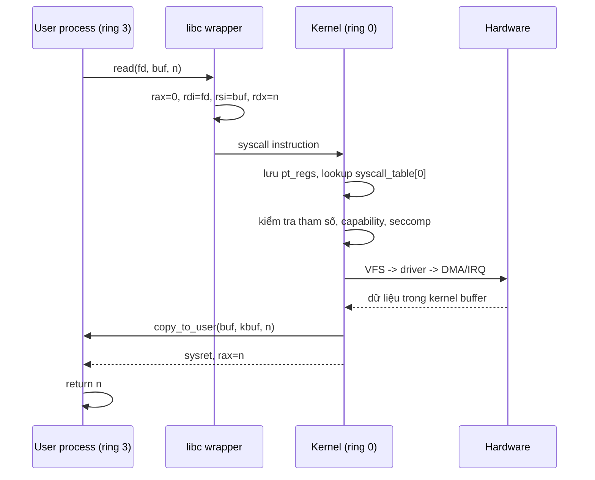

# What is a system call?

> System call là cổng duy nhất để user code yêu cầu kernel làm việc: open, read, write, fork, execve, brk, ioctl. User mode và kernel mode là hai mức đặc quyền CPU, phân tách bằng ring (x86-64) hoặc EL (AArch64); syscall chuyển từ ring 3/EL0 sang ring 0/EL1 qua trap instruction và trả về sau khi kernel xử lý.

Chủ đề: Operating Systems · Ngày: 2026-10-16

## 0. Nền tảng trước khi đọc

**Bối cảnh:** Lớp phần mềm quản lý CPU, bộ nhớ, tiến trình và thiết bị. Ứng dụng gọi OS thay vì tự điều khiển phần cứng trực tiếp.

**Nói đơn giản:** System call là cổng để code user yêu cầu kernel làm việc đặc quyền như đọc file hoặc tạo process.

**Từ khóa cần biết:** process = chương trình đang chạy; thread = luồng thực thi; kernel = phần lõi có quyền điều khiển máy.

**Ví dụ dễ hình dung:** read() chuyển từ user mode vào kernel để kiểm tra quyền và lấy byte từ file descriptor.

Khi đọc, luôn hỏi ba câu: nó giải quyết vấn đề gì, nó làm việc theo những bước nào, và khi nào không nên dùng?

**Cách học bài này:** Đọc phần này trước để nắm từ khóa; đọc phần 1 để lấy câu trả lời 30 giây; đọc phần 2 để hiểu cơ chế; cuối cùng mở từng câu hỏi ở phần 3 để luyện nói. Các con số và lệnh trong bài là bằng chứng cho câu trả lời, không cần học thuộc nếu chưa hiểu cơ chế.

## 1. Là gì

### Đọc nhanh trước khi đi sâu

**Ý chính:** System call là cổng để code user yêu cầu kernel làm việc đặc quyền như đọc file hoặc tạo process.

**Ví dụ interview:** read() chuyển từ user mode vào kernel để kiểm tra quyền và lấy byte từ file descriptor.

**Luồng 4 bước:**

1. Code user gọi wrapper như read(), open() hoặc fork().
2. CPU đổi từ user mode sang kernel mode qua trap/syscall instruction.
3. Kernel kiểm tra pointer, quyền và thực hiện thao tác với tài nguyên.
4. Kernel ghi kết quả hoặc error code rồi trả CPU về user mode.

**Nói như trong interview:** System call là cổng để code user yêu cầu kernel làm việc đặc quyền như đọc file hoặc tạo process. Hãy nói theo bốn bước trên trước; nếu interviewer hỏi sâu, chuyển sang cơ chế **Bước 1. CPU trap từ user mode sang kernel mode**, rồi nêu trade-off và failure mode ở các phần sau.

## 2. Cơ chế cốt lõi

### Bước 1. CPU trap từ user mode sang kernel mode

1. User process gọi libc wrapper (`read`, `write`, `open`, `fork`). Wrapper đặt số syscall vào thanh ghi chuyên dụng: x86-64 là `rax`, AArch64 là `x8`. Tham số vào `rdi, rsi, rdx, r10, r8, r9` (x86-64) hoặc `x0-x5` (AArch64).
2. CPU chạy trap instruction: `syscall` (x86-64) hoặc `svc #0` (AArch64). CPU tự lưu RIP/PC tiếp theo vào `rcx` (x86-64) hoặc `elr_el1` (AArch64), chuyển sang kernel mode, nạp PC từ `MSR_LSTAR` (x86-64) hoặc `vbar_el1` (AArch64).
3. Kernel entry point (`entry_SYSCALL_64` trên Linux) lưu phần còn lại của user context vào pt_regs trên kernel stack, chuyển sang kernel stack của thread hiện tại.

### Bước 2. Dispatcher tra syscall table

1. Kernel đọc số syscall từ thanh ghi, tra `sys_call_table[id]`. Linux 6.x có khoảng 450+ syscall. mỗi entry là một con trỏ hàm `long sys_xxx(...)`.
2. Kiểm tra tham số: con trỏ user có nằm trong vùng user VMA không, length không vượt quá giới hạn, flag hợp lệ. Nếu không hợp lệ → trả `-EFAULT` hoặc `-EINVAL`.
3. Kiểm tra quyền: capability, seccomp filter, AppArmor/SELinux hook. Seccomp (`SECCOMP_MODE_FILTER`) cho phép cấu hình BPF program từ chối syscall trước khi kernel xử lý — Chrome, container runtime dùng rất nhiều.

### Bước 3. Thực thi trong kernel

1. Hàm `sys_xxx` thực thi: ví dụ `sys_read` qua VFS tìm file theo fd, kiểm tra quyền đọc, gọi `file->f_op->read`, copy dữ liệu từ kernel buffer về user buffer bằng `copy_to_user`.
2. Nếu thao tác blocking (đọc socket chưa có dữ liệu, đợi lock, đợi I/O), kernel có thể đặt thread vào trạng thái `TASK_INTERRUPTIBLE` hoặc `TASK_UNINTERRUPTIBLE`, gọi scheduler, chuyển sang thread khác.
3. Khi sẵn sàng (dữ liệu tới, lock nhả), scheduler đánh thức thread, thread tiếp tục syscall.

### Bước 4. Trả về user mode

1. Sau khi syscall xong, kernel trả về user mode bằng `sysret` (x86-64) hoặc `eret` (AArch64). CPU khôi phục user RIP/PC, chuyển về ring 3/EL0.
2. libc đọc giá trị trả về (số byte, fd mới, hoặc `-errno`). Nếu là số âm, libc chuyển thành errno toàn cục (Linux) hoặc bằng `cerror` (BSD/macOS).
3. User process tiếp tục.

### Bước 5. So sánh hai cơ chế trap



*Luồng thời gian một lần syscall đọc: từ wrapper tới trap, kernel xử lý, copy data về user, trả về. Mỗi bước có thể bị block (IRQ, lock, page fault).*

### Bước 6. User mode vs kernel mode ở mức CPU

| Khía cạnh | User mode (ring 3 / EL0) | Kernel mode (ring 0 / EL1) |
|---|---|---|
| Mức đặc quyền | Thấp | Cao |
| Truy cập MMIO, CR3, MSR | Không | Có |
| Đọc/ghi bất kỳ page nào | Cần page table ánh xạ | Có (khi kernel page table cho phép) |
| Gọi trap instruction | Có (syscall, int 0x80) | Không cần |
| Chạy khi | Process user code | Kernel, driver, IRQ handler |
| Stack | User stack | Kernel stack (per-thread hoặc IRQ stack) |

Hypervisor mode (ring -1, EL2) và secure monitor (EL3) là các tầng đặc quyền cao hơn cho virtualization và secure boot. Không phải CPU nào cũng có.

### Bước 7. Cơ chế bảo vệ phía kernel

- **SMEP/SMAP** (x86-64): ngăn kernel vô tình thực thi code hoặc truy cập data từ user page khi đang ở kernel mode. Phải tắt cờ tạm thời nếu cần copy từ user buffer (xem `copy_from_user`).
- **KPTI** (Kernel Page Table Isolation, Meltdown mitigation): Linux tách page table kernel và user; khi user chạy, page table kernel hầu hết không ánh xạ, giảm leak qua spectre.
- **PAN** (AArch64): tương tự SMAP, ngăn kernel đọc user memory mà không đi qua helper.
- **Capability** (Linux): chia quyền thành hạt (CAP_SYS_ADMIN, CAP_NET_ADMIN, CAP_SYS_PTRACE...). Seccomp giới hạn syscall tới mức `prctl(PR_SET_SECCOMP, SECCOMP_MODE_STRICT)` chỉ cho `read`, `write`, `exit`, `sigreturn`.

### Quan sát

```bash
# Linux: đếm số syscall một process dùng
strace -c -p PID
# % time, seconds usecs/call calls syscall
#  0.00 0.000000 0  3 read
#  0.00 0.000000 0  1 write
# ...

# Linux: xem syscall nào bị seccomp chặn
grep SECCOMP /var/log/audit/audit.log

# Linux: dump seccomp filter của process
cat /proc/PID/status | grep Seccomp
# Seccomp:        2
# Seccomp_filters: 1
```

### Ví dụ chạy từng bước

Kịch bản: service ghi log `access.log` 1000 request/giây, mỗi request ghi một dòng ~80 byte qua `write()`. Mục tiêu: thấy một `write()` trên regular file đi từ user mode tới đĩa vật lý thế nào, biết khi nào dữ liệu thật sự an toàn, và thấy seccomp chặn ở đâu nếu cấu hình quá chặt.

Mỗi bước dùng số liệu minh họa đã tính lại bằng script; output lệnh chưa chạy thật ghi "output minh họa, chưa chạy".

| Bước | Thời gian | Hành động | Trạng thái sau bước |
|---|---|---|---|
| 0 | t0 | Service `glibc write(fd, buf, 80)`. fd=4 trỏ tới `/var/log/access.log` đã mở `O_APPEND`. | `rax=1` (SYS_write), `rdi=4`, `rsi=buf`, `rdx=80` |
| 1 | t0 + ~50 ns | Wrapper `mov rax,1` rồi `syscall`. CPU lưu RIP vào `rcx`, nạp `MSR_LSTAR` → `entry_SYSCALL_64`. | ring 3 → ring 0; user RIP ở `rcx` |
| 2 | t0 + ~250 ns | Kernel lưu pt_regs vào kernel stack (~16 KB). Dispatch `sys_call_table[1]` → `vfs_write` → `file->f_op->write_iter`. | dispatch xong |
| 3 | t0 + ~2 µs | ext4 `write_iter`: `copy_from_user(buf, kbuf, 80)` copy vào page cache. Đánh dấu page dirty, journal entry. | thread chạy tiếp; page chưa xuống đĩa |
| 4 | Sau 0-5 s | Kernel writeback thread flush dirty page xuống đĩa (`dirty_writeback_centisecs=500`). | page sạch, dữ liệu an toàn sau writeback |
| 5 | Nếu `fsync(fd)` | `sys_fsync` đợi journal commit + writeback xong (~5-50 ms tuỳ disk). | `fsync` trả 0 → an toàn crash |

Trạng thái hệ thống:
- Sau bước 5, `ps -o stat,vsz` cho thread vẫn `Sl`; file `/var/log/access.log` có size mới nhưng `dirty` count tăng: `cat /proc/meminfo | grep Dirty`.
- Sau writeback (bước 6), `Dirty` giảm, `Writeback` về 0.
- Crash giữa bước 5 và 6: mất tối đa ~5 giây dữ liệu gần nhất. Xem [write-ahead-log](../Database/write-ahead-log.md).

Biến thể lỗi: container cài seccomp `SECCOMP_RET_KILL_PROCESS` cấm `SYS_fsync` (rất hiếm nhưng gặp khi dev tự viết profile). Service gọi `fdatasync` → `kernel kill -9 process`. Trong `audit.log`: `type=SECCOMP msg=audit(...): auid=... syscall=319` (sys_fsync). Khắc phục: thêm syscall vào whitelist profile hoặc dùng `fsync` chỉ khi thật cần.

Điều rút ra: `write()` trả về chỉ nghĩa dữ liệu đã vào page cache, không phải an toàn; chỉ `fsync` (hoặc writeback tự nhiên sau ~5 s) mới bảo đảm. Nối sang câu 1 và câu 2 ở 3A để chứng minh vì sao nhầm "write xong là an toàn" là bẫy thường gặp.

## 3. Câu hỏi phỏng vấn

### 3A. Câu hỏi đào sâu

<details class="qa">
<summary>Câu 1. User mode và kernel mode khác nhau thế nào ở mức CPU và OS?</summary>

**Trả lời ngắn:** User mode là ring 3 (x86-64) hoặc EL0 (AArch64), chạy code ứng dụng với page table giới hạn, không truy cập được thanh ghi đặc quyền (CR3, MSR, APIC). Kernel mode là ring 0/EL1, có đặc quyền đầy đủ, có thể đọc/ghi bất kỳ page và cấu hình phần cứng. Chuyển đổi qua trap (syscall, interrupt, page fault) và tốn vài chục đến vài trăm ns.

**Đào sâu:**
- Ring 0/3 là mô hình x86 truyền thống; ring 1/2 hiếm dùng (driver cũ). AArch64 dùng EL0/EL1/EL2/EL3.
- User mode chạy trên user page table (CR3 ở x86-64, TTBR0 ở AArch64) — không có ánh xạ tới kernel data structure nhất định (KPTI). Kernel mode chạy trên kernel page table.
- User process không thể trực tiếp gọi `out` để ghi I/O port, không thể đọc CR3; nếu thử CPU raise #GP (general protection fault) → kernel kill process.
- Trap từ user sang kernel lưu context vào pt_regs ở kernel stack (per-thread, ~16KB). Kernel dùng stack riêng, không phải user stack.
- macOS XNU: BSD syscall layer gọi Mach trap (`mach_trap`), rồi IPC tới kernel; BSD process chạy ở user, BSD kernel chạy ở Mach kernel trong kernel address space.

**Bẫy:** "Ring 1/2 dùng cho driver." Hiếm gặp hiện nay; driver chạy ở kernel mode (ring 0) hoặc userspace driver (UIO, VFIO, DPDK) chạy ở ring 3 với quyền hạn chế.

**Follow-up:** Hypervisor mode khác kernel mode thế nào? Ring -1 / EL2 cho virtualization; hypervisor (KVM, Hyper-V) chạy ở EL2, guest kernel chạy ở EL1 nhưng bị trap vào EL2 khi thực thi lệnh đặc quyền (EPT violation, I/O).
</details>

<details class="qa">
<summary>Câu 2. Điều gì xảy ra từ khi `write()` được gọi tới khi dữ liệu xuống đĩa?</summary>

**Trả lời ngắn:** libc wrapper đặt `rax=1` rồi `syscall`. Kernel entry lưu context, lookup `sys_write` → VFS → file → `f_op->write` → đối với regular file: copy từ user buffer vào page cache, ghi metadata (size, mtime). Trả bytes đã ghi. Tới đĩa vật lý thì writeback sau (xem, `dirty page` flush bởi `writeback` thread, `fsync`).

**Đào sâu:**
- `sys_write` qua fd → `fdtable` → `struct file` → `f_op->write` (thường là `ext4_file_write_iter` hoặc pipe/socket variant).
- Regular file: kernel copy dữ liệu từ user vào page cache qua `copy_from_user`, đánh dấu page dirty, journal commit (ext4 ordered) hoặc data=writeback mode. Trả bytes đã copy.
- Ổ đĩa vật lý ghi async: writeback thread định kỳ (`dirty_writeback_centisecs`, mặc định 5s) hoặc khi `vm.dirty_ratio` đạt ngưỡng (20% RAM mặc định). `fsync(fd)` flush cưỡng bức, đợi driver xong.
- Tương tự socket write: TCP, kernel đưa vào socket send buffer; nếu đầy, user thread block (TASK_INTERRUPTIBLE) chờ space. IP packet ra NIC qua driver, ring buffer, DMA, transmit.

**Bẫy:** "`write()` xong là dữ liệu an toàn". Sai — chỉ an toàn khi `fsync()` trả về 0. Crash trước `fsync` có thể mất dữ liệu (last 0-5 giây ghi). Xem [write-ahead-log](../Database/write-ahead-log.md).

**Follow-up:** So sánh `write()` + `fsync()` với `O_DIRECT`? `O_DIRECT` bỏ page cache, kernel không buffer; ứng dụng tự quản lý cache (thường cho database). Tốn CPU hơn nhưng giảm double buffering.
</details>

<details class="qa">
<summary>Câu 3. Syscall tốn bao nhiêu thời gian và overhead ở đâu?</summary>

**Trả lời ngắn:** Trap đơn thuần (vào kernel và ra) tốn ~50-200 ns trên CPU hiện đại (x86-64 Skylake ~100 ns, Apple M-series tương tự). Phần lớn thời gian đến từ xử lý bên trong: `read` trên regular file cache hit tốn ~1-2 µs, cache miss ~10 µs; socket I/O tốn µs đến ms; thao tác block (đợi lock, đợi page) có thể tốn ms đến giây.

**Đào sâu:**
- Trap cost: lưu/restore thanh ghi (~30 ns), nạp kernel page table (KPTI, ~100 ns extra), cache flush (Spectre mitigation). KPTI từng đẩy trap cost lên ~500 ns; sau giảm nhẹ.
- VFS layer: lookup inode, file, dentry — cache hit ~hundreds ns. Cold path vài µs.
- I/O scheduler: cho block device, CFQ/mq-deadline sắp xếp request, có thể merge; thêm latency.
- `io_uring` (Linux 5.1+) và `uring` giảm overhead bằng cơ chế submission queue: user đẩy SQE vào ring buffer shared với kernel, kernel xử lý batch, completion queue thông báo. Round-trip giảm từ ~1-2 µs xuống ~200-500 ns mỗi syscall.
- Database (PostgreSQL, RocksDB) chuyển từ `read/write` sang `io_uring` để giảm syscall bottleneck.

**Bẫy:** "Syscall luôn tốn vài µs". Sai — trap cost ~100 ns; phần nặng là logic bên trong syscall (I/O, lock, page fault).

**Follow-up:** `io_uring` có thay thế hoàn toàn `epoll` không? Không — `io_uring` cho disk và một số network op; `epoll` vẫn cần cho event multiplexing nhiều fd. Nhiều production kết hợp cả hai.
</details>

<details class="qa">
<summary>Câu 4. Seccomp filter hoạt động thế nào và khi nào dùng?</summary>

**Trả lời ngắn:** Seccomp là BPF program chạy trước syscall thực sự. Có ba mode: `DISABLED` (off), `STRICT` (chỉ cho phép `read`, `write`, `exit`, `sigreturn`), `FILTER` (BPF user định nghĩa). Process phải chủ động cài (`prctl` hoặc `seccomp(SECCOMP_SET_MODE_FILTER)`); khi cài không thể gỡ.

**Đào sâu:**
- BPF filter nhận `struct seccomp_data` gồm syscall number, args (6 thanh ghi), arch (x86_64, aarch64). Filter trả `SECCOMP_RET_ALLOW`, `SECCOMP_RET_ERRNO`, `SECCOMP_RET_KILL_PROCESS`, `SECCOMP_RET_TRACE`.
- Chrome, Android app, container runtime (runc, containerd) cài seccomp profile mặc định cấm `clone(CLONE_NEWUSER)`, `ptrace`, `mount`, `bpf`. Chrome có sandbox renderer riêng với profile khác.
- Có thể chuyển filter qua `seccomp(SECCOMP_SET_MODE_FILTER, SECCOMP_FILTER_FLAG_TSYNC)` để áp dụng cho cả thread group; hoặc `SECCOMP_FILTER_FLAG_NEW_LISTENER` để nhận fd nghe filter (dùng cho bồi process).
- `prctl(PR_SET_NO_NEW_PRIVS, 1, ...)` phải set trước khi cài filter; ngăn child privilege escalation.

**Bẫy:** "Seccomp chặn được tất cả exploit". Sai — seccomp chỉ chặn syscall không mong muốn; nếu code vẫn cho phép `write` tới bất kỳ fd, file write vẫn xảy ra.

**Follow-up:** Seccomp khác AppArmor/SELinux thế nào? Seccomp lọc syscall; AppArmor/SELinux lọc file path, capability, network port. Thường dùng kết hợp: seccomp chặn syscall, AppArmor giới hạn file path.
</details>

<details class="qa">
<summary>Câu 5. vDSO và vsyscall là gì, vì sao có?</summary>

**Trả lời ngắn:** vDSO (virtual dynamic shared object) là vùng nhớ kernel map vào user space, chứa code cho các syscall "nhẹ" như `gettimeofday`, `clock_gettime`, `getcpu` mà không cần trap. vDSO được dynamic linker load cùng libc. vsyscall là phiên bản cũ (x86), đã deprecated, thay bằng vDSO; nhiều distro map vsyscall read-only hoặc vô hiệu hóa.

**Đào sâu:**
- Các hàm `clock_gettime(CLOCK_MONOTONIC)` hoặc `gettimeofday` thường xuyên (benchmark, log timestamp) — trap mỗi lần ~100 ns, batch 1000 lần tốn 100 µs. vDSO cho phép đọc VDSO_DATA (chia sẻ giữa kernel và user) để lấy time, chi phí ~10 ns.
- Cơ chế: kernel map một page (4KB) vào user, chứa code vDSO (gọi `clock_gettime` chẳng hạn) và data (TSC offset, last update). User code đọc data → trả giờ. Kernel update data khi timer IRQ.
- vsyscall cũ: 3 syscall ở địa chỉ cố định (0xffffffffff600000), gọi qua call. Không có arg filtering — exploit có thể lợi dụng. Hiện đại: emulate hoặc disabled (`vsyscall=emulate` hoặc `vsyscall=none`).

**Bẫy:** "vDSO là syscall". Sai — vDSO chạy hoàn toàn user mode, không trap. Tốc độ như user code.

**Follow-up:** Hiệu năng benchmark ảnh hưởng thế nào? Vòng lặp đo thời gian trong benchmark nên dùng `clock_gettime(CLOCK_MONOTONIC)` qua vDSO, không `gettimeofday` qua syscall.
</details>

<details class="qa">
<summary>Câu 6 (Debug). Process bị kill với "Bad system call" hoặc "Illegal instruction". Phân tích theo thứ tự nào?</summary>

**Trả lời ngắn:** "Illegal instruction" (SIGILL) thường do binary chạy sai kiến trúc CPU hoặc code dùng lệnh CPU chưa bật (AVX-512 trên CPU không có). "Bad system call" (SIGSYS) do seccomp hoặc noexec. Trình tự: xác định loại signal, kiểm tra binary architecture, kiểm tra seccomp filter, kiểm tra syscall number có trên kernel hiện tại không.

**Đào sâu:**
- Bước 1: dmesg, `journalctl -k`, audit log. SIGSYS có thể do seccomp RET_KILL_PROCESS — xem `/proc/PID/status` (Seccomp_filters) hoặc audit log.
- Bước 2: `file ./binary` xem arch (ELF 64-bit LSB executable, x86-64). Nếu binary ARM chạy trên x86 → SIGILL.
- Bước 3: `strace -f ./binary 2>&1 | tail`. Nếu `seccomp(SECCOMP_RET_KILL)` xuất hiện → cấu hình seccomp quá chặt.
- Bước 4: kernel có syscall đó không? `ausyscall syscall_name` hoặc tra bảng syscall x86-64. Syscall mới (vd: `copy_file_range`, `pidfd_getfd`) cần kernel đủ mới.
- Bước 5: Container seccomp profile áp từ runtime (runc, containerd). Kiểm tra `docker inspect` hoặc `crictl inspect` xem profile.

**Bẫy:** Tắt seccomp profile container để sửa. Sai — đó là defense in depth, sửa code ứng dụng để dùng syscall được phép.

**Follow-up:** Làm sao debug trong container khi không có strace? Dùng `pumba chaos testing` hoặc gắn seccomp profile lỏng cho debug container, không cho production.
</details>

<details class="qa">
<summary>Câu 7 (Thiết kế). Thiết kế sandbox cho untrusted code (plugin, user upload). Cần bảo vệ những gì và dùng cơ chế nào?</summary>

**Trả lời ngắn:** Sandbox cần bốn lớp: (1) syscall filter (seccomp) giới hạn syscall được phép; (2) capability giới hạn quyền root; (3) namespace/cgroup giới hạn tài nguyên và visibility; (4) file system read-only hoặc bind mount subset. Ví dụ: WASM runtime, gVisor, Firecracker.

**Đào sâu:**
- Yêu cầu: plugin user upload chạy được nhưng không thể truy cập network, đọc file ngoài sandbox, không fork được C++ DoS CPU/RAM.
- Seccomp profile cấm `socket`, `bind`, `connect`, `ptrace`, `mount`, `reboot`, `kexec_load`. Chỉ cho `read`, `write`, `mmap`, `brk`, `close`, `exit_group`, signal.
- Capability: drop tất cả (`CAP_SETPCAP, CAP_SYS_ADMIN...`) ngay từ đầu.
- Namespaces: `unshare(CLONE_NEWNS | CLONE_NEWPID | CLONE_NEWNET)` tạo isolated view. Cgroup v2 giới hạn CPU (`cpu.max`), memory (`memory.max`), PID (`pids.max`).
- File system: bind mount `/tmp/sandbox/` với chỉ data input, không `/etc`, không `/home`. overlayfs read-only root với tmpfs scratch.
- Runtime ví dụ: gVisor (intercept syscall ở user-space kernel, tăng safety), Firecracker microVM (chạy guest kernel riêng, mạnh hơn nhưng tốn overhead), WASM (cấm hầu hết syscall, gọi host qua WASI ABI).
- Không cần siết cùng lúc tất cả; chọn theo threat model: untrusted plugin → seccomp + namespace + cgroup; arbitrary code → microVM hoặc gVisor.

**Bẫy:** Chỉ dùng seccomp mà quên namespace — plugin vẫn thấy `/etc/shadow` và `ifconfig`.

**Follow-up:** So sánh Firecracker với gVisor về overhead? Firecracker cần VM boot ~125 ms, mỗi syscall guest→hypervisor; gVisor intercept ở user-space, nhanh hơn cho syscall-bound workload nhưng tốn RAM hơn.
</details>

### 3B. Câu hỏi phỏng vấn liên quan

<details class="qa">
<summary>Câu 8. `int 0x80` và `syscall` instruction khác nhau thế nào?</summary>

**Trả lời:** `int 0x80` là software interrupt cũ 32-bit, dùng cho compatibility; chậm hơn (~hundreds ns vs ~100 ns). `syscall` là instruction mới 64-bit, lưu RIP vào RCX, chuyển sang ring 0 nhanh. Linux 64-bit dùng `syscall`; 32-bit compat dùng `int 0x80`. Không nên dùng `int 0x80` trong code 64-bit mới.
</details>

<details class="qa">
<summary>Câu 9. Syscall bị block (TASK_UNINTERRUPTIBLE) có nguy hiểm không?</summary>

**Trả lời:** Có. Thread trong `D` state (TASK_UNINTERRUPTIBLE) không nhận signal, không thể kill bằng SIGTERM. Khi đông trong `D`, kernel trông có vẻ treo (`ps` hiển thị `D`). Thường do NFS mount chết, FUSE, hoặc I/O chờ driver. Dùng `cat /proc/PID/stack` xem stack; tránh bằng cách dùng NFS mount v4 với soft timeout, FUSE có kill option.
</details>

<details class="qa">
<summary>Câu 10. macOS syscall layer khác Linux thế nào?</summary>

**Trả lời:** macOS XNU: BSD syscall layer wrap Mach trap. POSIX API (`read`, `write`) chạy qua libc, BSD syscall layer gọi Mach IPC tới kernel. Kernel XNU chạy Mach microkernel + BSD. macOS gần đây (Ventura+) đã thêm KASLR cho kernel. Syscall number khác Linux; không portable giữa hai platform.
</details>

<details class="qa">
<summary>Câu 11. CPU ring 1 và ring 2 dùng khi nào?</summary>

**Trả lời:** Ring 1 và 2 dùng cho driver truyền thống (DOS, Windows 3.x driver). Hiện đại driver chạy ring 0 hoặc userspace (UIO, VFIO). Linux không phân biệt ring 1/2; macOS XNU chỉ dùng ring 0/3.
</details>

<details class="qa">
<summary>Câu 12. Tại sao không để user mode gọi thẳng driver mà bỏ syscall?</summary>

**Trả lời:** Ba lý do: (1) phải có người kiểm tra quyền (fd có phải của process không, có được đọc file đó không); (2) phải có chỗ để đặt thread vào trạng thái chờ khi I/O chưa sẵn sàng — driver không biết scheduler; (3) phải có chỗ kiểm soát tài nguyên chung (file table, socket buffer). Nếu user-mode driver (UIO, VFIO), kernel vẫn map page cho driver và cấp interrupt; driver vẫn phải gọi syscall cho một số thao tác.
</details>

<details class="qa">
<summary>Câu 13. True or false: "Syscall là synchronous — kernel xử lý xong rồi mới trả về."</summary>

**Trả lời:** Sai với một số syscall. `io_uring` cho phép submit nhiều SQE rồi nhận CQE sau, không synchronous từng cái. POSIX AIO `aio_read` tương tự: kernel có thể xử lý ngay hoặc tạo thread phụ. `epoll_wait` block nếu không có event. Nói chính xác hơn: syscall synchronous về flow control (user đợi completion), nhưng kernel có thể thực hiện deferred với cơ chế completion notification.
</details>

<details class="qa">
<summary>Câu 14. `mmap` có là syscall không? Khác `read`/`write` ở chỉ số nào?</summary>

**Trả lời:** Có, `mmap` là syscall 9 (x86-64). Khác `read`/`write`: `mmap` ánh xạ page của file vào user VMA; user truy cập qua pointer bình thường, kernel tự động page fault và fill từ page cache. Không cần copy data vào user buffer. Tốt cho file lớn (>page size) hoặc shared memory. So với `read`/`write`, `mmap` tránh double buffer nhưng cần unmap cuối cùng và không tốt cho file nhỏ hoặc sequential write heavy.
</details>

<details class="qa">
<summary>Câu 15. Làm sao đo số syscall trong một chương trình Linux?</summary>

**Trả lời:** `strace -c ./binary` đếm số lượng và thời gian mỗi syscall. `perf stat -e syscalls:sys_enter_*` đếm qua perf counter. Trong code: `perfetto` cho Android, `dtrace` cho macOS/Solaris. Trên production, sample-based profiling với `perf` để tránh overhead.
</details>

## 4. Đánh đổi và sự cố production

`int 0x80` (32-bit compat) tốn nhiều nhất vì đi qua IDT và iret thay vì syscall/ret riêng. `syscall` instruction nhanh hơn ~3-5x vì CPU lưu RIP thẳng vào RCX và chuyển sang ring 0 qua MSR mà không qua interrupt descriptor table. `io_uring` giảm tiếp bằng cách dùng submission ring chia sẻ giữa user và kernel: user đẩy SQE, kernel xử lý theo batch, completion ring báo về. Trade-off là `io_uring` chỉ phủ một số syscall, code phức tạp hơn và cần thiết kế cancel hợp lý. vDSO nhanh nhất vì không trap, nhưng chỉ cho vài API time và random. Khi chọn cơ chế: dùng `syscall` cho mọi thứ mặc định, `io_uring` cho disk-bound database hoặc proxy throughput cao, vDSO cho time/random trong hot path, tránh `int 0x80` trong code mới.

### So sánh các cơ chế trap

| Tiêu chí | `int 0x80` | `syscall` | `io_uring` | vDSO |
|---|---|---|---|---|
| Tốc độ | Chậm (~hundreds ns) | Nhanh (~100 ns) | Rất nhanh cho batch (~200 ns/syscall) | Nhanh nhất (~10 ns) |
| Overhead context switch | Có | Có | Giảm nhờ shared ring buffer | Không (không trap) |
| Phạm vi syscall | Tất cả (32-bit ABI) | Tất cả (64-bit ABI) | Một số (read, write, fsync, accept, send, recv, ...) | Chỉ time, getcpu, getrandom |
| Dùng cho | Binary 32-bit cũ | Code 64-bit mới | High-throughput I/O | Time, random |

### Năm failure mode

| Triệu chứng | Nguyên nhân gốc | Cách kiểm tra | Cách sửa |
|---|---|---|---|
| Process bị SIGSYS | Seccomp filter chặn syscall | `/proc/PID/status`, audit log | Cập nhật seccomp profile hoặc code |
| Latency syscall đột biến | Lock contention trong kernel (inode, socket) | `perf trace`, `bpftool` | Sharding fd, async I/O |
| `D` state nhiều | NFS hoặc FUSE chờ I/O xa | `cat /proc/PID/stack`, `/proc/slabinfo` | Soft mount, FUSE kill, dùng storage local |
| OOM do syscall leak | File descriptor không close | `lsof -p PID`, `/proc/PID/fd` | Close trong defer/finally, ulimit |
| "Bad system call" trên container | Binary dùng syscall host kernel không có | `dmesg`, `strace` | Build binary với feature detection |

Hai bài học rút ra từ production: (1) syscall tốn ít overhead hơn nhiều người tưởng (~100 ns), bottleneck thường nằm ở VFS, scheduler và I/O wait, không phải trap; (2) sandbox untrusted code phải kết hợp nhiều lớp, seccomp một mình không đủ. Xem [process-vs-thread](process-vs-thread.md) để hiểu thread state chuyển qua syscall blocking, và [interrupt-handling](interrupt-handling.md) cho cơ chế trap phần cứng tương tự.

## 5. Cheat sheet

| Chủ đề | Con số / quy tắc cần nhớ |
|---|---|
| Syscall trap cost | ~50-200 ns trên CPU hiện đại |
| User mode / kernel mode | x86-64 ring 3/0, AArch64 EL0/EL1 |
| Syscall x86-64 | `syscall`, số trong `rax`, args rdi-r9 |
| Syscall AArch64 | `svc #0`, số trong `x8`, args x0-x5 |
| vDSO | Cho `clock_gettime`, `gettimeofday`, `getcpu` |
| Seccomp modes | DISABLED / STRICT / FILTER (BPF) |
| KPTI | Meltdown mitigation, thêm ~100 ns vào trap |
| `io_uring` | Submission/completion ring shared với kernel |
| `copy_from_user` | Helper copy từ user buffer, tôn trọng SMAP |
| Linux 6.x | ~450+ syscall |

**Học tiếp:**
- [interrupt-handling](interrupt-handling.md) — trap từ phần cứng vào kernel
- [process-vs-thread](process-vs-thread.md) — đơn vị được schedule
- [context-switching](context-switching.md) — chi phí khi chuyển giữa user và kernel
