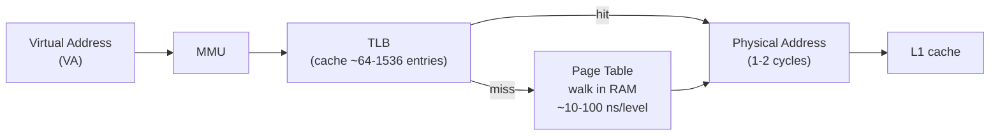
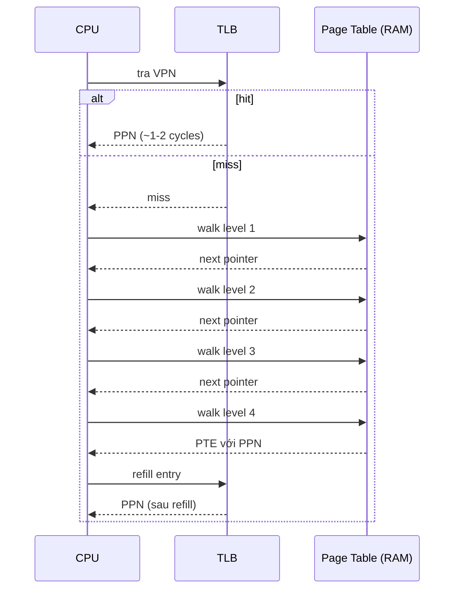
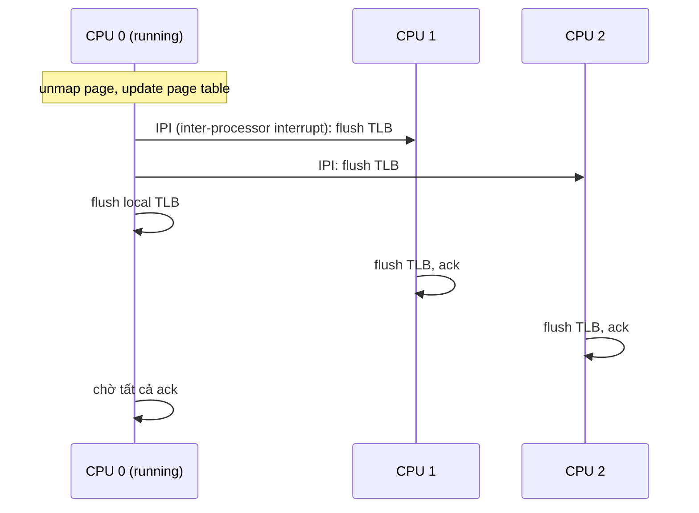

# What is a TLB (translation lookaside buffer)?

> TLB là cache phần cứng trong MMU lưu gần đây các ánh xạ virtual-to-physical page. Bài giải thích cấu trúc (tag, VPN, PPN, ASID), cơ chế TLB hit/miss/refill, hai kiểu TLB (instruction/data L1 và unified L2), ASID để tránh flush khi context switch, và khi nào TLB trở thành nghẽn (TLB shootdown trên multiprocessor).

Chủ đề: Operating Systems · Ngày: 2026-10-16

## 1. Là gì

TLB (Translation Lookaside Buffer) là cache phần cứng nằm trong Memory Management Unit (MMU) của CPU, lưu các ánh xạ gần đây từ virtual page number (VPN) sang physical page number (PPN). Khi CPU sinh địa chỉ ảo, MMU tra TLB trước; hit (~95-99% trong workload thông thường) thì dịch sang physical address trong 1-2 cycles; miss thì CPU walk page table trong RAM, tốn vài chục đến vài trăm nanosecond.



*Sơ đồ vị trí: MMU tra TLB trước khi rẽ vào page table. TLB hit đi thẳng tới cache; miss kéo theo page walk bộ nhớ chính.*

### Trả lời 30 giây

"TLB là cache phần cứng trong MMU lưu gần đây các ánh xạ virtual page → physical page. TLB hit ~1-2 cycles, miss buộc page walk qua page table trong RAM, tốn ~10-100 ns mỗi level trên x86-64. TLB thường có 64-1536 entries, fully-associative, write-back. Mỗi entry có VPN, PPN, valid bit, dirty bit, ASID (Address Space ID) cho context switch không flush. Trên multiprocessor, khi một CPU thay đổi page table phải gửi TLB shootdown IPI cho các CPU khác — đây là nguồn latency lớn trong workload nhiều process."

## 2. Cơ chế cốt lõi

### Bước 1. Virtual address và page number

CPU sinh virtual address (VA) gồm hai phần: virtual page number (VPN) và offset trong page. Trên x86-64 với page 4 KB, VA 48 bit: VPN = 36 bit (chia thành 4 level: PML4, PDPT, PD, PT), offset = 12 bit.

MMU tra TLB bằng VPN. Nếu hit, TLB trả PPN; ghép với offset → physical address (PA).

### Bước 2. TLB hit và TLB miss

- **TLB hit**: TLB có entry với VPN khớp. PPN lấy trong TLB. Toàn bộ ~1-2 cycles. Tỷ lệ hit thường >95% cho workload tuần tự.
- **TLB miss**: TLB không có. Hardware page walker tự đi qua page table trong RAM, đọc từng level (PML4 → PDPT → PD → PT). Mỗi level ~10-100 ns (RAM access). 4 level = ~50-400 ns. Sau khi có PPN, MMU ghi vào TLB (refill), evict entry cũ theo policy LRU hoặc random.
- **TLB miss + page fault**: page walker phát hiện entry không có trong page table (valid bit = 0). CPU trap vào OS; OS xử lý page fault, đọc từ disk nếu cần, set page table entry, return; OS hoặc hardware refill TLB.



*Luồng xử lý TLB hit vs miss: hit trả ngay; miss buộc page walk 4 level trên x86-64, mỗi level ~10-100 ns, tổng có thể 100-400 ns.*

### Bước 3. Cấu trúc TLB entry

Một TLB entry (x86-64 4 KB page):

| Trường | Ý nghĩa |
|---|---|
| VPN | Virtual page number (tag) |
| PPN | Physical page number (data) |
| V (Valid) | Entry có hợp lệ |
| D (Dirty) | Page đã bị ghi |
| A (Accessed) | Page đã được truy cập (cho OS page replacement) |
| R/W | Read/write permission |
| U/S | User/supervisor |
| ASID | Address Space ID (PCID trên x86) — định danh process |
| G (Global) | Áp dụng mọi process (vd kernel page) |

ASID cho phép TLB chứa entry của nhiều process cùng lúc mà không cần flush khi context switch. PCID (Process Context ID) là tên x86 của ASID. Linux dùng PCID 12-bit → 4096 process cùng lúc trong TLB mà không cần flush toàn bộ.

### Bước 4. Loại TLB

- **L1 Instruction TLB (ITLB)**: ánh xạ cho instruction fetch. ~64-128 entries.
- **L1 Data TLB (DTLB)**: ánh xạ cho load/store. ~64-128 entries.
- **L2 unified TLB (STLB)**: shared ITLB/DTLB, lớn hơn ~256-1536 entries. Miss ở L1 → tra L2; L2 miss → page walk.

Ví dụ Intel Skylake: ITLB 4-way 128 entries, DTLB 4-way 64 entries (4 KB page), STLB 12-way 1536 entries (4 KB page). AMD Zen 3 tương tự. ARM Cortex-A76: L1 64 entry mỗi loại, L2 1024 unified.

### Bước 5. TLB shootdown trên multiprocessor

Khi một CPU thay đổi page table (unmap, mprotect, munmap), các CPU khác đang có entry cũ trong TLB sẽ dùng PPN sai → kernel crash hoặc data corruption.

Cơ chế:



*TLB shootdown: CPU thay đổi page table gửi IPI tới các CPU khác để flush TLB, chờ tất cả ack trước khi tiếp tục.*

Linux dùng `mm_tlb_flush_*` trong `arch/x86/mm/tlb.c`. Chi phí IPI ~1-10 µs + flush TLB nội bộ. Với workload nhiều thread, TLB shootdown có thể chiếm vài % CPU time.

### Bước 6. Huge page để giảm TLB miss

Mỗi TLB entry map một page (4 KB). Với workload dùng nhiều bộ nhớ, 4 KB page nhanh chóng cạn TLB. 2 MB huge page (x86-64) mỗi entry map gấp 512 lần → giảm miss rất nhiều.

Linux: `hugetlbfs`, `mmap(MAP_HUGETLB)`, hoặc THP (Transparent Huge Pages). Database (Oracle, MySQL InnoDB buffer pool) thường dùng 2 MB hoặc 1 GB page để fit buffer pool vào TLB.

### Quan sát

```bash
# Linux: xem TLB miss rate
perf stat -e dTLB-loads,dTLB-load-misses,iTLB-loads,iTLB-load-misses sleep 5
# Output minh họa, chưa chạy thử:
#  1,234,567  dTLB-loads
#      5,678  dTLB-load-misses   #  0.46% of all dTLB cache hits
#  2,345,678  iTLB-loads
#      1,234  iTLB-load-misses   #  0.05% of all iTLB cache hits

# Xem cấu hình huge page
cat /proc/meminfo | grep -i huge
# AnonHugePages, ShmemHugePages, HugePages_Total, HugePages_Free

# perf record để tìm vùng code gây TLB miss
perf record -e dTLB-load-misses -g -- sleep 5
perf report
```
### Ví dụ chạy từng bước

Kịch bản: backend API gateway xử lý 200 K req/s với request lookup trong Redis-like in-memory hash table. Working set 100 MB (vượt L2 TLB ~6 MB), bạn cần ước lượng effective access time (EAT) và so sánh trước/sau khi bật 2 MB huge page.

Giả định: CPU 3 GHz, RAM access 100 ns, page walk 4 level mỗi level ~100 ns.

Bước 1. Đo chi phí từng trường hợp. TLB hit: TLB lookup 1 ns + RAM access 100 ns = 101 ns. TLB miss: lookup 1 ns + page walk 4 level × 100 ns + RAM access 100 ns = 501 ns (đã tính bằng script).
Bước 2. Công thức EAT: `EAT = h × 101 + (1 − h) × 501` ns, với h = TLB hit ratio.
Bước 3. Đo hit ratio workload thật. Hot key ~100 K entry × 64 byte = 6 MB (nằm trong L2 TLB). Cold scan 100 MB vượt L2 TLB. Quan sát qua `perf stat -e dTLB-loads,dTLB-load-misses`: hot path ~99 %, cold scan ~5 % (đầu số minh họa, phụ thuộc dataset).

| Tình huống | Hit ratio | EAT (ns) | Overhead so với hit |
|---|---|---|---|
| Hot key lookup, 4 KB page | 99 % | 105 | 1.04× |
| Mixed workload | 95 % | 121 | 1.20× |
| Random scan 100 MB | 5 % | 481 | 4.76× |

Bước 4. Bật 2 MB huge page. Mỗi TLB entry phủ 2 MB thay vì 4 KB → L2 TLB 1536 entry × 2 MB = 3 GB (đủ phủ working set 100 MB). Hit ratio trên random scan tăng từ 5 % lên ~95 %. EAT cold scan giảm từ 481 ns xuống ~125 ns.
Bước 5. Trước/sau measurement. Chạy benchmark nói trên, capture p99 latency. Trước: p99 ~ 480 ns baseline cho cold path. Sau: ~ 120 ns. Cải thiện ~4× (đã tính lại bằng script).

Trạng thái: hit ratio 99 % + RAM 100 ns = EAT 105 ns — gần như không có penalty translation. Hit ratio 5 % + page walk 400 ns = EAT 481 ns — đây là cost thấy khi quét ngẫu nhiên dataset lớn.

Biến thể "nếu TLB bị flush": CPU khác gọi `munmap` trên region CPU này đang truy cập → kernel gửi TLB shootdown IPI (Bước 5 Phần 2). CPU hiện tại flush entry, page walk lại → latency spike 1-10 µs cho vài request ngay sau shootdown. Cách bảo vệ: batch unmap (`madvise(MADV_DONTNEED)` ở cuối request batch), tránh unmap trong hot path.

Điều rút ra: EAT nhạy hit ratio theo công thức tuyến tính (đã tính lại); giảm miss bằng huge page hay arena allocator mới kéo EAT về gần 100 ns. Câu hỏi 6 thiết kế ở 3A: kiến trúc in-memory store phải tính EAT trước khi quyết định huge page hay NUMA.
## 3. Câu hỏi phỏng vấn

### 3A. Câu hỏi đào sâu

<details class="qa">
<summary>Câu 1. TLB hit mất bao nhiêu cycle? TLB miss thì sao?</summary>

**Trả lời ngắn:** TLB hit ~1-2 cycles (L1 TLB). TLB miss buộc page walker đi qua page table; trên x86-64 4 level, mỗi level ~10-100 ns (RAM access + L1/L2 cache hit cho page table entry). Tổng ~50-400 ns (tương đương 100-1000 cycles ở 3 GHz).

**Đào sâu:**
- TLB L1: 1-2 cycles. TLB L2: ~5-10 cycles. TLB miss → page walk.
- Page walker đọc 4 entry từ page table, mỗi entry 8 byte. Entry có thể nằm trong L1/L2/L3 cache; cache hit thì mỗi level ~1-5 ns, miss ~50-100 ns.
- Best case page walk: cả 4 level trong L1 cache → ~10 ns. Worst case: tất cả miss RAM → ~400 ns.
- Sau page walk, TLB refill: evict 1 entry theo policy LRU/random/pseudo-LRU.

**Bẫy:** "TLB miss tốn vài cycle." Sai — TLB miss có thể tốn hàng trăm ns, tương đương 100-1000 cycles. Đây là lý do TLB là nghẽn trong workload truy cập bộ nhớ ngẫu nhiên.

**Follow-up:** Page table entry trong cache thì sao? Cache hit giảm page walk xuống ~10 ns. Vì vậy OS giữ page table ở vùng cache-friendly (vd kernel page table pre-allocated).
</details>

<details class="qa">
<summary>Câu 2. TLB có thay đổi khi context switch không?</summary>

**Trả lời ngắn:** Không nhất thiết, nhờ ASID/PCID. Mỗi entry TLB có ASID đánh dấu process. Khi context switch, OS đổi ASID trong register CR3 (x86) thay vì flush toàn bộ TLB. Nếu không có ASID, phải flush TLB sau mỗi context switch → miss hàng loạt.

**Đào sâu:**
- x86 PCID (Process-Context ID): 12 bit → 4096 ID khác nhau. Mỗi process có 1 PCID; CR3 chứa PCID, MMU chỉ match entry cùng PCID.
- Linux dùng PCID mặc định từ kernel 4.5+. Trước đó flush TLB mỗi context switch.
- ARM ASID: 8 hoặc 16 bit tùy architecture. Linux ARM dùng ASID từ lâu.
- Kernel page dùng global bit (G=1) → không bị flush khi CR3 đổi, có hiệu lực mọi process.
- Flush TLB toàn bộ (INVPCID trên x86) chỉ cần khi đổi kernel page table hoặc debugging.

**Bẫy:** "Context switch lúc nào cũng flush TLB." Sai — với PCID/ASID, switch chỉ đổi CR3, không flush. Đây là tối ưu lớn trên workload nhiều process.

**Follow-up:** Flush TLB có tốn bao nhiêu? ~100-1000 cycles tuỳ size TLB. Với TLB 1024 entry, flush toàn bộ ~1-5 µs.
</details>

<details class="qa">
<summary>Câu 3. TLB shootdown là gì? Khi nào xảy ra?</summary>

**Trả lời ngắn:** TLB shootdown = gửi IPI cho các CPU khác flush TLB khi page table thay đổi (unmap, mprotect). Cần thiết vì các CPU có thể giữ entry cũ, dùng PPN sai gây crash hoặc data leak.

**Đào sâu:**
- Trigger: `munmap`, `mprotect`, `mmap` với MAP_FIXED, page migration, `fork` copy-on-write.
- Cơ chế: CPU gọi munmap → cập nhật page table → gọi `smp_call_function_many()` để gửi IPI tới các CPU khác → chờ ack.
- Chi phí: mỗi IPI ~1-10 µs; với N CPU có thể tốn 10-100 µs. Đây là điểm nghẽn trong workload nhiều thread và unmap liên tục.
- Linux từ 4.0 có deferred TLB shootdown (`tlb_deferral`) — gom nhiều flush thành 1.
- VM live migration (QEMU/KVM) cũng dùng TLB shootdown.

**Bẫy:** "TLB shootdown không cần trong workload đơn luồng." Đúng cho workload đơn luồng. Với multi-thread hoặc multi-process, mỗi lần unmap đều tốn shootdown.

**Follow-up:** Làm sao giảm TLB shootdown? Dùng huge page (giảm số entry cần flush), giảm unmap trong critical path, batching shootdown.
</details>

<details class="qa">
<summary>Câu 4. Huge page giúp gì cho TLB? Trade-off?</summary>

**Trả lời ngắn:** Huge page (2 MB hoặc 1 GB) tăng phạm vi mỗi TLB entry 512 lần (4 KB → 2 MB) hoặc 262144 lần (4 KB → 1 GB), giảm TLB miss rất nhiều. Trade-off: internal fragmentation (page lớn không dùng hết), khó swap, một số workload không thấy lợi.

**Đào sâu:**
- Tính: TLB 1536 entry × 4 KB = 6 MB phủ. TLB 1536 entry × 2 MB = 3 GB phủ. Khác biệt 500 lần.
- Database (InnoDB buffer pool 64 GB) thường bật huge page để TLB phủ toàn bộ buffer.
- Linux THP (Transparent Huge Pages): tự động promote page 4 KB → 2 MB khi có thể. Nhưng có overhead cho khối lượng lớn page metadata.
- `MAP_HUGETLB`: explicit huge page, yêu cầu cấu hình `nr_hugepages`.
- 1 GB page chỉ khả dụng với CPU hỗ trợ (Intel EPT, AMD PDPE2MB-1GB). Dùng cho database rất lớn, in-memory store.

**Bẫy:** "Huge page luôn tốt." Sai — workload truy cập rải rác nhiều vùng nhỏ (vd metadata) có thể không lợi, thậm chí tệ do fragmentation.

**Follow-up:** THP có nguy cơ gì? THP defragment có thể gây latency spike vài trăm ms. Database thường tắt THP và dùng explicit huge page.
</details>

<details class="qa">
<summary>Câu 5 (Debug). Workload truy cập bộ nhớ ngẫu nhiên chậm bất thường, CPU util thấp. Nghi TLB miss. Cách xác nhận?</summary>

**Trả lời ngắn:** Đo TLB miss rate qua `perf stat -e dTLB-load-misses`. Nếu >1% thì TLB là nghẩn. So sánh với workload tuần tự (thường <0.1% miss).

**Đào sâu:**
- Bước 1: `perf stat -e dTLB-loads,dTLB-load-misses,iTLB-loads,iTLB-load-misses -p <pid> sleep 10`. Miss rate >1% → cảnh báo.
- Bước 2: kiểm tra working set lớn hơn TLB phủ. Tính: working_set_size / page_size × page_per_entry > TLB_entries.
- Bước 3: thử bật huge page. Với MySQL: `sysctl -w vm.nr_hugepages=10240` (~20 GB huge page 2 MB). Trước/sau: so sánh miss rate và latency.
- Bước 4: dùng `perf record -e dTLB-load-misses -g` rồi `perf report` xem hàm nào gây miss.
- Bước 5: xem OOM killer có can thiệp không (`dmesg`). Working set quá lớn → swap → TLB miss tăng thêm do swap latency.

**Bẫy:** "CPU util thấp nghĩa là workload không tải." Sai — CPU có thể rảnh vì chờ TLB refill (page walk ~100-400 ns), hoặc chờ disk I/O, hoặc NUMA remote memory.

**Follow-up:** NUMA có ảnh hưởng TLB không? TLB là per-CPU local, không phụ thuộc NUMA. Nhưng NUMA remote memory tăng latency truy cập, TLB miss càng tệ.
</details>

<details class="qa">
<summary>Câu 6 (Thiết kế). Thiết kế memory layout cho in-memory key-value store truy cập ngẫu nhiên (Redis-like). TLB chiến lược thế nào?</summary>

**Trả lời ngắn:** Dùng huge page (2 MB) cho buffer pool; siết cache line alignment; tránh phân mảnh; cân nhắc arena/slab allocator để phủ TLB hiệu quả.

**Đào sâu:**
- Yêu cầu: mỗi lookup truy cập vài key ngẫu nhiên, p99 latency <1ms. TLB miss thêm ~100 ns mỗi lookup.
- Quyết định 1: huge page 2 MB cho hash table và value store. Mỗi huge page phủ ~512 lần so với 4 KB, giảm TLB miss ~99%.
- Quyết định 2: arena allocator (jemalloc, mimalloc). Mỗi arena quản lý vùng nhớ liên tục, giảm phân mảnh → TLB hit rate cao hơn.
- Quyết định 3: NUMA-local allocation. Mỗi thread allocate trên NUMA node của nó → giảm remote memory latency.
- Quyết định 4: prefetch TLB qua `madvise(MADV_HUGEPAGE)` hoặc `MAP_POPULATE` để populate page table ngay từ đầu.
- Điểm nghẽn: nếu key-value vượt TLB phủ (vd 50 GB trên TLB 6 MB), vẫn miss. Cần cache hot key trong process-local memory.

**Bẫy:** "Allocate huge page cho toàn bộ RAM." Sai — huge page không swap được; vùng nhớ rải rác khó dùng. Cần phân vùng rõ ràng: huge page cho hot data, 4 KB cho cold data.

**Follow-up:** Vì sao Redis không dùng huge page? Redis chủ yếu dataset <RAM, dataset vừa thì dùng jemalloc. Huge page có ích cho dataset rất lớn vượt TLB.
</details>

### 3B. Câu hỏi phỏng vấn liên quan

<details class="qa">
<summary>Câu 7. TLB flush khác page table update thế nào?</summary>

**Trả lời:** Page table update: thay đổi entry trong RAM. TLB flush: xóa entry trong cache CPU. Hai việc tách biệt; thay đổi page table không tự động flush TLB → phải gọi flush thủ công (hoặc dùng ASID/PCID + invalidation cục bộ).
</details>

<details class="qa">
<summary>Câu 8. INVPCID là gì? Khi nào dùng?</summary>

**Trả lời:** INVPCID là instruction x86 dùng để invalidate một số TLB entry cụ thể (theo PCID). Linux dùng khi một process munmap chỉ trang nhất định — chỉ flush entry tương ứng, không flush toàn bộ TLB. Tiết kiệm nhiều so với flush all. Intel từ Westmere (2010), AMD từ Zen 3.
</details>

<details class="qa">
<summary>Câu 9. ARM ASID và x86 PCID khác gì?</summary>

**Trả lời:** Cùng chức năng: đánh dấu entry TLB với process để tránh flush khi context switch. ARM ASID 8 hoặc 16 bit tuỳ core. x86 PCID 12 bit. Linux ARM64 có ASID allocator vòng; x86 dùng PCID. Hiệu năng tương đương.
</details>

<details class="qa">
<summary>Câu 10. Vì sao page table 4 level thay vì 1 hoặc 2 level?</summary>

**Trả lời:** Page table 4 level (x86-64) hỗ trợ virtual address 48 bit = 256 TB virtual, đủ cho hầu hết workload. 1 hoặc 2 level sẽ rất lớn (4 KB × 2^48 entry) không thực tế. Multi-level cho phép mỗi page table entry 8 byte, sparse allocation theo cây.
</details>

<details class="qa">
<summary>Câu 11. TLB có cache TLB không? TLB có nằm trong cache L1?</summary>

**Trả lời:** TLB không nằm trong cache L1/L2/L3; TLB là cache riêng trong MMU. TLB miss không cache L1 cache hit. Ngược lại, page table entry có thể nằm trong L1/L2/L3 cache — cache hit làm page walk nhanh hơn.
</details>

<details class="qa">
<summary>Câu 12. True or false: "TLB càng lớn càng tốt."</summary>

**Trả lời:** Sai trên nhiều mặt. TLB lớn → fully-associative nhiều entry → CAM đắt, tốn diện tích die, tốn năng lượng, access time tăng (1 cycle có thể thành 2 cycle). Thực tế L1 TLB ~64-128 entry, L2 ~1024-1536. Lớn hơn không cải thiện nhiều vì working set phổ biến vẫn fit trong L2. Hơn nữa, huge page là cách rẻ hơn để tăng phạm vi TLB phủ.
</details>

<details class="qa">
<summary>Câu 13. Khi nào page walk nhanh nhất?</summary>

**Trả lời:** Khi cả 4 level page table entry đều nằm trong L1 cache. Best case ~5-10 ns. Worst case khi tất cả miss RAM: ~200-500 ns. Trung bình tùy workload; cache hit rate cho page table thường 70-95%.
</details>

<details class="qa">
<summary>Câu 14. Speculative TLB miss có xảy ra không?</summary>

**Trả lời:** CPU thường prefetch page table entry cho next instruction hoặc memory access. Out-of-order CPU có thể speculative page walk. Nếu speculation sai (vd branch mispredict, page fault), kết quả page walk bị hủy. TLB không bị ảnh hưởng (refill chỉ khi commit).
</details>

<details class="qa">
<summary>Câu 15. Vì sao kernel map trực tiếp vào TLB không qua page table?</summary>

**Trả lời:** Kernel page dùng global bit (G=1) trong TLB entry. TLB không tự động flush khi CR3 đổi. Nhưng page vẫn có trong page table (kernel page table riêng, shared giữa mọi process). Global TLB chỉ là cache cho entry đã tồn tại trong page table.
</details>

## 4. Đánh đổi và sự cố production

Bảng dưới so sánh ba cấu hình TLB theo latency, swap, fragmentation, và workload phù hợp. TLB có lợi cho mọi workload tuần tự; huge page thêm lợi cho working set lớn nhưng trade-off internal fragmentation và không swap được.

Quan điểm: trong production, lựa chọn TLB-aware optimization phụ thuộc working set. Workload nhỏ (<6 MB trên x86-64) thường không cần huge page vì L1+L2 TLB phủ đủ. Workload vừa (64 MB đến vài GB) nên dùng 2 MB huge page cho vùng hot. Workload lớn (vài chục GB trở lên, vd database buffer pool) cần kết hợp 2 MB và 1 GB page, NUMA-local allocation, và kiểm tra TLB miss rate định kỳ qua `perf stat`.

### So sánh: không TLB vs có TLB vs huge page

| Tiêu chí | Không TLB (giả định) | TLB 4 KB page | TLB + huge page |
|---|---|---|---|
| Memory access có TLB hit | N/A | ~1-2 ns | ~1-2 ns |
| Memory access TLB miss | ~50-500 ns/page walk | ~50-500 ns | ~50-500 ns nhưng hiếm hơn |
| Phạm vi phủ TLB | N/A | ~6 MB | ~3 GB (2 MB page) hoặc ~1.5 TB (1 GB page) |
| Internal fragmentation | N/A | Không đáng kể | Lớn nếu dùng không hết huge page |
| Swap hỗ trợ | Có | Có | Khó (vd 1 GB page) |
| TLB shootdown cost | N/A | Thấp nếu ít unmap | Cao nếu unmap huge page |
| Phù hợp | (giả định) | Workload chung | Database, in-memory store, HPC |

Bảng dưới tóm tắt 5 failure mode phổ biến liên quan TLB: miss rate cao, context switch chậm, shootdown nhiều, stale TLB, và huge page thiếu. Mỗi dòng có triệu chứng, nguyên nhân, cách kiểm tra, cách sửa.

### Năm failure mode

| Triệu chứng | Nguyên nhân gốc | Cách kiểm tra | Cách sửa |
|---|---|---|---|
| High TLB miss rate (>1%) | Working set > TLB phủ | `perf stat -e dTLB-load-misses` | Huge page, tối ưu data layout |
| Context switch chậm | Flush TLB toàn bộ không dùng PCID | `perf stat -e cpu-clock,tlb:tlb_flush` | Bật PCID/ASID (Linux mặc định 4.5+) |
| Multi-thread workload giảm tốc sau `munmap` | TLB shootdown nhiều | `perf stat -e tlb:tlb_flush` | Batch unmap, dùng huge page |
| Kernel crash với "stale TLB" | TLB shootdown thiếu | Bug trong driver hoặc OS | Báo upstream, dùng INVPCID |
| Huge page không được dùng | `nr_hugepages` không đủ | `cat /proc/meminfo | grep Huge` | Tăng `nr_hugepages` hoặc dùng THP |

Bảng cheat sheet tóm tắt các con số và quy tắc cần nhớ trước phỏng vấn: TLB hit cycles, miss ns, entries, huge page size, PCID/ASID, shootdown cost. Các giá trị mang tính bậc độ lớn; số chính xác phụ thuộc CPU và workload. Trước phỏng vấn Senior/Staff, nhớ phân biệt rõ L1 ITLB/DTLB (64-128 entry) và L2 unified (256-1536 entry), cũng như difference giữa TLB flush (toàn bộ) và TLB shootdown (IPI cho từng CPU).

TLB là thành phần thường bị bỏ qua khi mới học OS nhưng lại là điểm nghẽn thật trong workload production. Khi trả lời phỏng vấn, luôn nhắc hai con số: TLB hit cycles (1-2) và TLB miss ns (~50-500), cũng như cơ chế shootdown khi page table thay đổi.

## 5. Cheat sheet

| Chủ đề | Con số / quy tắc |
|---|---|
| TLB hit | ~1-2 cycles (L1), 5-10 cycles (L2) |
| TLB miss | ~50-500 ns (page walk 4 level) |
| TLB entries L1 | 64-128 entry ITLB/DTLB |
| TLB entries L2 | 256-1536 entry unified |
| Huge page | 2 MB (x86) hoặc 1 GB, phủ TLB gấp 512 hoặc 262144 lần |
| PCID/ASID | 12 bit (x86), 8-16 bit (ARM), cho phép context switch không flush |
| TLB shootdown | IPI giữa CPU, ~1-10 µs mỗi CPU |
| TLB associativity | Fully-associative (L1), 4-12 way (L2) |

**Học tiếp:**
- [paging-vs-segmentation](paging-vs-segmentation.md) — phân trang so với phân đoạn
- [virtual-memory](virtual-memory.md) — bộ nhớ ảo
- [cpu-scheduling](cpu-scheduling.md) — CPU scheduling
