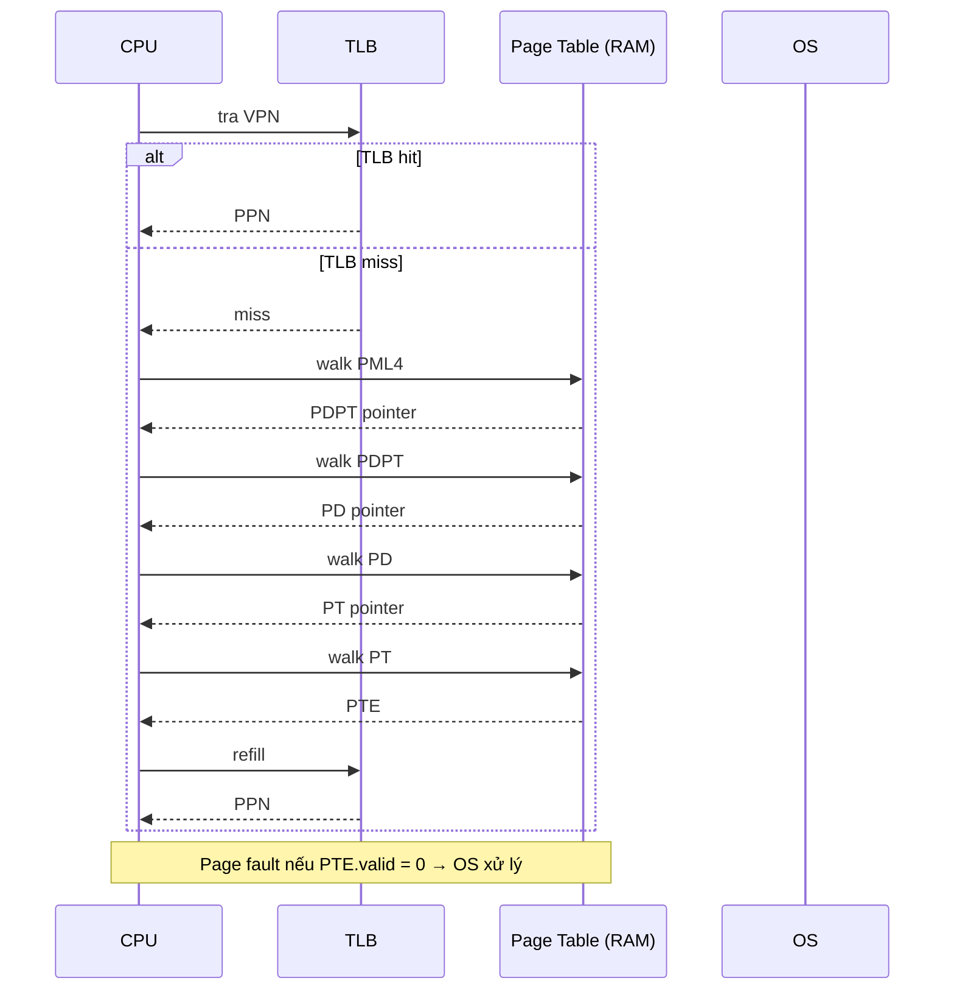
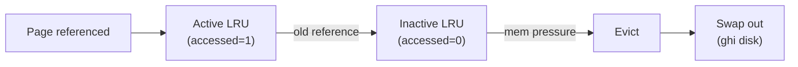

# Explain virtual memory.

> Virtual memory là kỹ thuật OS cho phép mỗi process dùng address space riêng (virtual), OS map sang physical memory qua page table; cho phép swap, bảo vệ, sharing. Bài giải thích cơ chế demand paging, page replacement (LRU, Clock), thrashing và cách phòng (working set, PFF), kèm resident set size và cách Linux kernel quản lý page cache.

Chủ đề: Operating Systems · Ngày: 2026-10-16

## 0. Nền tảng trước khi đọc

**Bối cảnh:** Lớp phần mềm quản lý CPU, bộ nhớ, tiến trình và thiết bị. Ứng dụng gọi OS thay vì tự điều khiển phần cứng trực tiếp.

**Nói đơn giản:** Virtual memory cho mỗi process một không gian địa chỉ riêng và chỉ nạp page cần thiết vào RAM, giúp bảo vệ và dùng RAM hiệu quả hơn.

**Từ khóa cần biết:** process = chương trình đang chạy; thread = luồng thực thi; kernel = phần lõi có quyền điều khiển máy.

**Ví dụ dễ hình dung:** Mỗi process thấy địa chỉ ảo riêng; page chưa có trong RAM gây page fault để OS nạp từ disk hoặc cấp frame mới.

Khi đọc, luôn hỏi ba câu: nó giải quyết vấn đề gì, nó làm việc theo những bước nào, và khi nào không nên dùng?

**Cách học bài này:** Đọc phần này trước để nắm từ khóa; đọc phần 1 để lấy câu trả lời 30 giây; đọc phần 2 để hiểu cơ chế; cuối cùng mở từng câu hỏi ở phần 3 để luyện nói. Các con số và lệnh trong bài là bằng chứng cho câu trả lời, không cần học thuộc nếu chưa hiểu cơ chế.

## 1. Là gì

### Đọc nhanh trước khi đi sâu

**Ý chính:** Virtual memory cho mỗi process một không gian địa chỉ riêng và chỉ nạp page cần thiết vào RAM, giúp bảo vệ và dùng RAM hiệu quả hơn.

**Ví dụ interview:** Mỗi process thấy địa chỉ ảo riêng; page chưa có trong RAM gây page fault để OS nạp từ disk hoặc cấp frame mới.

**Luồng 4 bước:**

1. Process dùng virtual address thay vì địa chỉ RAM trực tiếp.
2. MMU tra TLB hoặc page table để map virtual page sang physical frame.
3. Nếu page chưa có trong RAM, CPU tạo page fault để kernel xử lý.
4. Kernel nạp hoặc tạo page, cập nhật mapping rồi cho instruction chạy lại.

**Nói như trong interview:** Virtual memory cho mỗi process một không gian địa chỉ riêng và chỉ nạp page cần thiết vào RAM, giúp bảo vệ và dùng RAM hiệu quả hơn. Hãy nói theo bốn bước trên trước; nếu interviewer hỏi sâu, chuyển sang cơ chế **Bước 1. Virtual address space**, rồi nêu trade-off và failure mode ở các phần sau.

## 2. Cơ chế cốt lõi

### Bước 1. Virtual address space

Mỗi process có virtual address space (VAS) riêng. Layout x86-64 Linux:

- `0x0000000000000000` - `0x00007FFFFFFFFFFF`: user space (47-bit canonical, 128 TB).
- `0x0000800000000000` - `0xFFFF7FFFFFFFFFFF`: non-canonical (gap).
- `0xFFFF800000000000` - `0xFFFFFFFFFFFFFFFF`: kernel space (128 TB).

Trong user space: code (.text), data (.data), heap, mmap region (shared libraries, anonymous mmap), stack. Kernel map trực tiếp kernel text + data + physical memory qua direct map.

### Bước 2. Page table và MMU translation

Page table là cấu trúc dữ liệu đa cấp (x86-64 4 level: PML4 → PDPT → PD → PT). Mỗi PTE 8 byte: PPN (52 bit) + flags (valid, R/W, U/S, A, D, ...). MMU tra page table:



*MMU translation: TLB hit trả ngay PPN; TLB miss đi qua 4-level page table trong RAM. PTE valid=0 → page fault trap OS.*

### Bước 3. Demand paging

Khi process bắt đầu, page table rỗng (chỉ có một vài page đã map cho code segment từ file). Khi CPU truy cập page chưa map → page fault → OS:

1. Kiểm tra VMA (virtual memory area) trong `mm_struct`: page có thuộc vùng hợp lệ không?
2. Nếu anonymous (heap, stack): allocate frame mới, zero-fill.
3. Nếu file-backed (vd .so, executable): đọc page từ file vào frame.
4. Cập nhật PTE (valid=1, PPN).
5. Return từ page fault handler, CPU retry.

Minor page fault (zero-fill, file cache hit): ~100 ns - 1 µs. Major page fault (đọc từ disk): ~1-10 ms (SSD) hoặc ~5-20 ms (HDD).

### Bước 4. Page replacement

Khi RAM đầy và cần allocate frame mới, OS chọn một page "victim" để evict. Chiến lược:

- **LRU (Least Recently Used)**: evict page lâu không dùng. Tốt về hit rate nhưng implement đắt (cần sorted list hoặc heap).
- **Clock (second chance)**: dùng accessed bit trong PTE. Sweep qua page table, nếu A=1 thì set A=0, skip; nếu A=0 thì evict. Approximation của LRU.
- **FIFO**: evict page vào RAM sớm nhất. Đơn giản nhưng hiệu quả kém (Belady anomaly).
- **Working set / WSClock**: evict page không thuộc working set gần đây. Approximation của optimal.

Linux dùng hai LRU list: active và inactive. Page được reference → active; cũ → inactive. Khi cần evict, OS lấy từ inactive LRU. LRU list cập nhật theo accessed bit trong PTE.



*Linux page replacement: page vào active LRU; nếu cũ chuyển inactive; mem pressure → evict từ inactive → swap out nếu dirty.*

### Bước 5. Thrashing

Thrashing xảy ra khi tổng working set của các process > RAM. Khi một process chạy, nó touch các page, evict page của process khác; process khác chạy lại, evict page của process này. OS liên tục swap in/out, không có process nào hoàn thành.

Triệu chứng: CPU util thấp (vì chờ I/O), disk util cao (>90%), latency tăng vọt.

Cách phòng:

- **Working set model**: mỗi process khai báo working set size W; OS chỉ schedule khi đủ RAM cho tất cả working set.
- **Page Fault Frequency (PFF)**: nếu page fault rate > threshold → giảm degree of multiprogramming (kill process, swap ra); nếu thấp → tăng.
- **Tăng RAM**: đơn giản nhất.
- **Giảm working set**: tối ưu code (cache-friendly), tăng cache hit, giảm số process.

### Bước 6. Resident Set Size (RSS)

RSS = số page hiện ở trong RAM cho process. Linux hiển thị qua `/proc/<pid>/status` (`VmRSS`) hoặc `top` (RES column). RSS thấp nghĩa là process có nhiều page trong swap; RSS cao nghĩa là process fit trong RAM.

Có hai biến thể:

- **RSS**: page ở RAM (có thể share, vd shared library).
- **PSS (Proportional Set Size)**: chia shared page cho số process dùng. Công bằng hơn cho memory accounting (container, cgroup).
- **USS (Unique Set Size)**: page chỉ thuộc process này. Đo memory "thật" của process.

### Bước 7. Linux page cache

Linux gom page cache vào một cây radix cho mỗi file inode. Khi đọc file, page vào cache; lần sau đọc cùng page → cache hit (không cần disk). Khi RAM thiếu, evict clean page trước, dirty page write-back qua `writeback` thread.

`/proc/meminfo` cho thấy:
- `Cached`: page cache (file + swap cache).
- `Buffers`: block device buffer (ext4 metadata).
- `Dirty`: page đã sửa chưa write.
- `Writeback`: page đang write ra disk.

### Quan sát

```bash
# Linux: xem memory chi tiết
free -h
# Mem: total, used, free, shared, buff/cache, available
# Swap: total, used, free

# Xem page fault rate
sar -B 1
# pgpgin/s, pgpgout/s, fault/s, majflt/s

# Xem working set per process
top -o %MEM
# RES = RSS, VIRT = total virtual

# Xem swap usage
cat /proc/meminfo | grep -E "Swap|Mem"

# Đo thrashing
vmstat 1
# Nếu si (swap in) / so (swap out) liên tục >0 → thrashing
```

### Ví dụ chạy từng bước

Kịch bản: backend API node xử lý request từ 8 instance song song, mỗi instance có resident set ~600 MB (cache + session state). Server RAM 3 GB. Bạn phải dự đoán và phát hiện thrashing trước khi deploy tăng instance.

Giả định: Linux, swap trên SSD (~100-500 µs page swap latency). RAM 3 GB, không tính page cache.

Bước 1. Tính tổng resident set cần. 8 instance × 600 MB = 4800 MB ≈ 4.7 GB. RAM chỉ 3 GB → thiếu ~1.7 GB. Nếu tất cả instance cùng active, working set vượt RAM (đã tính bằng script).
Bước 2. Trước deploy, chạy benchmark 4 instance trên 3 GB. Capture `/proc/meminfo`: MemTotal ≈ 3000 MB, SwapTotal = 4096 MB. `vmstat 1`: si = 0, so = 0. p99 latency ~ 50 ms.
Bước 3. Deploy 8 instance. Sau ~30 giây, working set 8 instance ép RAM đầy → kernel swap ra swap. `vmstat 1` giờ cho: si = 1024 (KB/s), so = 512. p99 latency tăng lên 800 ms.
Bước 4. Triệu chứng thrashing rõ: CPU util giảm xuống ~10 %, disk util lên 95 %, request timeout xuất ngàn cái. Đây là Bước 5 Phần 2: working set > RAM, kernel swap liên tục.

Trạng thái giữa deploy và throughput:

| Metric | 4 instance | 8 instance (thrashing) |
|---|---|---|
| RAM dùng | 2.4 GB | 2.95 GB |
| Swap usage | 0 MB | 1.7 GB |
| `si` / `so` (KB/s) | 0 / 0 | 1024 / 512 |
| CPU util | 60 % | 10 % |
| p99 latency | 50 ms | 800 ms |
| Throughput | 1.2 K req/s | 0.3 K req/s |

Bước 5. Áp dụng PFF (Page Fault Frequency). Linux không có PFF chính thức, nhưng `majflt/s` trong `/proc/vmstat` > 100 đã là cảnh báo. Cách phòng: (a) giảm working set per instance; (b) giảm degree of multiprogramming xuống 5; (c) tăng RAM lên 8 GB.

Biến thể "nếu giảm instance sai cách": nếu bạn chỉ kill instance thay vì giảm working set, request load dồn sang instance còn lại → instance đó working set vượt RAM → thrashing ở instance khác. Cách bảo vệ: scale-out thêm node chứ không scale-in instance; đẩy session ra external cache (Redis cluster) để giảm RSS per instance xuống ~150 MB.

Điều rút ra: thrashing = working set > RAM, OS liên tục swap in/out. Phát hiện bằng `vmstat 1` (si/so > 0 kéo dài). Câu hỏi 3 ở 3A hỏi "Thrashing là gì, cách phòng" — ví dụ này cho thấy giảm degree of multiprogramming hoặc external cache là hai hướng thật, không phải "tăng swap".

## 3. Câu hỏi phỏng vấn

### 3A. Câu hỏi đào sâu

<details class="qa">
<summary>Câu 1. Virtual memory dùng để làm gì? Ba lợi ích chính?</summary>

**Trả lời ngắn:** (1) Isolation: mỗi process có address space riêng, không truy nhập memory của process khác. (2) Overcommit: tổng virtual vượt quá physical nhờ swap. (3) Sharing: page share giữa các process (shared library, COW khi fork).

**Đào sâu:**
- Isolation: page table per process; OS set permission trong PTE (R/W/U/S). Bug trong process A không crash process B.
- Overcommit: virtual address 128 TB / process trên x86-64, nhưng RAM chỉ vài GB → OS swap page ra disk khi cần. Linux cho phép `vm.overcommit_memory=1` (heuristic) hoặc `2` (strict accounting).
- Sharing: shared library (.so) map cùng physical page vào VAS nhiều process; chỉ một bản copy trong RAM. Copy-on-write (COW) khi fork: cha con share page read-only; khi một bên ghi → copy page riêng.
- Demand paging: process bắt đầu với page table rỗng, page load khi touch. Giảm startup time.

**Bẫy:** "Virtual memory = swap." Sai — virtual memory là abstraction của memory; swap là kỹ thuật lưu page trên disk khi RAM đầy. VM dùng swap là một trường hợp.

**Follow-up:** Overcommit có an toàn không? Linux mặc định cho phép overcommit; OOM killer giết process khi thực sự hết RAM. Production thường set `vm.overcommit_memory=2` để strict accounting.
</details>

<details class="qa">
<summary>Câu 2. Demand paging hoạt động thế nào? Latency bao nhiêu?</summary>

**Trả lời ngắn:** Process bắt đầu với page table rỗng. CPU touch page → page fault → OS kiểm tra VMA, allocate frame, đọc từ file hoặc zero-fill, cập nhật PTE, return. Minor fault ~100 ns - 1 µs; major fault ~1-10 ms (SSD) hoặc 5-20 ms (HDD).

**Đào sâu:**
- Minor page fault: page đã có trong page cache, không cần disk I/O. Hoặc zero-fill page mới (anonymous mmap). Latency ~100 ns - 1 µs.
- Major page fault: page phải đọc từ disk. SSD ~100-500 µs; HDD ~5-20 ms. Nếu swap, tương tự disk latency.
- Invalid page fault: page không có trong file/swap/COW → SIGSEGV. Process crash.
- Linux `min_fault` và `maj_fault` counter trong `/proc/vmstat`. Application nên giảm major fault qua pre-fetch (vd `madvise(MADV_WILLNEED)`).
- Trên Linux, page được zero-filled qua zero page (chỉ một physical page read-only được share, copy-on-write khi process ghi).

**Bẫy:** "Demand paging là miễn phí." Sai — page fault đầu tiên cho mỗi page tốn ~100 ns đến 10 ms tùy loại. Cold start của app lớn có thể tốn vài trăm ms do major fault.

**Follow-up:** Pre-fetch là gì? Hệ thống đoán trước page sẽ cần, load vào RAM sớm. `madvise(MADV_WILLNEED)` cho OS biết vùng sẽ đọc; Linux readahead tự động load khi đọc sequential.
</details>

<details class="qa">
<summary>Câu 3. Thrashing là gì? Cách phòng?</summary>

**Trả lời ngắn:** Thrashing = working set > RAM, OS liên tục swap in/out. Triệu chứng: CPU util thấp, disk util cao, latency tệ. Cách phòng: tăng RAM, giảm working set (cache-friendly code), working set model, PFF algorithm.

**Đào sâu:**
- Working set model: mỗi process có WS (working set size) = số page touch trong Δ time gần đây. OS chỉ schedule khi tổng WS ≤ RAM. Nếu vượt → swap ra hoặc giảm degree of multiprogramming.
- PFF (Page Fault Frequency): monitor page fault rate; nếu > threshold → giảm số process; nếu thấp → tăng.
- Locality: code truy cập cache-friendly (sequential, không random) → working set nhỏ → ít page fault.
- Linux không implement WS/PFF chính thức; dùng `vm.swappiness` (0-200) để điều chỉnh tendency swap. swappiness = 0 → giữ cache, ít swap. swappiness cao → swap aggressive.
- macOS dùng compressed memory (swap nén trong RAM trước khi đẩy ra disk) cho workload macOS nhỏ.

**Bẫy:** "Giảm swappiness = tắt swap." Sai — swappiness chỉ giảm thiên vị; khi thực sự OOM, OS vẫn swap. Để tắt hẳn: `swapoff -a`.

**Follow-up:** Swappiness bao nhiêu phù hợp cho database? Thường = 1-10 (giữ page cache, ít swap). MySQL gợi ý 1; PostgreSQL để mặc định hoặc giảm.
</details>

<details class="qa">
<summary>Câu 4. LRU vs Clock algorithm khác nhau thế nào?</summary>

**Trả lời ngắn:** LRU: track access order chính xác (sorted list hoặc heap), evict page lâu không dùng nhất. Tốt hit rate nhưng implement đắt. Clock: dùng accessed bit trong PTE, sweep qua page table; nếu A=1 set A=0 và skip; nếu A=0 evict. Approximation LRU, O(1) amortized.

**Đào sâu:**
- LRU chính xác cần doubly linked list + hash table, mỗi access O(1) update. Với hàng triệu page, overhead đáng kể.
- Clock (second chance): page table entry có A bit; pointer quay vòng; nếu A=1, set A=0 và skip; nếu A=0, evict. Khi sweep đủ nhanh, page được tham chiếu giữ A=1 và không evict.
- Enhanced Clock (Clock-Pro): thêm reference bit thứ hai cho "gần đây". Linux dùng biến thể của Clock với active/inactive LRU.
- Working set / WSClock: evict page không thuộc working set. Cần timestamp last reference.
- Belady anomaly: FIFO có thể tăng page fault khi tăng frame (counter-intuitive). LRU không có Belady anomaly (stack property).

**Bẫy:** "LRU luôn tốt nhất." Sai — LRU tối ưu theo hit rate nhưng không optimal tuyệt đối (Belady optimal = oracle). Trong thực tế, Clock đủ tốt và overhead thấp.

**Follow-up:** ARC (Adaptive Replacement Cache) là gì? Kết hợp LRU và LFU, tự điều chỉnh. IBM dùng trong storage. Linux không dùng.
</details>

<details class="qa">
<summary>Câu 5 (Debug). Server báo OOM, process bị kill. Cách phân tích?</summary>

**Trả lời ngắn:** OOM killer kill process khi RAM thực sự cạn và swap hết. Phân tích: `dmesg | grep -i oom` xem process nào bị kill, score, vmRSS. Có thể giảm working set, tăng RAM, hoặc tăng swap.

**Đào sâu:**
- Bước 1: `dmesg -T | grep -i 'oom\|killed'` xem log OOM. Có thể có stack trace của process.
- Bước 2: xác định process: `journalctl -k | grep oom` hoặc `/var/log/syslog`.
- Bước 3: phân tích OOM score: process nào có oom_score_adj cao thì được ưu tiên giữ. Kernel chọn process có score cao nhất để kill.
- Bước 4: kiểm tra memory accounting: cgroup memory limit (`memory.limit_in_bytes` trong cgroupv1), container có thể bị OOM trong container.
- Bước 5: nếu là application leak (RSS tăng theo thời gian), cần heap profiler (jemalloc, tcmalloc) hoặc MemorySanitizer.

**Bẫy:** "Tăng swap là giải pháp." Sai — swap không giúp nếu process cần RAM thực cho working set; chỉ trì hoãn OOM.

**Follow-up:** Có nên tắt OOM killer? Không nên — đây là safety net cuối cùng. Nếu tắt, kernel panic khi OOM, downtime lâu hơn.
</details>

<details class="qa">
<summary>Câu 6 (Thiết kế). Thiết kế memory layout cho backend service với 200 concurrent user, mỗi user session ~512 MB.</summary>

**Trả lời ngắn:** Tổng 100 GB session, cần cache (Redis/Memcached) để giảm RAM; phân vùng hot/cold; swap đủ cho spike; NUMA-aware allocation; monitoring chi tiết.

**Đào sâu:**
- Yêu cầu: 200 session × 512 MB = 100 GB. Server thường 64-256 GB RAM → không fit toàn bộ.
- Quyết định 1: external cache (Redis cluster, 256 GB RAM). Session hot ở Redis, cold load từ DB khi cần. Service giữ working set nhỏ (vài GB).
- Quyết định 2: phân vùng session: hot field (current state) ~50 MB / session trong process memory; cold field (history) load từ DB khi cần.
- Quyết định 3: NUMA-aware allocator (jemalloc `--enable-prof` với `MALLOC_CONF=narenas:N`). Mỗi NUMA node quản arena riêng, giảm cross-node memory access.
- Quyết định 4: monitoring RSS qua Prometheus (`process_resident_memory_bytes`); alert khi RSS >80% RAM limit.
- Điểm nghẽn: nếu session share nhiều (vd cùng user từ nhiều device) → cần copy-on-write hoặc shared structure.

**Bẫy:** "Allocate tất cả session trong process memory." Sai — 100 GB > RAM, sẽ thrashing ngay. Cần external cache + lazy loading.

**Follow-up:** Redis cluster có giải quyết được OOM không? Redis có thể swap trên disk (RDB/AOF) nhưng latency tăng. Cần đủ RAM cho hot dataset.
</details>

### 3B. Câu hỏi phỏng vấn liên quan

<details class="qa">
<summary>Câu 7. Page fault vs segmentation fault khác gì?</summary>

**Trả lời:** Page fault (#PF): MMU tra page table không có valid PTE, hoặc permission không khớp. OS xử lý (swap, COW, zero-fill) hoặc gửi SIGSEGV. Segmentation fault trên x86-64 long mode: thường là page fault khi selector null hoặc offset ngoài canonical range. Trên Unix, "Segmentation fault (core dumped)" = SIGSEGV signal, dùng core dump debug.
</details>

<details class="qa">
<summary>Câu 8. Swap là gì? Có nên dùng trên server production?</summary>

**Trả lời:** Swap = dùng disk làm RAM mở rộng. SSD swap latency ~100-500 µs (gấp ~1000 lần RAM). Server production nên có swap cho memory pressure safety, nhưng không nên swap thường xuyên. MySQL gợi ý swappiness=1; PostgreSQL để mặc định hoặc giảm. Nếu swap > 10% RAM thường xuyên → cần tăng RAM.
</details>

<details class="qa">
<summary>Câu 9. Tại sao Linux cho phép overcommit memory?</summary>

**Trả lời:** Linux mặc định cho phép process allocate virtual nhiều hơn physical (vd malloc trả 1 GB nhưng chỉ touch 100 MB thực). Heuristic ước lượng RAM free > request + safety margin. Strict mode (`vm.overcommit_memory=2`) giới hạn tổng commit = swap + ratio × RAM. Production thường strict để biết trước OOM.
</details>

<details class="qa">
<summary>Câu 10. COW (Copy-on-Write) hoạt động thế nào?</summary>

**Trả lời:** Khi fork(), page table của parent và child share cùng physical page với PTE read-only + COW flag. Khi một bên ghi → page fault → OS copy page riêng, set PTE write. Tiết kiệm memory cho fork ngay sau đó exec (child không cần copy toàn bộ address space).
</details>

<details class="qa">
<summary>Câu 11. RSS vs VSZ vs PSS khác nhau thế nào?</summary>

**Trả lời:** RSS (Resident Set Size) = số page trong RAM. VSZ (Virtual Size) = tổng virtual address space (bao gồm page không trong RAM). PSS (Proportional Set Size) = RSS + share page chia cho số process. PSS công bằng cho container memory accounting. USS = page chỉ thuộc process này.
</details>

<details class="qa">
<summary>Câu 12. True or false: "RAM càng nhiều thì không cần swap."</summary>

**Trả lời:** Sai. Swap cần thiết cho memory pressure safety. Ngay cả khi RAM nhiều, có lúc workload spike (vd backup chạy đêm) chiếm thêm RAM. Swap cho phép OS buffer qua spike. Tắt swap = kernel panic khi OOM. Đề xuất: swap = 25-100% RAM tuỳ workload, swappiness thấp (1-10).
</details>

<details class="qa">
<summary>Câu 13. mmap là gì? Liên quan virtual memory thế nào?</summary>

**Trả lời:** mmap = map file hoặc anonymous memory vào virtual address space. Lazy: page chỉ allocate khi touch. Dùng cho shared library load, large data structure, IPC. Linux dùng mmap cho page cache (file page vào page cache qua mmap).
</details>

<details class="qa">
<summary>Câu 14. Transparent Huge Pages (THP) là gì?</summary>

**Trả lời:** THP: kernel tự động promote page 4 KB → 2 MB khi có thể. Giảm TLB miss. Nhược: defragmentation overhead có thể gây latency spike vài trăm ms. Database (MySQL, PostgreSQL, Oracle) thường tắt THP (`/sys/kernel/mm/transparent_hugepage/enabled=never`) và dùng explicit huge page.
</details>

<details class="qa">
<summary>Câu 15. Vì sao kernel map trực tiếp vào virtual address space?</summary>

**Trả lời:** Direct map: kernel map toàn bộ physical memory vào virtual address space (vd x86-64: `0xffff888000000000` - `0xffffc87fffffffff`). Kernel có thể truy cập mọi page trong O(1) mà không cần page fault. Trade-off: kernel page table lớn (~64 MB cho 64 GB RAM).
</details>

## 4. Đánh đổi và sự cố production

Bảng dưới so sánh các chiến lược quản lý virtual memory theo hit rate, swap I/O, complexity và overhead. LRU và Clock là hai page replacement phổ biến; working set và PFF phù hợp cho system có memory constraint rõ ràng.

Quan điểm: lựa chọn page replacement algorithm không phải quyết định lớn trong production. Linux dùng active/inactive LRU (Clock variant) và tự tune qua `vm.swappiness`. Quyết định lớn hơn là: có bật swap không, có dùng huge page không, có THP không.

### So sánh: page replacement algorithm

| Tiêu chí | FIFO | LRU | Clock | WSClock |
|---|---|---|---|---|
| Hit rate | Kém | Tốt | Tốt (gần LRU) | Tốt nhất (working set) |
| Implement | O(1) | O(1) với doubly list + hash | O(1) amortized | O(1) amortized với timestamp |
| Belady anomaly | Có | Không | Không | Không |
| Overhead | Thấp | Trung bình | Thấp | Trung bình |
| Phù hợp | (giả định) | Đa số OS | Linux inactive LRU | Embedded, real-time |

### Năm failure mode

Bảng dưới tóm tắt 5 failure mode phổ biến: thrashing, OOM, swap storm, COW overhead, memory leak.

| Triệu chứng | Nguyên nhân gốc | Cách kiểm tra | Cách sửa |
|---|---|---|---|
| CPU util thấp, disk util cao | Thrashing | `vmstat 1` xem si/so | Tăng RAM, giảm working set |
| OOM killer giết process | RAM cạn | `dmesg` xem OOM log | Tăng RAM, set `vm.overcommit_memory=2` |
| Swap usage >50% liên tục | Working set > RAM | `cat /proc/meminfo` | Tăng RAM, tối ưu code |
| Fork chậm với RSS lớn | COW copy nhiều page | `ps` xem RSS cha/con | Dùng `posix_spawn`, hoặc thiết kế lại |
| RSS tăng đều không giảm | Memory leak | Heap profiler (jemalloc, tcmalloc) | Fix leak trong code, dùng AddressSanitizer |

## 5. Cheat sheet

Bảng cheat sheet tóm tắt con số và quy tắc cần nhớ: page size, page table, page fault latency, swap latency, working set rule.

| Chủ đề | Con số / quy tắc |
|---|---|
| Page size | 4 KB (x86-64), 2 MB huge, 1 GB huge |
| Virtual address | 47-bit user (128 TB), 48-bit kernel (256 TB) |
| Page table level | 4 level x86-64, 9 bit mỗi level |
| Minor page fault | ~100 ns - 1 µs (zero-fill, COW) |
| Major page fault | ~1-10 ms (SSD), 5-20 ms (HDD) |
| Swap latency | ~100-500 µs (SSD swap) |
| TLB hit | 1-2 cycles |
| TLB entries | L1 64-128, L2 256-1536 |
| Working set size | Phải ≤ RAM để tránh thrashing |

**Học tiếp:**
- [paging-vs-segmentation](paging-vs-segmentation.md) — phân trang và phân đoạn
- [tlb](tlb.md) — TLB cache
- [cpu-scheduling](cpu-scheduling.md) — CPU scheduling
